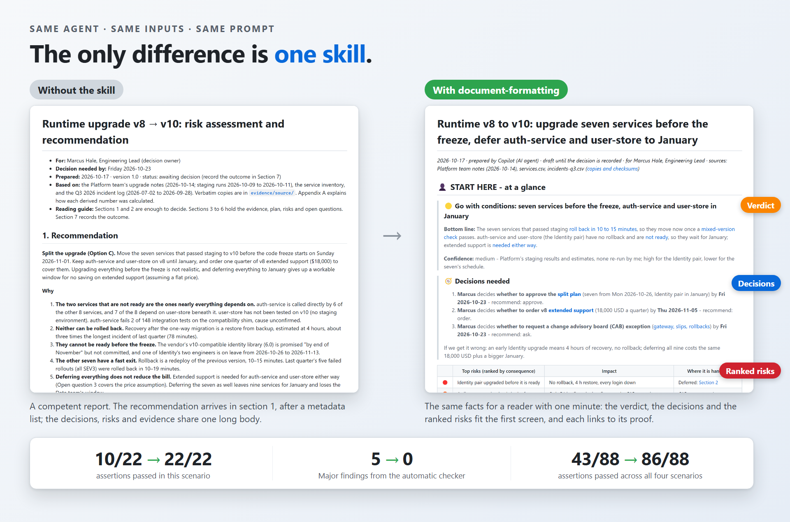
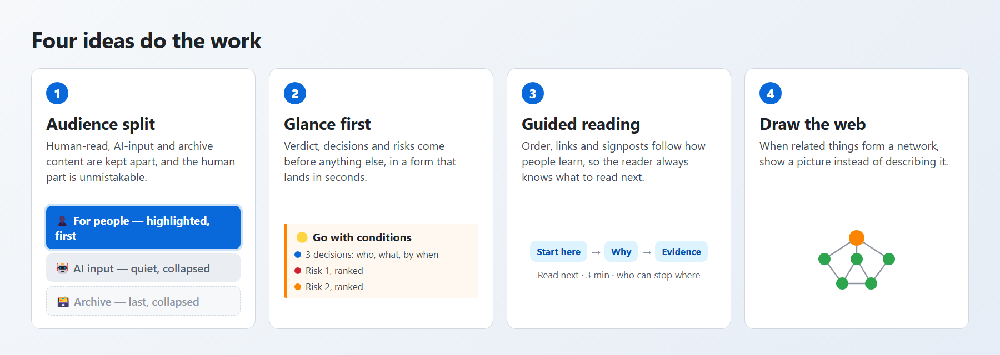
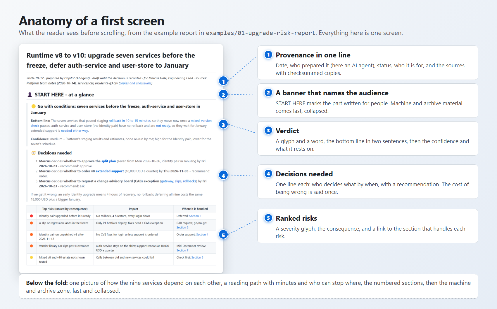
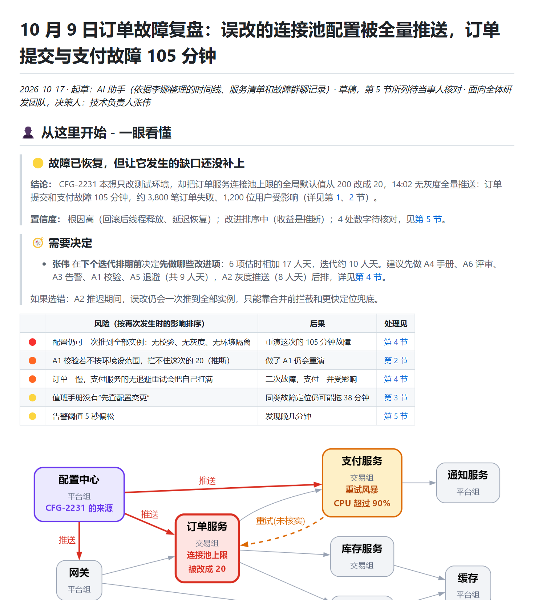
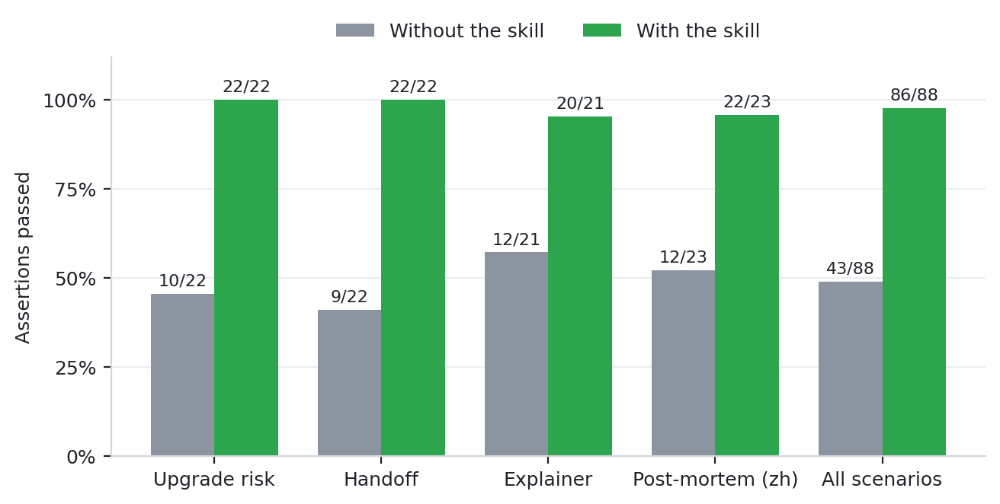
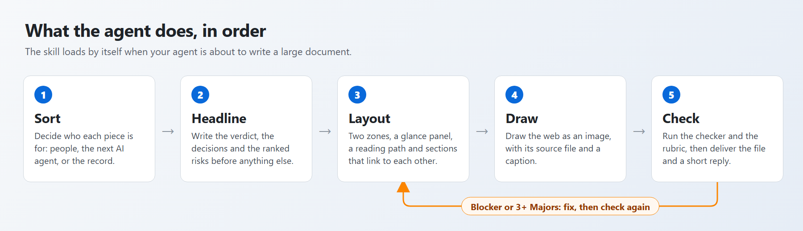

<p align="center">
  <picture>
    <source media="(prefers-color-scheme: dark)" srcset="docs/assets/lockup-dark.svg" />
    
  </picture>
</p>
<h3 align="center">The documents your AI agent writes for people: verdict first, evidence last.</h3>

<p align="center"></p>

<p align="center">An agent that has just finished a long piece of work writes down everything it found, in the order it found it.<br/>The person who has to act on that document digs for the conclusion, cannot tell the three paragraphs that matter from the thirty that are logs, and has no map of how the pieces relate.<br/><b>document-formatting</b> is an <a href="https://agentskills.io">Agent Skill</a> that fixes this at the source: your agent decides who each piece of content is for, then lays the document out so a person gets most of its value in a minute and knows where to go for the rest.</p>

<p align="center">
  <a href="#install-then-ask"><strong>Install</strong></a> &nbsp;·&nbsp;
  <a href="#what-changes"><strong>What changes</strong></a> &nbsp;·&nbsp;
  <a href="#examples"><strong>Examples</strong></a> &nbsp;·&nbsp;
  <a href="#evidence"><strong>Evidence</strong></a> &nbsp;·&nbsp;
  <a href="review/README.md"><strong>Review records</strong></a> &nbsp;·&nbsp;
  <a href="README.zh-CN.md"><strong>简体中文</strong></a>
</p>

<p align="center">
  <a href="https://github.com/jasonxu08/document-formatting/actions/workflows/ci.yml"></a>
  <a href="LICENSE"></a>
  <a href="CHANGELOG.md"></a>
  <a href="#installation-options"></a>
  <a href="review/README.md"></a>
</p>

<a id="install-then-ask"></a>

## Install, then ask

```bash
npx skills add jasonxu08/document-formatting -g
```

That installs the skill into every agent the [skills CLI](https://github.com/vercel-labs/skills) finds on your machine (Claude Code, GitHub Copilot, Codex, Cursor, Gemini CLI, OpenCode and more). Add `-a claude-code` to choose one, or drop `-g` to install into the current project. [Other ways to install](#installation-options).

Then ask for a document the way you always do. You do not need to name the skill: it loads itself when your agent is about to write a large document or report.

```text
Write the root-cause report for last night's checkout outage. The timeline, the service list
and the chat log are in incident/. The VP will decide the follow-ups from it.
```

```text
Turn my notes in notes/ into a handoff document. My manager will skim it, and an AI agent
will continue the work from the same file.
```

```text
docs/project-log.md has grown to about 900 lines and nobody can find anything in it.
Rewrite it so a manager sees where things stand in two minutes and the team still
finds every detail.
```

In a simulation of the agent's skill-selection step (22 realistic requests, 3 runs each) the skill loaded 36 of 36 times it should and 0 of 30 times it should not ([trigger tests](review/trigger-tests/README.md)). If your agent ever skips it, [one line of project instructions](#make-it-load-every-time) makes it load every time.

<a id="what-changes"></a>

## What changes

<p align="center"></p>

1. **Audience split.** What people must read, what a later AI agent needs, and what is only for the record are kept apart, in that order. The human part comes first, under a banner that names who it is for. Machine and archive material comes last, collapsed, each block labelled with what it supports.
2. **Glance first.** The document opens with a panel a reader can take in within a minute: the verdict (a glyph and a word), the decisions needed (who, what, by when, with a recommendation), the ranked risks and a reading path. The prose budget is about 300 words, so it stays a glance.
3. **Guided reading.** Order follows understanding, not discovery: mental model, then concepts, then flows; chronology goes to the archive. Headings carry the argument, every section says where to go next, and claims link to their proof.
4. **Draw the web.** When more than five related things, or any web of relationships, appear, the agent draws them: an embedded image by default (it renders everywhere), with its source file beside it, a caption, and every entity covered.

And the agent checks its own work before it hands over: a deterministic checker ([`check_doc.py`](skills/document-formatting/scripts/check_doc.py)) for links, anchors, images, zone order, raw dumps in the human zone and panel length, then a [35-rule rubric](skills/document-formatting/references/review-rubric.md) for what a script cannot judge. The delivery gate is **no Blocker and at most two Majors**.

## Anatomy of a first screen

<p align="center"></p>

<a id="examples"></a>

## Examples

Four scenarios, each run twice with the same prompt and the same inputs: once without the skill, once with it. Click a document to read it; every folder holds the inputs, both documents, the first-screen screenshots and the scoring.

<table>
<tr>
  <td align="center" width="25%"><a href="examples/01-upgrade-risk-report/README.md"></a><br/><b>Decision report</b><br/>Upgrade now or in January?</td>
  <td align="center" width="25%"><a href="examples/02-dual-audience-handoff/README.md"></a><br/><b>Handoff</b><br/>A manager skims, an agent continues</td>
  <td align="center" width="25%"><a href="examples/03-ingestion-explainer/README.md"></a><br/><b>Explainer</b><br/>Eleven components, one mental model</td>
  <td align="center" width="25%"><a href="examples/04-postmortem-zh/README.md"></a><br/><b>Post-mortem in Chinese</b><br/>Same rules, other language</td>
</tr>
</table>

| Scenario | Assertions passed, without → with | Automatic gate, without → with | Read it |
|---|---|---|---|
| Upgrade risk report | 10/22 → **22/22** | 5 Majors → **pass** | [page](examples/01-upgrade-risk-report/README.md) |
| Dual-audience handoff | 9/22 → **22/22** | 4 Majors → **pass** | [page](examples/02-dual-audience-handoff/README.md) |
| Platform explainer | 12/21 → **20/21** | 4 Majors → **pass** | [page](examples/03-ingestion-explainer/README.md) |
| Post-mortem (Chinese) | 12/23 → **22/23** | 4 Majors → **pass** | [page](examples/04-postmortem-zh/README.md) |

[Browse all examples →](examples/README.md)

## Rewrite an unreadable report

Hand your agent a long document that records everything in the order it happened and ask it to make the thing readable. The skill switches to a rewriting method ([`rewriting.md`](skills/document-formatting/references/rewriting.md)):

1. read all of it, then classify every section by layer: current, evidence, supporting notes, superseded, handoff;
2. settle contradictions over time: the human part states the current truth and says the older note predates it;
3. keep the original text verbatim in sibling files, copied by script (`source_set.py slice`), never retyped;
4. restate in short, faithful paragraphs that link to the block behind each claim;
5. add a map of every section of the original, then **prove that nothing was lost**:

```bash
python skills/document-formatting/scripts/source_set.py verify report.md \
  --source original.md --sha256 <hash>
```

`verify` fails when a verbatim block differs from its source lines, when a non-blank source line is nowhere in the set, or when a source section is missing from the map.

The script is covered by unit tests ([`tests/test_source_set.py`](tests/test_source_set.py)). There is no published end-to-end example of a rewrite yet, so treat this flow as less proven than the rest of the skill.

<a id="evidence"></a>

## Evidence

Every number below comes from the raw records in this repository; the [review dashboard](review/README.md) generates the charts and tables from them with [`review/tools/build_review.py`](review/tools/build_review.py).

| | Without the skill | With the skill |
|---|---|---|
| Assertions passed, 4 scenarios | 43 / 88 | **86 / 88** |
| Automatic gate (no Blocker, at most 2 Majors) | 0 of 4 documents pass | **4 of 4 pass** |
| Cold reader: key facts from the first 60 lines | 22 / 24 | 22 / 24 |
| Skill loads on realistic requests (simulated, 3 runs) | n/a | **36 / 36** should-trigger, **0 / 30** false triggers |

<p align="center"></p>

**Read these numbers honestly.** The assertions come from the skill's own rubric, so a high pass rate shows that the skill makes an agent follow its rules, not that the rules are right for every reader. The independent measure is the cold reader, and on the four synthetic scenarios it did **not** separate the arms (22 of 24 each): an agent asked for a decision report already puts the conclusion first. What the skill adds there is structure and consistency. Everything is one run per arm, judged by AI agents, with no blind human rating and no token or time comparison. The [method page](review/method.md) lists every limit.

The review is public down to the grader's evidence:

- [Review dashboard](review/README.md): charts, every assertion in every run, the gate, the cold reader
- [How the review was done](review/method.md) and [the human decision log](review/maintainer-review.md)
- [How the skill evolved](review/skill-evolution/README.md): every finding, the change it caused, the diffs
- [Iteration 1](review/iteration-1/README.md) · [Iteration 2](review/iteration-2/README.md) · [Trigger tests](review/trigger-tests/README.md) · [Final check](review/final-check/README.md)

## How it works

<p align="center"></p>

| In the skill folder | What it is | Loaded |
|---|---|---|
| [`SKILL.md`](skills/document-formatting/SKILL.md) | the workflow, about 23 KB (roughly 5 to 6 thousand tokens) | whenever the skill triggers |
| [`assets/skeleton.md`](skills/document-formatting/assets/skeleton.md) | the template: zone markers, panel, reading path, collapsed blocks | when writing |
| [`references/diagrams.md`](skills/document-formatting/references/diagrams.md) | which diagram, how to draw it (Graphviz, matplotlib, Mermaid), CJK fonts | when drawing |
| [`references/review-rubric.md`](skills/document-formatting/references/review-rubric.md) | the 35 rules, three tiers, what a script can check and what only a reviewer can | when checking |
| [`references/rewriting.md`](skills/document-formatting/references/rewriting.md) | the method for restructuring an existing long document | when rewriting |
| [`scripts/check_doc.py`](skills/document-formatting/scripts/check_doc.py) | the automatic checker, standard library only | run, not read |
| [`scripts/source_set.py`](skills/document-formatting/scripts/source_set.py) | slice a source verbatim, then verify nothing was lost | run, not read |

Short answers are left alone: a reply of about one screen leads with the answer and gets no zones, panel or diagram. A format the user or a team requires always wins over the skill's layout.

<a id="installation-options"></a>

## Installation options

| Method | Command | Notes |
|---|---|---|
| All your agents, globally | `npx skills add jasonxu08/document-formatting -g` | symlinks to one canonical copy; add `--copy` to copy instead |
| One agent | `npx skills add jasonxu08/document-formatting -g -a claude-code` | any `--agent` id in the [skills CLI table](https://github.com/vercel-labs/skills#supported-agents) |
| This project only | `npx skills add jasonxu08/document-formatting` | commit the result so teammates get it |
| Non-interactive | `npx skills add jasonxu08/document-formatting -g -a github-copilot -y` | for scripts and CI |
| Just look at it | `npx skills add jasonxu08/document-formatting --list` | lists the skill without installing |
| Update or remove | `npx skills update document-formatting` · `npx skills remove document-formatting` | |
| By hand | copy [`skills/document-formatting/`](skills/document-formatting) into your agent's skills folder | paths below |
| Claude Code plugin | `/plugin marketplace add jasonxu08/document-formatting`, then `/plugin install document-formatting@document-formatting` | manifests follow the documented schema; not yet tried with a real `claude` CLI |
| Claude.ai and Claude Desktop | download `document-formatting.zip` from the [latest release](https://github.com/jasonxu08/document-formatting/releases/latest) and upload it as a custom skill | |

Global skill folders for the most common agents (from the skills CLI documentation):

| Agent | `--agent` | Global folder |
|---|---|---|
| Claude Code | `claude-code` | `~/.claude/skills/` |
| GitHub Copilot | `github-copilot` | `~/.copilot/skills/` |
| Codex, Cline, Warp, Zed and others | `codex`, `cline`, `warp`, `zed` | `~/.agents/skills/` |
| Cursor | `cursor` | `~/.cursor/skills/` |
| Gemini CLI | `gemini-cli` | `~/.gemini/skills/` |
| OpenCode | `opencode` | `~/.config/opencode/skills/` |
| Windsurf | `windsurf` | `~/.codeium/windsurf/skills/` |

The skill was developed and evaluated in GitHub Copilot CLI sessions. It is a plain `SKILL.md` folder in the open Agent Skills format, so other agents load it the same way, but I have not run the full evaluation in each of them. Skill loading is probabilistic everywhere; see the next section.

The skills CLI sends anonymous install telemetry to skills.sh. Set `DISABLE_TELEMETRY=1` to turn it off.

<a id="make-it-load-every-time"></a>

## Make it load every time

Skills load when the agent judges that the description matches the task. To remove the judgment, add this to `AGENTS.md`, `CLAUDE.md` or `.github/copilot-instructions.md`:

```markdown
## Documents and reports
Before writing a large document or report for people to read (analysis, investigation,
review, design or decision doc, status or handoff note, test report, explainer), or before
rewriting an unreadable long one, load the `document-formatting` skill and follow it.
```

## Use the checker yourself

The scripts need Python 3.9 or newer and nothing else, and they work without any agent:

```bash
# findings, with rule IDs and tiers
python skills/document-formatting/scripts/check_doc.py report.md
# the same as JSON, for CI
python skills/document-formatting/scripts/check_doc.py report.md --json
# the anchor of every heading
python skills/document-formatting/scripts/check_doc.py report.md --slugs
```

It exits with 1 when there is a Blocker (a broken link or image, an unbalanced fence, a leftover template placeholder). It works on any Markdown file, so you can also use it to review documents people wrote. The rubric reads the same way for a human reviewer: score a document against [the rules](skills/document-formatting/references/review-rubric.md) and report the verdict and the failing rule IDs.

## Tune it for your readers

- **Diagrams.** The default is an embedded image, because VS Code's classic Markdown preview and Azure DevOps repo and pull-request pages do not render Mermaid. If your readers use GitHub or Azure DevOps wikis, tell your agent "our readers use GitHub, Mermaid is fine" and run the checker with `--allow-mermaid`.
- **Language.** The document is written in the reader's language, labels in diagrams included ([the Chinese example](examples/04-postmortem-zh/README.md)). CJK labels need a CJK font; the diagram guide covers the pitfall.
- **Thresholds.** 300 panel words, a 2,500-word human zone, 15-row tables and 25-line code blocks are defaults you can pass to the checker (`--panel-words`, `--human-words`, `--max-table`, `--max-block`). They are experience-based and provisional.
- **A table you asked for by name** (a map, an inventory) is exempt from the table-size rule when marked `<!-- requested-table -->` above it.

## FAQ

**Will it turn short answers into reports?** No. About one screen or less gets the answer first and nothing else.

**How much context does it cost?** `SKILL.md` is about 23 KB, roughly 5 to 6 thousand tokens, when the skill loads. The rubric, diagram guide and rewriting guide are read only when needed, and the scripts are run without being read.

**Does it need Graphviz?** No. Graphviz is recommended for diagrams; without it the agent draws with another tool it finds (matplotlib for charts) or, when you allow it, Mermaid.

**Does it convert or style Word, PDF or Excel files?** No. It shapes Markdown documents and their diagrams. Its description says so, so it stays out of the way of those tasks.

**Does anything leave my machine?** The scripts use only the standard library and make no network calls. The install command sends anonymous install telemetry (see above).

**Can I trust the results?** Read [the honest limits](#honest-limits), then the [records](review/README.md).

<a id="honest-limits"></a>

## Honest limits

- One run per arm and scenario, graded by AI agents, no blind human rating. The assertions are the skill's own rules; the cold reader did not separate the arms on the synthetic scenarios.
- The example documents were written by earlier versions of the skill (v0.1 and v0.2). Version 1.0.0 was run again on the four scenarios afterwards ([final check](review/final-check/README.md)): every document passes the gate and cold readers recovered 23 of 24 key facts, but no grader scored assertions and there was no baseline rerun. The version differs from the last fully graded one (v0.4) by 22 added and 10 removed lines.
- The rewrite flow (the rewriting guide and `source_set.py`) has unit tests for its script but no published end-to-end example.
- Exercised end to end only in GitHub Copilot CLI. The Claude Code plugin manifests follow the documented schema and have not been installed from a real `claude` CLI.
- The checker's word counts cover Latin-script languages and CJK. For other scripts (Cyrillic, Arabic, Thai) the panel budget is not enforced.
- Previews in this repository are drawn with a GitHub-like stylesheet, not by VS Code or Azure DevOps. How Azure DevOps handles `<details>` and CJK heading anchors comes from its documentation.
- What the review leaves undone is listed in [how the skill evolved](review/skill-evolution/README.md#open-items).

## Repository map

```text
skills/document-formatting/   the skill: SKILL.md, assets/, references/, scripts/
examples/                     the reviewed documents: inputs, both versions, scoring
review/                       the review dashboard: every round, every record
evals/                        the regression kit: prompts, assertions, facts
tests/                        unit tests for the scripts
tools/                        validate_skill.py and the figure-drawing tools
docs/assets/                  the logo and README figures
.claude-plugin/               Claude Code plugin and marketplace manifests
.github/                      CI, release workflow, issue and PR templates
```

## Contributing

Issues and pull requests are welcome; start with [CONTRIBUTING.md](CONTRIBUTING.md). The most useful bug report is the prompt, the document that came out, and which rule it broke. If you change the skill, run the [regression kit](evals/README.md) and the unit tests, and add the result to the [review](review/README.md) when it changes a claim.

## Credits

Built and tested with GitHub Copilot CLI, using the skill-creator workflow from [anthropics/skills](https://github.com/anthropics/skills). Installation is by Vercel's [skills CLI](https://github.com/vercel-labs/skills); the format is [Agent Skills](https://agentskills.io).

## License

[MIT](LICENSE) © jasonxu08
