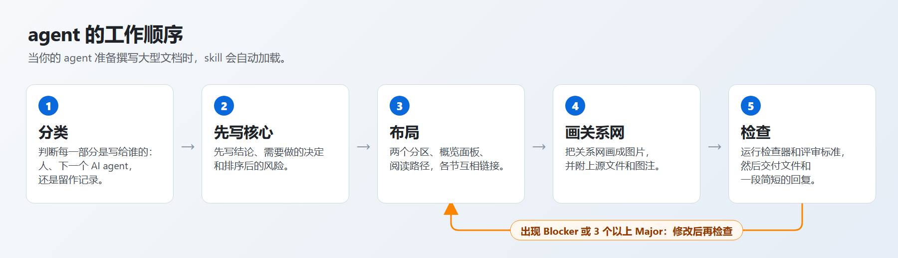

<p align="center">
  <picture>
    <source media="(prefers-color-scheme: dark)" srcset="docs/assets/lockup-dark.svg" />
    
  </picture>
</p>
<h3 align="center">AI agent 写给人看的文档：结论在前，证据在后。</h3>

<p align="center"></p>

<p align="center">一个 agent 刚完成一项耗时很长的工作，就会把发现的一切，按发现的顺序写下来。<br/>要根据这份文档采取行动的人，得自己翻找结论，分不清哪三段才重要、哪三十段只是日志，也没有一张图能说明各部分之间的关系。<br/><b>document-formatting</b> 是一个 <a href="https://agentskills.io">Agent Skill</a>，从源头解决这个问题：让你的 agent 先判断每一块内容是写给谁的，再据此编排文档，让读者一分钟内就能获得文档的大部分价值，并知道其余内容该去哪里找。</p>

<p align="center">
  <a href="#install-then-ask"><strong>安装</strong></a> &nbsp;·&nbsp;
  <a href="#what-changes"><strong>改变了什么</strong></a> &nbsp;·&nbsp;
  <a href="#examples"><strong>示例</strong></a> &nbsp;·&nbsp;
  <a href="#evidence"><strong>证据</strong></a> &nbsp;·&nbsp;
  <a href="review/README.md"><strong>评审记录</strong></a> &nbsp;·&nbsp;
  <a href="README.md"><strong>English</strong></a>
</p>

<p align="center">
  <a href="https://github.com/jasonxu08/document-formatting/actions/workflows/ci.yml"></a>
  <a href="LICENSE"></a>
  <a href="CHANGELOG.md"></a>
  <a href="#installation-options"></a>
  <a href="review/README.md"></a>
</p>

<a id="install-then-ask"></a>

## 先安装，再提需求

```bash
npx skills add jasonxu08/document-formatting -g
```

这条命令会把 skill 安装到 [skills CLI](https://github.com/vercel-labs/skills) 在你机器上找到的每一个 agent 中（Claude Code、GitHub Copilot、Codex、Cursor、Gemini CLI、OpenCode 等）。加上 `-a claude-code` 可指定单个 agent，去掉 `-g` 则安装到当前项目。[其他安装方式](#installation-options)。

然后像往常一样提出写文档的需求。不必点名这个 skill：agent 准备写大型文档或报告时，它会自行加载。

```text
帮我写一份昨晚结账服务中断的根因报告。时间线、服务清单和聊天记录都在 incident/ 目录里。
VP 会根据这份报告决定后续的跟进事项。
```

```text
把 notes/ 里的笔记整理成一份交接文档。我的经理会快速浏览它，
AI agent 则会基于同一个文件继续这项工作。
```

```text
docs/project-log.md 已经有大约 900 行，没人能在里面找到任何东西。请重写它，让经理两分钟内
就能看清现状，团队也仍然能找到每一处细节。
```

在对 agent 选择 skill 这一步的模拟中（22 条贴近真实的请求，每条运行 3 次），该加载时 skill 加载了 36 / 36 次，不该加载时加载了 0 / 30 次（[触发测试](review/trigger-tests/README.md)）。如果你的 agent 偶尔漏掉了它，[一条项目指令](#make-it-load-every-time)就能让它每次都加载。

<a id="what-changes"></a>

## 改变了什么

<p align="center"></p>

1. **按受众分区。** 把人必须读的内容、后续的 AI agent 需要的内容、仅作存档的内容分开，并按这个顺序排列。给人读的部分排在最前，开头有一条横幅，点明这部分是写给谁的。给 AI 的输入和存档内容排在最后，折叠起来，每个块都标明它支撑的是什么。
2. **先一眼看懂。** 文档以一眼看懂的概览面板开头，读者一分钟内就能看完：结论（一个符号加一个词）、需要做的决定（谁、做什么、何时之前，并附建议）、排序后的风险，以及一条阅读路径。文字预算约为 300 词，所以它始终一眼就能看完。
3. **引导阅读。** 顺序服从理解，而不是发现的先后：先讲心智模型，再讲概念，然后讲流程；按时间顺序的记录放进存档。标题承载着论点，每一节都会说明接下来该去哪里，每个论断都链接到它的证据。
4. **画出关系网。** 当相互关联的事物超过五个，或者出现任何关系网时，agent 会把它们画出来：默认是嵌入的图片（在哪里都能渲染），旁边附上源文件和图注，并且涵盖每一个实体。

交付之前，agent 还会检查自己的成果：先用一个确定性的检查器（[`check_doc.py`](skills/document-formatting/scripts/check_doc.py)）检查链接、锚点、图片、分区顺序、给人读的部分中直接堆放的原始内容以及概览面板的长度，再用一份[含 35 条规则的评审标准](skills/document-formatting/references/review-rubric.md)检查脚本无法判断的部分。交付关卡（gate）的标准是：**没有 Blocker（阻断项），且 Major（主要问题）不超过两个**。

## 第一屏剖析

<p align="center"></p>

<a id="examples"></a>

## 示例

四个场景，每个场景都用相同的提示词和相同的输入运行两次：一次不用 skill，一次使用 skill。点击文档即可阅读；每个文件夹里都有输入、两份文档、第一屏截图和评分。

<table>
<tr>
  <td align="center" width="25%"><a href="examples/01-upgrade-risk-report/README.md"></a><br/><b>决策报告</b><br/>现在升级，还是等到一月？</td>
  <td align="center" width="25%"><a href="examples/02-dual-audience-handoff/README.md"></a><br/><b>交接文档</b><br/>经理快速浏览，agent 接着做</td>
  <td align="center" width="25%"><a href="examples/03-ingestion-explainer/README.md"></a><br/><b>讲解文档</b><br/>11 个组件，一个心智模型</td>
  <td align="center" width="25%"><a href="examples/04-postmortem-zh/README.md"></a><br/><b>中文复盘</b><br/>规则相同，语言不同</td>
</tr>
</table>

| 场景 | 通过的断言数，不用 skill → 使用 skill | 自动关卡，不用 skill → 使用 skill | 阅读 |
|---|---|---|---|
| 升级风险报告 | 10/22 → **22/22** | 5 个 Major → **通过** | [页面](examples/01-upgrade-risk-report/README.md) |
| 双受众交接文档 | 9/22 → **22/22** | 4 个 Major → **通过** | [页面](examples/02-dual-audience-handoff/README.md) |
| 平台讲解文档 | 12/21 → **20/21** | 4 个 Major → **通过** | [页面](examples/03-ingestion-explainer/README.md) |
| 复盘（中文） | 12/23 → **22/23** | 4 个 Major → **通过** | [页面](examples/04-postmortem-zh/README.md) |

[浏览全部示例 →](examples/README.md)

## 重写读不下去的报告

把一份按发生顺序记录了一切的长文档交给你的 agent，请它改成能读的样子。skill 会切换到改写方法（[`rewriting.md`](skills/document-formatting/references/rewriting.md)）：

1. 通读全部内容，再把每一节归入对应的层：当前、证据、辅助说明、已被取代、交接；
2. 化解前后矛盾：给人读的部分写明当前的事实，并说明较早的记录写在它之前；
3. 把原文逐字保留在同级文件里，由脚本复制（`source_set.py slice`），绝不手工重抄；
4. 用简短、忠实的段落重新表述，并链接到每个论断背后的那一块原文；
5. 添加一张涵盖原文每一节的对照表，然后**证明没有丢失任何内容**：

```bash
python skills/document-formatting/scripts/source_set.py verify report.md \
  --source original.md --sha256 <hash>
```

出现以下任一情况，`verify` 就会失败：逐字块与它对应的源行不一致；某个非空源行在整套文件中的任何位置都找不到；某个源章节没有出现在对照表中。

该脚本有单元测试（[`tests/test_source_set.py`](tests/test_source_set.py)）。目前还没有公开的端到端改写示例，所以请把这套流程视为比 skill 其余部分验证得更少。

<a id="evidence"></a>

## 证据

评审记录页面为英文。

下面的每个数字都来自本仓库中的原始记录；[评审看板](review/README.md)用 [`review/tools/build_review.py`](review/tools/build_review.py) 根据这些记录生成图表和表格。

| | 不用 skill | 使用 skill |
|---|---|---|
| 通过的断言数（4 个场景） | 43 / 88 | **86 / 88** |
| 自动关卡（无 Blocker，Major 不超过 2 个） | 4 份文档中 0 份通过 | **4 份全部通过** |
| 冷读者：从前 60 行读出的关键事实 | 22 / 24 | 22 / 24 |
| 贴近真实的请求下，skill 是否加载（模拟，运行 3 次） | 不适用 | 应触发 **36 / 36**，误触发 **0 / 30** |

<p align="center"></p>

**请如实看待这些数字。** 这些断言出自 skill 自带的评审标准，所以高通过率只能说明 skill 能让 agent 遵守它自己的规则，并不能说明这些规则适合每一位读者。独立的衡量指标是冷读者，而在四个合成场景中，它**没有**把两组区分开（两组都是 22 / 24）：被要求写决策报告的 agent，本来就会把结论放在最前面。在这些场景里，skill 带来的是结构和一致性。所有结果都是每组只运行一次，由 AI agent 评判，没有人工盲评，也没有 token 或耗时的对比。[方法页面](review/method.md)列出了每一项局限。

评审全程公开，细到评分者给出的证据：

- [评审看板](review/README.md)：图表、每次运行中的每条断言、关卡、冷读者
- [评审是怎么做的](review/method.md)和[人工决策日志](review/maintainer-review.md)
- [skill 是如何演进的](review/skill-evolution/README.md)：每一个发现、由它引发的改动，以及对应的 diff
- [第 1 轮迭代](review/iteration-1/README.md) · [第 2 轮迭代](review/iteration-2/README.md) · [触发测试](review/trigger-tests/README.md) · [最终检查](review/final-check/README.md)

## 工作原理

<p align="center"></p>

| skill 文件夹中的文件 | 是什么 | 加载时机 |
|---|---|---|
| [`SKILL.md`](skills/document-formatting/SKILL.md) | 工作流程，约 23 KB（大约 5,000 到 6,000 个 token） | 只要 skill 触发就会加载 |
| [`assets/skeleton.md`](skills/document-formatting/assets/skeleton.md) | 模板：分区标记、概览面板、阅读路径、折叠块 | 写作时 |
| [`references/diagrams.md`](skills/document-formatting/references/diagrams.md) | 该用哪种图、怎么画（Graphviz、matplotlib、Mermaid），以及 CJK 字体 | 画图时 |
| [`references/review-rubric.md`](skills/document-formatting/references/review-rubric.md) | 35 条规则、三个等级，以及哪些规则可由脚本检查、哪些只有评审者才能判断 | 检查时 |
| [`references/rewriting.md`](skills/document-formatting/references/rewriting.md) | 重构现有长文档的方法 | 改写时 |
| [`scripts/check_doc.py`](skills/document-formatting/scripts/check_doc.py) | 自动检查器，仅使用标准库 | 运行，不读取 |
| [`scripts/source_set.py`](skills/document-formatting/scripts/source_set.py) | 逐字切出原文片段，再验证没有丢失任何内容 | 运行，不读取 |

简短的回答保持原样：大约一屏的回复直接以答案开头，不分区，也没有概览面板或图示。用户或团队要求的格式，始终优先于 skill 自己的版式。

<a id="installation-options"></a>

## 安装方式

| 方式 | 命令 | 说明 |
|---|---|---|
| 所有 agent，全局安装 | `npx skills add jasonxu08/document-formatting -g` | 以符号链接指向同一份规范副本；加上 `--copy` 则改为复制 |
| 单个 agent | `npx skills add jasonxu08/document-formatting -g -a claude-code` | 可使用 [skills CLI 支持列表](https://github.com/vercel-labs/skills#supported-agents)中的任意 `--agent` ID |
| 仅当前项目 | `npx skills add jasonxu08/document-formatting` | 把安装结果提交到仓库，队友就能一并获得 |
| 非交互式 | `npx skills add jasonxu08/document-formatting -g -a github-copilot -y` | 适用于脚本和 CI |
| 只看看 | `npx skills add jasonxu08/document-formatting --list` | 只列出这个 skill，不安装 |
| 更新或卸载 | `npx skills update document-formatting` · `npx skills remove document-formatting` | |
| 手动安装 | 把 [`skills/document-formatting/`](skills/document-formatting) 复制到 agent 的 skills 文件夹中 | 路径见下表 |
| Claude Code 插件 | `/plugin marketplace add jasonxu08/document-formatting`，然后 `/plugin install document-formatting@document-formatting` | 清单遵循文档中的 schema；尚未用真实的 `claude` CLI 试过 |
| Claude.ai 和 Claude Desktop | 从[最新发布版](https://github.com/jasonxu08/document-formatting/releases/latest)下载 `document-formatting.zip`，作为自定义 skill 上传 | |

最常用 agent 的全局 skill 文件夹（取自 skills CLI 文档）：

| Agent | `--agent` | 全局文件夹 |
|---|---|---|
| Claude Code | `claude-code` | `~/.claude/skills/` |
| GitHub Copilot | `github-copilot` | `~/.copilot/skills/` |
| Codex、Cline、Warp、Zed 等 | `codex`、`cline`、`warp`、`zed` | `~/.agents/skills/` |
| Cursor | `cursor` | `~/.cursor/skills/` |
| Gemini CLI | `gemini-cli` | `~/.gemini/skills/` |
| OpenCode | `opencode` | `~/.config/opencode/skills/` |
| Windsurf | `windsurf` | `~/.codeium/windsurf/skills/` |

这个 skill 是在 GitHub Copilot CLI 会话中开发并评估的。它就是一个遵循开放 Agent Skills 格式的普通 `SKILL.md` 文件夹，所以其他 agent 加载它的方式也一样，只是我没有在每个 agent 里都跑过完整评估。skill 的加载在所有 agent 中都是概率性的；见下一节。

skills CLI 会向 skills.sh 发送匿名的安装遥测数据。设置 `DISABLE_TELEMETRY=1` 即可关闭。

<a id="make-it-load-every-time"></a>

## 让它每次都加载

skill 是否加载，取决于 agent 是否判断它的描述与当前任务相符。想去掉这层判断，就把下面这段加到 `AGENTS.md`、`CLAUDE.md` 或 `.github/copilot-instructions.md` 里：

```markdown
## 文档与报告
在撰写供人阅读的大型文档或报告之前（分析、调查、评审、设计或决策文档、状态或交接说明、
测试报告、讲解文档），或者在重写一份读不下去的长文档之前，请先加载 `document-formatting`
skill 并遵照它执行。
```

## 自己使用检查器

这些脚本只需要 Python 3.9 或更高版本，不需要任何其他依赖，也不需要 agent 就能运行：

```bash
# 列出带规则 ID 和等级的检查结果
python skills/document-formatting/scripts/check_doc.py report.md
# 输出 JSON，便于接入 CI
python skills/document-formatting/scripts/check_doc.py report.md --json
# 打印每个标题的锚点
python skills/document-formatting/scripts/check_doc.py report.md --slugs
```

出现 Blocker（失效的链接或图片、未闭合的代码围栏、遗留的模板占位符）时，它会以退出码 1 退出。它适用于任何 Markdown 文件，所以也可以用来评审人写的文档。对人工评审者来说，评审标准的用法也一样：对照[这些规则](skills/document-formatting/references/review-rubric.md)给文档打分，再报告结论和未通过的规则 ID。

## 按你的读者调整

- **图示。** 默认使用嵌入的图片，因为 VS Code 经典的 Markdown 预览，以及 Azure DevOps 的仓库页面和 Pull Request 页面，都不渲染 Mermaid。如果你的读者使用 GitHub 或 Azure DevOps wiki，就告诉 agent“我们的读者用 GitHub，Mermaid 没问题”，并在运行检查器时加上 `--allow-mermaid`。
- **语言。** 文档用读者的语言来写，图中的标签也包括在内（[中文示例](examples/04-postmortem-zh/README.md)）。CJK 标签需要 CJK 字体；图示指南里说明了这个坑。
- **阈值。** 概览面板 300 词、给人读的部分 2,500 词、表格 15 行、代码块 25 行，都是默认值，可通过检查器的参数调整（`--panel-words`、`--human-words`、`--max-table`、`--max-block`）。这些数值来自经验，属于暂定值。
- **你点名要的表格**（对照表、清单），只要在上方标注 `<!-- requested-table -->`，就不受表格大小规则的限制。

## 常见问题

**它会把简短的回答变成报告吗？** 不会。大约一屏或更短的回复，只先给出答案，不加别的。

**会占用多少上下文？** skill 加载时，`SKILL.md` 约 23 KB，大约 5,000 到 6,000 个 token。评审标准、图示指南和改写指南只在需要时才读取，脚本则只运行、不读取。

**需要 Graphviz 吗？** 不需要。绘制图示推荐使用 Graphviz；没有它时，agent 会改用自己找到的其他工具（图表用 matplotlib），或者在你允许时使用 Mermaid。

**它会转换或排版 Word、PDF、Excel 文件吗？** 不会。它编排的是 Markdown 文档及其图示。skill 的描述里写明了这一点，所以不会干扰这些任务。

**会有数据离开我的机器吗？** 脚本只使用标准库，不发起任何网络调用。安装命令会发送匿名的安装遥测数据（见上文）。

**结果可信吗？** 先读[如实说明的局限](#honest-limits)，再看[评审记录](review/README.md)。

<a id="honest-limits"></a>

## 如实说明的局限

- 每个场景的每一组都只运行一次，由 AI agent 评分，没有人工盲评。断言就是 skill 自己的规则；在合成场景上，冷读者没有把两组区分开。
- 示例文档是由 skill 的早期版本（v0.1 和 v0.2）写出的。之后又用 1.0.0 版本把这四个场景重新运行了一遍（[最终检查](review/final-check/README.md)）：每份文档都通过了关卡，冷读者读出了 24 个关键事实中的 23 个，但没有评分者对断言打分，也没有重新运行基线。这个版本与最后一次完整评分的版本（v0.4）相比，新增了 22 行，删除了 10 行。
- 改写流程（改写指南和 `source_set.py`）只有脚本的单元测试，没有公开的端到端示例。
- 端到端验证只在 GitHub Copilot CLI 中做过。Claude Code 插件清单遵循文档中的 schema，但还没有用真实的 `claude` CLI 安装过。
- 检查器的词数统计适用于使用拉丁字母的语言以及 CJK 文字。对于其他文字（西里尔文、阿拉伯文、泰文），概览面板的文字预算不会被强制执行。
- 本仓库中的预览图是用类似 GitHub 的样式表渲染的，而不是由 VS Code 或 Azure DevOps 渲染的。Azure DevOps 如何处理 `<details>` 和 CJK 标题锚点，依据的是它的文档。
- 评审遗留的未完成事项，列在 [skill 是如何演进的](review/skill-evolution/README.md#open-items)中。

## 仓库结构

```text
skills/document-formatting/   skill 本体：SKILL.md、assets/、references/、scripts/
examples/                     经过评审的文档：输入、两个版本、评分
review/                       评审看板：每一轮、每一条记录
evals/                        回归测试套件：提示词、断言、关键事实
tests/                        脚本的单元测试
tools/                        validate_skill.py 和绘制插图的工具
docs/assets/                  logo 和 README 中的插图
.claude-plugin/               Claude Code 插件和 marketplace 清单
.github/                      CI、发布工作流、Issue 和 PR 模板
```

## 参与贡献

欢迎提交 Issue 和 Pull Request，请先阅读 [CONTRIBUTING.md](CONTRIBUTING.md)。最有用的 Bug 报告包含：提示词、生成的文档，以及它违反了哪条规则。如果你修改了这个 skill，请运行[回归测试套件](evals/README.md)和单元测试；如果结果改变了某个论断，请把结果补充到[评审记录](review/README.md)中。

## 致谢

使用 GitHub Copilot CLI 构建和测试，并采用了 [anthropics/skills](https://github.com/anthropics/skills) 中的 skill-creator 工作流。安装借助 Vercel 的 [skills CLI](https://github.com/vercel-labs/skills) 完成；格式遵循 [Agent Skills](https://agentskills.io)。

## 许可证

[MIT](LICENSE) © jasonxu08
