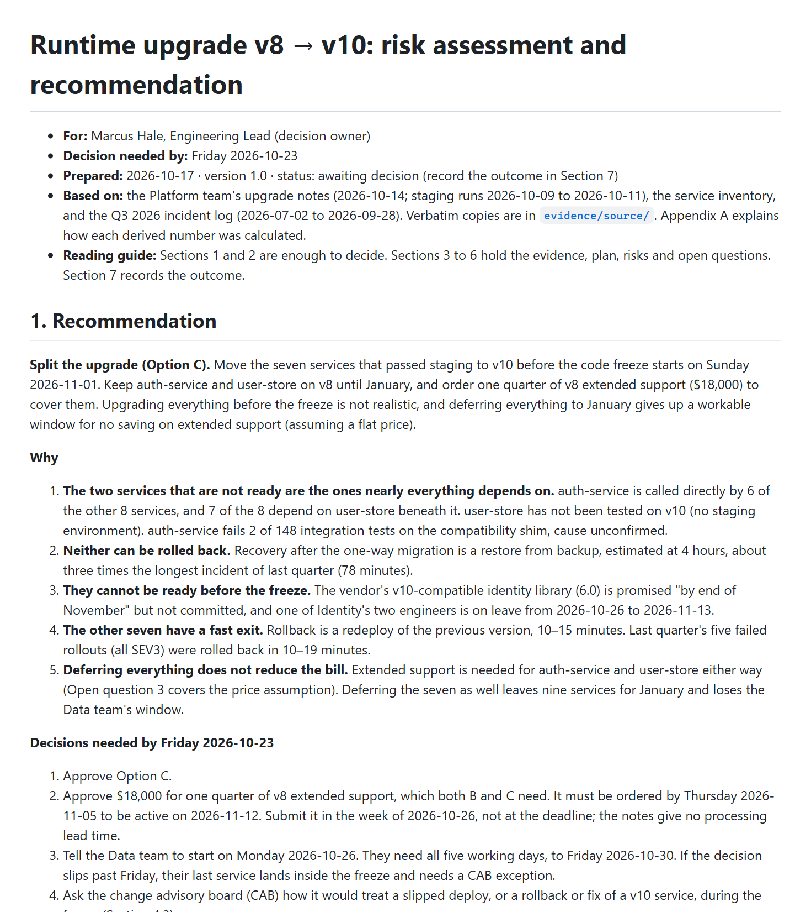
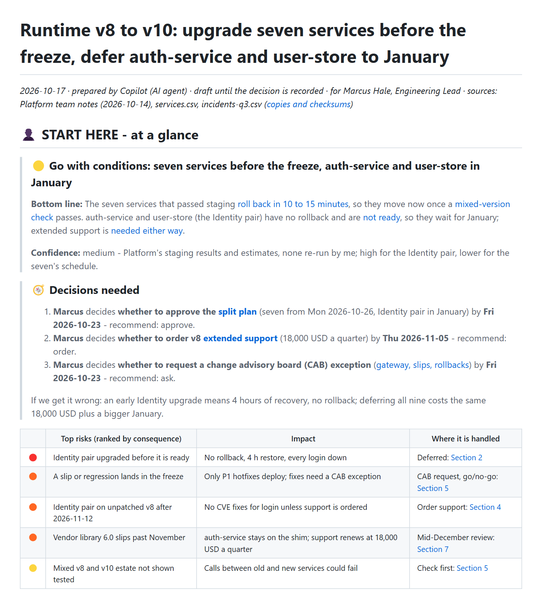

# Upgrade risk report

[← All examples](../README.md) · [Review of this scenario](../../review/iteration-2/eval-1-upgrade-risk-report.md)

**Decision report · English.** An engineering lead must decide by Friday whether to upgrade nine services before a code freeze or push everything to January. The input is the platform team's notes, a service dependency inventory and a quarter of incident records.

> **Prompt given to both agents**
>
> Our runtime upgrade (v8 to v10) is on the table and our Eng Lead, Marcus, has to decide by Friday whether we upgrade before the November code freeze or push everything to January. I put the notes, the service inventory and last quarter's incidents in examples/01-upgrade-risk-report/input/. Write the assessment report for Marcus. I also want it kept in the repo as the audit trail for whatever we decide, so keep the supporting data.

## What the reader sees first

| Without the skill | With the skill |
|---|---|
|  |  |
| [Open the document](without-skill/report.md) | [Open the document](with-skill/report.md) |

The scenario was also written again with the published skill, v1.0.0: [the document](../../review/final-check/outputs/01-upgrade-risk-report/report.md), gate ✅, cold reader 6/6 ([final check](../../review/final-check/README.md)).

## What to look for

- A verdict with a glyph, a confidence line and its basis, then three decisions that each say who, what, by when and what is recommended.
- A ranked risk table with a severity glyph and a link from every risk to the section that handles it.
- A dependency map of the nine services with the hub highlighted, built as an image so it renders everywhere, with its source file beside it.
- The raw incident rows and checksummed copies of the inputs in a collapsed archive zone, because the user asked to keep the supporting data.

## Scores

| | Without the skill | With the skill |
|---|---|---|
| Assertions passed | 10 / 22 | 22 / 22 |
| Automatic checker | ❌ 0 Blockers · 5 Majors · 1 Minor | ✅ 0 Blockers · 0 Majors · 1 Minor |
| First section, words (budget about 300) | 495 | 292 |
| Cold reader, first 60 lines | 5 / 6 key facts | 5 / 6 key facts |

Every assertion with the grader's evidence is on the [review page](../../review/iteration-2/eval-1-upgrade-risk-report.md).

## What is in this folder

| Folder | Contents |
|---|---|
| `input/` | `upgrade-notes.md` (the platform team's notes: staging results, estimates, constraints); `services.csv` (nine services and their dependencies); `incidents-q3.csv` (36 incident records from last quarter) |
| `without-skill/` | `evidence`, `figures`, `final_reply.md`, `report.md` |
| `with-skill/` | `final_reply.md`, `report.assets`, `report.data`, `report.evidence.md`, `report.md` |
