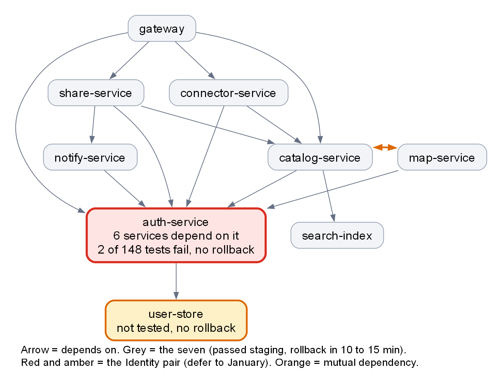
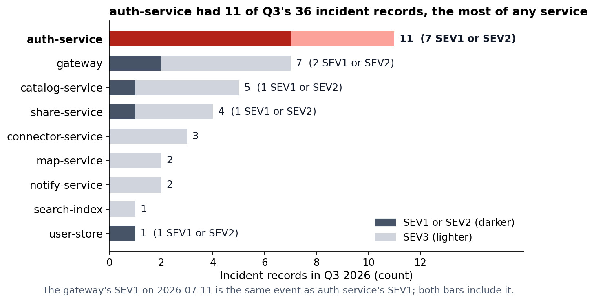
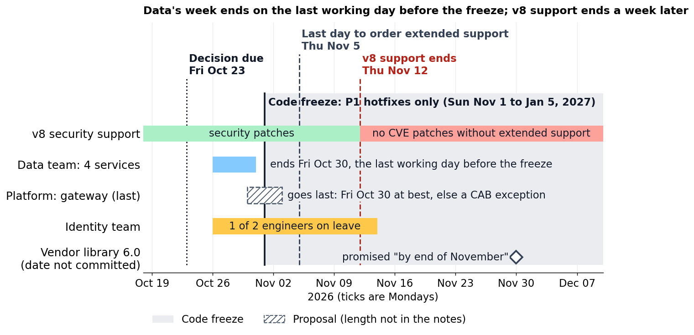

<!-- zone:human -->
# Runtime v8 to v10: upgrade seven services before the freeze, defer auth-service and user-store to January

*2026-10-17 · prepared by Copilot (AI agent) · draft until the decision is recorded · for Marcus Hale, Engineering Lead · sources: Platform team notes (2026-10-14), services.csv, incidents-q3.csv ([copies and checksums](report.evidence.md#sources-and-integrity))*

## 👤 START HERE - at a glance

> ### 🟡 Go with conditions: seven services before the freeze, auth-service and user-store in January
>
> **Bottom line:** The seven services that passed staging [roll back in 10 to 15 minutes](#1-seven-of-nine-services-are-ready-and-two-are-not), so they move now once a [mixed-version check](#5-the-seven-fit-before-the-freeze-with-no-slack) passes. auth-service and user-store (the Identity pair) have no rollback and are [not ready](#2-auth-service-and-user-store-must-wait-for-january), so they wait for January; extended support is [needed either way](#4-the-split-costs-no-more-than-waiting).
>
> **Confidence:** medium - Platform's staging results and estimates, none re-run by me; high for the Identity pair, lower for the seven's schedule.

> ### 🧭 Decisions needed
>
> 1. **Marcus** decides **whether to approve the [split plan](#4-the-split-costs-no-more-than-waiting)** (seven from Mon 2026-10-26, Identity pair in January) by **Fri 2026-10-23** - recommend: approve.
> 2. **Marcus** decides **whether to order v8 [extended support](#4-the-split-costs-no-more-than-waiting)** (18,000 USD a quarter) by **Thu 2026-11-05** - recommend: order.
> 3. **Marcus** decides **whether to request a change advisory board (CAB) exception** ([gateway, slips, rollbacks](#5-the-seven-fit-before-the-freeze-with-no-slack)) by **Fri 2026-10-23** - recommend: ask.
>
> If we get it wrong: an early Identity upgrade means 4 hours of recovery, no rollback; deferring all nine costs the same 18,000 USD plus a bigger January.

| | Top risks (ranked by consequence) | Impact | Where it is handled |
|---|---|---|---|
| 🔴 | Identity pair upgraded before it is ready | No rollback, 4 h restore, every login down | Deferred: [Section 2](#2-auth-service-and-user-store-must-wait-for-january) |
| 🟠 | A slip or regression lands in the freeze | Only P1 hotfixes deploy; fixes need a CAB exception | CAB request, go/no-go: [Section 5](#5-the-seven-fit-before-the-freeze-with-no-slack) |
| 🟠 | Identity pair on unpatched v8 after 2026-11-12 | No CVE fixes for login unless support is ordered | Order support: [Section 4](#4-the-split-costs-no-more-than-waiting) |
| 🟠 | Vendor library 6.0 slips past November | auth-service stays on the shim; support renews at 18,000 USD a quarter | Mid-December review: [Section 7](#7-next-steps-if-marcus-approves) |
| 🟡 | Mixed v8 and v10 estate not shown tested | Calls between old and new services could fail | Check first: [Section 5](#5-the-seven-fit-before-the-freeze-with-no-slack) |



*Arrows mean "depends on". Takeaway: six services depend on auth-service, the one that is not ready.*

**Read next**

- [1 Seven of nine services are ready and two are not](#1-seven-of-nine-services-are-ready-and-two-are-not) - terms, table · 2 min
- [2 auth-service and user-store must wait for January](#2-auth-service-and-user-store-must-wait-for-january) - the reasons · 3 min
- [3 Q3 incidents point the same way](#3-q3-incidents-point-the-same-way) - the evidence · 2 min
- [4 The split costs no more than waiting](#4-the-split-costs-no-more-than-waiting) - options, cost · 2 min
- [5 The seven fit before the freeze with no slack](#5-the-seven-fit-before-the-freeze-with-no-slack) - order, dates · 3 min
- [6 Five unknowns could change the call](#6-five-unknowns-could-change-the-call) - open questions · 2 min
- [7 Next steps if Marcus approves](#7-next-steps-if-marcus-approves) - who does what · 1 min

*Only deciding? Stop here. Checking the plan? Read 2, 4 and 5. Auditing? See the machine zone.*

## 1 Seven of nine services are ready and two are not

*Question answered: which services can move, and what holds them together? Builds on the map above.*

Six services call **auth-service** directly, and auth-service rests on user-store, so a failure in the Identity pair can reach seven of the other eight services. The other seven passed staging (2026-10-09 to 2026-10-11) and roll back in 10 to 15 minutes. catalog-service has four dependents and a two-way dependency with map-service.

Unmarked facts come from the three source files named under the title; the rest is marked *Inference*, *Assumption* or *Proposal*.

**Terms used in this report**

- **The seven:** gateway, catalog-service, share-service, connector-service, map-service, search-index and notify-service.
- **Identity pair:** auth-service and user-store, both owned by the Identity team.
- **Split plan:** the seven before the freeze, the Identity pair in January.
- **Shim:** the compatibility layer that lets auth-service's IdentityModel 5.x run on v10 until the vendor ships 6.0.
- **Freeze:** 2026-11-01 to 2027-01-05, when only P1 hotfixes deploy. **CAB exception:** change advisory board approval to deploy anyway, for staged and tested work only. **Extended support:** paid v8 security patches; v8's normal support ends 2026-11-12.
- **Mixed-version check:** a staging run with the seven on v10 and the Identity pair still on v8.

| Service | Team | Criticality | v10 change named in the notes | Staging | Rollback | Depended on by |
|---|---|---|---|---|---|---|
| gateway | Platform | critical | HTTP client and retry behaviour | pass | yes | 0 |
| auth-service | Identity | critical | IdentityModel 5.x, no v10 release yet (shim) | **fail** (2 of 148 integration tests) | **no** | 6 |
| user-store | Identity | critical | database driver: one-way schema migration | **not tested** (no staging environment) | **no** | 1 |
| catalog-service | Data | high | none named | pass | yes | 4 |
| share-service | Data | high | custom JSON converters | pass | yes | 1 |
| connector-service | Integration | medium | custom JSON converters | pass | yes | 1 |
| map-service | Data | medium | none named | pass | yes | 1 |
| search-index | Data | medium | none named | pass | yes | 1 |
| notify-service | Platform | low | none named | pass | yes | 1 |

*Depended on by = direct dependents, counted from services.csv. The full inventory is in [the evidence file](report.evidence.md#service-inventory).*

**The split follows the breaking changes.** The two v10 changes that hit the seven (JSON converters, gateway retry policy) passed staging; the two that hit the Identity pair (identity library, one-way migration) are the unresolved ones.

**Next →** [2 auth-service and user-store must wait for January](#2-auth-service-and-user-store-must-wait-for-january)

## 2 auth-service and user-store must wait for January

*Question answered: can the Identity pair be upgraded before the freeze? No, for four independent reasons.*

1. **Not ready.** auth-service fails 2 of 148 integration tests, in the token refresh flow, on the compatibility shim; the root cause is not confirmed. user-store was not tested at all: no staging environment exists, and building one takes about a week. Two failures sound small, but token refresh also caused 3 of auth-service's 11 Q3 incidents ([3](#3-q3-incidents-point-the-same-way)). *Inference:* the failures and the incidents may share a cause.
2. **No way back.** After the schema migration neither service can be rolled back; recovery means restoring from backup, estimated at 4 hours. That is about three times the longest Q3 incident (78 minutes, 2026-07-11).
3. **A vendor date it cannot control.** IdentityModel 6.0, the release that supports v10, is promised "by end of November" but not committed. Until then auth-service runs on the shim.
4. **No hands, no exception route yet.** Identity has two engineers and one is on leave from 2026-10-26 to 2026-11-13, the whole pre-freeze window. A CAB exception covers only work already staged and tested, which neither service is. They could qualify later in the freeze if 6.0 ships and staging passes; *Inference:* January is the realistic date.

> "We would rather not touch auth-service until the vendor library is out. A failed upgrade takes down every login." - Identity team, in the notes

**Use of the freeze, and a gate for January.** *Proposal* (the notes set no gate): the Identity team spends the freeze on work that deploys nothing - root-causing the 2 failing tests, building the user-store staging environment, timing a restore from backup - and upgrades the Identity pair only when 6.0 has shipped, all 148 tests pass without the shim, user-store has passed a staging run including the one-way migration, and the restore has been rehearsed. If that happens during the freeze, it can ask for a CAB exception; otherwise the planning date is after 2027-01-05. *Assumption:* the freeze limits production deployments only, not staging.

**Next →** [3 Q3 incidents point the same way](#3-q3-incidents-point-the-same-way)

## 3 Q3 incidents point the same way

*Question answered: does last quarter's record support touching auth-service now? No, and it also backs the rollback estimate for the seven.*



*How to read it: each bar counts incident records for one service, dark for SEV1 or SEV2. Takeaway: auth-service has the most incidents and the most severe ones.*

- **auth-service is the incident hub.** 11 of 36 records, 380 minutes, and 7 of the 11 SEV1 or SEV2 events (the gateway's SEV1 of 2026-07-11 is the same event as auth-service's, so it is counted once). Its top causes are token validation timeouts (5) and token refresh bugs (3).
- **Its failures spread.** On 2026-07-11 the gateway returned 503 on every authenticated route for 78 minutes because of auth-service's SEV1. 4 of the gateway's 7 incidents name auth-service in their summary.
- **The upgrade is not a reliability fix.** Only 3 of 36 incidents were GC pauses, the only cause labelled as runtime; the notes do not say whether v10 changes that. The case for upgrading is security support, not stability.
- **Rollbacks work.** The 5 failed rollouts of Q3 were rolled back in 10 to 19 minutes, 4 of them within 15, in line with the 10 to 15 minute estimate for the seven. Caveat: these were ordinary deploys, not runtime upgrades.

Counting rules and the full log are in [the evidence file](report.evidence.md#incident-statistics).

**Next →** [4 The split costs no more than waiting](#4-the-split-costs-no-more-than-waiting)

## 4 The split costs no more than waiting

*Question answered: what does each option cost, and what is still on v8 after 2026-11-12?*

| Option | On v10 before the freeze | On v8 after 2026-11-12 | Extended support | Verdict |
|---|---|---|---|---|
| Upgrade all nine | 9 | 0 | none, if all nine finish by then | Reject: the Identity pair is not ready, and a CAB exception needs staged, tested work |
| Defer all nine | 0 | 9 | 18,000 USD | Fallback: safe for now, but January becomes a nine-service job |
| Split plan | 7 | 2 | the same 18,000 USD | Recommend: same cost, a smaller January |

**Extended support costs the same whether we defer or split**, because the Identity pair stays on v8 either way, so the real choice is whether the seven move now or in January. Moving now shrinks January from nine services to two, in a week the Data team says it is ready ("We can do ours in a week if we start Monday"). Waiting also leaves the staging results 86 days old by 2027-01-05, so *Inference:* they would be re-run.

The case for deferring all nine is that nothing changes right before a two-month deploy lock. It is a fair case and stays our fallback, but a v10 regression in the seven is cheap to reverse (10 to 15 minutes), the CAB can be asked in advance (decision 3), and waiting buys a nine-service January. The split's own costs are change risk during the freeze ([5](#5-the-seven-fit-before-the-freeze-with-no-slack)) and a mixed v8 and v10 estate for about two months.

*Assumptions:* 18,000 USD is a flat price for the whole v8 estate, one quarter runs from 2026-11-12 to about 2027-02-12, and Marcus can approve the spend. If the price is per service or quarters are calendar quarters, the cost changes ([6](#6-five-unknowns-could-change-the-call)).

Skipping extended support would leave the two most critical services without CVE patches from 2026-11-12 until they move: 54 days if that is the day the freeze ends, longer if 6.0 slips. Not recommended; the notes give no CVE exposure estimate.

**Next →** [5 The seven fit before the freeze with no slack](#5-the-seven-fit-before-the-freeze-with-no-slack)

## 5 The seven fit before the freeze with no slack

*Question answered: in what order, and by when? The order and checkpoints are my proposal, built from the dependency table and the teams' quotes.*



*How to read it: solid bars are facts from the notes; the dashed box is a proposal. Takeaway: no slack before the freeze, and both v8 deadlines fall inside it.*

| Step | Services | Why here | Team |
|---|---|---|---|
| 1 | search-index, notify-service | No dependencies or low criticality | Data, Platform |
| 2 | catalog-service and map-service together | They depend on each other; catalog-service has four dependents | Data |
| 3 | share-service, connector-service | Both call catalog-service; Integration: "we can go any time" | Data, Integration |
| 4 | gateway | Platform: last, "because it fronts everything" | Platform |

Steps 1 to 3 fit the Data team's week, Mon 2026-10-26 to Fri 2026-10-30; step 4 follows them.

- **No slack.** Data's week is five working days ending Fri 2026-10-30, and the freeze starts Sun 2026-11-01. Gateway goes last, so it lands on 2026-10-30 at best and otherwise inside the freeze. *Assumption:* a Monday-to-Friday week.
- **The freeze limits fixes.** Only P1 hotfixes deploy. A slipped service can ask for a CAB exception because it is staged and tested; *Inference:* a fix for a non-P1 regression would not qualify, since exceptions cover only staged and tested work. Hence decision 3, and a go/no-go check before step 4.
- **Mixed estate.** For about two months the seven run on v10 against auth-service on v8, and the serializer defaults changed (property naming, null handling). The notes do not say which auth-service version the seven were tested against, so run the mixed-version check before step 1. The fallback if it fails is in [6](#6-five-unknowns-could-change-the-call).
- **Effort is known only for Data.** The notes give no estimate for gateway, notify-service or connector-service.

**Next →** [6 Five unknowns could change the call](#6-five-unknowns-could-change-the-call)

## 6 Five unknowns could change the call

*Question answered: what could make this recommendation wrong, and who can settle it?*

| # | Unknown | If it goes the wrong way | Who can settle it |
|---|---|---|---|
| 1 | Root cause of the 2 failing token refresh tests | Nothing changes for 2026; it moves the January date | Identity |
| 2 | Release date of IdentityModel 6.0 ("by end of November", not committed) | The Identity pair stays on v8 longer; extended support renews at 18,000 USD a quarter | Vendor, via Identity |
| 3 | Which auth-service version the seven were tested against | If the v10-to-v8 mix fails, fall back to deferring all nine | Platform |
| 4 | Extended support terms: flat or per service, what a quarter means, whether a CVE patch counts as a P1 hotfix | Cost could double to 36,000 USD, or patches wait for the freeze to end | Vendor, CAB |
| 5 | Whether the CAB allows a rollback or fix of the seven during the freeze | A regression could stay until January | CAB |

**Fall back to deferring all nine** *(Proposal)* if the mixed-version check fails, the Data team cannot start on Mon 2026-10-26, or an early service regresses in production. It costs the same as the split plan ([4](#4-the-split-costs-no-more-than-waiting)).

**Next →** [7 Next steps if Marcus approves](#7-next-steps-if-marcus-approves)

## 7 Next steps if Marcus approves

*Question answered: who does what, by when? Dates come from the notes; owners and order are my proposal.*

1. **Fri 2026-10-23 · Marcus** - record decisions 1 to 3 in [B Decision record](#b-decision-record), order extended support (deadline Thu 2026-11-05) and ask the CAB for the exception.
2. **Before Mon 2026-10-26 · Platform** - confirm which auth-service version the seven were tested against; if it was not v8, run the mixed-version check in staging.
3. **Mon 2026-10-26 · Data, Platform, Integration** - start steps 1 to 3 of [the order in section 5](#5-the-seven-fit-before-the-freeze-with-no-slack); Data's four services run to Fri 2026-10-30. After step 3, Platform and Data decide go/no-go on gateway (step 4).
4. **During the freeze · Identity** - root-cause the 2 failing tests, build the user-store staging environment (about a week) and rehearse a timed restore from backup.
5. **Mid-December, proposed date · Identity and Marcus** - if IdentityModel 6.0 is not out, decide whether to renew extended support for a second quarter.
6. **After 2027-01-05 · Identity** - upgrade the Identity pair once [the gate in section 2](#2-auth-service-and-user-store-must-wait-for-january) is met.

---

<!-- zone:ai-input -->
## 🗄️ Machine and archive zone - skip unless you need the evidence or are an agent continuing this work

*What is in here: handoff notes for an agent, the decision record, the supporting data kept as the audit trail, and the sources of the three pictures. It supports every number above; nothing here is needed to decide.*

### A Handoff context for the next agent

*🤖 AI input - lets a later agent update this report once Marcus decides, regenerate its pictures and verify its numbers. Paths are relative to the folder that contains `report.md`.*

<details>
<summary>Files, commands, update rules and constraints - click to expand</summary>

**State:** draft of 2026-10-17. No decision is recorded. Verdict 🟡 go with conditions (split plan). Data as of the Platform team's notes of 2026-10-14.

**Files in this folder**

| Path | What it is |
|---|---|
| `report.md` | this report, human zone first |
| `report.evidence.md` | full supporting data, claim traceability and counting rules (archive) |
| `report.data/` | verbatim copies of the three inputs; hashes are in the evidence file; do not edit |
| `report.assets/dependency-map.dot` and `.png` | dependency map: Graphviz source and image |
| `report.assets/incidents.py` and `.png` | incident chart; the script also prints the statistics |
| `report.assets/timeline.py` and `.png` | timeline chart |

**Commands** (run from this folder; they need Graphviz `dot` and Python with matplotlib; SKILL_FOLDER is the folder of the document-formatting skill, if it is available)

```powershell
dot -Tpng -Gdpi=150 report.assets/dependency-map.dot -o report.assets/dependency-map.png
python report.assets/incidents.py
python report.assets/timeline.py
Get-FileHash -Algorithm SHA256 report.data/*
python SKILL_FOLDER/scripts/check_doc.py report.md
python SKILL_FOLDER/scripts/check_doc.py report.evidence.md
```

**When a decision is made**

1. Fill the rows in [B Decision record](#b-decision-record): outcome, who, date, conditions.
2. In the metadata line under the title, change "draft until the decision is recorded" to "final, decided YYYY-MM-DD".
3. Rewrite the glance panel so it stays true: replace the verdict heading, the bottom line and the Decisions needed block with the recorded outcome; keep in the risk table only the risks that are still open.
4. If the decision differs from the recommendation, say so in the first sentence of the bottom line, keep sections 1 to 7 as the analysis at the time, and do not delete the recommendation.
5. Re-run the checker on both Markdown files; no Blocker may remain.

**Constraints and what not to do**

- Do not edit the files in `report.data/`; they are the audit baseline.
- Do not change a number in the report without updating the claim table in the evidence file.
- Keep the labels Inference, Assumption and Proposal; never present them as facts.
- Use one name per entity: the Identity pair is auth-service and user-store; the seven are gateway, catalog-service, share-service, connector-service, map-service, search-index and notify-service.
- Nothing in this report authorizes an upgrade of auth-service or user-store.

**While decisions are open:** start no upgrade. Safe preparation that every option needs: ask Platform the version question (section 6, row 3), confirm the extended support terms with the vendor (row 4) and ask the CAB for its position (row 5). Record the answers in the unknowns table of section 6 and in the update log of block B.

**Definition of done:** the decision record is complete, the panel is true to the decision, the checker reports no Blocker on both Markdown files, and the hashes in the evidence file still match `report.data/`.

</details>

<!-- zone:archive -->
### B Decision record

*🗄️ Archive - the audit trail of what was decided; all rows are pending until Marcus decides. Supports the Decisions needed block in the glance panel.*

<details>
<summary>Decision log and update log - click to expand</summary>

| # | Decision asked | Recommendation in this report | Outcome | Decided by | Date | Conditions or notes |
|---|---|---|---|---|---|---|
| 1 | Approve the split plan | Approve | Pending | Marcus Hale |  |  |
| 2 | Order v8 extended support (deadline 2026-11-05) | Order | Pending | Marcus Hale |  |  |
| 3 | Ask the CAB for an exception to the freeze | Ask | Pending | Marcus Hale |  |  |

Update log, newest last. Add one line per later event, for example the CAB's answer or the vendor's release date.

| Date | Event | Recorded by |
|---|---|---|
| 2026-10-17 | Report drafted from the three source files; nothing verified beyond them | Copilot (AI agent) |

</details>

<!-- zone:archive -->
### C Evidence and source data

*🗄️ Archive - the full data behind the numbers above; supports sections 1 to 5.*

Full evidence: [report.evidence.md](report.evidence.md) - claim traceability, the full service inventory, the 16 dependency edges, the 36-row incident log, incident statistics, date checks and the counting rules.

Verbatim inputs, unedited: [upgrade-notes.md](report.data/upgrade-notes.md), [services.csv](report.data/services.csv) and [incidents-q3.csv](report.data/incidents-q3.csv).

<!-- zone:archive -->
### D Diagram and chart sources

*🗄️ Archive - the sources of the three pictures, so they can be regenerated or checked; supports the glance panel, section 3 and section 5.*

- Dependency map: source [dependency-map.dot](report.assets/dependency-map.dot). Its text equivalent is the edge list in [the evidence file](report.evidence.md#dependency-edges): 16 edges, all verified from services.csv, none inferred.
- Incident chart: [incidents.py](report.assets/incidents.py) reads the incident CSV and prints the statistics reproduced in [the evidence file](report.evidence.md#incident-statistics).
- Timeline: [timeline.py](report.assets/timeline.py). The dates behind it are in [the evidence file](report.evidence.md#date-checks); the gateway box is a proposal and its length is not in the notes.
