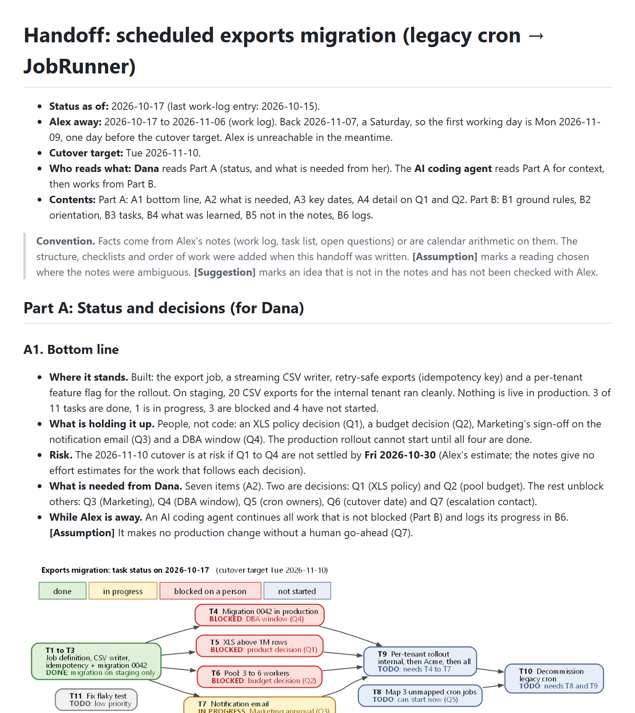
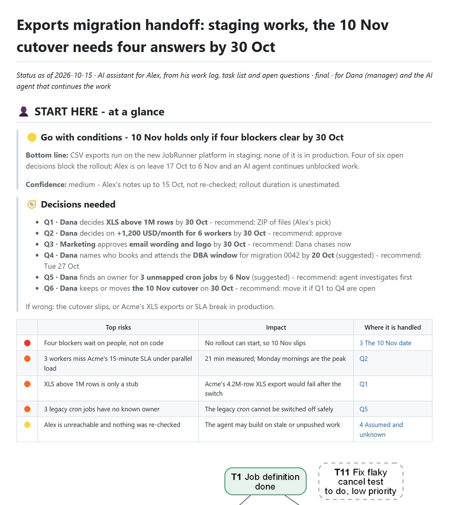

# Dual-audience handoff

[← All examples](../README.md) · [Review of this scenario](../../review/iteration-2/eval-2-dual-audience-handoff.md)

**Status and handoff · English.** An engineer goes on leave. A manager will skim the handoff; an AI agent will continue the work from it. The input is a work log, a task list and a list of open questions.

> **Prompt given to both agents**
>
> I'm on leave from tomorrow for three weeks (back 7 Nov). My notes on the exports migration are in examples/02-dual-audience-handoff/input/ (work log, task list, open questions). Turn them into a handoff document. My manager Dana will skim it to see where things stand and what she needs to decide, and an AI coding agent will pick up the remaining work next week from this same document, so it has to be able to continue without asking me anything.

## What the reader sees first

| Without the skill | With the skill |
|---|---|
|  |  |
| [Open the document](without-skill/report.md) | [Open the document](with-skill/report.md) |

The scenario was also written again with the published skill, v1.0.0: [the document](../../review/final-check/outputs/02-dual-audience-handoff/report.md), gate ✅, cold reader 5/6 ([final check](../../review/final-check/README.md)).

## What to look for

- One document with two readers: a human panel for the manager (status, blockers, decisions) and a self-sufficient AI-input block for the agent (paths, commands, constraints, what not to do, definition of done).
- A task dependency graph that shows which blockers stop which tasks.
- Decisions that say when the source gives no deadline instead of inventing one, and suggested dates marked as suggested.

## Scores

| | Without the skill | With the skill |
|---|---|---|
| Assertions passed | 9 / 22 | 22 / 22 |
| Automatic checker | ❌ 0 Blockers · 4 Majors · 2 Minors | ✅ 0 Blockers · 0 Majors · 1 Minor |
| First section, words (budget about 300) | 677 | 298 |
| Cold reader, first 60 lines | 6 / 6 key facts | 5 / 6 key facts |

Every assertion with the grader's evidence is on the [review page](../../review/iteration-2/eval-2-dual-audience-handoff.md).

## What is in this folder

| Folder | Contents |
|---|---|
| `input/` | `work-log.md` (the engineer's running notes); `tasks.md` (eleven tasks with dependencies); `open-questions.md` (six questions that need other people) |
| `without-skill/` | `assets`, `final_reply.md`, `report.md` |
| `with-skill/` | `final_reply.md`, `report.assets`, `report.evidence.md`, `report.md` |
