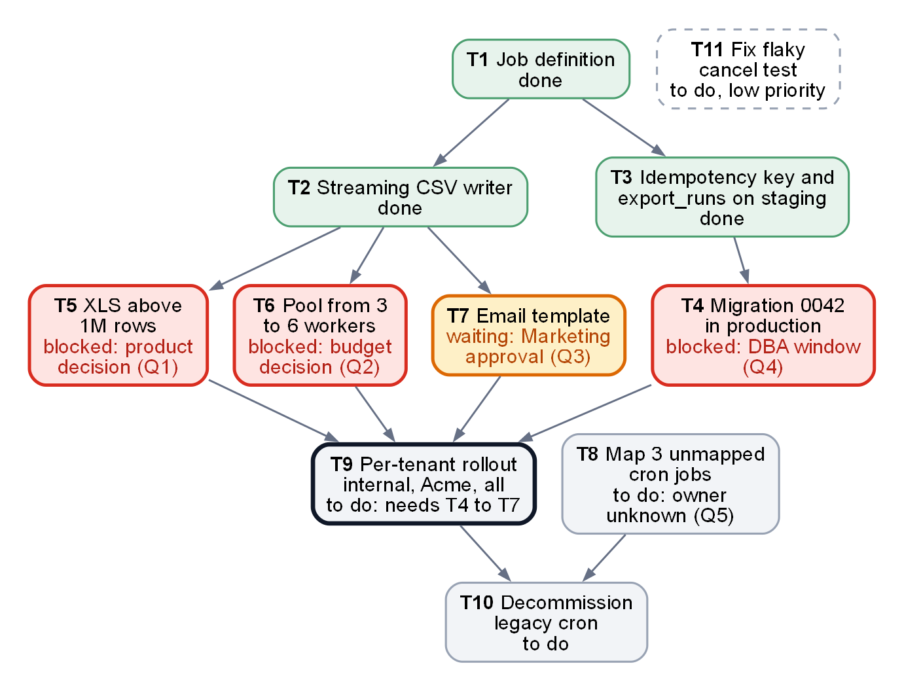

<!-- zone:human -->
# Exports migration handoff: staging works, the 10 Nov cutover needs four answers by 30 Oct

*Status as of 2026-10-15 · AI assistant for Alex, from his work log, task list and open questions · final · for Dana (manager) and the AI agent that continues the work*

## 👤 START HERE - at a glance

> ### 🟡 Go with conditions - 10 Nov holds only if four blockers clear by 30 Oct
>
> **Bottom line:** CSV exports run on the new JobRunner platform in staging; none of it is in production. Four of six open decisions block the rollout; Alex is on leave 17 Oct to 6 Nov and an AI agent continues unblocked work.
>
> **Confidence:** medium - Alex's notes up to 15 Oct, not re-checked; rollout duration is unestimated.

> ### 🧭 Decisions needed
>
> - **Q1 · Dana** decides **XLS above 1M rows** by **30 Oct** - recommend: ZIP of files (Alex's pick)
> - **Q2 · Dana** decides on **+1,200 USD/month for 6 workers** by **30 Oct** - recommend: approve
> - **Q3 · Marketing** approves **email wording and logo** by **30 Oct** - recommend: Dana chases now
> - **Q4 · Dana** names who books and attends the **DBA window** for migration 0042 by **20 Oct** (suggested) - recommend: Tue 27 Oct
> - **Q5 · Dana** finds an owner for **3 unmapped cron jobs** by **6 Nov** (suggested) - recommend: agent investigates first
> - **Q6 · Dana** keeps or moves **the 10 Nov cutover** on **30 Oct** - recommend: move it if Q1 to Q4 are open
>
> If wrong: the cutover slips, or Acme's XLS exports or SLA break in production.

| | Top risks | Impact | Where it is handled |
|---|---|---|---|
| 🔴 | Four blockers wait on people, not on code | No rollout can start, so 10 Nov slips | [3 The 10 Nov date](#3-the-10-nov-date-holds-only-if-the-blockers-clear-by-30-oct) |
| 🟠 | 3 workers miss Acme's 15-minute SLA under parallel load | 21 min measured; Monday mornings are the peak | [Q2](#q2-three-workers-miss-the-acme-sla-and-six-are-expected-to-fix-it) |
| 🟠 | XLS above 1M rows is only a stub | Acme's 4.2M-row XLS export would fail after the switch | [Q1](#q1-xls-above-1m-rows-needs-a-policy-and-a-zip-of-files-is-recommended) |
| 🟠 | 3 legacy cron jobs have no known owner | The legacy cron cannot be switched off safely | [Q5](#q5-three-cron-jobs-have-no-owner-and-block-switching-the-legacy-cron-off) |
| 🟡 | Alex is unreachable and nothing was re-checked | The agent may build on stale or unpushed work | [4 Assumed and unknown](#4-what-is-assumed-and-what-is-still-unknown) |



*Arrows mean "must finish before"; green is done, red is blocked on a person, amber is waiting on Marketing, grey is to do. Takeaway: the production rollout (thick outline) needs all of T4 to T7, and each needs someone else's answer.*

**Read next**

- [1 Where things stand](#1-three-of-eleven-tasks-are-done-and-production-is-untouched) - what works, the terms · 2 min
- [2 The six decisions](#2-six-decisions-are-open-and-four-of-them-block-the-rollout) - options, evidence, recommendation · 4 min
- [3 The 10 Nov date](#3-the-10-nov-date-holds-only-if-the-blockers-clear-by-30-oct) - calendar, DBA windows, how to answer · 2 min
- [4 Assumed and unknown](#4-what-is-assumed-and-what-is-still-unknown) - how far to trust this status · 1 min
- [A Handoff context](#a-handoff-context-for-the-next-agent) - everything an agent needs · agent only

*Only deciding? Stop after 2. Agent? Go straight to A.*

## 1 Three of eleven tasks are done and production is untouched

*What exists today, and the terms the rest of this document uses.*

The plan moves scheduled exports from the legacy cron jobs to JobRunner one customer at a time and switches the legacy cron off last. The building blocks are done and tested; production has no migration and no customer switched, and the notes record nothing else done there. Monitoring is only an idea so far (an export-duration dashboard, a dead-letter-queue alert).

**Works today** (Alex's results; none of it is in production):

- **CSV streaming:** 5M rows in 6 minutes on one worker, memory under 300 MB.
- **Safe retries:** an idempotency key stops a retried job from sending a second email or overwriting a finished file (staging only).
- **Gradual switch:** the internal tenant ran 20 CSV exports on staging without a failure.
- **Tests:** 212 pass and 1 is an expected failure (a flaky cancel test).
- **Cron inventory:** 11 of the 14 legacy cron jobs have a documented one-to-one mapping to JobRunner definitions.

**Terms**

| Term | Meaning in this document |
|---|---|
| JobRunner | The new platform: each export is a YAML job run by workers in a pool |
| Pool | `exports-pool`, the workers that run exports; 3 today |
| Legacy cron | The 14 scheduled jobs that JobRunner replaces |
| Tenant flag | A per-customer (tenant) switch, `exports.jobrunner.enabled`, off by default; it moves one customer to JobRunner |
| Idempotency key | `export_id`, a UUID per export kept in table `export_runs`; the reason for migration 0042 |
| Acme and the SLA | Acme's contract allows 15 minutes per export; its largest dataset has 4.2M rows |
| DBA window | Tue and Thu 22:00 to 23:00 UTC, the only slots for production database migrations |
| Cutover | Assumed: every customer on JobRunner (T9 done); the legacy cron switch-off (T10) follows |
| T1 to T11, Q1 to Q6 | Task and decision IDs from Alex's notes, kept for traceability |

**Next →** [2 The six decisions](#2-six-decisions-are-open-and-four-of-them-block-the-rollout)

## 2 Six decisions are open and four of them block the rollout

*Q1 to Q4 block the rollout (T9), Q5 blocks the legacy cron switch-off (T10), Q6 sets the date. Recommendations marked (Alex) are his; the others are suggested here and Dana may overrule them.*

### Q1 XLS above 1M rows needs a policy and a ZIP of files is recommended

*Asked of Dana on 6 Oct, no answer yet. Blocks T5.*

- **Problem:** the Excel library caps a sheet at 1,048,576 rows; Acme's largest dataset has 4.2M. The XLS writer is a stub that raises an error above 1M rows, so that export would fail on JobRunner.
- **Options:** (a) several XLS files of 1M rows each in one ZIP, about 5 for Acme (derived); (b) no XLS for large datasets, customers use CSV. Several sheets in one workbook was set aside: each sheet stays capped and it is confusing.
- **Recommendation (Alex):** (a). It keeps XLS for Acme, but customers get a ZIP instead of one file, so it needs a product decision and probably a customer notice. For (b) the notes do not say how customers would be told to use CSV.

### Q2 Three workers miss the Acme SLA and six are expected to fix it

*Budget decision, no answer yet. Blocks T6.*

- **Evidence:** Acme's largest dataset took 9.5 minutes on 3 workers alone (pass) and 21 minutes with 3 exports at once (fail, limit 15). Acme runs several on Monday mornings. See [performance results](report.evidence.md#performance-results).
- **Cost and proof:** about +1,200 USD per month for 6 workers (Alex's estimate). Not measured: that 6 workers bring the parallel case under 15 minutes; the notes record no 6-worker run.
- **If declined:** no fallback is defined; Acme would stay on the legacy cron (blocking T10) or run with SLA risk (inferred).
- **Recommendation:** approve. The agent measures the parallel case on 6 workers before Acme is switched and reports to Dana if it still misses 15 minutes.

### Q3 Marketing must approve the email wording and logo

*Blocks T7. The draft has been with Marketing since 12 Oct.*

- **Context:** legacy emails were plain text; the new HTML template is wired and used only when a job sets `notify_email`.
- **Recommendation:** Dana chases Marketing now and asks for an answer by 30 Oct. The notes define no fallback.

### Q4 Migration 0042 needs a booked DBA window and a person on call

*Blocks T4. Ticket DBA-5521 was logged on 14 Oct and is not scheduled.*

- **What:** creates the `export_runs` table behind the idempotency key; applied on staging only.
- **Window:** someone must book a DBA window and be reachable during it (in local time, derived: 23:00 to 00:00 CET from 25 Oct). Slots left (derived): Tue 20, Thu 22, Tue 27 and Thu 29 Oct, then Tue 3 and Thu 5 Nov.
- **Recommendation:** name the person by 20 Oct and book Tue 27 Oct, spare Thu 29 Oct. T4 depends only on T3 (done), so it need not wait for Q1 to Q3, and an early run keeps the six working days after 30 Oct free (see [3](#3-the-10-nov-date-holds-only-if-the-blockers-clear-by-30-oct)).

### Q5 Three cron jobs have no owner and block switching the legacy cron off

*Blocks T10. The notes give no date; 6 Nov is suggested so that T10 can follow the cutover.*

- **Jobs:** `export_weekly_xls`, `export_audit`, `export_adhoc`. Nobody on the team knows who owns them, and the legacy cron may be switched off only after they are mapped or retired.
- **Watch:** from the names alone, `export_weekly_xls` may be affected by Q1 and `export_audit` may matter for compliance (inferred, not checked).
- **Recommendation:** the agent finds out what each job does and who receives its output (T8 needs no decision), then proposes map or retire per job. Nothing is retired without an owner or Dana's written OK.

### Q6 Keep or move the 10 Nov cutover is decided on 30 Oct

*Sets the date for everything above.*

The rollout (T9) cannot start until T4 to T7 are done, and Alex's notes put the date at risk if decisions slip past 30 Oct. **Recommendation:** on 30 Oct, if any of Q1 to Q4 is still open, move the date rather than squeeze the rollout for a customer with an SLA into six working days. One way to protect the date (suggested, not in the notes): let the internal-tenant stage start after T4 alone, so production validation begins before Q1 to Q3 are answered; the task list makes T9 wait for all four, so only Dana can allow that. The calendar is in [3](#3-the-10-nov-date-holds-only-if-the-blockers-clear-by-30-oct).

**Next →** [3 The 10 Nov date](#3-the-10-nov-date-holds-only-if-the-blockers-clear-by-30-oct)

## 3 The 10 Nov date holds only if the blockers clear by 30 Oct

*What the calendar allows, what the agent does meanwhile, and how to answer.*

Alex is on leave from 17 Oct to 6 Nov and back on Sat 7 Nov, so Mon 9 Nov is his first working day: one working day before the target. Nobody who knows the details will be on hand for the last week.

| Date | What happens | Basis |
|---|---|---|
| Mon 19 Oct | First working day of Alex's leave; the agent starts | derived |
| Tue 20 Oct | Latest day to name the DBA contact (Q4); first DBA window | suggested |
| Tue 27 Oct | Recommended DBA window for migration 0042, spare Thu 29 Oct | suggested |
| Fri 30 Oct | Last day for Q1 to Q4; Dana decides Q6 | Alex's notes; Q6 suggested |
| Tue 3, Thu 5 Nov | Last DBA windows before the cutover | derived |
| Mon 9 Nov | Alex's first working day back | derived |
| Tue 10 Nov | Cutover target | Alex's notes |

After 30 Oct only six working days remain (2 to 6 and 9 Nov, derived) to build and test T5 to T7, run the migration if it is still open, and roll out three stages: the internal tenant, then Acme, then everyone else. Nobody has estimated how long T5 or the rollout takes, so treat 30 Oct as the last day and not the target: the earlier Q1 to Q3 are answered, the safer 10 Nov is.

- **Meanwhile the agent works only on what needs no decision:** it checks the repo and the tests, investigates the 3 unmapped cron jobs (T8), prepares migration 0042 for its window and, if idle, fixes the flaky test (T11). It does not touch production, spend money, switch a customer or switch the legacy cron off without Dana's written OK; the full rules are in [A](#a-handoff-context-for-the-next-agent).
- **Checkpoints:** Mon 19 Oct (is the Q4 contact named?), Tue 27 Oct (are Q1 to Q3 answered, is 0042 done?) and Fri 30 Oct (keep or move 10 Nov).
- **How to answer:** tell the agent in its session, or write the answer next to the matching row of the Decision log in A. The agent then updates this panel.

**Next →** [4 Assumed and unknown](#4-what-is-assumed-and-what-is-still-unknown)

## 4 What is assumed and what is still unknown

*How far to trust this status, and what could change it.*

**Trust.** Everything here comes from Alex's work log (1 to 15 Oct), task list and open questions. This document was written from those notes alone; the repo, staging and production were not opened. Labels: *Alex* means from his notes, *derived* means calendar or arithmetic done while writing, *suggested* means a proposal that is not in the notes.

**Assumed** (change these if they are wrong):

- Dana decides or routes all of Q1 to Q6; the notes name her only for Q1.
- "Cutover" means every customer on JobRunner (T9 done); the legacy cron switch-off (T10) comes after it.
- Alex's work is committed and pushed; the notes do not name the branch.
- "XLS" means `.xlsx` files, the only format the Excel library writes.
- A Monday to Friday week; local time is CET (the notes give CET for the legacy logs).

**Unknown, and it could change a decision:**

- Whether 6 workers bring the parallel case under 15 minutes. It was not measured, and 4.2M rows took 9.5 minutes on 3 workers while 5M rows took 6 minutes on one; the notes do not say why ([evidence](report.evidence.md#performance-results)).
- How long T5 and the three-stage rollout take.
- Which customers besides Acme have datasets above 1M rows.
- What the 3 unmapped cron jobs do and who receives their output.

The technical gaps only the agent needs are listed in [A](#a-handoff-context-for-the-next-agent).

---

<!-- zone:ai-input -->
## 🗄️ Machine and archive zone - skip unless you need the evidence or are an agent continuing this work

*What is in here: the brief an agent needs to continue (A), the evidence behind the numbers above (B) and the source of the picture (C). It supports sections 1 to 4.*

### A Handoff context for the next agent

*🤖 AI input - lets you continue the migration without asking Alex. Paths are relative to the repo root, which is `C:\work\nimbus-exports` on Alex's machine (your clone may be elsewhere). Supports sections 2 and 3.*

<details>
<summary>Mission, first checks, task board, ordered steps, rules, decision log, panel refresh, gaps, definition of done - click to expand</summary>

#### Mission

Finish moving scheduled exports from the legacy cron (`legacy/crontab.txt`, 14 jobs) to JobRunner, so that every tenant runs on JobRunner and the cron can be switched off. Target: Tue 2026-11-10 (see the "cutover" assumption in section 4). Alex built everything so far and is on leave until 2026-11-06; do not wait for him. Dana, his manager, is the contact for every open decision (assumed, see section 4); reach her through the channel your session gives you. Stack: Python 3.12, PowerShell, Postgres through `docker compose`, staging behind a VPN. Production secrets live in the vault under `kv://nimbus/exports/prod/*`; never copy them into files, logs, commits or messages.

#### Check the notes against reality first

Run from the repo root:

```powershell
git status
git branch --show-current
git log --oneline -15
docker compose up -d postgres
pytest tests/exports -q
```

Alex recorded 212 passed and 1 xfailed (`tests/exports/test_export_cancel.py::test_export_cancel`). Different counts are a reason to look; a FAILED test is a stop sign. The notes name no branch and do not say whether Alex pushed. If `src/exports/streaming_csv.py` or `migrations/0042_export_runs.sql` is missing, stop: log it in the Decision log and tell Dana that Alex's work may be unpushed.

#### Where things live

| Path or object | What it is | Task |
|---|---|---|
| `jobs/export-dataset.yaml` | JobRunner job definition; parameters `dataset`, `format`, `tenant`, `notify_email`; pool `exports-pool` (3 workers) | T1 |
| `src/exports/streaming_csv.py` | `StreamingCsvWriter`: keyset pagination and a streaming write; memory under 300 MB | T2 |
| `src/exports/xls_writer.py` | XLS writer stub; raises `NotImplementedError` above 1M rows | T5 |
| `migrations/0042_export_runs.sql` | creates table `export_runs` (idempotency key `export_id`, a UUID); applied on STAGING only | T3, T4 |
| `templates/export_ready.html` | new HTML notification email (legacy sent plain text); used only when `notify_email` is set | T7 |
| `legacy/crontab.txt`, `docs/cron-mapping.md` | the 14 legacy jobs; the mapping of the 11 that map one-to-one | T8, T10 |
| flag `exports.jobrunner.enabled`, table `tenant_flags` | per-tenant switch to JobRunner; default off; per-tenant override in `tenant_flags` | T9 |
| `scripts/deploy.ps1` | deploy script (PowerShell, run from the repo root) | T3, T9 |
| `tests/exports/` | tests for exports | all |

#### Commands that worked for Alex

```powershell
docker compose up -d postgres                                        # local Postgres; the next two need it
python -m exports.cli run --dataset demo --format csv --rows 100000  # local export run
pytest tests/exports -q                                              # tests
./scripts/deploy.ps1 -Env staging -Service exports-runner            # staging deploy: repo root, staging VPN on
kubectl get pods -n exports                                          # after EVERY deploy: the script fails silently when the VPN is down
```

Only the staging deploy is recorded; read "Not in the notes" before any production step.

#### Task board

State at 2026-10-15, from Alex's task list. The last column is suggested, except the conditions for T10, which are Alex's.

| ID | Task | Status | Blocked by | What is left | Done when (suggested) |
|---|---|---|---|---|---|
| T1 | Job definition `jobs/export-dataset.yaml` | done | - | nothing | - |
| T2 | Streaming CSV writer | done | - | nothing (XLS is T5) | - |
| T3 | `export_id` idempotency key and `export_runs` migration on staging | done | - | nothing on staging; production is T4 | - |
| T4 | Apply `migrations/0042_export_runs.sql` in production | blocked | DBA window (Q4), ticket DBA-5521 | book the slot; a human applies it in the window | table exists in production, verified, time logged in UTC |
| T5 | XLS above 1M rows | blocked | Q1 | replace the stub in `src/exports/xls_writer.py` | a 4.2M-row export works as Q1 decides; tests added; memory well under the 2 GB container limit |
| T6 | Pool from 3 to 6 workers | blocked | Q2 | resize `exports-pool` | 3 parallel exports of the 4.2M-row dataset each finish in 15 min or less |
| T7 | Email template approval and wiring | in progress, waiting | Marketing (Q3) | apply the approved wording and logo in `templates/export_ready.html` | approved text in the template, one test email checked on staging, approver and date logged |
| T8 | Map the 3 unmapped cron jobs | to do | nothing, can start now; resolving it needs an owner (Q5) | find out what each does; map or retire | each job has its purpose in `docs/cron-mapping.md` and a mapping or retirement approved by an owner or Dana |
| T9 | Per-tenant rollout: `nimbus-internal`, then Acme, then everyone | to do | T4, T5, T6, T7 | three production stages | flag on for every tenant; each stage verified before the next |
| T10 | Decommission the legacy cron | to do | T8, T9 | switch off the 14 cron jobs | only after every tenant is migrated and T8 is resolved (Alex), with Dana's written OK |
| T11 | Fix flaky `test_export_cancel` | to do, low priority | - | remove the `xfail` mark once it passes reliably | passes in 20 repeated runs, `xfail` removed |

#### Ordered next steps

No decision needed, start now:

1. Run the checks above.
2. T8: read `legacy/crontab.txt` and `docs/cron-mapping.md`. For `export_weekly_xls`, `export_audit` and `export_adhoc` find the command or script, schedule, datasets, formats, tenants, recipients and last runs (legacy logs are in CET), and who added them (`git log` and `git blame` on `legacy/crontab.txt`). Write the findings into `docs/cron-mapping.md`, draft a definition under `jobs/` where a one-to-one mapping is obvious, and log a map-or-retire proposal per job under Q5. Check whether `export_weekly_xls` exports datasets above 1M rows, because that touches Q1.
3. T4 preparation (suggested pre-flight, not in Alex's notes): read `migrations/0042_export_runs.sql`, write down for the DBA what it touches, how long it should take on production volume and how to undo it, and add that to ticket DBA-5521.
4. T11, only if nothing else is available: Alex already spent half a day on it, so stop at the same limit. The notes say the test cancels before the worker has started. Suggested fix: make the test wait until the worker has picked the job up, and check whether cancelling a job that has not started is handled by the runner, because the flake may be a real race. Re-run the test 20 times before removing the `xfail` mark.
5. Optional, not planned and not started: a Grafana dashboard for export duration (folder "Exports") and an alert on the dead-letter queue.

When an answer arrives:

6. Q1 answered: do T5. For (a), split into files of at most 1M rows and zip them; for (b), fail early with a clear message or fall back to CSV (ask Dana which, and who tells customers). Verify with the 4.2M-row dataset and keep memory under the 2 GB container limit.
7. Q2 approved: do T6 on staging first (the autoscaler is off there, so scale manually) and run 3 parallel exports of the 4.2M-row dataset. Record the durations. Resize production only if they pass; Dana's written Q2 approval is the OK for the resize unless she attached conditions. If they do not pass, stop and tell Dana before Acme is switched.
8. Q3 answered: do T7. Put the approved wording and logo in `templates/export_ready.html`, run the tests, deploy to staging, check one email and log the approver and the date.
9. Q4 slot booked: a human DBA applies migration 0042 in the window (T4). Afterwards verify that `export_runs` exists in production and log the time in UTC.
10. T4 to T7 done and Dana's written go-ahead: do T9 in three stages, `nimbus-internal`, then Acme, then everyone else. Enable per tenant through `exports.jobrunner.enabled` and `tenant_flags`. Verify each stage (exports complete, no duplicate email, durations) before the next. Enable Acme only when the pool has 6 workers. Keep the legacy cron running until T10, and check that a migrated tenant's legacy job does not run as well. If a stage misbehaves, switch that tenant's flag back off and tell Dana (suggested rollback: the flag defaults to off, but confirm that the legacy cron still serves the tenant).
11. T8 and T9 done and Dana's written go-ahead: do T10.

#### Rules

1. Do not run a production action yourself (migration, deploy, tenant switch, pool resize, cron change) without Dana's written OK. T4 is run by a DBA in the window. Assumption: the notes name no approver, so Dana is it.
2. Order from the task list: T9 only after T4 to T7; T10 only after T8 and T9. Only Dana can relax this in writing (for example, to let the internal-tenant stage start after T4).
3. Migration 0042 exists on STAGING only. Do not enable the flag for a production tenant before it is applied in production.
4. Do not switch the legacy cron off until every tenant is migrated and the 3 unmapped jobs are resolved (Alex's rule).
5. Do not retire or remap `export_weekly_xls`, `export_audit` or `export_adhoc` without an owner's or Dana's written OK.
6. Do not enable Acme before the pool has 6 workers, unless Dana accepts the SLA risk in writing: with 3 workers, parallel exports took 21 minutes against a 15-minute SLA.
7. Dead ends, do not retry: loading all rows into memory before writing (the worker was OOM-killed at 2M rows under the 2 GB container limit) and `LIMIT`/`OFFSET` paging (slower with every page, sequential scan). The working approach is `StreamingCsvWriter` with keyset pagination.
8. Never copy production secrets (`kv://nimbus/exports/prod/*`) anywhere.
9. The staging deploy fails silently when the VPN is down: always run `kubectl get pods -n exports` afterwards.
10. The staging autoscaler is disabled: if exports queue up, scale manually.
11. `export_runs` dates are UTC; legacy cron logs are CET. Convert before comparing.
12. Keep the test baseline green. Work on a branch and open a pull request instead of pushing to the default branch (suggested; the notes record no workflow).
13. Never decide for Dana. If an answer is missing, log the question and work on something else.

#### While decisions are open

- Work only on steps 1 to 5.
- Record every question you ask and every answer you receive in the Decision log: date, who answered, their words, and where the answer came from. Only the decision owner's written answer counts.
- Ask Dana again at the checkpoints in section 3 (19, 27 and 30 Oct).
- If your session gives you no way to reach Dana, set the status to "asked, no channel" and carry on.

#### Decision log

| Q | Decision | Owner | Needed by | Status | Answer (their words) | Date | Source |
|---|---|---|---|---|---|---|---|
| Q1 | XLS above 1M rows: (a) ZIP of 1M-row files or (b) CSV only | Dana | 2026-10-30 | open, asked 2026-10-06 | - | - | - |
| Q2 | Approve +1,200 USD/month for a pool of 6 | Dana | 2026-10-30 | open | - | - | - |
| Q3 | Approve email wording and logo | Marketing | 2026-10-30 | open, draft sent 2026-10-12 | - | - | - |
| Q4 | Who books and attends the DBA window for 0042 | Dana | 2026-10-20 (suggested) | open, ticket DBA-5521 | - | - | - |
| Q5 | Owner or retirement for `export_weekly_xls`, `export_audit`, `export_adhoc` | Dana | 2026-11-06 (suggested) | open | - | - | - |
| Q6 | Keep or move the cutover of 2026-11-10 | Dana | 2026-10-30 | open | - | - | - |

#### Refresh the panel when status changes

When a task changes state, an answer arrives or a date moves, update in this order:

1. This block: the Task board and the Decision log are the source of truth for everything else.
2. The picture: edit `report.assets/tasks.dot` (node colours and status lines, as its header says) and re-render from the folder that holds this file with `dot -Tpng -Gdpi=150 report.assets/tasks.dot -o report.assets/tasks.png`. If Graphviz is missing, add a line under the picture saying it is out of date as of the current date and rely on the Task board.
3. The panel: the verdict line and its glyph, the Bottom line, the Confidence line, the Decisions block (remove answered decisions, add new ones), the risk table (re-rank, drop resolved risks), the picture's alt text and caption, and the "Status as of" date in the metadata line.
4. Section 1 (works today, terms), section 3 (calendar and checkpoints, if a date moved) and section 4 (assumptions that no longer hold). The Read next list changes only if a section is added or renamed.

#### Not in the notes

Find these in the repo or the tools, or ask Dana. Do not guess.

- The branch or pull request that holds Alex's work, and whether it is pushed.
- Where the pool size (3 workers) is configured and how to resize `exports-pool`; how to scale staging by hand.
- How to switch a tenant on: the columns of `tenant_flags` and how Alex enabled `nimbus-internal` on staging (search the repo for `tenant_flags` and `exports.jobrunner.enabled`).
- The production deploy invocation: only the staging command is recorded; read `scripts/deploy.ps1` for the accepted `-Env` values before any production deploy.
- How the legacy cron skips a tenant that is already on JobRunner, so that exports and emails are not duplicated.
- Whether the 11 mapped cron jobs already exist as JobRunner definitions under `jobs/` or only as a documented mapping onto `jobs/export-dataset.yaml` (check `jobs/` and `docs/cron-mapping.md`).
- Where and on which data the Acme SLA test ran, and why it differs from the 5M-row benchmark.
- Which tenants besides Acme have datasets above 1M rows.
- How to set up the Python environment and dependencies.
- Who in Marketing approves the template, and who in the DBA team owns ticket DBA-5521.

#### Definition of done

- Every tenant runs on JobRunner in production, with `exports.jobrunner.enabled` on.
- Migration 0042 is applied in production, and 3 parallel exports of Acme's largest dataset finish within 15 minutes on the resized pool.
- XLS above 1M rows behaves as Q1 decided, and the email template is approved and live.
- The 3 unmapped cron jobs are resolved and documented in `docs/cron-mapping.md`.
- The legacy cron is switched off (T10) with Dana's written OK, after everything above.
- `pytest tests/exports -q` is green (213 pass if T11 removed the `xfail`), and this document's panel and Task board show the final state.

</details>

<!-- zone:archive -->
### B Evidence

*🗄️ Archive - benchmarks, XLS options, dead ends, a dated digest of the work log and the source of every number in the panel; supports sections 1 to 4.*

Full evidence: [report.evidence.md](report.evidence.md) - performance results, XLS options, dead ends, the dated work-log digest, where each panel number comes from, and the calendar arithmetic.

### C Diagram sources and edge list

*🗄️ Archive - how the task map in the panel was built, so it can be regenerated or checked.*

<details>
<summary>Source and edge list of the task map</summary>

Source file: [tasks.dot](report.assets/tasks.dot)

Every edge means "must finish before" and comes from the "Depends on" column of Alex's task list; none is inferred. Node statuses are as of 2026-10-15.

| From | Relation | To | Verified? |
|---|---|---|---|
| T1 | must finish before | T2 | yes |
| T1 | must finish before | T3 | yes |
| T3 | must finish before | T4 | yes |
| T2 | must finish before | T5 | yes |
| T2 | must finish before | T6 | yes |
| T2 | must finish before | T7 | yes |
| T4 | must finish before | T9 | yes |
| T5 | must finish before | T9 | yes |
| T6 | must finish before | T9 | yes |
| T7 | must finish before | T9 | yes |
| T8 | must finish before | T10 | yes |
| T9 | must finish before | T10 | yes |

</details>
