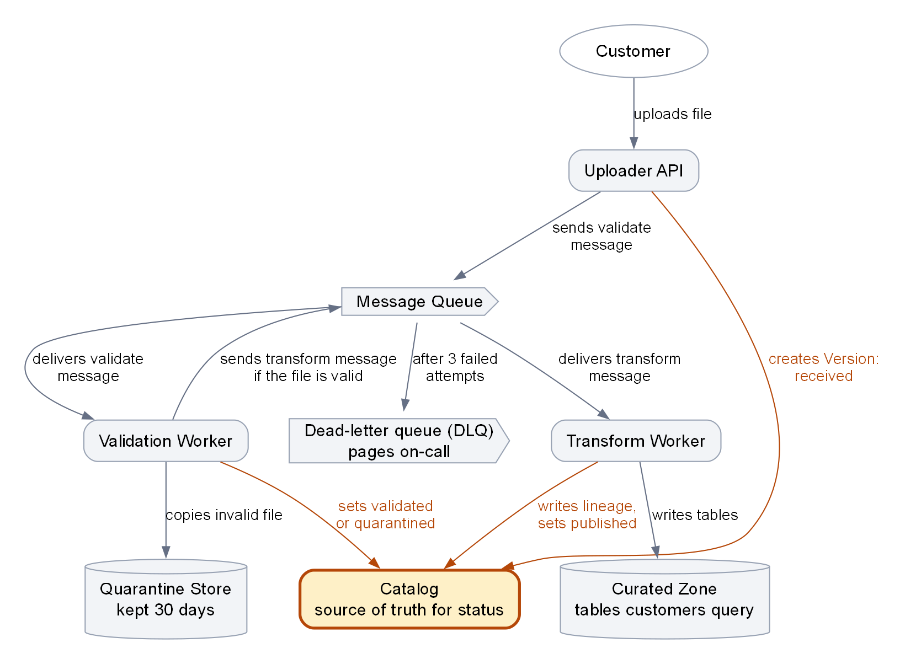
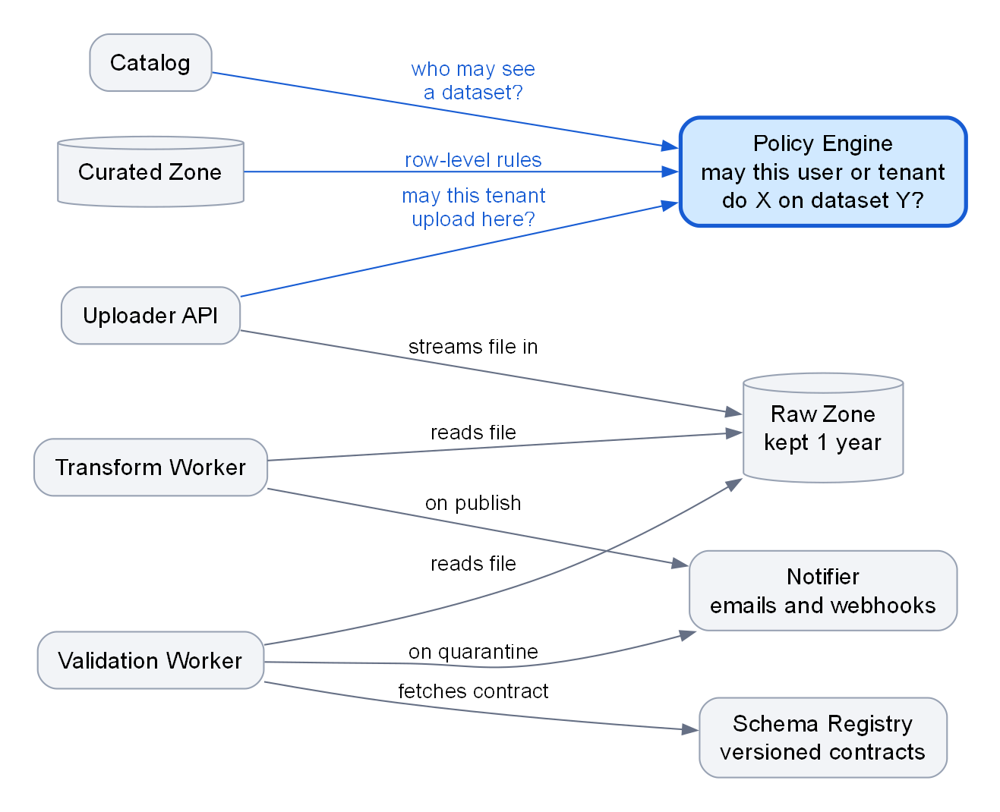

<!-- zone:human -->
# How the ingestion platform works - a first-week explainer for new engineers

*2026-10-17 · GitHub Copilot, from Sam's architecture notes and the week-one checklist · draft for team review · for Priya and later new ingestion engineers*

## 👤 START HERE - at a glance

**Mental model:** every upload becomes an immutable *Version*, background workers advance its status from `received` to `validated` to `published` (or `quarantined`), and the Catalog, not the Message Queue, is the record of that status.



*Figure 1. Arrows run from the component that acts to what it acts on; amber marks the Catalog and the arrows that record a Version's status. Takeaway: validation and transformation are separate queue-driven steps, and each reports to the Catalog. Left out here: Raw Zone, Policy Engine, Schema Registry and Notifier, drawn in Figure 2 in [section 1](#1-six-concepts-and-eleven-components-make-up-the-platform).*

| The 5 things that matter | The trap if you miss it | Where |
|---|---|---|
| Everything is asynchronous; read a Version's status in the Catalog | Waiting on the HTTP call or the Message Queue for the result | [2 Four steps](#2-every-upload-follows-four-steps-and-the-catalog-records-each-one) |
| A Version is one upload and never changes | Trying to "fix" a Version instead of uploading a new one | [1 Vocabulary](#1-six-concepts-and-eleven-components-make-up-the-platform) |
| A failed validation is expected; failed infrastructure is not | Paging people over quarantines, or ignoring the dead-letter queue | [3 Failures](#3-a-bad-file-is-normal-and-a-stuck-message-is-an-alarm) |
| Delivery is at-least-once, so every worker must be idempotent | Duplicate side effects on redelivery and DLQ replay | [3 Failures](#3-a-bad-file-is-normal-and-a-stuck-message-is-an-alarm) |
| Locally the Policy Engine is mocked as allow-all | A change that passes on your machine and is denied for real | [4 Traps](#4-six-traps-catch-most-newcomers) |

**Key facts:** published within 15 min for files up to 1 GB (target) · typical file 50 to 500 MB, hard limit 5 GB · 3 attempts, then the dead-letter queue (DLQ) pages on-call · quarantine kept 30 days, raw uploads 1 year

**Basis:** Sam's architecture notes (true as of October 2026) and the week-one checklist, not yet checked against code or dashboards. Items marked *derived*, *suggested* or *guess* are the writer's own.

**Read next**

- [1 Six concepts and eleven components](#1-six-concepts-and-eleven-components-make-up-the-platform) - the vocabulary every later section uses · 3 min
- [2 Four steps from upload to published table](#2-every-upload-follows-four-steps-and-the-catalog-records-each-one) - what happens in order, and the status after each step · 2 min
- [3 A bad file is normal, a stuck message is an alarm](#3-a-bad-file-is-normal-and-a-stuck-message-is-an-alarm) - failures, retries, the DLQ and who acts · 3 min
- [4 Six traps](#4-six-traps-catch-most-newcomers) - the mistakes newcomers make most · 1 min
- [5 Week one](#5-week-one-means-a-local-stack-two-runbooks-and-a-starter-ticket) - your checklist, mapped to this page · 2 min
- [6 Seven open questions](#6-seven-questions-the-source-notes-leave-open) - gaps in the notes to close early · 2 min

*Only need the big picture? You can stop here. Starting the checklist? Read 1 and 2, then jump to 5. Before the on-call shadow shift? Add 3. Looking up a setting? Go to [B Configuration reference](report.evidence.md#b-configuration-reference).*

## 1 Six concepts and eleven components make up the platform

*Question answered: what do the nouns in every team conversation mean? Later sections use these names without explaining them again.*

The six concepts are the data model:

| Term | What it means |
|---|---|
| **Tenant** | A customer organisation. Everything is scoped to a tenant. |
| **Dataset** | A named collection a tenant owns, with a Schema contract. Example: `acme/orders`. |
| **Version** | One upload of a dataset. Its data never changes: a re-upload creates a new Version and never overwrites. Only its status moves on: `received`, `validated`, `published`, or `quarantined` if the file is bad. |
| **Schema contract** | The agreed column names, types and constraints that validation checks against. Versioned per dataset; only backward-compatible changes are allowed. |
| **Quarantine** | Where a Version goes when validation fails. It stays visible in the Catalog with status `quarantined`. |
| **Lineage record** | Links a published Version to its raw file and to the Schema contract version it was validated with. |

Watch the word "version": a *Version* (capital V) is one upload, while a dataset's *major version* changes only when its schema changes in a breaking way.

The eleven components are the moving parts:

| Component | Role |
|---|---|
| **Uploader API** | The only public entry point; starts every upload |
| **Message Queue** | Carries `validate` and `transform` messages between steps; its dead-letter queue (DLQ) collects messages that keep failing |
| **Validation Worker** | Checks each file against its Schema contract |
| **Transform Worker** | Turns a validated file into published tables |
| **Schema Registry** | Stores each dataset's versioned Schema contracts |
| **Quarantine Store** | Holds files that failed validation, for 30 days |
| **Raw Zone** | Immutable blob storage for every original upload, kept 1 year |
| **Curated Zone** | The lakehouse tables customers query |
| **Catalog** | Metadata store for datasets, Versions, statuses, lineage and owners; the source of truth for status |
| **Policy Engine** | Answers "may this user or tenant do X on dataset Y?" |
| **Notifier** | Sends emails and webhooks |



*Figure 2. Arrows run from the caller to the service it uses; blue marks the Policy Engine. Takeaway: three components call the Policy Engine (the Uploader API, the Catalog and the Curated Zone), and the Raw Zone is shared by the Uploader API and both workers. Every arrow is stated in Sam's notes.*

**Next →** [2 Every upload follows four steps and the Catalog records each one](#2-every-upload-follows-four-steps-and-the-catalog-records-each-one)

## 2 Every upload follows four steps and the Catalog records each one

*Question answered: what happens, in order, between a customer's upload and a published table? Figure 1 above shows the same path as a picture.*

1. **Upload.** Customers upload CSV, Parquet or JSON lines files. The Uploader API authenticates the caller, asks the Policy Engine whether this tenant may upload to this dataset, streams the file into the Raw Zone, creates the Version in the Catalog (status `received`) and puts a `validate` message on the Message Queue. Nobody waits on this call for the result.
2. **Validate.** The Validation Worker takes the `validate` message, reads the file from the Raw Zone, fetches the dataset's Schema contract from the Schema Registry and checks the file against it. If it passes, the status becomes `validated` and a `transform` message goes on the Message Queue. If it fails, the file is quarantined (see [3 Failures](#3-a-bad-file-is-normal-and-a-stuck-message-is-an-alarm)).
3. **Transform.** The Transform Worker takes the `transform` message, reads the validated file from the Raw Zone, converts it to the curated format and writes it to the Curated Zone.
4. **Publish.** The Transform Worker writes the Lineage record to the Catalog, sets the status to `published` and asks the Notifier to email the dataset owner. Customers can now query the tables, and the Policy Engine enforces row-level access.

To find out where an upload is, read its Version's status in the Catalog. If the Catalog and what you see in the Message Queue disagree, trust the Catalog.

**Speed.** The target is publication within 15 minutes for files up to 1 GB. For a 1 GB file, p95 validation takes 40 seconds and p95 transform takes 6 minutes, so the transform is the slow step. Typical files are 50 to 500 MB; the Uploader API enforces a hard limit of 5 GB.

**Next →** [3 A bad file is normal and a stuck message is an alarm](#3-a-bad-file-is-normal-and-a-stuck-message-is-an-alarm)

## 3 A bad file is normal and a stuck message is an alarm

*Question answered: what happens when something goes wrong, and who has to act?*

The platform treats two kinds of failure very differently.

| | A bad file | A failing step |
|---|---|---|
| What it is | The file does not match its Schema contract. This is an expected outcome, not a platform error | Infrastructure trouble, such as blob timeouts or an unavailable Schema Registry |
| What happens | The file is copied to the Quarantine Store (kept 30 days), the Version becomes `quarantined` and the Notifier tells the dataset owner why | The message is retried (3 attempts, delays of 30 s, 2 min and 10 min; the exact count is open, see [6 question 1](#6-seven-questions-the-source-notes-leave-open)), then moves to the DLQ |
| Who acts | The dataset owner uploads a corrected file as a new Version, or asks support to release the file with the runbook `quarantine-release` | The on-call engineer, who is paged as soon as the DLQ holds one message; replay with the runbook `replay-dlq` |

The Message Queue delivers at least once, so the same message can arrive twice and every worker must be idempotent. That is also why replaying the DLQ is safe.

One debugging aid *(derived from the cache settings, not stated in the notes)*: workers cache Catalog reads for 60 seconds and Schema Registry reads for 5 minutes, so a change can take that long to reach them. Retry, timeout and cache settings with their defaults are in [B Configuration reference](report.evidence.md#b-configuration-reference).

**Next →** [4 Six traps catch most newcomers](#4-six-traps-catch-most-newcomers)

## 4 Six traps catch most newcomers

*Question answered: which mistakes do new engineers and support staff make most often?*

| Trap | Do this instead |
|---|---|
| Trusting a green local run: `docker compose up` starts emulators for the Message Queue and blob storage and mocks the Policy Engine as allow-all unless you set `POLICY_MODE=strict` | Always run the e2e smoke test with `POLICY_MODE=strict` before opening a PR |
| "Fixing" a Version | Upload a new Version; Versions are immutable |
| Shipping a breaking schema change as a new Version | Create a new dataset major version; only backward-compatible changes are allowed within one |
| Reading Catalog times as local time | All timestamps are UTC, including in the Catalog UI; support asks about this every week |
| Treating a missing email as a failed upload | The Notifier is fire-and-forget, so a failed email never fails a Version; check the status in the Catalog |
| Mixing up retention | Quarantine Store: 30 days. Raw Zone: 1 year |

**Next →** [5 Week one means a local stack two runbooks and a starter ticket](#5-week-one-means-a-local-stack-two-runbooks-and-a-starter-ticket)

## 5 Week one means a local stack two runbooks and a starter ticket

*Question answered: what do I do on Monday, and which part of this page helps with each step?*

The team checklist has eight items and no prescribed order. Items 1 to 3 build on each other (access, then repos, then the local stack), so start there, and read the runbooks (item 4) before you shadow on-call (item 6); items 6 and 8 depend on the rota and the calendar *(suggested order)*.

| # | Do this | This page helps with |
|---|---|---|
| 1 | Get access: repo permissions, the `ingestion-dev` cloud subscription, the on-call rota (read-only for now), Grafana | Nothing to read first |
| 2 | Clone `ingest-api`, `ingest-workers`, `schema-contracts` and `platform-docs` | [1 Vocabulary](#1-six-concepts-and-eleven-components-make-up-the-platform) for the names; which repo holds which component is open ([6 question 3](#6-seven-questions-the-source-notes-leave-open)) |
| 3 | Run the local stack with `docker compose up`, then the e2e smoke test with `POLICY_MODE=strict` | [4 Traps](#4-six-traps-catch-most-newcomers) explains why strict matters; the smoke-test command is open ([6 question 2](#6-seven-questions-the-source-notes-leave-open)) |
| 4 | Read the runbooks `replay-dlq` and `quarantine-release` | [3 Failures](#3-a-bad-file-is-normal-and-a-stuck-message-is-an-alarm) |
| 5 | Upload a sample file that passes and one that fails validation; watch both in the Catalog UI | [2 Four steps](#2-every-upload-follows-four-steps-and-the-catalog-records-each-one) for the statuses to expect; times are UTC; where to run it is open ([6 question 7](#6-seven-questions-the-source-notes-leave-open)) |
| 6 | Shadow the on-call engineer for one shift | Read [3 Failures](#3-a-bad-file-is-normal-and-a-stuck-message-is-an-alarm) first |
| 7 | Pick up a starter ticket: INGEST-310 (add a column type to the Schema Registry validator) or INGEST-322 (improve the quarantine email wording) | INGEST-310 touches the Schema contract and validation, INGEST-322 the quarantine notification *(derived from the ticket titles)* |
| 8 | Join the weekly ingestion sync (Wednesdays 10:00 CET) and the Friday incident review | Nothing to read first |

Defaults for the settings behind these steps, such as `POLICY_MODE`, are in [B Configuration reference](report.evidence.md#b-configuration-reference).

**Next →** [6 Seven questions the source notes leave open](#6-seven-questions-the-source-notes-leave-open)

## 6 Seven questions the source notes leave open

*Question answered: what can this page not tell you yet? These are gaps in the source notes, not errors. Ask Sam or the team, then fold each answer into the section it affects.*

1. **How many attempts does a message get?** The notes say "3 failed attempts" and "retried 3 times", and they also list three delays (30 s, 2 min, 10 min). If the third failure goes straight to the DLQ, the 10 min delay is never used and about 2.5 minutes of waiting pass before on-call is paged; if "3" means retries after a first attempt, it is about 12.5 minutes *(derived)*. Why it matters: when on-call is paged, and the 15-minute publish target.
2. **How do I run the smoke test in strict mode?** The notes give no command and no repo. They also pull in two directions: the configuration default for `POLICY_MODE` is `strict`, yet the local stack mocks allow-all unless you set `strict`. Setting it explicitly is safe either way. Why it matters: you must run it before every PR.
3. **Which repo owns which component?** The checklist names four repos and the notes name eleven components, with no mapping. By name, `ingest-api` is probably the Uploader API and `ingest-workers` both workers *(guess)*. INGEST-310 also mentions a "Schema Registry validator" that the notes never describe. Why it matters: it tells you what you can change and what you depend on.
4. **What status does a Version show while its message is in the DLQ?** Only `received`, `validated`, `quarantined` and `published` are listed; probably the last one it reached *(guess)*. Why it matters: on-call triage relies on the Catalog being the truth.
5. **What does the Uploader API return, and who receives webhooks?** The notes say nobody waits on the HTTP call for the result, but not what the call does return. Only owner emails are described; webhook recipients are not. Why it matters: it is the customer-facing contract if you work on the Uploader API.
6. **Can a 5 GB file finish before the transform timeout?** Transform p95 is 6 minutes per GB and the per-message timeout is 30 minutes, so a 5 GB file would land right at the limit if time scales linearly *(derived)*. The notes do not say what a timeout does. Why it matters: large files may be the ones that end in the DLQ.
7. **Where are the sample files, and where is the Catalog UI?** Checklist item 5 needs both, but the notes do not say where the files live or whether the exercise runs on the local stack or in `ingestion-dev`. Why it matters: it is your first hands-on look at the statuses.

**Next →** reference tables: [B Configuration reference](report.evidence.md#b-configuration-reference) when you need a setting, [C Diagram sources and edge lists](#c-diagram-sources-and-edge-lists) to check a diagram.

---

<!-- zone:ai-input -->
## 🗄️ Machine and archive zone - skip unless you need a lookup table or are an agent updating this page

*Block A is for an agent that edits this page; blocks B and C hold the full configuration table and the diagram sources behind sections 3 and 5 and both figures.*

### A Maintenance notes for the next editor

*🤖 AI input - what an agent needs to update this page without breaking it. Paths are relative to the folder that holds `report.md`.*

<details>
<summary>Sources, places where facts repeat, regeneration commands, definition of done</summary>

**Built from.** Two source notes: `architecture-notes.md` ("Ingestion platform - brain dump (Sam, unedited)", true as of October 2026) and `onboarding-checklist.md` ("Week-one checklist for new ingestion engineers"). Both were supplied with the request; where they are stored is not recorded here. Nothing was checked against code, repositories or dashboards.

**Facts that appear in more than one place.** When one changes, update every place:

- Retry policy (3 attempts, delays 30 s / 2 min / 10 min, DLQ alert at 1): panel key facts, section 3 (failure table and idempotency paragraph), section 6 question 1, block B.
- Retention (Quarantine Store 30 days, Raw Zone 1 year): panel key facts, section 1 component table, section 3 failure table, section 4 last row, Figure 1 and Figure 2 node labels, block B.
- Speed and size numbers (15 min target, p95s, file sizes, timeouts): panel key facts, section 2, section 6 questions 1 and 6, block B.
- `POLICY_MODE` advice: panel table row 5, section 4 row 1, section 5 item 3, section 6 question 2, block B.
- Status names and their order: panel mental model, section 1 Version row, section 2, section 6 question 4, Figure 1 (`report.assets/journey.dot`).

**Rules.**

- Keep component and concept names exactly as written in section 1; do not introduce synonyms.
- Mark anything the source notes do not state as *derived*, *suggested* or *guess*.
- When a section 6 question is answered, fold the answer into the section it affects, delete the row and renumber the references to it.
- Keep the panel table at 5 rows and the panel prose near 300 words.

**Regenerate the diagrams** (Graphviz required; run in the folder that holds `report.md`), then open both PNGs and confirm they stay readable at 800 px wide and are under 2600 px wide:

```powershell
dot -Tpng -Gdpi=150 report.assets/journey.dot -o report.assets/journey.png
dot -Tpng -Gdpi=150 report.assets/shared-services.dot -o report.assets/shared-services.png
```

**Definition of done for an edit.** Run `python scripts/check_doc.py` from the `document-formatting` skill directory on `report.md` and on `report.evidence.md` (pass each file's path). No Blocker may remain and at most two Majors, each named with a reason.

</details>

<!-- zone:archive -->
### B Configuration reference

*🗄️ Archive - the 20 settings the notes' author always has to look up, copied unchanged; supports [3 Failures](#3-a-bad-file-is-normal-and-a-stuck-message-is-an-alarm) and [5 Week one](#5-week-one-means-a-local-stack-two-runbooks-and-a-starter-ticket).*

Full table: [report.evidence.md](report.evidence.md#b-configuration-reference) - setting, default and note for all 20 settings.

### C Diagram sources and edge lists

*🗄️ Archive - how the two diagrams were built, so they can be regenerated or checked; supports Figure 1 in the panel and Figure 2 in [1 Vocabulary](#1-six-concepts-and-eleven-components-make-up-the-platform).*

Sources: [journey.dot](report.assets/journey.dot) (Figure 1) and [shared-services.dot](report.assets/shared-services.dot) (Figure 2).

Full edge lists: [report.evidence.md](report.evidence.md#c-diagram-edge-lists) - 20 arrows, each with its basis in the notes.
