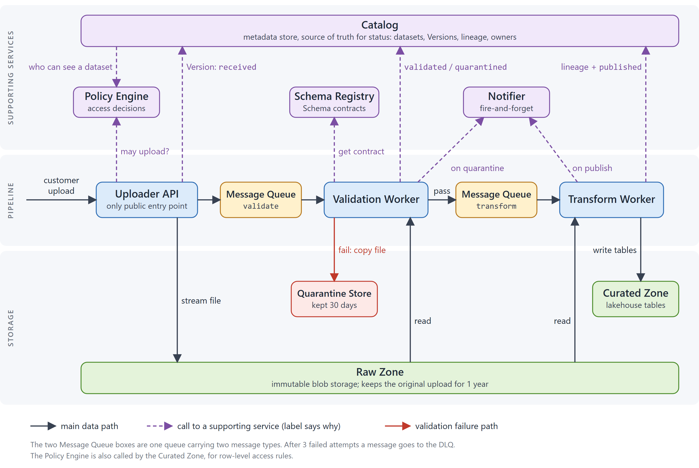
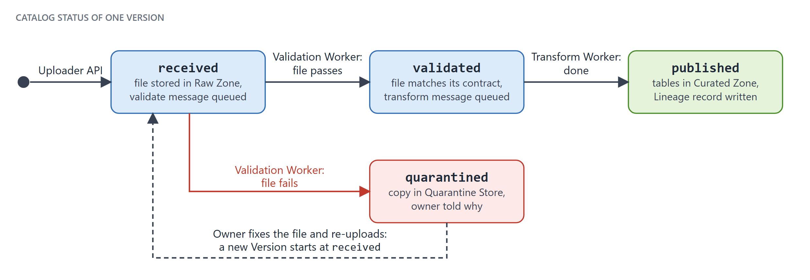

# Ingestion platform: how it works

A guide for engineers joining the ingestion team. Read the first three sections on your first day (about 15 minutes) and keep the rest as a reference. The week-one plan is in [Your first week](#your-first-week).

- **Audience:** engineers new to the ingestion platform. It assumes you already know message queues, idempotency and blob storage, and explains *our* platform rather than the basics.
- **Scope:** the path from upload to publish. How customers query the Curated Zone, and how the team builds and deploys, are not covered.
- **Based on:** Sam's architecture notes and the team's week-one checklist. Accurate as of October 2026.
- **Markers:** **Assumption** marks a gap in the source notes that this guide fills with a best guess. **Check** marks something in the notes that looks inconsistent and should be confirmed. All open items are collected in [Assumptions and open questions](#assumptions-and-open-questions).

**Contents**

- [The short version](#the-short-version)
- [Vocabulary](#vocabulary)
- [How a file moves through the platform](#how-a-file-moves-through-the-platform)
- [The components](#the-components)
- [When things go wrong](#when-things-go-wrong)
- [Running it locally](#running-it-locally)
- [Gotchas](#gotchas)
- [Your first week](#your-first-week)
- [Reference: settings](#reference-settings)
- [Assumptions and open questions](#assumptions-and-open-questions)

## The short version

Customers upload files (CSV, Parquet or JSON Lines). The platform validates each file against an agreed schema, transforms it, and publishes it as a table that customers can query. Files can be up to 5 GB, and the target is to publish within 15 minutes for files up to 1 GB. The whole thing is asynchronous: nobody waits on an HTTP call for the result.

A file passes through three stages joined by a message queue: **Upload → Validate → Transform and publish**. The outcome shows up as a status on the Version in the Catalog and as an email to the dataset owner.

Five rules explain most of the design. Learn these first:

1. **The Catalog is the source of truth for status, not the queue.** If the two disagree, trust the Catalog.
2. **Delivery is at-least-once, so every worker must be idempotent.** The same message can arrive twice, and the second run must do no harm. This is also why replaying the dead-letter queue (DLQ) is safe.
3. **A Version is immutable.** A Version is one upload. Re-uploading creates a new Version; nothing is overwritten or "fixed" in place.
4. **A validation failure is an expected outcome, not a platform error.** The file is quarantined and the owner is told why. Only infrastructure failures are retried and then sent to the DLQ, which pages on-call.
5. **Everything is scoped to a tenant** (a customer organisation), and the Policy Engine decides who may do what.

## Vocabulary

These six concepts come up everywhere, so it is worth getting them exactly right.

| Term | Meaning | Notes |
|---|---|---|
| **Tenant** | A customer organisation. | Everything in the platform is scoped to a tenant. |
| **Dataset** | A named collection that a tenant owns, with a Schema contract. | Example: `acme/orders`. |
| **Version** | One upload of a dataset. Immutable. | Re-uploading creates a new Version and never overwrites. The file never changes, but its Catalog status does as it moves through the pipeline. |
| **Schema contract** | The agreed column names, types and constraints for a dataset. Validation checks every upload against it. | Stored per dataset, versioned, in the Schema Registry. Only backward-compatible changes are allowed. |
| **Quarantine** | Where a Version goes when validation fails. | The Version stays visible in the Catalog with status `quarantined`; the file is copied to the Quarantine Store. |
| **Lineage record** | Links a published Version to its raw file and to the Schema contract version it was validated with. | Written to the Catalog by the Transform Worker when it publishes. |

> **"Version" means three different things.**
>
> - A **Version** (capital V) is one upload of a dataset.
> - A **Schema contract version** is one revision of a dataset's contract in the Schema Registry.
> - A **dataset major version** is what a *breaking* schema change creates. It is not a new Version.
>
> Say which one you mean in tickets, PRs and conversations with Support.

## How a file moves through the platform

Figure 1 is the map. Follow the middle band from left to right; the three stages below walk through the same path in words.



*Figure 1. The platform at a glance. Solid arrows carry the file. Dashed purple arrows are calls to supporting services (the label says why). Red is the validation-failure path.*

### Stage 1: Upload

The Uploader API is the only public entry point. For each upload it:

1. authenticates the caller;
2. asks the Policy Engine whether this tenant may upload to this dataset;
3. streams the file into the Raw Zone (blob storage), in 16 MB chunks by default;
4. creates a Version record in the Catalog with status `received`;
5. puts a `validate` message on the Message Queue.

Uploads are capped at 5 GB (`MAX_UPLOAD_MB`, 5120). The caller does not wait for the result: everything after step 5 happens in the background.

### Stage 2: Validate

The Validation Worker takes the `validate` message, reads the file from the Raw Zone, fetches the dataset's Schema contract from the Schema Registry and checks the file against it, in batches of 50,000 rows by default. Then:

- **The file passes:** the Catalog status becomes `validated` and a `transform` message goes on the queue.
- **The file fails:** the file is copied to the Quarantine Store, the Catalog status becomes `quarantined`, and the Notifier tells the dataset owner why. The Version goes no further.

### Stage 3: Transform and publish

The Transform Worker takes the `transform` message and then:

1. reads the validated file from the Raw Zone;
2. converts it to the curated format and writes it to the Curated Zone (lakehouse tables);
3. writes a Lineage record to the Catalog;
4. sets the Catalog status to `published`;
5. asks the Notifier to email the owner.

Customers can now query the table. Row-level access is enforced by the Policy Engine.

### Version status lifecycle



*Figure 2. The Catalog status of one Version. Open this figure side by side with the Catalog UI when you upload your first sample files.*

| Status | Set by | What is true | If a Version sits here too long |
|---|---|---|---|
| `received` | Uploader API | The file is in the Raw Zone and a `validate` message has been queued. | The `validate` message is waiting, being retried or in the DLQ. |
| `validated` | Validation Worker | The file passed its Schema contract and a `transform` message has been queued. | The `transform` message is waiting, being retried or in the DLQ. |
| `quarantined` | Validation Worker | The file failed validation, a copy is in the Quarantine Store and the owner has been notified. | Nothing is stuck. It is waiting for the owner to re-upload or for Support to release it. |
| `published` | Transform Worker | The tables are in the Curated Zone, the Lineage record is written and the owner has been emailed. | Nothing. This is the end of the road. |

> **Assumption:** the notes mention only these four statuses and no "failed" status. The last column assumes that a Version whose message is being retried, or has been dead-lettered, simply keeps its last status. Confirm this when you shadow on-call.

### How long it should take

| Measure | Value |
|---|---|
| Typical file | 50 to 500 MB |
| Largest file accepted | 5 GB |
| Validation, p95 | 40 seconds for a 1 GB file |
| Transform, p95 | 6 minutes for a 1 GB file |
| **Target** | **Published within 15 minutes, for files up to 1 GB** |

The notes set no target for files above 1 GB.

## The components

Quick reference for who is who. The previous section shows the order of events; this one shows responsibilities.

| Component | What it does | Who talks to it |
|---|---|---|
| **Uploader API** | The only public entry point. Authenticates the caller, checks upload rights, streams the file into the Raw Zone, creates the Version and queues `validate`. | Called by customers. Calls the Policy Engine, Raw Zone, Catalog and Message Queue. |
| **Message Queue** | Carries `validate` and `transform` messages. Delivery is at-least-once. After 3 failed attempts a message goes to the DLQ, which pages on-call. | The Uploader API publishes `validate`; the Validation Worker publishes `transform`; the two workers consume. |
| **Validation Worker** | Checks a file against its Schema contract, then hands it on or quarantines it. | Consumes `validate`. Reads the Raw Zone and Schema Registry. Writes the Catalog, Quarantine Store and queue. Calls the Notifier. |
| **Schema Registry** | Stores each dataset's Schema contract, versioned. Only backward-compatible changes are allowed; a breaking change means a new dataset major version. | Read by the Validation Worker. |
| **Transform Worker** | Converts a validated file to the curated format, writes it to the Curated Zone, records lineage and publishes. | Consumes `transform`. Reads the Raw Zone. Writes the Curated Zone and Catalog. Calls the Notifier. |
| **Raw Zone** | Immutable blob storage. Keeps the original upload for 1 year. | Written by the Uploader API; read by both workers. |
| **Quarantine Store** | Holds files that failed validation, for 30 days. | Written by the Validation Worker. |
| **Curated Zone** | The lakehouse tables that customers query. Row-level access is enforced by the Policy Engine. | Written by the Transform Worker; queried by customers. |
| **Catalog** | Metadata store: datasets, Versions, statuses, lineage and owners. **The source of truth for status.** | Written by the Uploader API and both workers. Asks the Policy Engine who can see a dataset. |
| **Policy Engine** | Answers "may this user or tenant do X on dataset Y?" | Called by the Uploader API (upload rights), the Catalog (who can see a dataset) and the Curated Zone (row-level rules). |
| **Notifier** | Sends emails and webhooks. Fire-and-forget: a failed email never fails a Version. | Called by the Validation Worker (on quarantine) and the Transform Worker (on publish). |

## When things go wrong

There are two very different kinds of failure. Do not mix them up.

| | Validation failure | Infrastructure failure |
|---|---|---|
| **Example** | The file does not match its Schema contract. | Blob storage times out, or the Schema Registry is unavailable. |
| **Is it a platform error?** | No. It is an expected outcome. | Yes. |
| **What happens** | The file is copied to the Quarantine Store, the Version becomes `quarantined` and the Notifier tells the owner why. | The message is retried with backoff. After the last attempt it goes to the DLQ. |
| **Who finds out** | The dataset owner. | The on-call engineer, who is paged when the DLQ holds at least one message. |
| **How it is resolved** | The owner fixes the file and re-uploads (a new Version), or asks Support to release it using the `quarantine-release` runbook. | Replay the DLQ with the `replay-dlq` runbook. It is safe to run because workers are idempotent. |

**Retries.** A failed message is retried with backoff delays of 30 seconds, 2 minutes and 10 minutes (`QUEUE_BACKOFF_S`), up to `QUEUE_MAX_ATTEMPTS` = 3, and then goes to the DLQ.

> **Check:** the notes say both "3 attempts" and "retried 3 times", and they list three delays. Three attempts have only two gaps between them, so it is unclear whether the first delivery counts towards the three. Confirm in the queue configuration before you quote a time-to-DLQ to anyone.

**Other things worth knowing:**

- **Replaying does not fix the cause.** If whatever made the messages fail is still broken, they will fail again.
- **A failed email never fails a Version.** The Notifier is fire-and-forget (it retries twice, then gives up). "The owner never got the email" is not evidence that a Version failed; look at the Catalog.
- **When you change worker code**, keep it idempotent. Assume any message can be delivered twice.
- **When the Catalog and the queue disagree, trust the Catalog.**

### If a Version looks stuck

1. Find the Version in the Catalog and read its status. Remember that timestamps are UTC.
2. Use the status table above to work out which message should be in flight: `validate` for `received`, `transform` for `validated`. `quarantined` and `published` need no message in flight.
3. Look for that message: still waiting, being retried or in the DLQ. A message in the DLQ has already paged on-call.
4. For a file of up to 1 GB, "too long" means well past the 15-minute target.

> **Assumption:** this procedure is derived from the flow described in the notes rather than taken from a team runbook. Prefer the runbooks where they cover your case.

## Running it locally

```bash
docker compose up
```

- This starts emulators for the queue and for blob storage.
- The Policy Engine is mocked as **allow-all** unless you set `POLICY_MODE=strict`. Allow-all hides permission problems.
- **Always run the e2e smoke test with `POLICY_MODE=strict` before you open a PR.** The notes do not include the smoke-test command; ask the team or look in the repo you are working in.

> **Check:** the settings reference lists `strict` as the default and says `allow-all` is for local development only, yet the local stack is described as allow-all unless you opt in. This guide assumes the local compose setup overrides the default to `allow-all`. It is also unclear whether `POLICY_MODE` has to be set for the stack, for the test run or for both; if in doubt, set it for both.

The notes mention emulators only for the queue and blob storage. How the Catalog, Schema Registry and Notifier are provided locally is not covered (see [open questions](#assumptions-and-open-questions)).

## Gotchas

1. **You cannot "fix" a Version.** People will ask. A Version is immutable, so the answer is always: upload a new one.
2. **A breaking schema change is not a new Version.** It needs a new dataset major version. Only backward-compatible changes are allowed on an existing Schema contract.
3. **All timestamps are UTC, including in the Catalog UI.** Support gets confused about this every week. Convert before you quote a time to anyone.
4. **Local runs are allow-all by default.** Always run the e2e smoke test with `POLICY_MODE=strict` before opening a PR.
5. **A failed email never fails a Version.** The Notifier is fire-and-forget.
6. **Quarantine keeps files for 30 days; the Raw Zone keeps originals for 1 year.** People mix these up. A quarantined file is a copy; the original upload stays in the Raw Zone for its own retention period.

## Your first week

### By Friday you should be able to

- Redraw Figure 1 from memory and say what each Catalog status means.
- Tell a validation failure from an infrastructure failure, and say which runbook goes with each.
- Run the local stack and the e2e smoke test with `POLICY_MODE=strict`.
- Have picked up a starter ticket.

### Checklist

- [ ] **Get access.** Repo permissions, the `ingestion-dev` cloud subscription, the on-call rota (read-only for now) and Grafana. Do this first; most of the rest depends on it.
- [ ] **Clone the repos.** `ingest-api`, `ingest-workers`, `schema-contracts` and `platform-docs`. See [Repos](#repos).
- [ ] **Run the local stack.** `docker compose up`, then the e2e smoke test with `POLICY_MODE=strict`. See [Running it locally](#running-it-locally).
- [ ] **Read the runbooks.** `replay-dlq` and `quarantine-release`. They are the two resolutions in [When things go wrong](#when-things-go-wrong).
- [ ] **Upload two sample files.** One that passes validation and one that fails. Watch both in the Catalog UI. Expect `received` → `validated` → `published` for the first and `received` → `quarantined` for the second (Figure 2).
- [ ] **Shadow the on-call engineer for one shift.** DLQ messages page on-call, so a shift shows you what real failures look like.
- [ ] **Pick up a starter ticket.** INGEST-310 or INGEST-322. See [Starter tickets](#starter-tickets).
- [ ] **Join the meetings.** The weekly ingestion sync (Wednesdays 10:00 CET) and the Friday incident review. The notes give no time for the incident review, and "CET" could mean local Central European time or a fixed UTC+1 (they differ in summer), so check the calendar invites.

> **Assumption:** the notes fix only the two meetings. A reasonable pace, offered as a suggestion: access and repos on Monday; local stack and sample uploads on Tuesday and Wednesday; runbooks and on-call shadowing on Thursday; starter ticket under way by Friday. Reshuffle as access arrives.

### Repos

| Repo | Probably contains |
|---|---|
| `ingest-api` | The Uploader API |
| `ingest-workers` | The Validation Worker and Transform Worker |
| `schema-contracts` | The Schema contract definitions |
| `platform-docs` | Platform documentation, possibly the runbooks |

> **Assumption:** the notes name the four repos but not what is in them. The right-hand column is inferred from the names. Confirm on day one, including where the Catalog, Policy Engine and Notifier live and which of them this team owns.

### Starter tickets

- **INGEST-310:** add a column type to the Schema Registry validator. Read first: [Vocabulary](#vocabulary) (Schema contract), [Stage 2: Validate](#stage-2-validate) and [Gotcha 2](#gotchas).
- **INGEST-322:** improve the quarantine email wording. Read first: [Stage 2: Validate](#stage-2-validate) (the failure branch) and [Gotcha 5](#gotchas).

## Reference: settings

Defaults as of October 2026. Names, defaults and descriptions come from Sam's notes; the grouping and the unit conversions in brackets are added. The notes do not say where settings are defined (environment variables or config files per service).

| Area | Setting | Default | What it controls |
|---|---|---|---|
| **Upload** | `MAX_UPLOAD_MB` | 5120 | Uploader API hard limit (5 GB). |
| | `UPLOAD_CHUNK_MB` | 16 | Streaming chunk size. |
| **Validation** | `VALIDATION_BATCH_ROWS` | 50000 | Rows per validation batch. |
| | `VALIDATION_TIMEOUT_S` | 600 | Timeout per message (10 min). |
| | `MAX_ROW_BYTES` | 1048576 | Longer rows are rejected (1 MiB). |
| | `SCHEMA_CACHE_TTL_S` | 300 | Schema Registry reads are cached (5 min). |
| **Transform** | `TRANSFORM_TIMEOUT_S` | 1800 | Timeout per message (30 min). |
| | `PARQUET_ROW_GROUP_MB` | 128 | Transform output. |
| | `CURATED_PARTITION_BY` | `upload_date` | Default partitioning of curated tables. |
| **Queue and workers** | `QUEUE_MAX_ATTEMPTS` | 3 | Attempts before the message goes to the DLQ. |
| | `QUEUE_BACKOFF_S` | 30,120,600 | Retry delays (30 s, 2 min, 10 min). |
| | `DLQ_ALERT_THRESHOLD` | 1 | Page on-call when the DLQ depth is at least this. |
| | `WORKER_CONCURRENCY` | 4 | Messages per worker. |
| **Retention** | `QUARANTINE_RETENTION_DAYS` | 30 | How long the Quarantine Store keeps files. |
| | `RAW_RETENTION_DAYS` | 365 | How long the Raw Zone keeps originals. |
| **Policy, Catalog, Notifier, logging** | `POLICY_MODE` | `strict` | `allow-all` only in local dev. See the **Check** in [Running it locally](#running-it-locally). |
| | `POLICY_CACHE_TTL_S` | 30 | Policy decision cache. |
| | `CATALOG_CACHE_TTL_S` | 60 | Catalog reads are cached in workers. |
| | `NOTIFIER_RETRY` | 2 | Fire-and-forget retries. |
| | `LOG_LEVEL` | `info` | Log verbosity. |

Three of these are cache lifetimes (`POLICY_CACHE_TTL_S`, `CATALOG_CACHE_TTL_S`, `SCHEMA_CACHE_TTL_S`). **Assumption:** a change to a permission, a status or a Schema contract can take up to that long to be seen by whoever caches it, so if something you just changed does not seem to apply, wait out the TTL before suspecting a bug. The notes say what is cached but not, for every setting, who caches it.

## Assumptions and open questions

The source notes are one engineer's working notes, so a few things are missing or inconsistent. When an item is resolved, fold the answer into the relevant section above and delete it from this list.

**Confirm first (the notes conflict or the numbers look risky)**

1. **How many times is a message tried?** "3 attempts", "retried 3 times" and three backoff delays do not line up. See [When things go wrong](#when-things-go-wrong).
2. **What does `POLICY_MODE` default to locally?** `strict` in the settings table, but allow-all in the local stack. See [Running it locally](#running-it-locally).
3. **Can a 5 GB file be transformed within the timeout?** The transform p95 is 6 minutes per GB, so a 5 GB file would take about 30 minutes at that rate, which equals `TRANSFORM_TIMEOUT_S` (1,800 seconds). The notes do not say whether transform time scales linearly or whether files near the limit are known to time out.

**Assumptions made in this guide**

4. **Repo contents.** Inferred from the repo names. See [Repos](#repos).
5. **Status when a message is stuck.** A Version keeps its last status while its message is being retried or sits in the DLQ. See [Version status lifecycle](#version-status-lifecycle).
6. **Week-one pacing.** Only the two meetings have fixed days. See [Your first week](#your-first-week).

**Not covered by the notes (ask the team)**

7. Which components this team owns and which are shared services, where each one's code and deployment live, and where the runbooks are kept.
8. How the Catalog, Schema Registry and Notifier run in the local stack; whether "the Catalog UI" in the checklist means the local one or the dev environment's; and where the sample files (one passing, one failing) and the dataset to upload them to come from.
9. What happens if the Uploader API creates the Version but fails before queuing `validate`. By the Catalog-is-truth rule the symptom would presumably be a Version stuck in `received`.
10. How a new dataset major version is created and named in practice.
11. The delivery process: deployment, CI, code review conventions and environments beyond `ingestion-dev`.

---

*The figures are generated by `diagrams/build_diagrams.py` (SVG and PNG). Edit the script and re-run it rather than editing the images. The guide embeds the PNGs because they render in every wiki engine.*
