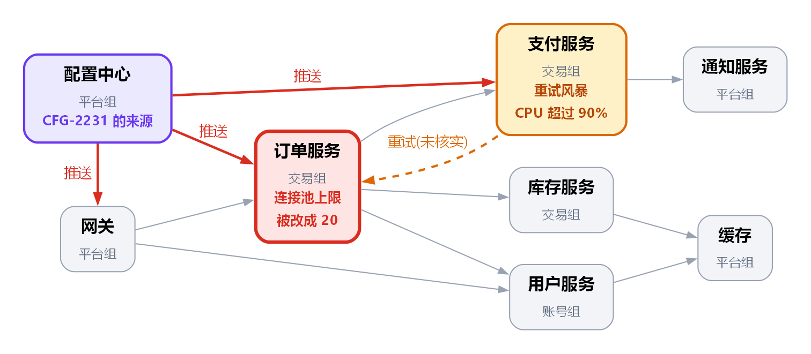

<!-- zone:human -->
# 10 月 9 日订单故障复盘：误改的连接池配置被全量推送，订单提交与支付故障 105 分钟

*2026-10-17 · 起草：AI 助手（依据李娜整理的时间线、服务清单和故障群聊记录）· 草稿，第 5 节所列待当事人核对 · 面向全体研发团队，决策人：技术负责人张伟*

## 👤 从这里开始 - 一眼看懂

> ### 🟡 故障已恢复，但让它发生的缺口还没补上
>
> **结论：** CFG-2231 本想只改测试环境，却把订单服务连接池上限的全局默认值从 200 改成 20，14:02 无灰度全量推送：订单提交和支付故障 105 分钟，约 3,800 笔订单失败、1,200 位用户受影响（详见第 [1](#1-配置推送先卡住订单服务再拖垮支付服务)、[2](#2-根因是误改的配置畅通无阻地到了生产) 节）。
>
> **置信度：** 根因高（回滚后线程释放、延迟恢复）；改进排序中（收益是推断）；4 处数字待核对，见[第 5 节](#5-四处资料对不上-两件事资料里没有)。

> ### 🧭 需要决定
>
> - **张伟** 在**下个迭代排期前**决定**先做哪些改进项**：6 项估时相加 17 人天，迭代约 10 人天。建议先做 A4 手册、A6 评审、A3 告警、A1 校验、A5 退避（共 9 人天），A2 灰度推送（8 人天）后排，详见[第 4 节](#4-建议先做-a4-a6-a3-a1-a5-共-9-人天-a2-灰度推送后排)。
>
> 如果选错：A2 推迟期间，误改仍会一次推到全部实例，只能靠合并前拦截和更快定位兜底。

| | 风险（按再次发生时的影响排序） | 后果 | 处理见 |
|---|---|---|---|
| 🔴 | 配置仍可一次推到全部实例：无校验、无灰度、无环境隔离 | 重演这次的 105 分钟故障 | [第 4 节](#4-建议先做-a4-a6-a3-a1-a5-共-9-人天-a2-灰度推送后排) |
| 🟠 | A1 校验若不按环境设范围，拦不住这次的 20（推断） | 做了 A1 仍会重演 | [第 2 节](#2-根因是误改的配置畅通无阻地到了生产) |
| 🟠 | 订单一慢，支付服务的无退避重试会把自己打满 | 二次故障，支付一并受影响 | [第 4 节](#4-建议先做-a4-a6-a3-a1-a5-共-9-人天-a2-灰度推送后排) |
| 🟡 | 值班手册没有“先查配置变更” | 同类故障定位仍可能拖 38 分钟 | [第 3 节](#3-105-分钟里有-38-分钟花在定位上) |
| 🟡 | 告警阈值 5 秒偏松 | 发现晚几分钟 | [第 5 节](#5-四处资料对不上-两件事资料里没有) |



*怎么看：灰色箭头是调用，红色箭头是 14:02 的配置推送，橙色虚线是群聊所说的重试（服务清单里没有，未核实）。要点：一次推送同时到了三个服务，没有“先试一小部分”的环节。*

**接着读**

- [1 经过与影响](#1-配置推送先卡住订单服务再拖垮支付服务) - 出了什么事、影响了谁 · 2 分钟
- [2 根因](#2-根因是误改的配置畅通无阻地到了生产) - 七个没拦住的环节 · 3 分钟
- [3 耗时](#3-105-分钟里有-38-分钟花在定位上) - 105 分钟花在哪 · 3 分钟
- [4 改进排序](#4-建议先做-a4-a6-a3-a1-a5-共-9-人天-a2-灰度推送后排) - 张伟的决策依据和备选 · 4 分钟
- [5 待核对](#5-四处资料对不上-两件事资料里没有) - 对不上的数字、请谁核对 · 2 分钟
- [B 群聊原文](#b-群聊原文) - 存档，核对原话时看

*只做决定？读到第 4 节。要核对数字，读第 5 节和 B。*

## 1 配置推送先卡住订单服务再拖垮支付服务

*这一节回答：出了什么事，影响了谁。*

*约定：没有标注的内容来自时间线或群聊原文；“（推断）”是本报告的判断；时长由两份资料里的时间点相减得出；时间均为北京时间。*

故障沿着下面这条链传下去，推送的路径见上图的红色箭头：

1. 13:58，配置变更 CFG-2231 合并：本想只改测试环境，实际把订单服务连接池上限的全局默认值从 200 改成了 20。
2. 14:02，配置中心把它一次性推给网关、订单服务和支付服务，没有灰度。
3. 订单服务最多只能同时占用 20 个连接，线程排队等连接：P99 延迟 14:05 超过 3 秒，14:52 的线程栈显示大部分线程都在等连接池。
4. 支付服务因订单服务超时而不断重试，没有退避，CPU 14:22 已到 90%；网关 5xx 上升，主要是订单接口（14:24）。
5. 用户看到“下单一直转圈”，客服从 14:11 起收到投诉。

**影响**（来源：时间线）

- 约 3,800 笔订单失败，约 1,200 位用户受影响；受影响的是订单提交和支付。
- 当月可用性从 99.97% 降到 99.93%，低于 99.95% 的 SLO。
- 支付服务 CPU 被推到 90% 以上；持续多久，时间线和群聊说法不一，见[第 5 节](#5-四处资料对不上-两件事资料里没有)。

推送来自平台组的配置中心，受影响的主要是交易组的订单和支付服务；A1、A2 要改的正是配置中心。

**几个会反复出现的词**

| 词 | 意思 |
|---|---|
| 连接池上限 | 订单服务同时能占用的连接数上限；降到 20 后，超出的请求只能排队 |
| 全量推送 / 灰度推送 | 一次推给全部实例 / 先推一小部分、观察后再扩大；14:02 是前者 |
| 重试风暴 | 调用方对失败请求不停重试，反而加重对方压力；指数退避（越重试等得越久）和熔断（暂停调用）能抑制它 |
| A1–A6 | 时间线里的六项改进项，见[第 4 节](#4-建议先做-a4-a6-a3-a1-a5-共-9-人天-a2-灰度推送后排) |

**下一节 →** [2 根因是误改的配置畅通无阻地到了生产](#2-根因是误改的配置畅通无阻地到了生产)

## 2 根因是误改的配置畅通无阻地到了生产

*这一节回答：为什么一次误改能一路走到生产，还放大成 105 分钟的故障。*

**根因：** CFG-2231 把订单服务连接池上限的全局默认值从 200 误改成 20（时间线；14:58 赵敏在群里找到）。置信度高：线程栈显示线程都在等连接池，配置值是 20，回滚后线程释放、延迟恢复。

误改只是起点。下面七个环节里只要有一个守住，就不会有 105 分钟。按变更走向生产的顺序：

| # | 环节 | 缺口 | 依据 | 对应改进项 |
|---|---|---|---|---|
| 1 | 合并 | 没有强制双人评审 | 推断：A6 写的是“必须”，资料没说这次有没有人评审 | A6 |
| 2 | 配置中心 | 没有取值范围校验 | 时间线 | A1 |
| 3 | 配置中心 | 默认值不分环境，测试环境的改动落到了全局 | 群聊 15:03 李娜 | 无 |
| 4 | 推送 | 一次性全量，没有灰度 | 时间线 | A2 |
| 5 | 发现 | 延迟告警阈值 5 秒过松 | 时间线 | A3 |
| 6 | 定位 | 值班手册没有“先查最近的配置变更” | 时间线 | A4 |
| 7 | 放大 | 支付服务对订单服务的重试没有退避 | 时间线；群聊 14:22 | A5 |

**环节 3 是 A1–A6 漏掉的缺口。** 15:01 周杰说“这是我们测试环境的改动，怎么推到生产了”，15:03 李娜答“配置中心没有区分环境的默认值，也没有范围校验”。这一条没有对应的改进项，还决定 A1 管不管用（推断）：测试环境本来就想用 20，范围校验若只有一套全局范围，要么放过生产里的 20，要么把测试环境的合法取值一起拦掉；范围按环境设置才拦得住。配置中心要先能区分环境，A1 的 3 人天是否包含这部分，请周杰确认。

**下一节 →** [3 105 分钟里有 38 分钟花在定位上](#3-105-分钟里有-38-分钟花在定位上)

## 3 105 分钟里有 38 分钟花在定位上

*这一节回答：时间花在了哪里，哪项改进能缩短它。*

把 105 分钟按时间线和群聊里的时间点切成六段：

| 阶段 | 时间 | 用时 | 发生了什么 | 对应改进项 |
|---|---|---|---|---|
| 无人察觉 | 14:02–14:09 | 7 分钟 | 推送后 3 分钟 P99 就超过 3 秒；告警阈值 5 秒，14:09 才触发 | A3 |
| 告警到拉群 | 14:09–14:20 | 11 分钟 | 王磊 14:12 开始看，14:15 发现 CPU、内存都正常，14:20 拉起故障群 | 无 |
| 定位 | 14:20–14:58 | 38 分钟 | 先怀疑数据库（14:27–14:35 排除），14:38 问“最近有没有发布”得到“没有”，14:52 线程栈指向连接池，14:58 找到 CFG-2231 | A4 |
| 决定回滚 | 14:58–15:10 | 12 分钟 | 15:07 才说“先回滚再说”，15:10 回滚并开始推送 | 无 |
| 回滚生效 | 15:10–15:25 | 15 分钟 | 4 分钟后线程开始释放，15:25 延迟恢复正常 | 无 |
| 确认收尾 | 15:25–15:47 | 22 分钟 | 15:31 支付 CPU 回落，15:40 没有新投诉，15:47 错误率低于 0.1%，宣布结束 | 无 |

三点值得注意：

1. **变更发生在故障前 4 分钟，却用了 38 分钟才找到。** 13:58 合并、14:02 推送；直到 14:38 才有人问“最近有没有发布”，14:40 得到的回答是“今天下午没有服务发布”，这回答的是发布，不是配置变更。手册里没有这一步，A4 要补的就是它。
2. **数据库方向只花了 8 分钟。** 14:27 怀疑，14:35 老吴确认正常。时间线写这个方向“浪费约 25 分钟”，与群聊对不上（见[第 5 节](#5-四处资料对不上-两件事资料里没有)）；更大的一块是 14:35 到 14:58 的 23 分钟：查发布、讨论重启、抓线程栈。
3. **找到原因后，隔了 9 分钟才决定回滚。** 14:58 找到，15:07 才说“先回滚再说”，期间群里只有两条发言（15:01、15:03），都在谈为什么会推到生产。建议把“怀疑是最近的变更就先回滚，再分析”写进 A4（推断；待王磊确认）。

做得好的地方：14:46 王磊没有急着重启订单服务，而是先抓了线程栈，正是它把方向指向了连接池；回滚推送后 4 分钟就看到线程释放。

**下一节 →** [4 建议先做 A4 A6 A3 A1 A5 共 9 人天 A2 灰度推送后排](#4-建议先做-a4-a6-a3-a1-a5-共-9-人天-a2-灰度推送后排)

## 4 建议先做 A4 A6 A3 A1 A5 共 9 人天 A2 灰度推送后排

*这一节回答：六项改进怎么排，供张伟决定。*

时间线里六项改进的估时相加共 17 人天（本报告相加得出），下个迭代约能腾出 10 人天（时间线）。表中顺序是本报告的建议优先级，依据是“这次故障的证据显示它本来能改变什么 ÷ 人天”；这是推断，不是实测，把握：中。

| 顺序 | 编号 | 改进项 | 负责人 | 人天 | 累计 | 建议 |
|---|---|---|---|---|---|---|
| 1 | A4 | 值班手册加“先查最近 30 分钟的配置变更” | 王磊 | 0.5 | 0.5 | 本迭代 |
| 2 | A6 | 配置变更必须双人评审（CODEOWNERS 规则） | 李娜 | 1 | 1.5 | 本迭代 |
| 3 | A3 | 订单延迟告警阈值从 5 秒降到 2 秒 | 王磊 | 0.5 | 2 | 本迭代 |
| 4 | A1 | 配置中心增加取值范围校验（最小值、最大值） | 周杰 | 3 | 5 | 本迭代，验收加“范围按环境设置” |
| 5 | A5 | 支付服务对订单服务的重试增加指数退避和熔断 | 赵敏 | 4 | 9 | 本迭代 |
| 6 | A2 | 配置推送支持灰度（先推 5% 实例，观察 10 分钟） | 周杰 | 8 | 17 | 再下个迭代 |

**为什么这样排**（“如果当时已有”都是推断）

1. **A4**：14:20 拉群后先看一眼“最近 30 分钟的配置变更”，13:58 的 CFG-2231 很可能当场就被看到，38 分钟的定位有望缩到几分钟。0.5 人天，收益最大。
2. **A6**：评审人有机会发现“改的是全局默认值，不是测试环境”；能否挡住取决于评审质量。1 人天。
3. **A3**：14:05 延迟已超 3 秒，阈值降到 2 秒最多把告警提前约 4 分钟；若规则另有“持续 5 分钟”的条件，收益更小（见[第 5 节](#5-四处资料对不上-两件事资料里没有)）。很便宜，所以仍先做。
4. **A1**：根因的直接修复，但只有范围按环境设置才拦得住这次的 20（见[第 2 节](#2-根因是误改的配置畅通无阻地到了生产)），验收要加上这一条。
5. **A5**：重试被退避和熔断限住后，支付服务不该再被推到 90% 以上，订单服务变慢也不会连带拖垮支付；订单服务本身仍会慢。
6. **A2**：影响面从全部实例缩到约 5%；这次推送后 3 分钟延迟就超过 3 秒，10 分钟观察窗口够发现，前提是“观察”会自动卡关（资料没写）。保护面最广，也最贵：8 人天占掉迭代的八成。

**取舍：** 前五项共 9 人天，在 10 人天以内，剩 1 人天缓冲。四个人可以并行：周杰 3（A1）、赵敏 4（A5）、王磊 1（A3、A4）、李娜 1（A6），最重的是 4 人天。缓冲先留给 A1 可能超出的部分（按环境设范围）；用不完，就让周杰先把 A2 的方案写清楚，包括“观察 10 分钟”怎么判定，把 8 人天的估算落实。

**备选：先做 A2。** A2 加 A4、A6、A3 共 10 人天，把迭代用满，没有缓冲。影响面缩得最小，但根因（A1）和放大器（A5）都留着；A2 的 8 人天还全压在周杰一人身上，他同时负责 A1，两项合计 11 人天，超过整个迭代的 10 人天。张伟若更看重“缩小影响面”，可选这个。

**两个假设：** 资料没给排期日期，“下个迭代排期前”是本报告的假设；时间线称六项改进“待决定优先级”，本报告据此假设自 10 月 9 日起都还没动工，如已有进展请更正。

**下一节 →** [5 四处资料对不上 两件事资料里没有](#5-四处资料对不上-两件事资料里没有)

## 5 四处资料对不上 两件事资料里没有

*这一节回答：哪些说法还没核实，对决定有多大影响。*

| # | 时间线或服务清单说 | 群聊或其他资料显示 | 影响 | 请谁核对 |
|---|---|---|---|---|
| 1 | 支付 CPU 超过 90%“持续约 40 分钟” | 14:22 已报 90%，15:31 才报回落，相隔 69 分钟 | 影响时长；A5 的紧迫度 | 赵敏，查监控 |
| 2 | 数据库方向“浪费约 25 分钟” | 14:27 怀疑、14:35 排除，只有 8 分钟（见[第 3 节](#3-105-分钟里有-38-分钟花在定位上)） | 耗时的是缺少“查配置变更”这一步，不是查数据库本身 | 王磊 |
| 3 | 告警晚是因为阈值 5 秒过松（A3） | 告警写“已持续 5 分钟”：按字面，14:09 时 P99 已连续 5 分钟高于 5 秒（约 14:04 起），晚的可能是持续时长条件，不是阈值 | A3 的收益可能接近 0，需要把持续时长一起看 | 王磊，看告警规则 |
| 4 | 支付服务对订单服务重试（时间线；群聊 14:22） | 服务清单里只有订单服务调用支付服务，没有反方向 | A5 要改哪一侧的重试 | 赵敏 |

四处都不改变根因和推荐的取舍，影响的是 A3 的收益、A5 的施工位置和两个时长数字。

**资料里没有的两件事**

- 网关和支付服务也收到了 CFG-2231 的推送，它们的连接池上限是否也被降到 20？群聊只确认了订单服务。
- CFG-2231 合并时有没有人评审？这决定 A6 能挡住多少。

---

<!-- zone:ai-input -->
## 🗄️ 机器与存档区 - 不需要原始证据、也不是接手这项工作的 AI，可以跳过

*这里放什么：给后续接手者的上下文、群聊原文、示意图的来源和边清单，用来支撑上面第 1 至 5 节的结论。*

### A 给后续接手者的上下文

*🤖 AI 输入 - 让接手的人或 AI 知道这份复盘停在哪、决定之后要更新哪里。路径相对于本文件所在目录。*

<details>
<summary>当前状态、更新位置、不要做的事 - 点击展开</summary>

- 当前状态：复盘初稿已完成，等待张伟决定先做哪些改进项（面板“需要决定”块）；第 5 节 4 处数字待赵敏、王磊核对。
- 决定记录在哪里：张伟决定后，在面板“需要决定”块下面加一行结果，并更新第 4 节表格的“建议”列。
- 状态变化时要刷新的面板部分：第一行结论的 🟡（改进项落地后再重新评级）、“需要决定”块、风险表里已被处理的行；第 5 节核对完后，把已确认的数字改回正文并删掉对应行。
- 输入文件（由发起复盘的人保管，不在本目录里）：timeline.md（李娜整理的时间线）、services.csv（服务清单）、chat-log.txt（故障群聊导出）。
- 重新生成示意图：在本文件所在目录运行下面的命令；需要微软雅黑字体，Linux 上把 services.dot 里的 fontname 换成 "Noto Sans CJK SC"。
- 不要：把“推断”写成事实；在第 5 节核对完之前引用“约 40 分钟”“约 25 分钟”；未经张伟决定就把 A2 排进下个迭代。
- 完成标准：张伟的决定已记录；第 5 节四处都有结论；各改进项排期后，在第 4 节表格里注明状态。

```powershell
dot -Tpng -Gdpi=150 report.assets/services.dot -o report.assets/services.png
```

</details>

<!-- zone:archive -->
### B 群聊原文

*🗄️ 存档 - 2026-10-09 故障群聊导出，一字未改，北京时间；支撑第 3 节的耗时拆解和第 5 节的核对。*

<details>
<summary>故障群聊原文（28 条）- 点击展开</summary>

```text
[14:09] 告警机器人: 订单服务 P99 延迟 > 5s，已持续 5 分钟
[14:12] 王磊: 看到告警了，我先看下
[14:13] 客服-小陈: 有用户反馈下单一直转圈，已经 10 多个了
[14:15] 王磊: 订单服务 CPU 不高，内存也正常，奇怪
[14:17] 客服-小陈: 现在 30 多个了，群里有人说支付也卡
[14:20] 王磊: 拉群了，@赵敏 @周杰 @李娜 麻烦都进一下，订单和支付都有问题
[14:22] 赵敏: 支付服务 CPU 90% 了，在疯狂重试订单服务
[14:24] 周杰: 网关这边 5xx 在涨，主要是订单接口
[14:27] 王磊: 先看是不是数据库的问题，@DBA-老吴
[14:35] DBA-老吴: 数据库连接数、慢查询都正常，不是数据库
[14:38] 王磊: 那是啥……有没有最近的发布？
[14:40] 李娜: 今天下午没有服务发布。
[14:44] 赵敏: 要不要先重启订单服务？
[14:46] 王磊: 先别，重启会丢掉现场。我先抓一份线程栈
[14:52] 王磊: 线程栈里大部分线程都在等连接池
[14:55] 赵敏: 连接池？这个值不是 200 吗
[14:57] 赵敏: 我看下配置……现在是 20
[14:58] 赵敏: 找到了，CFG-2231，今天 13:58 合并的，把默认值改成 20 了
[15:01] 周杰: 这是我们测试环境的改动，怎么推到生产了
[15:03] 李娜: 配置中心没有区分环境的默认值，也没有范围校验……
[15:07] 王磊: 先回滚再说
[15:10] 周杰: 已回滚 CFG-2231，正在推送
[15:14] 赵敏: 订单服务线程池开始释放了
[15:20] 王磊: 延迟在降
[15:25] 王磊: 延迟恢复正常
[15:31] 赵敏: 支付服务 CPU 也降下来了，重试风暴结束
[15:40] 客服-小陈: 新的投诉没有了
[15:47] 王磊: 错误率 < 0.1%，宣布故障结束。晚点拉复盘
```

</details>

<!-- zone:archive -->
### C 示意图的来源和边清单

*🗄️ 存档 - 概览图是怎么画出来的，便于重画或核对；支撑第 1 节的链路和第 5 节的第 4 行。*

<details>
<summary>图的源文件和 12 条边 - 点击展开</summary>

源文件：[services.dot](report.assets/services.dot)。8 个节点取自服务清单（services.csv）；灰色箭头的 8 条调用关系含义相同（前者调用后者），所以图里不逐条标注。

| 从 | 关系 | 到 | 是否核实 |
|---|---|---|---|
| 网关（gateway） | 调用 | 订单服务（order-service） | 是（服务清单） |
| 网关（gateway） | 调用 | 用户服务（user-service） | 是（服务清单） |
| 订单服务（order-service） | 调用 | 支付服务（payment-service） | 是（服务清单） |
| 订单服务（order-service） | 调用 | 库存服务（inventory-service） | 是（服务清单） |
| 订单服务（order-service） | 调用 | 用户服务（user-service） | 是（服务清单） |
| 支付服务（payment-service） | 调用 | 通知服务（notification-service） | 是（服务清单） |
| 库存服务（inventory-service） | 调用 | 缓存（cache） | 是（服务清单） |
| 用户服务（user-service） | 调用 | 缓存（cache） | 是（服务清单） |
| 配置中心（config-center） | 推送配置 | 网关（gateway） | 是（时间线 14:02；服务清单列了同一目标） |
| 配置中心（config-center） | 推送配置 | 订单服务（order-service） | 是（时间线 14:02；服务清单列了同一目标） |
| 配置中心（config-center） | 推送配置 | 支付服务（payment-service） | 是（时间线 14:02；服务清单列了同一目标） |
| 支付服务（payment-service） | 重试 | 订单服务（order-service） | 未核实（时间线和群聊 14:22 这么说，服务清单里没有这条调用） |

</details>
