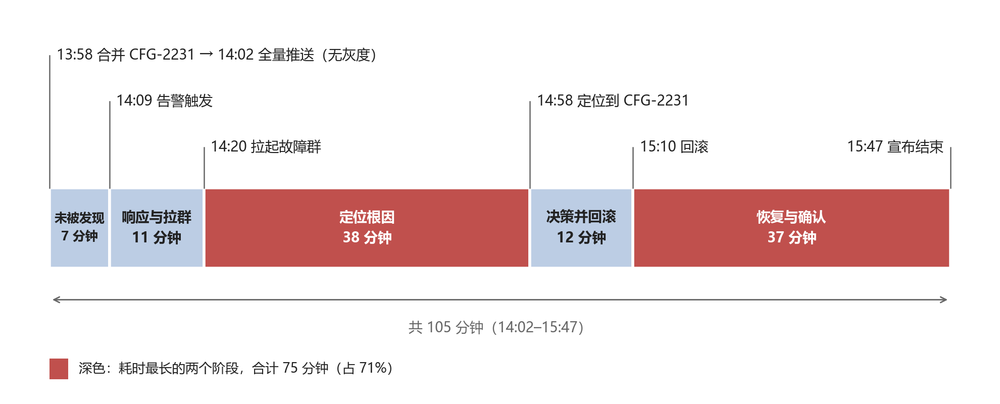
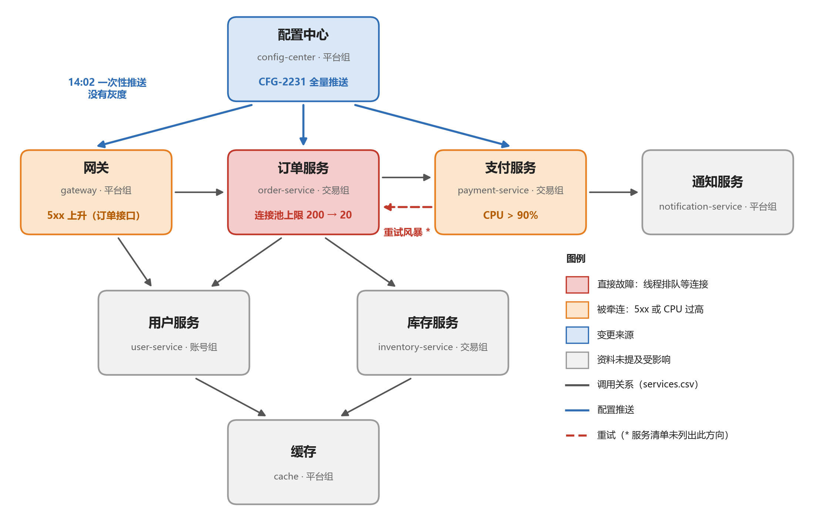
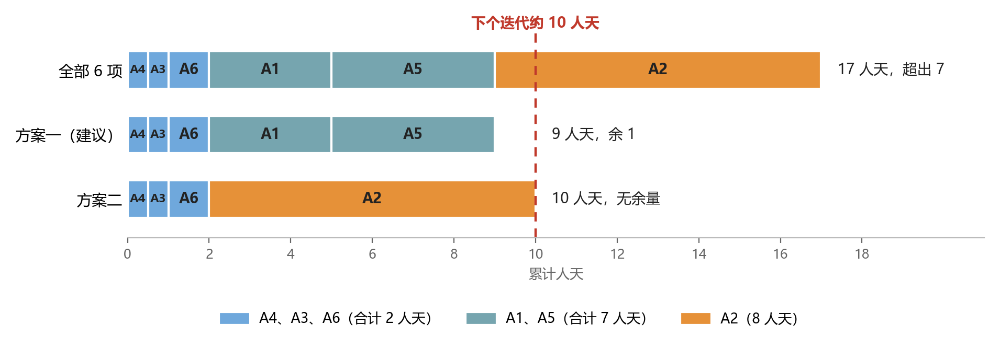

# 2026-10-09 订单与支付故障复盘报告

| 项目 | 内容 |
|---|---|
| 故障时间 | 2026-10-09（周五）14:02–15:47，共 105 分钟（本文时间均为北京时间） |
| 影响范围 | 订单提交、支付 |
| 状态 | 服务已恢复；6 个改进项待排期 |
| 读者 | 研发团队全体；技术负责人张伟据此决定改进项的先后 |
| 资料来源 | 李娜整理的时间线、服务清单（services.csv）、故障群聊记录（原文见[附录 C](#附录-c-原始群聊记录)） |
| 报告日期 | 2026-10-17 |

本复盘只讨论流程与系统，不追究个人。

## 1. 摘要与待决事项

**发生了什么。** 10 月 9 日 13:58 合并的配置变更 CFG-2231，把订单服务的连接池上限从 200 改成了 20。这个改动本意只针对测试环境，却落在了全局默认值上。14:02 配置中心把它一次性推送到订单服务、支付服务和网关，没有灰度。订单服务的大部分线程都在排队等连接，下单大量超时；支付服务在重试订单服务的过程中，CPU 升到 90% 以上。15:10 回滚 CFG-2231 后逐步恢复，15:47 宣布故障结束。

**影响。** 持续 105 分钟，失败订单约 3,800 笔，受影响用户约 1,200 人。当月可用性从 99.97% 降到 99.93%，低于 99.95% 的 SLO。

**为什么拖了这么久。** 最长的两段是定位根因（38 分钟）和回滚后的恢复确认（37 分钟）。定位慢，是因为排查先后走了“数据库”和“有没有发布”两条路：14:40 得到的回答是“今天下午没有服务发布”，但 CFG-2231 是配置变更，不算服务发布，这个回答并没有排除它。恢复确认为什么要 37 分钟，资料里没有记录（见第 6 节的 6.4）。

> **需要张伟决定：下个迭代先做哪些改进项**
>
> 6 个改进项合计 17 人天，下个迭代只有约 10 人天，缺 7 人天。
>
> - **建议（方案一）：** 先做 A4 值班手册、A3 告警阈值、A6 双人评审、A1 范围校验、A5 重试退避，共 9 人天，余 1 人天缓冲；A2 灰度推送（8 人天）放到后续迭代。
> - **备选（方案二）：** 做 A2 灰度推送、A3、A4、A6，共 10 人天，没有缓冲；A1、A5 推后。
> - **理由：** A4、A3、A6 合计只要 2 人天；A1 和 A5 分别在入口拦住坏配置、切断向支付的扩散；A2 独占 8 人天，做了它就装不下 A1 和 A5。
>
> 依据和取舍见[第 6 节](#6-改进项与优先级建议)。

**给所有人的提醒。** 排查线上问题时，“最近的变更”既包括服务发布，也包括配置变更，请一并检查。

## 2. 影响

| 指标 | 数据 |
|---|---|
| 持续时间 | 105 分钟（14:02–15:47）。其中延迟 15:25 已恢复，客服 15:40 起不再收到新投诉，15:47 错误率低于 0.1% 才宣布结束 |
| 失败订单 | 约 3,800 笔 |
| 受影响用户 | 约 1,200 人 |
| 受影响功能 | 订单提交、支付（用户侧表现为“下单一直转圈”） |
| 客服反馈 | 14:11 首批投诉；14:13 已有 10 多个，14:17 已有 30 多个 |
| 二次影响 | 支付服务因订单服务超时而重试，CPU 超过 90%（持续时长有出入，见[附录 B](#附录-b-资料核对记录)） |
| SLO | 当月可用性从 99.97% 降到 99.93%，低于 99.95% 的目标 |

**SLO 影响。** 99.95% 的目标意味着当月只允许 0.05% 的不可用。故障前已用 0.03%，本次又用 0.04%（相当于当月额度的 80%），累计 0.07%，超出 0.02 个百分点。

## 3. 时间线

时间均为 2026-10-09，北京时间。人的操作以群聊的时间戳为准，监控类数据（推送、P99）以时间线为准。两者有出入的地方标 †，逐条说明见[附录 B](#附录-b-资料核对记录)。

### 3.1 各阶段耗时



**图 1** 故障各阶段耗时（14:02 推送生效，15:47 宣布结束）

| 阶段 | 时间 | 耗时 | 发生了什么 | 对应改进项 |
|---|---|---|---|---|
| ① 未被发现 | 14:02–14:09 | 7 分钟（6.7%） | 新配置全量生效；14:05 订单服务 P99 已超过 3 秒，告警 14:09 才触发 | A3 |
| ② 响应与拉群 | 14:09–14:20 | 11 分钟（10.5%） | 14:12 王磊开始排查，14:20 拉起故障群 | 无直接对应项 |
| ③ 定位根因 | 14:20–14:58 | 38 分钟（36.2%） | 先怀疑数据库（8 分钟排除），再问“有没有发布”（答案是没有），14:52 线程栈指向连接池，14:58 对比配置找到 CFG-2231 | A4 |
| ④ 决策并回滚 | 14:58–15:10 | 12 分钟（11.4%） | 找到根因后 9 分钟做出回滚决定，3 分钟完成回滚并开始推送 | 无直接对应项（建议并入 A4） |
| ⑤ 恢复与确认 | 15:10–15:47 | 37 分钟（35.2%） | 15:25 延迟恢复，15:31 支付 CPU 回落，15:40 投诉停止，15:47 错误率低于 0.1% | 无直接对应项（A5 间接缩短） |
| 合计 | 14:02–15:47 | 105 分钟（100%） | | |

### 3.2 详细时间线

| 时间 | 事件 | 来源 |
|---|---|---|
| 13:58 | CFG-2231 合并：订单服务连接池上限 200 → 20。本意只改测试环境，却改到了全局默认值 | 时间线；群聊 |
| 14:02 | 配置中心把新配置一次性推送到订单服务、支付服务和网关，没有灰度（故障开始） | 时间线 |
| 14:05 | 订单服务 P99 延迟超过 3 秒（告警阈值是 5 秒）† | 时间线 |
| 14:09 | 告警触发：订单服务 P99 延迟 > 5s，“已持续 5 分钟” † | 群聊 |
| 14:11 | 客服收到首批用户投诉：下单一直转圈。14:13 已有 10 多个，14:17 已有 30 多个，并有人反映支付也卡 | 时间线；群聊 |
| 14:12 | 值班的王磊看到告警，开始排查 † | 群聊 |
| 14:15 | 王磊：订单服务 CPU 不高，内存也正常，“奇怪” | 群聊 |
| 14:20 | 王磊拉起故障群，邀请赵敏、周杰、李娜 | 时间线；群聊 |
| 14:22 | 赵敏：支付服务 CPU 已到 90%，在疯狂重试订单服务 † | 群聊 |
| 14:24 | 周杰：网关 5xx 在涨，主要是订单接口 | 群聊 |
| 14:27 | 王磊怀疑数据库，请 DBA 老吴检查 † | 群聊 |
| 14:35 | 老吴确认数据库连接数、慢查询都正常，排除数据库 | 时间线；群聊 |
| 14:38–14:40 | 王磊问“有没有最近的发布”，李娜答“今天下午没有服务发布” | 群聊 |
| 14:44–14:46 | 赵敏提议重启订单服务；王磊认为重启会丢掉现场，先抓线程栈 | 群聊 |
| 14:52 | 线程栈显示大部分线程都在等连接池 † | 群聊 |
| 14:55–14:58 | 赵敏记得连接池应是 200，查配置发现已是 20，找到 CFG-2231 † | 时间线；群聊 |
| 15:01–15:03 | 周杰：这是测试环境的改动，怎么推到了生产？李娜：配置中心没有区分环境的默认值，也没有范围校验 | 群聊 |
| 15:07 | 王磊：先回滚再说 | 群聊 |
| 15:10 | 周杰回滚 CFG-2231 并开始推送 | 时间线；群聊 |
| 15:14–15:25 | 15:14 订单服务线程池开始释放，15:20 延迟开始下降，15:25 延迟恢复正常 | 时间线；群聊 |
| 15:31 | 支付服务 CPU 降下来，重试风暴结束 † | 群聊 |
| 15:40 | 客服：新的投诉没有了 | 群聊 |
| 15:47 | 错误率低于 0.1%，王磊宣布故障结束，约定晚些时候复盘 | 时间线；群聊 |

## 4. 根因与促成因素

**根因。** 配置中心没有拦住这次变更。它没有取值范围校验（时间线），也不区分环境默认值（李娜 15:03 在故障群里指出），所以一个本该只落在测试环境的值，被当作全局默认值接受，并推送到了生产。

### 4.1 故障是怎么传导的



**图 2** CFG-2231 的传导路径（服务与调用关系取自 services.csv）。图中带 * 号的虚线是重试方向：它来自时间线和群聊，services.csv 里支付服务只调用通知服务，这一方向待确认（见[第 7 节](#7-待确认事项)）。

1. 配置中心把包含 CFG-2231 的新配置一次性推到订单服务、支付服务和网关。
2. 订单服务的连接池上限只剩 20，大部分线程在排队等连接，请求超时。线程在等待而不是计算，因此 CPU 和内存看起来正常（14:15），延迟却一路升高。
3. 网关收到的订单接口失败增多，5xx 上升（14:24）。
4. 订单服务一超时，支付服务就重试，而且没有退避，CPU 升到 90%（14:22），形成重试风暴。

### 4.2 原因与对应的改进项

| 类别 | 原因 | 本次的表现 | 对应改进项 |
|---|---|---|---|
| 根因 | 配置中心没有取值范围校验 | 连接池上限 20 被当作合法值接受 | A1 |
| 根因 | 配置中心不区分环境默认值（群聊补充，时间线未列） | 测试环境的改动落成了全局默认值 | 暂无，见 6.4 的 A7 候选 |
| 促成 | 配置推送没有灰度 | 14:02 一次性推送到 3 个服务 | A2 |
| 促成 | 延迟告警阈值 5 秒偏松 | P99 14:05 已超过 3 秒，14:09 才告警 | A3 |
| 促成 | 值班手册没有“先查最近的配置变更”这一步 | 14:38 问的是“有没有最近的发布”，14:40 得到“没有”；配置变更不在这个问法里，14:58 才发现 | A4 |
| 促成 | 支付服务对订单服务的重试没有退避 | 订单服务一超时，支付服务就疯狂重试，CPU 90%（14:22） | A5 |
| 待确认 | 配置变更的评审 | 资料没有记录 CFG-2231 当时是否评审、几人评审 | A6 |

## 5. 做得好的与靠运气的

**做得好的**

- 告警触发后 3 分钟内有人响应（14:09 告警，14:12 王磊开始排查）。
- 没有急着重启订单服务，而是先抓线程栈保留现场（14:44–14:52），这份线程栈直接指向了连接池。重启后配置仍是 20，多半也解决不了问题（推断，未验证）。
- 排除数据库很快：王磊 14:27 求助，DBA 老吴 14:35 就给出了结论。
- 客服持续反馈影响量级（10 多个、30 多个），并在 15:40 确认投诉停止，帮助判断恢复情况。
- 确认根因后选择回滚，3 分钟内完成（15:07 决定，15:10 完成）。

**靠运气的**

- 找到 CFG-2231 靠的是线程栈，再加上赵敏记得连接池本来是 200（14:55），而不是靠变更记录。换成不清楚这个值的人值班，可能会更慢。

## 6. 改进项与优先级建议

### 6.1 约束

- 6 个改进项合计 **17 人天**（取自时间线，本报告未重新估算）；下个迭代约有 **10 人天**，缺 7 人天。
- 假设“10 人天”是团队合计，可以按负责人分配；各人实际有多少时间，见[第 7 节](#7-待确认事项)。
- A1 和 A2 都是周杰负责，合计 11 人天，比整个迭代的预算还多。



**图 3** 改进项工作量与 10 人天预算

### 6.2 建议的顺序

| 批次 | 编号 | 改进项 | 负责人 | 人天 | 累计 |
|---|---|---|---|---:|---:|
| 第一批 | A4 | 值班手册加入“先查最近 30 分钟的配置变更” | 王磊 | 0.5 | 0.5 |
| 第一批 | A3 | 订单服务延迟告警阈值从 5 秒降到 2 秒 | 王磊 | 0.5 | 1.0 |
| 第一批 | A6 | 配置变更必须双人评审（CODEOWNERS 规则） | 李娜 | 1 | 2.0 |
| 第二批 | A1 | 配置中心增加取值范围校验（最小值、最大值） | 周杰 | 3 | 5.0 |
| 第二批 | A5 | 支付服务对订单服务的重试增加指数退避和熔断 | 赵敏 | 4 | 9.0 |
| 后续迭代 | A2 | 配置推送支持灰度（先推 5% 实例，观察 10 分钟） | 周杰 | 8 | 17.0 |

第一批三项合计只要 2 人天，各自对应一个明确的缺口，建议无论选哪个方案都先做。下面是各项对本次故障的作用与局限，均为按时间线和群聊作出的估算，不是实测：

- **A4 值班手册先查配置变更（0.5 人天）。** 如果当时手册里已有这一步，14:12–14:20 排查之初就能在最近 30 分钟的变更里看到 13:58 的 CFG-2231；实际到 14:58 才发现，定位阶段的 38 分钟最多可以压缩到几分钟。建议同时写上“确认可疑变更后先回滚，再追因”：本次从找到根因到决定回滚用了 9 分钟，期间群里在讨论变更为什么会进入生产。
- **A3 延迟告警阈值 5 秒 → 2 秒（0.5 人天）。** 能发现 2–5 秒的中度劣化，这类劣化现在不会触发告警。但对本次时长帮助有限：告警写着“已持续 5 分钟”，看起来规则里还有 5 分钟的持续窗口，只降阈值最多提前一两分钟，建议连窗口一起检查（待王磊确认）。它也是 A2 的前提：A2 的观察窗口是 10 分钟，而本次从推送到告警用了 7 分钟。
- **A6 配置变更双人评审（1 人天）。** 第二位评审者有机会发现“测试环境的改动落在了全局默认值上”。能否拦住，取决于评审时是否看变更的作用范围，也取决于 CFG-2231 当时有没有经过评审（资料没有记录）。
- **A1 取值范围校验（3 人天）。** 如果“连接池上限”设有大于 20 的下限，CFG-2231 会被直接拒绝。它的局限是只管取值、不管作用范围：如果测试环境本来就会用到 20 这样的小值，校验会放行（见 6.4 的 A7）。
- **A5 支付重试退避和熔断（4 人天）。** 订单服务出问题时，支付服务不再被重试推到 CPU 90% 以上，故障也不再从订单扩散到支付；订单侧的失败仍会发生。订单服务因其他原因变慢时，它同样有用，不只针对配置变更。
- **A2 灰度推送（8 人天）。** 影响面从全部实例缩小到 5%，是对“任何未知的坏配置”最有效的兜底，但它独占 8 人天，是最大的单项。建议排到后续迭代，并请周杰评估能否拆出更小的第一步。

### 6.3 两个方案

真正需要决定的，是第一批之外剩下的 8 人天怎么花：

| 对比项 | 方案一（建议） | 方案二 |
|---|---|---|
| 做哪些 | A4、A3、A6、A1、A5 | A4、A3、A6、A2 |
| 合计 | 9 人天，余 1 人天缓冲 | 10 人天，没有缓冲 |
| 补上的缺口 | 评审、校验、告警、值班手册、重试退避（5 个） | 评审、灰度、告警、值班手册（4 个） |
| 仍然敞开 | 灰度：通过评审和校验的坏配置，仍会一次性全量推送 | 校验和重试退避：同类错误仍可写入配置中心；订单变慢时，支付仍会被重试风暴拖住 |
| 人员安排 | 周杰 3、赵敏 4、王磊 1、李娜 1，可并行，最长的一条是 4 人天 | 周杰 8、王磊 1、李娜 1，周杰是瓶颈 |

建议方案一，理由如下：

1. **补上的缺口更多，且直接对着这次的失误。** A6 和 A1 在入口处拦截坏配置，A3 和 A4 缩短发现与定位，A5 切断向支付的扩散；方案二没有 A1 和 A5。
2. **更容易按期完成。** 方案一的工作分散在 4 个人身上，可以并行；方案二要周杰连续投入 8 人天，而“10 人天”本来就只是个大约数，没有缓冲。
3. **A2 不是不重要，而是太贵。** 先做 A3，是为了给 A2 的 10 分钟观察窗口打基础；A2 排到后续迭代，期间请周杰评估能否拆出更小的第一步。
4. **方案一的代价要说清楚。** A2 推迟期间，只要坏配置通过了评审和校验，仍会一次性推到全部实例。如果张伟认为这个风险比 A1 和 A5 加起来更大，应选方案二。

余下的 1 人天（方案一）可以作缓冲，也可以用来评估下面的 A7 和恢复阶段的耗时。

### 6.4 A1–A6 之外

- **A7（候选）：配置中心区分环境默认值。** 李娜在群里指出配置中心“没有区分环境的默认值”（15:03）。本次出错的是作用范围（测试环境 → 全局），不只是取值；20 在测试环境里可能是合法值，所以只做 A1 未必能拦住同类变更。时间线没有对应的改进项，也没有负责人和估算，建议周杰、李娜评估后再定，暂不计入 10 人天。
- **响应与恢复阶段没有直接对应的改进项。** 响应与拉群（11 分钟）加恢复与确认（37 分钟）共 48 分钟，占 46%。其中恢复阶段只有 A5 间接起作用，原因也没有记录：回滚推送的生效时间、连接池重建、积压请求的消化，还是等指标回落，各占多少不清楚。建议先把这 37 分钟拆清楚，再决定要不要增加改进项。

## 7. 待确认事项

下面这些在资料里找不到答案，会影响改进项的取舍，建议在迭代计划前确认。

| # | 待确认 | 为什么重要 | 建议确认人 |
|---|---|---|---|
| 1 | CFG-2231 当时是否经过评审、几人评审 | 如果它已经过双人评审仍然通过，A6 的预期收益要下调 | 李娜、周杰 |
| 2 | 延迟告警规则的完整定义（阈值、持续窗口、评估周期），以及订单服务平时的 P99 水平 | 决定 A3 是只改阈值还是连持续窗口一起改，也决定 2 秒会不会过于敏感 | 王磊 |
| 3 | “连接池上限”在配置中心里合理的取值范围；测试环境是否确实需要 20 这样的小值 | 决定 A1 能不能拦住同类变更，也决定 A7 的优先级 | 周杰 |
| 4 | 这次推送后，支付服务和网关自己的连接池上限是否也变成了 20（时间线只记录了订单服务） | 决定支付 CPU 升高有多少是自身池子受限、多少是重试造成的，影响 A5 的预期效果 | 周杰、赵敏 |
| 5 | 支付服务是通过什么调用订单服务的（services.csv 里没有这条调用） | 服务清单需要补全，A5 的熔断要加在哪条调用上 | 赵敏 |
| 6 | “10 人天”是团队合计还是每人可用的量；周杰、赵敏下个迭代各有多少时间 | 决定方案一能否真正并行 | 张伟 |
| 7 | CFG-2231 从合并（13:58）到推送（14:02）相隔 4 分钟，推送是自动触发还是人工触发 | 如果合并即自动推送，评审（A6）就是唯一的人工关口；如果有人工步骤，可以在那一步加检查 | 周杰 |

## 附录 A 服务清单与本次角色

取自 services.csv。“调用 / 推送对象”即原表的 calls 列；配置中心一行对应时间线里的推送对象。

| 服务 | 名称 | 负责团队 | 调用 / 推送对象 | 本次故障中的角色 |
|---|---|---|---|---|
| gateway | 网关 | 平台组 | order-service、user-service | 收到同一次推送；订单接口 5xx 上升 |
| order-service | 订单服务 | 交易组 | payment-service、inventory-service、user-service | 直接故障：连接池上限 20，线程排队 |
| payment-service | 支付服务 | 交易组 | notification-service | 收到同一次推送；重试订单服务，CPU 超过 90%（调用方向待确认） |
| inventory-service | 库存服务 | 交易组 | cache | 资料未提及受影响 |
| user-service | 用户服务 | 账号组 | cache | 资料未提及受影响 |
| notification-service | 通知服务 | 平台组 | 无 | 资料未提及受影响 |
| config-center | 配置中心 | 平台组 | gateway、order-service、payment-service | 变更来源：无范围校验、不区分环境默认值、无灰度 |
| cache | 缓存 | 平台组 | 无 | 资料未提及受影响 |

## 附录 B 资料核对记录

时间线与群聊在以下几处不一致，或资料本身无法互相印证。报告按右列处理。

| 涉及的时间点 | 时间线说的 | 群聊 / 服务清单显示的 | 本报告的处理 |
|---|---|---|---|
| 14:05、14:09 告警 | 14:05 P99 超过 3 秒；阈值是 5 秒，所以告警 14:09 才触发 | 告警写的是“P99 延迟 > 5s，已持续 5 分钟”。这说明规则除 5 秒阈值外还有 5 分钟的持续窗口；按这个措辞，P99 约 14:04 就已超过 5 秒，与“14:05 才超过 3 秒”对不上 | 两处都记录；A3 建议连持续窗口一起检查，规则原文待王磊确认（第 7 节 #2） |
| 14:12、14:20 排查开始 | 14:20 拉起故障群，开始排查 | 14:12 王磊已看到告警并开始查，14:20 才拉群 | 记 14:12 首次响应、14:20 拉群 |
| 14:27–14:35 数据库方向 | 14:35 判断数据库变慢，DBA 排除，“浪费了约 25 分钟” | 14:27 提出怀疑，14:35 老吴排除，数据库这一步用了 8 分钟；14:27 到 14:52（线程栈指向连接池）恰好 25 分钟 | 数据库这一步记 8 分钟；“约 25 分钟”理解为 14:27–14:52 没有头绪的时间，其间还问了“有没有发布”和“要不要重启” |
| 14:52–14:58 谁发现线程池满 | 14:58 赵敏注意到线程池已满，对比配置发现问题 | 14:52 王磊的线程栈显示大部分线程在等连接池；赵敏 14:55–14:58 查配置 | 记为两人接力 |
| 14:22–15:31 支付 CPU | 超过 90%，持续约 40 分钟 | 14:22 已是 90%，15:31 才回落，相隔 69 分钟 | 持续时长待用监控确认；正文只写“超过 90%”，不写时长 |
| 支付与订单的调用方向 | 支付服务对订单服务重试 | services.csv 中支付服务只调用通知服务，调用支付服务的是订单服务 | 图 2 用虚线标出重试方向；见第 7 节 #5 |
| 可用性口径 | 99.97% → 99.93% | 无其他数据 | 按原数字引用。口径（按请求还是按时间、月累计还是整月）未说明；105 分钟若全部按不可用计，全月只有约 99.77%，所以推测是按失败请求比例统计 |

## 附录 C 原始群聊记录

以下为故障群聊记录原文，共 28 条，未做任何修改。记录从 14:09 的告警开始，包含 14:20 拉群之前的消息；时间为 2026-10-09，北京时间。

```text
[14:09] 告警机器人: 订单服务 P99 延迟 > 5s，已持续 5 分钟
[14:12] 王磊: 看到告警了，我先看下
[14:13] 客服-小陈: 有用户反馈下单一直转圈，已经 10 多个了
[14:15] 王磊: 订单服务 CPU 不高，内存也正常，奇怪
[14:17] 客服-小陈: 现在 30 多个了，群里有人说支付也卡
[14:20] 王磊: 拉群了，@赵敏 @周杰 @李娜 麻烦都进一下，订单和支付都有问题
[14:22] 赵敏: 支付服务 CPU 90% 了，在疯狂重试订单服务
[14:24] 周杰: 网关这边 5xx 在涨，主要是订单接口
[14:27] 王磊: 先看是不是数据库的问题，@DBA-老吴
[14:35] DBA-老吴: 数据库连接数、慢查询都正常，不是数据库
[14:38] 王磊: 那是啥……有没有最近的发布？
[14:40] 李娜: 今天下午没有服务发布。
[14:44] 赵敏: 要不要先重启订单服务？
[14:46] 王磊: 先别，重启会丢掉现场。我先抓一份线程栈
[14:52] 王磊: 线程栈里大部分线程都在等连接池
[14:55] 赵敏: 连接池？这个值不是 200 吗
[14:57] 赵敏: 我看下配置……现在是 20
[14:58] 赵敏: 找到了，CFG-2231，今天 13:58 合并的，把默认值改成 20 了
[15:01] 周杰: 这是我们测试环境的改动，怎么推到生产了
[15:03] 李娜: 配置中心没有区分环境的默认值，也没有范围校验……
[15:07] 王磊: 先回滚再说
[15:10] 周杰: 已回滚 CFG-2231，正在推送
[15:14] 赵敏: 订单服务线程池开始释放了
[15:20] 王磊: 延迟在降
[15:25] 王磊: 延迟恢复正常
[15:31] 赵敏: 支付服务 CPU 也降下来了，重试风暴结束
[15:40] 客服-小陈: 新的投诉没有了
[15:47] 王磊: 错误率 < 0.1%，宣布故障结束。晚点拉复盘
```
