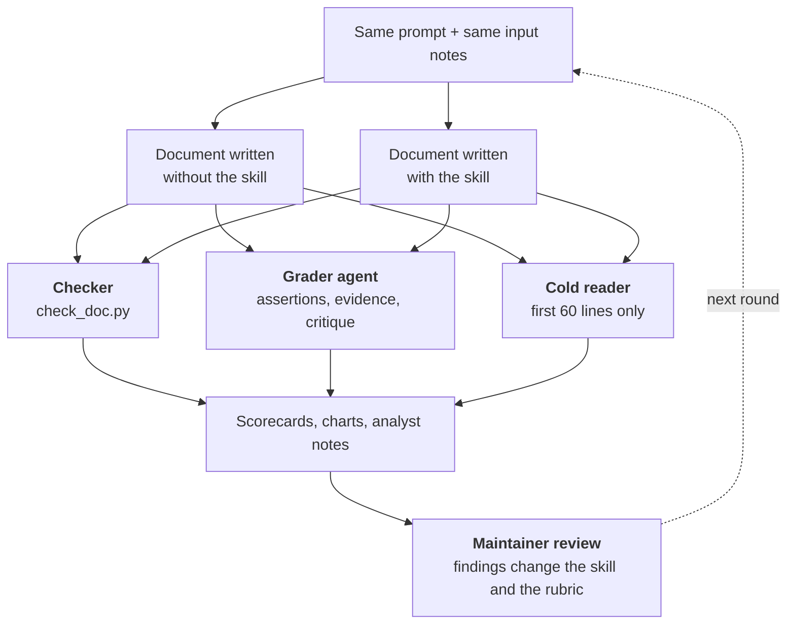

[← The project README](../README.md)

<h1 align="center">Review records</h1>

<b>Every claim in this repository about the skill is backed by a record you can open.</b> The charts and tables on these pages are generated from the raw files in this folder by <a href="tools/build_review.py"><code>tools/build_review.py</code></a>.

## The result in one table

| | Without the skill | With the skill |
|---|---|---|
| Assertions passed, 4 scenarios | 43 / 88 (mean 48.9%) | **86 / 88 (mean 97.7%)** |
| Automatic gate: no Blocker, at most 2 Majors | 0 / 4 documents pass | **4 / 4 documents pass** |
| Cold reader: key facts recovered from the first 60 lines | 22 / 24 | 22 / 24 |
| Skill loads on realistic requests (simulated, 3 runs) | n/a | **36 / 36** should-trigger · **0 / 30** false triggers |
| Version 1.0.0 as published, the four scenarios rerun (no baseline rerun) | n/a | **4 / 4** documents pass the gate · cold reader **23 / 24** |

## How to read these numbers

> The assertions come from the skill's own rubric, so a high pass rate with the skill shows that the skill makes agents follow its rules, not that the rules are the right ones. The **cold-reader test** is the independent measure, and on the synthetic scenarios it did **not** separate the arms (both recovered 22 of 24 facts): a baseline agent that is asked for a decision report already puts the conclusion first. What the skill adds there is structure and consistency: audience zones, a compact glance panel, a reading path, honest labelling and a clean automatic gate.

Limits that apply to everything here: one run per scenario and arm (no variance estimate), AI agents as graders and readers, no blind human rating, and no token or time comparison because the harness does not report them.

## Where the skill moved the needle

## Every assertion, every run

## The automatic gate

## Cold reader

## How the review works

Details, roles and limits: [method.md](method.md).

## Rounds of review

| Round | Skill | What was tested | Result | Pages |
|---|---|---|---|---|
| 1 | v0.1 | 3 scenarios, hand-written assertions | 40/44 vs 30/44 assertions (mean 91% vs 68%) | [iteration 1](iteration-1/README.md) |
| 2 | v0.2 | 4 scenarios, rubric-derived assertions, cold reader, gate | 86/88 vs 43/88 (mean 97.7% vs 48.9%) | [iteration 2](iteration-2/README.md) |
| 3 | v0.3 to v1.0.0 | Description triggering, 22 requests × 3 descriptions × 3 runs | 36/36 and 0/30 | [trigger tests](trigger-tests/README.md) |
| 4 | v1.0.0 | The four scenarios again with the published skill: gate and cold reader | 4/4 pass the gate · cold reader 23/24 | [final check](final-check/README.md) |

## Browse

| | |
|---|---|
| [method.md](method.md) | how every number was produced, roles, limits |
| [maintainer-review.md](maintainer-review.md) | the human review: questions, decisions and what they changed |
| [skill-evolution/](skill-evolution/README.md) | every finding and the change it caused, with the diffs |
| [iteration-1/](iteration-1/README.md) · [iteration-2/](iteration-2/README.md) | scenario pages, scorecards, grader evidence, raw records |
| [trigger-tests/](trigger-tests/README.md) | does the description load the skill when it should |
| [final-check/](final-check/README.md) | the four scenarios rerun with the published v1.0.0, and what the executors found unclear |
| [../examples/](../examples/README.md) | the documents that were reviewed |
