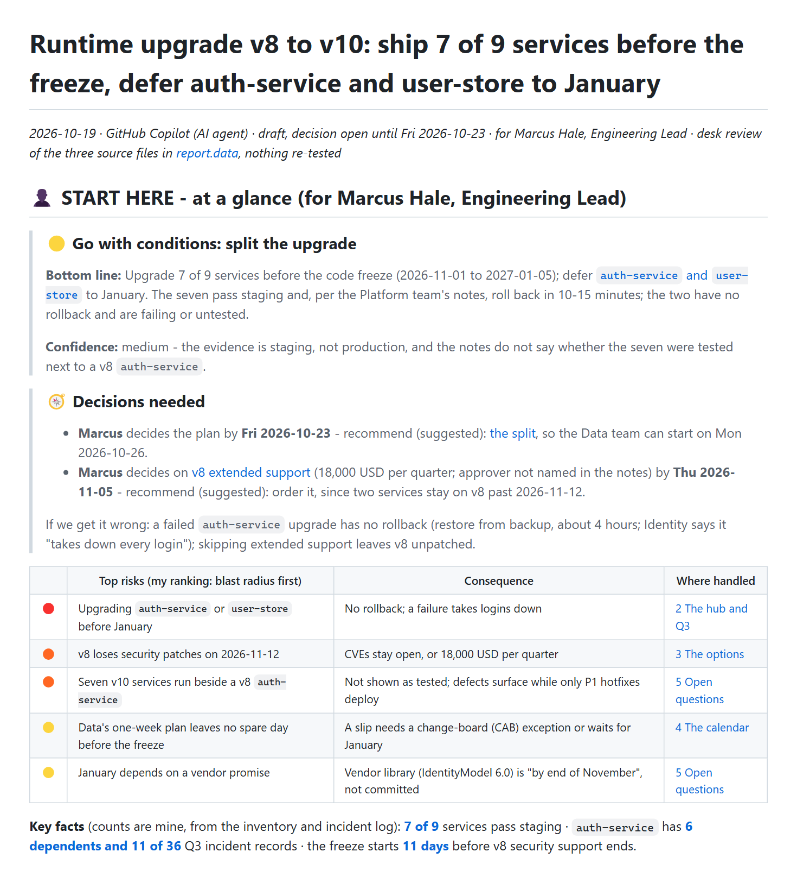
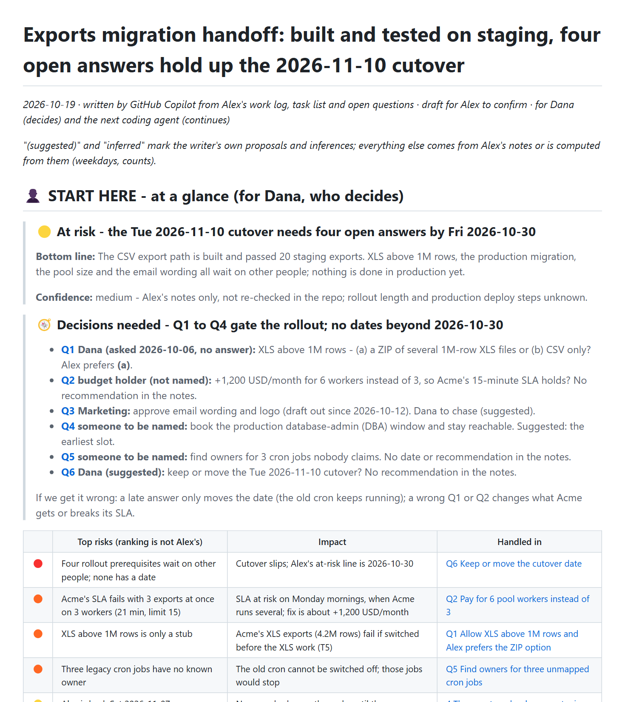
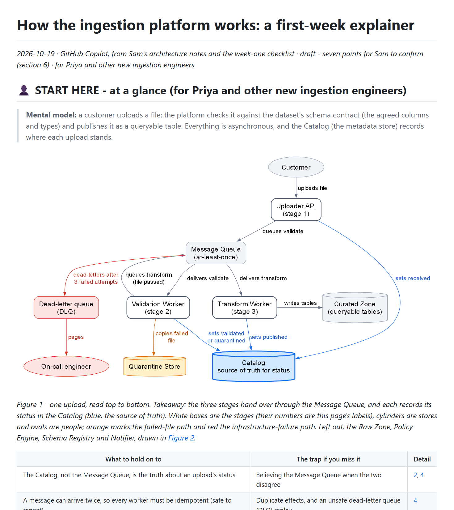
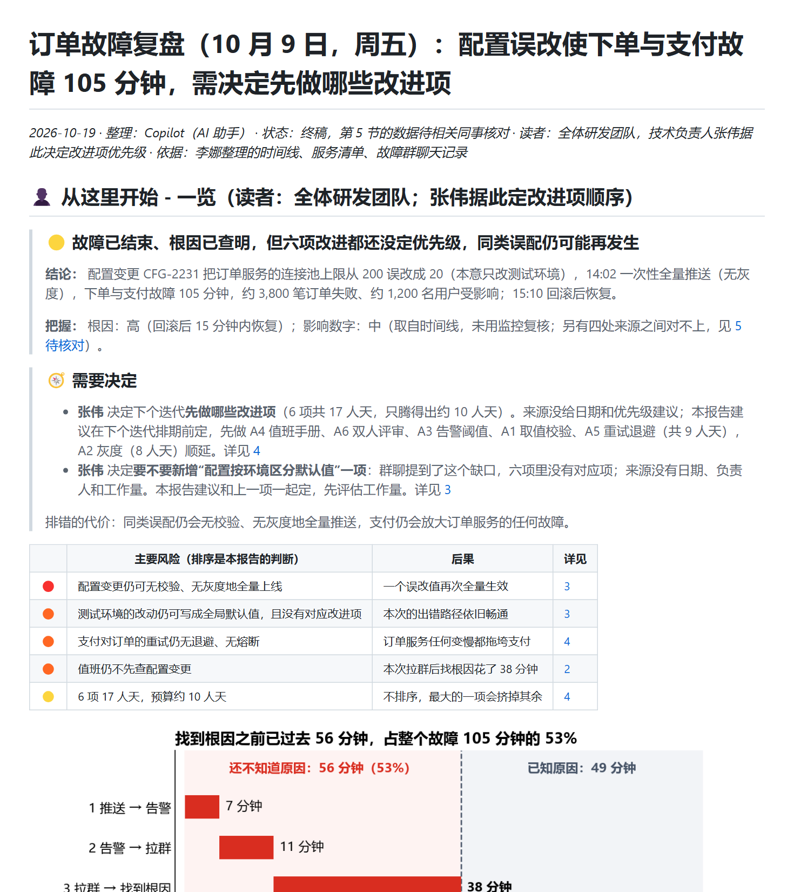

# Final check · skill v1.0.0

[← Review dashboard](../README.md) · [How the skill evolved](../skill-evolution/README.md)

> ### What this round is
>
> The example documents were written by earlier versions of the skill (v0.2). This round wrote the four scenarios again with **the skill as published, v1.0.0**, to check that the version that ships still produces documents that pass. It is smaller than a full round: four with-skill runs, the automatic gate and one cold reader per document. The without-skill baselines of iteration 2 are not repeated (they do not depend on the skill), and no grader scored assertions.
>
> **Result:** 4 of 4 documents pass the gate, every one with no finding at all. The cold readers recovered **23 of 24** key facts from the first 60 lines (iteration 2: 22 of 24).

## Result, next to iteration 2

| Scenario | Gate, v0.2 → **v1.0.0** | First section, words | Human-read zone, words | Cold reader, key facts |
|---|---|---|---|---|
| [Upgrade risk report](outputs/01-upgrade-risk-report/report.md) | ✅ 0 Blockers · 0 Majors · 1 Minor → **✅ 0 Blockers · 0 Majors · 0 Minors** | 292 → **264** | 2,472 → **2,474** | 5/6 → **6/6** |
| [Dual-audience handoff](outputs/02-dual-audience-handoff/report.md) | ✅ 0 Blockers · 0 Majors · 1 Minor → **✅ 0 Blockers · 0 Majors · 0 Minors** | 298 → **295** | 2,140 → **2,173** | 5/6 → **5/6** |
| [Platform explainer for a new hire](outputs/03-ingestion-explainer/report.md) | ✅ 0 Blockers · 0 Majors · 1 Minor → **✅ 0 Blockers · 0 Majors · 0 Minors** | 289 → **258** | 2,362 → **2,363** | 6/6 → **6/6** |
| [Post-mortem in Chinese](outputs/04-postmortem-zh/report.md) | ✅ 0 Blockers · 0 Majors · 0 Minors → **✅ 0 Blockers · 0 Majors · 0 Minors** | 283 → **286** | 2,480 → **2,492** | 6/6 → **6/6** |
| **All four** | | | | 22/24 → **23/24** |

The panel budget is about 300 words. Gate: no Blocker and at most two Majors; the checker's findings by rule are in `records/<scenario>/with-skill/mechanical.json`. Two cautions on the comparison: the one Minor in iteration 2 was the checker's own note on the archive-only evidence file, which later versions no longer print; and the checker's panel measure changed in v0.3 (link-led Read-next bullets stopped counting), so the word counts are indicative, not strictly comparable.

## What the reader sees first

| Scenario | v0.2, in the examples (iteration 2) | **v1.0.0**, this round |
|---|---|---|
| Upgrade risk report |  |  |
| Dual-audience handoff |  |  |
| Platform explainer for a new hire |  |  |
| Post-mortem in Chinese |  |  |

## What the executors reported

Each executor wrote notes on where the skill's instructions were unclear, contradictory or not followed. These are the points that came up, grouped. **None of them changed the skill in v1.0.0**: the point of this round was to check the version that ships, so they are the backlog for the next one, and they are also listed under [open items](../skill-evolution/README.md#open-items).

| # | What the executors reported | Seen in |
|---|---|---|
| 1 | **The panel budget is hard to apply.** The skill says about 300 words with tables, the picture and the Read-next list excluded, but the checker also counts the caption and the "who can stop where" line and ignores link-led bullets. The agents learned this by running it. For Chinese the unit is unclear (words or characters) | scenarios 1, 2, 4 |
| 2 | **The panel's contents list has no slot for a handoff reader's questions** ("who carries on, what may they do alone, what must they not touch"). The agent dropped "Key facts" for a "Carrying on" line | scenario 2 |
| 3 | **Headings that carry their answer (B3) collide with plain-word link-target headings (B6).** An executor stripped the punctuation from question headings to keep the link anchors safe, and in Chinese the full-width punctuation counts as punctuation too. The skill does not say which rule wins | scenarios 2, 4 |
| 4 | **The sibling-file rule against "from this same document" or "a doc for the wiki".** It is unclear whether the "one self-sufficient file" exception covers an AI-input block, and a wiki repository might list every Markdown file as a page | scenarios 2, 3, 4 |
| 5 | **Block letters collide across files.** The main file has blocks A to C, the evidence file A to E, and `source_set.py` letters from A as well, so "block A" is ambiguous | scenario 1 |
| 6 | **Gaps the skill does not cover:** logging the outcome in a document kept as an audit trail; a decision whose decider the sources do not name; and what "today" is when the sources disagree about the date | scenarios 1, 2 |
| 7 | **"Write each fact once" against a panel that must restate the headline numbers**, and against a diagram that repeats a list. The only written exemption is for rewrites | scenarios 1, 2, 3 |
| 8 | **Legibility at 800 px is a judgment.** The checker only tests that the width is between 500 and 2,600 px, and the legend advice pulls two ways (`SKILL.md` wants a legend, `diagrams.md` warns that swatch nodes distort a Graphviz layout) | scenarios 1, 2, 3 |
| 9 | **Several small inputs.** `rewriting.md` and `source_set.py` assume one large source; byte-exact copies of three small notes had no tool, and the executor compared bytes by hand. Files written with CRLF line endings are byte-identical only while they stay CRLF, which is why this repository stores the example inputs without line-ending conversion | scenarios 2, 4 |
| 10 | **`SKILL.md` is about 23 KB**, more than one read in the executor's file viewer (limit about 20 KB) allowed. More of it could move into `references/` | scenario 1 |
| 11 | **Two drawing tips for `diagrams.md`:** in matplotlib date charts use `datetime`, not `date`, as positions (adding a fractional `timedelta` to a `date` silently adds nothing), and a long Graphviz cluster label widens the whole graph, so break it with `\l` | scenario 1 |

One finding goes the other way. In the Chinese post-mortem the checker was green, and the executor's own reading still found a wrong count (four source mismatches, not three), a heading that claimed more than the sources said and two statements the sources did not support. The judgment rules (C4 and C5 of the rubric) caught what a script cannot, which is the reason the rubric has both layers.

## How this round was run

- **The skill as published, apart from one fix.** The agents read a scratch copy of `skills/document-formatting/` whose files were identical in content to the published ones. One line of `source_set.py` was changed afterwards so that `slice` runs on Python 3.9 (`Path.write_text(newline=)` needs 3.10); it does not change what the script does on 3.10 and newer, and no agent in this round ran that command.
- **Same prompts as iteration 2**, with only the folder paths changed. The agents received copies of the input files in a scratch folder, so they could not see any earlier document.
- **Four fresh executor agents**, one per scenario, each asked to leave its notes on unclear instructions. **Four fresh cold readers**, each given only the first 60 lines of one document and the images in them, answering the [six fixed questions](../../evals/cold-reader-test.md). The orchestrating agent scored them against the same key facts as in iteration 2.
- **The checker** was run on `report.md` and on its sibling files, as in every round.

## Limits

- One run per scenario, AI executors and readers, no grader and no human rating: this is a regression check, not a new measurement. It cannot show that v1.0.0 is better than v0.2, only that it did not get worse on these four documents.
- The cold-reader scores can only be compared with iteration 2's because the key facts and the questions are the same; the readers were different agents.
- The executors knew they were being tested for where the instructions were unclear, which is not how an agent normally works.

## Records

- Documents: [`outputs/`](outputs/) (each scenario's `report.md`, siblings, diagram and the agent's final chat reply)
- Per scenario under `records/<scenario>/with-skill/`: `mechanical.json` (checker output), `coldreader-answers.md`, `executor-notes.md`
- [`records/coldreader-scores.json`](records/coldreader-scores.json): which key facts each cold reader recovered
