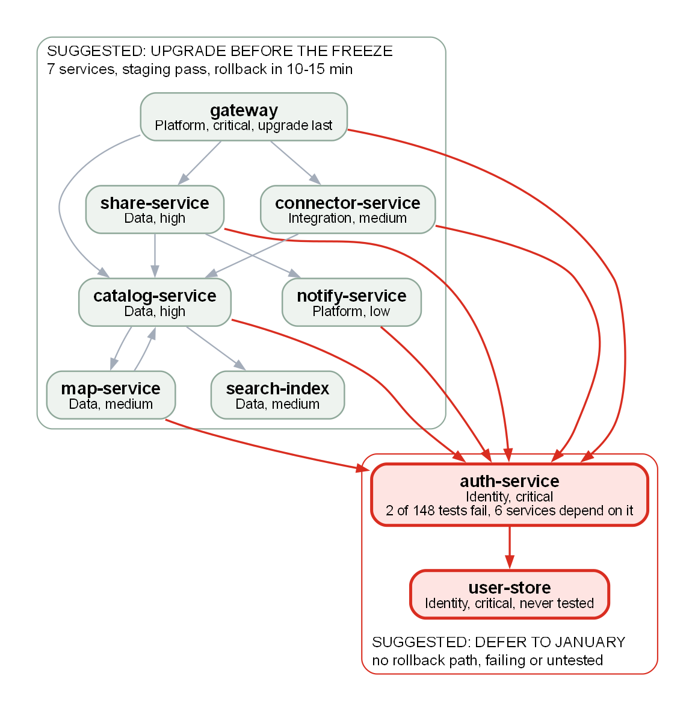
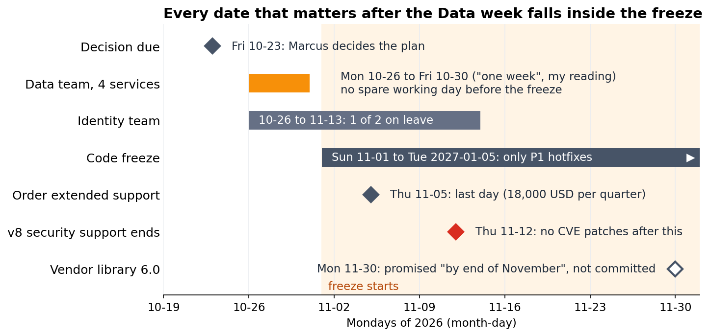

<!-- zone:human -->
# Runtime upgrade v8 to v10: ship 7 of 9 services before the freeze, defer auth-service and user-store to January

*2026-10-19 · GitHub Copilot (AI agent) · draft, decision open until Fri 2026-10-23 · for Marcus Hale, Engineering Lead · desk review of the three source files in [report.data](report.data/), nothing re-tested*

## 👤 START HERE - at a glance (for Marcus Hale, Engineering Lead)

> ### 🟡 Go with conditions: split the upgrade
>
> **Bottom line:** Upgrade 7 of 9 services before the code freeze (2026-11-01 to 2027-01-05); defer [`auth-service` and `user-store`](#1-seven-services-are-ready-and-two-are-not) to January. The seven pass staging and, per the Platform team's notes, roll back in 10-15 minutes; the two have no rollback and are failing or untested.
>
> **Confidence:** medium - the evidence is staging, not production, and the notes do not say whether the seven were tested next to a v8 `auth-service`.

> ### 🧭 Decisions needed
>
> - **Marcus** decides the plan by **Fri 2026-10-23** - recommend (suggested): [the split](#3-the-split-beats-upgrading-all-nine-or-deferring-all-nine), so the Data team can start on Mon 2026-10-26.
> - **Marcus** decides on [v8 extended support](#3-the-split-beats-upgrading-all-nine-or-deferring-all-nine) (18,000 USD per quarter; approver not named in the notes) by **Thu 2026-11-05** - recommend (suggested): order it, since two services stay on v8 past 2026-11-12.
>
> If we get it wrong: a failed `auth-service` upgrade has no rollback (restore from backup, about 4 hours; Identity says it "takes down every login"); skipping extended support leaves v8 unpatched.

| | Top risks (my ranking: blast radius first) | Consequence | Where handled |
|---|---|---|---|
| 🔴 | Upgrading `auth-service` or `user-store` before January | No rollback; a failure takes logins down | [2 The hub and Q3](#2-auth-service-is-the-hub-and-the-weakest-point-in-q3) |
| 🟠 | v8 loses security patches on 2026-11-12 | CVEs stay open, or 18,000 USD per quarter | [3 The options](#3-the-split-beats-upgrading-all-nine-or-deferring-all-nine) |
| 🟠 | Seven v10 services run beside a v8 `auth-service` | Not shown as tested; defects surface while only P1 hotfixes deploy | [5 Open questions](#5-open-questions-to-close-and-items-parked-for-january) |
| 🟡 | Data's one-week plan leaves no spare day before the freeze | A slip needs a change-board (CAB) exception or waits for January | [4 The calendar](#4-the-calendar-leaves-no-slack-so-the-plan-must-be-decided-on-friday) |
| 🟡 | January depends on a vendor promise | Vendor library (IdentityModel 6.0) is "by end of November", not committed | [5 Open questions](#5-open-questions-to-close-and-items-parked-for-january) |

**Key facts** (counts are mine, from the inventory and incident log): **[7 of 9](#1-seven-services-are-ready-and-two-are-not)** services pass staging · `auth-service` has **[6 dependents and 11 of 36](#2-auth-service-is-the-hub-and-the-weakest-point-in-q3)** Q3 incident records · the freeze starts **[11 days](#4-the-calendar-leaves-no-slack-so-the-plan-must-be-decided-on-friday)** before v8 security support ends.



*How to read it: an arrow means "depends on" (all 16 come from the inventory, none inferred); red arrows lead into `auth-service`. Takeaway: six services depend on `auth-service`, which sits on `user-store`, and both have to wait.*

**Read next**

- [1 Seven services are ready and two are not](#1-seven-services-are-ready-and-two-are-not) - the plan per service · 2 min
- [2 auth-service is the hub and the weakest point in Q3](#2-auth-service-is-the-hub-and-the-weakest-point-in-q3) - why those two wait · 2 min
- [3 The split beats upgrading all nine or deferring all nine](#3-the-split-beats-upgrading-all-nine-or-deferring-all-nine) - three options compared · 2 min
- [4 The calendar leaves no slack so the plan must be decided on Friday](#4-the-calendar-leaves-no-slack-so-the-plan-must-be-decided-on-friday) - dates and next steps · 2 min
- [5 Open questions to close and items parked for January](#5-open-questions-to-close-and-items-parked-for-january) - what to confirm first · 2 min

*Only deciding? Read 3, then stop. Planning the work? Continue to 4 and 5. Checking numbers or the audit trail? Go to [B Evidence and source data](#b-evidence-and-source-data).*

## 1 Seven services are ready and two are not

*Which services can move before the freeze, and what blocks the other two?*

Sources: the Platform team's notes (`upgrade-notes.md`, called "the notes" below), the service inventory (`services.csv`) and the Q3 incident log (`incidents-q3.csv`), all kept unchanged in [report.data](report.data/). Terms:

- **Freeze**: 2026-11-01 to 2027-01-05. Only P1 hotfixes deploy; anything else needs an exception from the change advisory board (**CAB**).
- **Extended support**: paid security patches for v8 after 2026-11-12, 18,000 USD per quarter, security patches only.
- **Compatibility shim**: the stop-gap that lets `auth-service` run on v10 until the vendor library (IdentityModel 6.0, the v10-compatible identity library) is released.
- **Q3**: 2026-07-01 to 2026-09-30 (the incident log runs 2026-07-02 to 2026-09-28).

| Service | Owner | Criticality | Staging, 2026-10-09 to 10-11 | Rollback | Suggested plan |
|---|---|---|---|---|---|
| `gateway` | Platform | critical | pass | yes | Before the freeze, last of the seven |
| `catalog-service` | Data | high | pass | yes | Before the freeze, Data's week from 2026-10-26 |
| `share-service` | Data | high | pass | yes | Before the freeze, Data's week |
| `map-service` | Data | medium | pass | yes | Before the freeze, Data's week |
| `search-index` | Data | medium | pass | yes | Before the freeze, Data's week |
| `connector-service` | Integration | medium | pass | yes | Before the freeze, any time |
| `notify-service` | Platform | low | pass | yes | Before the freeze |
| `auth-service` | Identity | critical | fail: 2 of 148 integration tests | no | January |
| `user-store` | Identity | critical | not tested, no staging environment | no | January |

**Why the seven can go**

- All seven pass staging, including the three services the notes single out for breaking changes: the JSON converters in `connector-service` and `share-service`, and the custom retry policy in `gateway`.
- Rollback is a redeploy of the previous version, 10 to 15 minutes (the notes). Q3 shows it working: five failed rollouts on four of the seven services were each rolled back, in 10, 14, 15, 15 and 19 minutes. The notes' range holds for four of the five; I would plan for up to about 20 minutes (my reading).
- The team statements in the notes fit the split: Identity wants to wait for the vendor library, Data can do its four services in a week if it starts Monday, Platform wants `gateway` last of the passing services, Integration says `connector-service` can go any time. Identity speaks only of `auth-service`; deferring `user-store` rests on its never having been tested. The notes give no view on `notify-service`.

**Why the two cannot**

- `auth-service`: 2 of 148 integration tests fail (the token refresh flow, on the compatibility shim) and the root cause is not confirmed. The vendor library is promised "by end of November", not committed. After the schema migration there is no rollback; recovery means a backup restore, estimated RTO (recovery time) 4 hours.
- `user-store`: never tested, because no staging environment exists; building one is about a week of work. Its migrations are one-way after the upgrade.
- Identity has two engineers and one is on leave from 2026-10-26 to 2026-11-13.
- A CAB exception does not help: the notes allow one only for work already staged and tested, and neither service qualifies.

## 2 auth-service is the hub and the weakest point in Q3

*Why a failed upgrade there would be felt everywhere, and what the incident log adds.*

- **The map in the panel.** Six services depend on `auth-service` (`gateway`, `catalog-service`, `share-service`, `connector-service`, `map-service`, `notify-service`), and `auth-service` depends on `user-store`. So 7 of the other 8 services, all but `search-index`, depend on `user-store` through it.
- **Q3 incident log.** `auth-service` has 11 of the 36 records (31%), including 6 of the 10 SEV2 and one of the two SEV1 records. The two SEV1 records are one outage: on 2026-07-11 `auth-service` login failures lasted 78 minutes and `gateway` returned 503 on all authenticated routes for the same 78. The quarter had one SEV1 outage, not two.
- **Spill-over.** Four of `gateway`'s seven records name `auth-service` in their summary, as cause or circumstance (2026-07-05, 07-11, 08-27, 09-15). With `auth-service`'s own 11, that is 15 of 36 records (42%); counting the 07-11 outage once, 14 of 35 (40%).
- **Failure pattern.** Most of `auth-service`'s 11 records are token validation timeouts (5) or token-refresh bugs (3, on 2026-07-21, 08-14 and 09-28). Inference: the 2 failing staging tests are in the token refresh flow, the same area; that does not prove the same cause, and the notes say the root cause is not confirmed.
- **What the upgrade does not fix (my reading).** Only 3 Q3 records (82 minutes) are runtime-related, all GC pauses, and the notes name no v10 benefit beyond staying supported. The case for upgrading is the support date, not fewer incidents.
- **`catalog-service` and `map-service` depend on each other** (both Data). Q3 shows the effect twice: on 2026-09-08 and 2026-09-19 each one's latency slowed the other. Suggested: Data tests and ships the two together.

## 3 The split beats upgrading all nine or deferring all nine

*Three options, what each costs, and why the split is the pick.*

| Option | What happens | Cost | Main risk | Assessment (mine) |
|---|---|---|---|---|
| A All nine before the freeze | `auth-service` and `user-store` move too, `auth-service` on the shim | No extended support needed | No rollback, failing and untested, Identity down to one engineer, no CAB route | 🔴 Not workable by 2026-11-01 |
| B All nine in January | Nothing changes until after 2027-01-05 | 18,000 USD per quarter, or at least 54 days of unpatched v8 (2026-11-12 to 2027-01-05) | Seven ready services wait; January becomes a nine-service project | 🟠 Safe for the change, late and costly |
| C Split (suggested) | Seven before the freeze, two in January | No more than B | Mixed v8 and v10 fleet; no slack in the Data week | 🟡 Go with conditions |

**Why C over B.** C costs no more than B, because the two deferred services need extended support after 2026-11-12 in both. In return for the change risk of seven small upgrades with a 10-15 minute rollback, C gives three things:

- If the extended-support order slips past 2026-11-05, two services are exposed instead of nine.
- January shrinks to the two hardest services.
- The seven are tested now (staging 2026-10-09 to 10-11) and the Data team can start now; the notes say nothing about capacity in January.

**Why not A.** Identity's own words: "We would rather not touch auth-service until the vendor library is out. A failed upgrade takes down every login." Section 1 lists what else blocks it. Confidence that A is not workable is high: it rests on the notes' own facts (failing tests, no rollback, never tested, one engineer short), not on a judgment of the teams.

**Conditions for C, and the fallback.**

1. The plan is decided by Fri 2026-10-23, so the Data team can start on Mon 2026-10-26.
2. Extended support is ordered by Thu 2026-11-05. This is no-regret: B and C both need it, and only A, which is not workable, avoids it.
3. `gateway` goes last of the seven.
4. Platform confirms the seven were tested next to a v8 `auth-service` (question 1 in [5 Open questions](#5-open-questions-to-close-and-items-parked-for-january)).

If condition 4 fails, or the Data week slips, ask the CAB for an exception (the notes allow one for staged and tested work) or fall back to B for the services not yet deployed.

## 4 The calendar leaves no slack so the plan must be decided on Friday

*Which dates are fixed, which are only promises, and what happens when.*



*How to read it: each row is one date or period from the notes; the shaded area is the freeze; orange is the Data team's week, red the end of v8 security support, the hollow diamond a promise rather than a commitment. Takeaway: after the Data week, the extended-support deadline, the end of v8 security support and the vendor date all land inside the freeze.*

**What the dates force**

- The Data team can only start on Mon 2026-10-26 if the decision is made on Fri 2026-10-23. A later decision means a later start, and the week no longer fits before the freeze: waiting is in effect choosing B, or asking the CAB for an exception.
- Its week ends on Fri 2026-10-30, two days before the freeze starts on Sun 2026-11-01. I read "one week" as five working days; if Data means seven calendar days, the work ends on the first day of the freeze.
- `gateway` goes last, so a slip pushes it into the freeze first. Suggested: ask the CAB in the week of 2026-10-26 for a standby exception covering any of the seven that slip.
- The extended-support order (Thu 2026-11-05) and the end of v8 security support (Thu 2026-11-12) fall inside the freeze. Ordering is a purchase, not a deployment, so the freeze should not block it (my reading).
- The vendor library is promised for the end of November, 18 days after v8 support ends and 29 days into the freeze. Using it before January would mean staging and testing `auth-service` inside the freeze to qualify for a CAB exception, with one of two Identity engineers until 2026-11-13. Plan on January (my judgment).

**Next steps if the split is approved** (dates are suggested unless they come from the notes)

1. Fri 2026-10-23: Marcus decides the plan and the extended-support order (the notes' deadline for the order is Thu 2026-11-05).
2. By Mon 2026-10-26: Platform answers question 1 in section 5.
3. Mon 2026-10-26 to Fri 2026-10-30: Data upgrades its four services; Integration and Platform schedule `connector-service` and `notify-service`; `gateway` goes last.
4. Fri 2026-10-30: go or no-go. Services not yet deployed ask the CAB for an exception or wait for January.
5. Thu 2026-11-12: v8 security support ends; extended support must be active.
6. After 2027-01-05: Identity upgrades `user-store` and `auth-service` once the parked items in section 5 are closed and a restore from backup has been rehearsed (suggested; the 4-hour estimate is untested).

## 5 Open questions to close and items parked for January

*What the notes do not say, who could answer it, and what each answer changes.*

**Ask before Mon 2026-10-26** (each can change the plan)

| # | Open question | What it changes | State in the sources |
|---|---|---|---|
| 1 | Were the seven staging passes run against `auth-service` on v8, or on v10 with the shim? Did the `gateway` run include a slow `auth-service`? | The split runs v10 services beside a v8 `auth-service`; v10 changed JSON defaults and retry behaviour; 4 of 7 Q3 `gateway` records name an `auth-service` problem | Not stated. Ask Platform, who wrote the notes |
| 2 | Does a rollback during the freeze need a CAB exception? | The 10-15 minute rollback is the safety net for the seven | Not stated; the notes say only P1 hotfixes deploy. Ask the CAB |
| 3 | What are the extended-support terms: flat price or by scope, quarters from activation or calendar, who approves the spend? | The cost of B and C | Not stated; the notes give only "18,000 USD per quarter" |

**Parked for January** (no owner and no date in the notes)

| # | Item | What it gates | State in the sources |
|---|---|---|---|
| 4 | Root cause of the 2 failing `auth-service` tests | Upgrading `auth-service` | "Root cause not confirmed" |
| 5 | Vendor library (IdentityModel 6.0) release | Leaving the shim; each extra quarter on v8 costs 18,000 USD | "By end of November", not committed |
| 6 | Staging environment for `user-store` | Any test of `user-store` | About one week of work; nobody assigned |
| 7 | Capacity in January, and whether `user-store` and `auth-service` can move separately | The January plan | Not stated |

**Assumptions in this report (mine)**

- "January" means after the freeze ends on 2027-01-05.
- One quarter of extended support covers 2026-11-12 to about 2027-02-11 (91 days from activation).
- The staging results of 2026-10-09 to 10-11 still hold; nothing in the notes says the code changed in the 8 days since.

---

<!-- zone:archive -->
## 🗄️ Machine and archive zone - skip unless you need the evidence or are an agent continuing this work

*What is in here: how to keep this report current, the evidence and source data behind it, and the diagram sources. It supports every claim above.*

<!-- zone:ai-input -->
### A Keeping this report current

*🤖 AI input - what to change when the decision is made or a fact changes, and what must never be touched. Paths are relative to the folder that holds `report.md`.*

<details>
<summary>Files, refresh rules, commands and constraints - click to expand</summary>

**Current state (2026-10-19):** the decision is open and the recommendation is the split. Nothing has been ordered, scheduled or deployed.

**Files in this set**

- `report.md` - this report: the human zone, then this zone.
- `report.evidence.md` - archive: checksums, recomputed numbers, edge list, incident breakdown, decision record.
- `report.assets/` - `dependency-map.dot` and `dependency-map.png`, `timeline.py` and `timeline.png`.
- `report.data/` - byte-exact copies of the three inputs: `upgrade-notes.md`, `services.csv`, `incidents-q3.csv`.

**When Marcus decides**

1. Change the status in the line under the title to `decided on DATE: PLAN`.
2. Rewrite the verdict heading and the first line of the decisions block in the panel so they state the outcome.
3. Append one row to the decision record (block E of `report.evidence.md`). Never edit earlier rows.
4. If the plan is not the split, re-read the risk table and section 3 for statements that are no longer true.

**When a fact changes** (a staging rerun, the vendor date, the extended-support order, a slip in the Data week): refresh the confidence line, the matching row of the risk table, the matching row of section 5, and the dates in section 4 and in `report.assets/timeline.py`. Then re-render the images with the commands below.

**Commands** (run from the folder that holds `report.md`)

```powershell
dot -Tpng -Gdpi=150 report.assets/dependency-map.dot -o report.assets/dependency-map.png
python report.assets/timeline.py
Get-FileHash report.data/* -Algorithm SHA256
```

Compare the hashes with block A of `report.evidence.md`. On Linux or macOS use `sha256sum report.data/*`.

**Do not**

- Edit anything in `report.data/`. If a source changes, add a dated copy beside it and record its checksum in the evidence file.
- Rename or renumber the numbered sections: links in the panel and in the evidence file point at their anchors.
- Present a staging result as production evidence, or an inference as a fact.

**Definition of done:** the decision and its date are in the panel and in the decision record, every statement in the panel is still true, and every link resolves.

</details>

<!-- zone:archive -->
### B Evidence and source data

*🗄️ Archive - checksums, recomputed numbers, edge list and incident breakdown; supports the panel and sections 1 to 5.*

Full evidence: [report.evidence.md](report.evidence.md) - source checksums, every derived number and date recomputed, the 16 dependency edges, the Q3 incident breakdown and the decision record. Byte-exact copies of the three inputs: [report.data](report.data/).

<!-- zone:archive -->
### C Diagram sources and edge list

*🗄️ Archive - how the two images were built, so they can be regenerated or checked; supports the map in the panel and the timeline in section 4.*

Sources: [dependency-map.dot](report.assets/dependency-map.dot) (Graphviz) and [timeline.py](report.assets/timeline.py) (matplotlib). The 16 edges of the map, each traced to a line of the inventory, are in [block C of report.evidence.md](report.evidence.md#c-service-inventory-and-dependency-edges); none is inferred.
