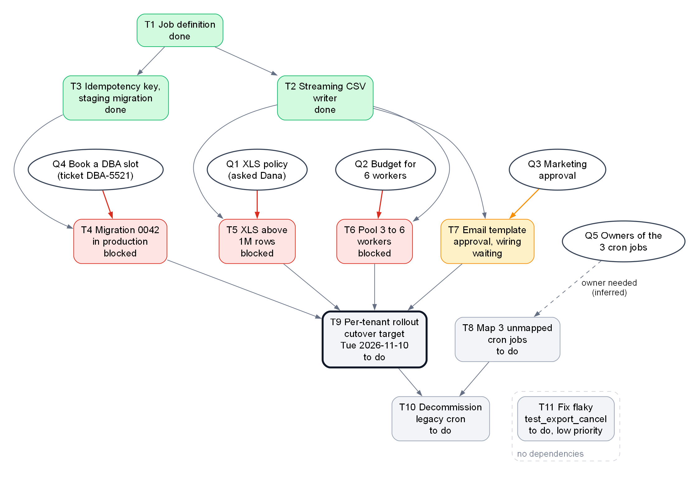

<!-- zone:human -->
# Exports migration handoff: built and tested on staging, four open answers hold up the 2026-11-10 cutover

*2026-10-19 · written by GitHub Copilot from Alex's work log, task list and open questions · draft for Alex to confirm · for Dana (decides) and the next coding agent (continues)*

*"(suggested)" and "inferred" mark the writer's own proposals and inferences; everything else comes from Alex's notes or is computed from them (weekdays, counts).*

## 👤 START HERE - at a glance (for Dana, who decides)

> ### 🟡 At risk - the Tue 2026-11-10 cutover needs four open answers by Fri 2026-10-30
>
> **Bottom line:** The CSV export path is built and passed 20 staging exports. XLS above 1M rows, the production migration, the pool size and the email wording all wait on other people; nothing is done in production yet.
>
> **Confidence:** medium - Alex's notes only, not re-checked in the repo; rollout length and production deploy steps unknown.

> ### 🧭 Decisions needed - Q1 to Q4 gate the rollout; no dates beyond 2026-10-30
>
> - **[Q1](#q1-allow-xls-above-1m-rows-and-alex-prefers-the-zip-option) Dana (asked 2026-10-06, no answer):** XLS above 1M rows - (a) a ZIP of several 1M-row XLS files or (b) CSV only? Alex prefers **(a)**.
> - **[Q2](#q2-pay-for-6-pool-workers-instead-of-3) budget holder (not named):** +1,200 USD/month for 6 workers instead of 3, so Acme's 15-minute SLA holds? No recommendation in the notes.
> - **[Q3](#q3-approve-the-email-wording-and-logo) Marketing:** approve email wording and logo (draft out since 2026-10-12). Dana to chase (suggested).
> - **[Q4](#q4-book-a-dba-slot-for-the-production-migration) someone to be named:** book the production database-admin (DBA) window and stay reachable. Suggested: the earliest slot.
> - **[Q5](#q5-find-owners-for-three-unmapped-cron-jobs) someone to be named:** find owners for 3 cron jobs nobody claims. No date or recommendation in the notes.
> - **[Q6](#q6-keep-or-move-the-cutover-date) Dana (suggested):** keep or move the Tue 2026-11-10 cutover? No recommendation in the notes.
>
> If we get it wrong: a late answer only moves the date (the old cron keeps running); a wrong Q1 or Q2 changes what Acme gets or breaks its SLA.

| | Top risks (ranking is not Alex's) | Impact | Handled in |
|---|---|---|---|
| 🔴 | Four rollout prerequisites wait on other people; none has a date | Cutover slips; Alex's at-risk line is 2026-10-30 | [Q6 Keep or move the cutover date](#q6-keep-or-move-the-cutover-date) |
| 🟠 | Acme's SLA fails with 3 exports at once on 3 workers (21 min, limit 15) | SLA at risk on Monday mornings, when Acme runs several; fix is about +1,200 USD/month | [Q2 Pay for 6 pool workers instead of 3](#q2-pay-for-6-pool-workers-instead-of-3) |
| 🟠 | XLS above 1M rows is only a stub | Acme's XLS exports (4.2M rows) fail if switched before the XLS work (T5) | [Q1 Allow XLS above 1M rows and Alex prefers the ZIP option](#q1-allow-xls-above-1m-rows-and-alex-prefers-the-zip-option) |
| 🟠 | Three legacy cron jobs have no known owner | The old cron cannot be switched off; those jobs would stop | [Q5 Find owners for three unmapped cron jobs](#q5-find-owners-for-three-unmapped-cron-jobs) |
| 🟡 | Alex is back Sat 2026-11-07, one working day before cutover | No one who knows the code until then; one working day of buffer | [4 The agent works alone on staging and never touches production](#4-the-agent-works-alone-on-staging-and-never-touches-production) |

**Carrying on:** a coding agent from next week, staging only; production steps need Dana's go-ahead (suggested). See [section 4](#4-the-agent-works-alone-on-staging-and-never-touches-production).



*Arrows: "must finish first"; ovals: answers people give; dashed: inferred. Takeaway: the rollout (T9, with the Q6 date) waits on four answers, Q1 to Q4; Q5 only gates the cron shutdown (T10).*

**Read next**

- [1 Exports move from cron to JobRunner one tenant at a time behind a flag](#1-exports-move-from-cron-to-jobrunner-one-tenant-at-a-time-behind-a-flag) - the model and the terms · 1 min
- [2 Three of eleven tasks are done and four wait on other people](#2-three-of-eleven-tasks-are-done-and-four-wait-on-other-people) - every task and what it waits on · 2 min
- [3 Six open questions need answers and four gate the rollout](#3-six-open-questions-need-answers-and-four-gate-the-rollout) - options, evidence, what each unblocks · 4 min
- [4 The agent works alone on staging and never touches production](#4-the-agent-works-alone-on-staging-and-never-touches-production) - what it may and must not do · 1 min
- [A Handoff context for the next agent](#a-handoff-context-for-the-next-agent) - commands, ordered steps, decision log · agents only
- [B Evidence](#b-evidence) - Alex's original notes with checksums, and where each entry went · audit only

*Only deciding? Read 3 and stop. Agent continuing the work? Read 4, then A.*

## 1 Exports move from cron to JobRunner one tenant at a time behind a flag

*The model in five lines, so the rest reads cold. Task ids T1 to T11 and question ids Q1 to Q6 are Alex's own numbering. Repo paths are relative to the repo root, given once in [A Handoff context for the next agent](#a-handoff-context-for-the-next-agent).*

- **Legacy cron** runs 14 scheduled export jobs today. 11 map one-to-one to JobRunner definitions; 3 have no known owner (Q5).
- **JobRunner** is the new platform: a job is a YAML file in `jobs/`, run by workers in a pool. Alex built one job, `export-dataset`, for the pool `exports-pool` (3 workers).
- **Per-tenant switch:** the feature flag `exports.jobrunner.enabled` is off by default and can be overridden per tenant (customer account). Planned order: `nimbus-internal` (the internal tenant), then **Acme** (a customer whose contract promises every export within 15 minutes, its SLA), then everyone else.
- **Staging** is the test environment and **production** is the live one. The notes record only local and staging work, and say nothing is done in production yet.
- **Cutover** is the move of production exports from the legacy cron to JobRunner. The notes give only a target date, Tue 2026-11-10. The old cron is switched off last (T10), only after every tenant has moved and the 3 unowned jobs are resolved.

## 2 Three of eleven tasks are done and four wait on other people

| ID | Task | Alex's status | Waiting on, or next move |
|---|---|---|---|
| T1 | Job definition `export-dataset` | done | - |
| T2 | Streaming CSV writer | done | - |
| T3 | Idempotency key (a retried job cannot repeat an email) and `export_runs` migration, staging only | done | - |
| T4 | Apply migration 0042 in production | blocked: needs a DBA window | [Q4](#q4-book-a-dba-slot-for-the-production-migration); a DBA window is the database admins' slot for production changes |
| T5 | XLS export above 1M rows | blocked: needs product decision | [Q1](#q1-allow-xls-above-1m-rows-and-alex-prefers-the-zip-option) |
| T6 | Pool sizing, 3 to 6 workers | blocked: needs budget decision | [Q2](#q2-pay-for-6-pool-workers-instead-of-3) |
| T7 | Email template approval and wiring | in progress: waiting for Marketing | [Q3](#q3-approve-the-email-wording-and-logo); the wiring is done |
| T8 | Map the 3 unmapped cron jobs | todo | no dependency, but owners unknown ([Q5](#q5-find-owners-for-three-unmapped-cron-jobs)) |
| T9 | Per-tenant rollout: `nimbus-internal`, Acme, all others | todo | T4, T5, T6 and T7 |
| T10 | Decommission legacy cron | todo | T8 and T9 |
| T11 | Fix flaky `test_export_cancel` | todo (low priority) | nothing; do last |

**Proven so far** (per Alex's notes; none of it in production): the streaming CSV writer keeps memory under 300 MB and wrote 5M rows in 6 min on one worker; 20 CSV exports for `nimbus-internal` ran fine on staging; 212 tests pass and 1 is marked xfail (a known failing test the suite tolerates; T11). **Not proven:** XLS above 1M rows (a stub), the 6-worker pool, the new email in real use, and anything in production.

**Not on the task list:** whether the 11 mapped cron jobs already have JobRunner definitions (the log shows only one job definition, `export-dataset`), the production deploy steps, and Alex's "remaining ideas" (a Grafana dashboard for export duration and an alert on the dead-letter queue). The agent's first step checks the first one; see [A Handoff context for the next agent](#a-handoff-context-for-the-next-agent).

## 3 Six open questions need answers and four gate the rollout

*Answer by telling the agent, or by filling the decision log in [A Handoff context for the next agent](#a-handoff-context-for-the-next-agent). Q1 to Q4 gate T9; Q5 gates T10; Q6 is the date itself.*

### Q1 Allow XLS above 1M rows and Alex prefers the ZIP option

*Acme's biggest dataset has 4.2M rows, but the XLS library (`xlsxwriter`) stops at 1,048,576 rows per sheet. The XLS code is only a stub that raises `NotImplementedError` above 1M rows.*

- Options in Alex's log (2026-10-06): **(a)** several XLS files of 1M rows each, delivered as a ZIP; **(b)** drop XLS for large datasets and tell customers to use CSV; (c) several sheets in one file, which Alex judged "still capped per sheet, confusing".
- Alex prefers (a). It changes what customers receive, so he asked Dana on 2026-10-06; no answer yet. The notes name Dana as the person asked, not as the final decider.
- Unblocks T5, then T9. Nothing is built beyond the stub.

### Q2 Pay for 6 pool workers instead of 3

*Acme's contract: each export completes within 15 minutes.*

- Acme's biggest dataset (4.2M rows) takes **9.5 min** on the 3-worker pool when it runs alone (pass) and **21 min** when 3 exports run at once (fail); Acme runs several exports on Monday mornings.
- Alex expects 6 workers to fix it for about +1,200 USD/month. The notes record no 6-worker test run, no recommendation and no budget owner.
- The notes do not say how these runs were set up, and an earlier run of 5M rows took 6 min on one worker (2026-10-05), so the two figures are not comparable as they stand.
- Not explored in the notes: autoscaling (it is off in staging; production is not recorded). Suggested: let the agent measure the 6-worker case on staging first (step 3 in A).
- Unblocks T6, then T9.

### Q3 Approve the email wording and logo

- The legacy system sent plain text. The new HTML email template is wired in and used only when a job sets `notify_email`. Marketing has had the draft since 2026-10-12 and has not answered; the notes name no contact.
- Unblocks T7, then T9. After approval the agent applies any requested changes and re-tests on staging.

### Q4 Book a DBA slot for the production migration

- Migration 0042 adds the table `export_runs` as part of the idempotency work (T3): a retried job must not send a second email or overwrite a finished file. It is applied on staging only.
- Production needs a DBA window: Tuesdays and Thursdays 22:00-23:00 UTC. Ticket DBA-5521 is open and unscheduled. Someone must book a slot and be reachable during it; nobody is named.
- T4 depends only on T3 (done), so it does not wait for Q1 to Q3. Suggested: book the earliest window someone can staff. Windows are in the dates table under Q6.

### Q5 Find owners for three unmapped cron jobs

- `export_weekly_xls`, `export_audit` and `export_adhoc` are in the legacy cron with no JobRunner equivalent, and nobody on the team knows who owns them. Each must be mapped or retired before the old cron is switched off (T10).
- T8 has no dependencies in Alex's table, so the agent starts by collecting evidence (what each job does, its last run, who changed it). Retiring a job needs a human owner.

### Q6 Keep or move the cutover date

- T9 cannot start until T4, T5, T6 and T7 are done. Alex's own line: "If the decisions slip past 2026-10-30 the date is at risk." Read here as the answers behind T4 to T7 (Q1 to Q4), which is inferred; the line does not list them.
- The notes do not say how long the three rollout steps take, whether "cutover" on 2026-11-10 means the rollout starts or finishes, or whether the first step (`nimbus-internal`) could start before all four prerequisites are done; Alex's table makes T9 wait for all four.
- Alex is back on Sat 2026-11-07. On a Monday-to-Friday week (assumed), Mon 2026-11-09 is his first working day: one working day before the target.

| Date | What |
|---|---|
| Fri 2026-10-30 | Alex's at-risk line for the answers |
| Tue 2026-10-20, Thu 2026-10-22, Tue 2026-10-27, Thu 2026-10-29 | DBA windows (22:00-23:00 UTC) before that line |
| Tue 2026-11-03, Thu 2026-11-05 | DBA windows after it, before the target |
| Fri 2026-11-06 | Last day of Alex's leave (work log header; Alex says back 7 Nov) |
| Sat 2026-11-07 | Alex is back; Mon 2026-11-09 is the first working day |
| Tue 2026-11-10 | Cutover target, also a DBA window |

*The DBA windows follow Alex's rule "Tuesdays and Thursdays"; all weekdays are computed ([C Derived dates and counts](report.evidence.md#c-derived-dates-and-counts)).*

## 4 The agent works alone on staging and never touches production

*Who carries on: a coding agent, starting next week from this file. Alex is away until Sat 2026-11-07, so the agent asks Dana, not Alex. The "must not" list comes from Alex's notes; "may do alone" and "ask first" are the writer's proposal (suggested) for Dana to change.*

**May do alone** (suggested; T8 and T11 have no dependencies in Alex's table)

- T8: read-only investigation of the three unmapped cron jobs.
- T11, the flaky test: last, and time-boxed.
- On staging only: tests, benchmarks and deploys, and code for T5, T6 or T7 once the matching answer is in the decision log.

**Must not do** (from Alex's notes)

- Apply migration 0042 in production: it needs a DBA window and someone reachable.
- Start the rollout or enable the flag for any production tenant before T4 to T7 are done.
- Edit or switch off the legacy cron before T8 and T9 are done.
- Copy anything from the production vault path `kv://nimbus/exports/prod/*`.
- Retry the two dead ends (loading all rows into memory, LIMIT/OFFSET paging).

**Ask Dana first** (suggested): every production step, any spend such as the production pool size, and any customer-facing wording Marketing has not approved.

---

<!-- zone:archive -->
## 🗄️ Machine and archive zone - agents continuing the work start at A; everyone else can skip

*What is in here: A is the agent's working file (limits, commands, ordered steps, decision log); B points to the original notes and their checksums; C holds the diagram source. They back sections 2 to 4.*

<!-- zone:ai-input -->
### A Handoff context for the next agent

*🤖 AI input - lets a coding agent continue the migration without asking Alex; backs sections 2 to 4. Repo root: `C:\work\nimbus-exports` (Alex's checkout, Python 3.12; use your own checkout root if it differs); every other path in this document is relative to it.*

<details>
<summary>Limits, commands, repo map, ordered steps, decision log, gotchas, gaps, definition of done - click to expand</summary>

**State on 2026-10-19:** task statuses are in the table in section 2. Staging: migration 0042 applied, flag on for `nimbus-internal`, 20 CSV exports ran fine. Production: nothing done (flag off, migration 0042 not applied). All six questions are open.

**Limits - read first**

From Alex's notes:

1. Migration 0042 is not applied in production; it needs a DBA window and someone reachable (T4).
2. The rollout (T9) does not start, and no production tenant's flag is switched on, until T4, T5, T6 and T7 are done.
3. The legacy cron is not edited or switched off before T8 and T9 are done (T10).
4. Never copy secrets. The production runner's secrets live in the vault under `kv://nimbus/exports/prod/*`; do not copy them anywhere (files, logs, this document, chat).
5. T5, T6 and T7 are blocked on Q1, Q2 and Q3: do not change behaviour for them before the matching answer is in the decision log below. Alex prefers Q1 option (a); that is a preference, not a decision.
6. Do not retry the two dead ends listed below.

Proposed by the writer (suggested):

7. No production change of any kind (deploy, flag, pool size) without Dana's go-ahead.
8. If a situation is not covered here, write it in the decision log and tell Dana; do not guess. Alex is away until Sat 2026-11-07 and cannot be asked.

**Setup and commands** (PowerShell, from the repo root)

```powershell
docker compose up -d postgres                                         # Postgres for local runs and tests
python -m exports.cli run --dataset demo --format csv --rows 100000   # local smoke run
pytest tests/exports -q                                               # expect 212 passed, 1 xfailed
./scripts/deploy.ps1 -Env staging -Service exports-runner             # staging only; needs the staging VPN
kubectl get pods -n exports                                           # run after every deploy (see Gotchas)
```

Staging commands need the staging VPN and `kubectl` access. If you have neither, do the local parts only and say so in your report to Dana.

**Repo map**

| Path | What it is |
|---|---|
| `jobs/export-dataset.yaml` | The one JobRunner job Alex wrote (T1). Parameters: dataset, format, tenant, notify_email. Pool `exports-pool`, 3 workers. |
| `src/exports/streaming_csv.py` | `StreamingCsvWriter`: keyset pagination plus a streaming writer (T2). Memory stays under 300 MB. |
| `src/exports/xls_writer.py` | XLS stub; raises `NotImplementedError` above 1M rows (T5). |
| `migrations/0042_export_runs.sql` | Creates table `export_runs`; idempotency key `export_id` (a UUID). Applied on staging only (T3, T4). |
| `templates/export_ready.html` | New notification email; used only when `notify_email` is set (T7). |
| `legacy/crontab.txt` | The 14 legacy cron jobs (T8, T10). |
| `docs/cron-mapping.md` | The 11 cron jobs that map one-to-one to JobRunner definitions. |
| `tests/exports/` | Test suite. `tests/exports/test_export_cancel.py::test_export_cancel` is the flaky one, marked xfail (T11). |
| `scripts/deploy.ps1` | Deploy script; the staging command is above. |
| flag `exports.jobrunner.enabled` | Default false. Per-tenant overrides live in table `tenant_flags`. On for `nimbus-internal` on staging only. |

**Ordered next steps** - steps 1 to 4 need no answer; steps 5 to 8 start when the matching answer is in the decision log, in any order; steps 9 and 10 start when the tasks they depend on are done; (suggested) marks the writer's proposals

1. **Baseline** (any time, local and staging only). Read the decision log. Run the commands above and expect 212 passed, 1 xfailed. List `jobs/` and compare it with `docs/cron-mapping.md`: does every one of the 11 mapped cron jobs have a JobRunner definition? If not, tell Dana; that is work missing from the task list.
2. **T8, map the three unmapped cron jobs** (any time; no dependencies). For each of `export_weekly_xls`, `export_audit` and `export_adhoc` in `legacy/crontab.txt`, record the schedule (legacy logs are in CET), the command it runs, what it exports and for whom, the last evidence of a run, and who last changed it (`git log`). Write the findings in `docs/cron-mapping.md` and propose map or retire for each job (both suggested). Do not retire or delete anything. Done when each job has a written proposal and a named human owner has confirmed it (record in decision log Q5).
3. **Q2 evidence** (optional; staging only; suggested). Scale the staging pool to 6, start 3 exports at once on a 4.2M-row dataset and time them against the 15-minute SLA, then scale back to 3. How a job is submitted to the staging pool and how to scale it are not recorded (see "Not recorded"); the local runner takes `--rows`, so a demo dataset of that size should be possible. Write the result in decision log Q2. Use the same dataset for every run: the notes do not record how the earlier 9.5-minute and 21-minute runs were set up.
4. **T11, flaky test** (low priority; last of the free steps). Alex's diagnosis: timing, the test cancels before the worker has started. He spent half a day and judged more not worth it; stop after about the same. If unfixed, leave the xfail.
5. **Q3 answered, then T7.** Put the approved wording and logo into `templates/export_ready.html`, run the tests, deploy to staging, run an export with `notify_email` set and check the email. Done when Marketing's approval (who, when) is in the decision log and the staging email is correct.
6. **Q1 answered, then T5.** Option (a): in `src/exports/xls_writer.py`, split the output into XLS files of at most 1M rows and deliver them as a ZIP. Option (b): the notes say drop XLS for large datasets and tell customers to use CSV; in code that would be a deliberate message in place of the stub (suggested), and its wording needs Dana's approval. Keep memory bounded: loading all rows in memory killed a 2 GB worker at 2M rows. Add tests and verify on staging with a 4.2M-row dataset. Done when an Acme-sized XLS request no longer hits `NotImplementedError`.
7. **Q2 approved, then T6.** Raise `exports-pool` from 3 to 6 workers (where the pool size is configured is not recorded; find it first) and repeat the timing from step 3. Done when 3 simultaneous 4.2M-row exports each finish within 15 minutes. If Q2 is declined, record that and tell Dana the SLA risk stays open.
8. **Q4 booked, then T4 (run by a human, not by the agent).** The DBA or a named colleague applies `migrations/0042_export_runs.sql` in production in the booked window. The agent may prepare by comparing the file with the staging schema and writing a short pre-flight checklist (suggested). Done when the DBA confirms that 0042 is applied and `export_runs` exists in production.
9. **T4, T5, T6 and T7 all done, then T9, rollout one tenant at a time:** `nimbus-internal`, then Acme, then all others. Mechanism: the flag `exports.jobrunner.enabled` with a per-tenant override in `tenant_flags`; look at the staging row for `nimbus-internal` to see its shape. Get Dana's go-ahead before each production step (suggested). Rollback by switching the override off is the writer's inference, not in the notes. Done when every tenant runs on JobRunner.
10. **T8 and T9 done, then T10, decommission the legacy cron.** Only with Dana's explicit approval; the steps are not recorded. Done when all 14 cron jobs are accounted for (11 mapped, 3 mapped or retired) and the cron is off. Optional afterwards (Alex's "remaining ideas", not tasks): a Grafana dashboard for export duration in the folder "Exports", and an alert on the dead-letter queue.

If no answers arrive: do steps 1 to 4, and by Fri 2026-10-30 tell Dana which of Q1 to Q4 are still open; after that day Alex's at-risk line has passed.

**Decision log** (the one place answers are recorded; then refresh the panel)

| Q | Question | Status | Answer | By | Date |
|---|---|---|---|---|---|
| Q1 | XLS above 1M rows: (a) ZIP of 1M-row XLS files or (b) CSV only | open | | | |
| Q2 | Pay about +1,200 USD/month for 6 pool workers instead of 3 | open | | | |
| Q3 | Marketing approves the email wording and logo | open | | | |
| Q4 | Who books the production DBA slot for migration 0042, and which date | open | | | |
| Q5 | Owners of `export_weekly_xls`, `export_audit`, `export_adhoc`; map or retire each | open | | | |
| Q6 | Keep or move the cutover date Tue 2026-11-10 | open | | | |

**Gotchas** (from Alex's "Things that bit me")

- The runner pool autoscaler is disabled in staging. If exports queue up, scale the pool manually; the notes do not record the command.
- Dates in `export_runs` are UTC. The legacy cron logs are in local time (CET).
- `scripts/deploy.ps1` fails silently when the VPN is down. After every deploy run `kubectl get pods -n exports` and check that the pods are running.

**Dead ends - do not retry**

- Loading all rows into memory and then writing the CSV: fine at 100k rows, but at 2M rows the worker was OOM-killed (container limit 2 GB).
- LIMIT/OFFSET paging: slower with every page (sequential scan).

Both are replaced by keyset pagination plus the streaming writer (T2).

**Not recorded in the notes** (and what to do about each)

- Production deploy procedure for `exports-runner`; only the staging command exists. Ask Dana; do not guess.
- How an export job is submitted to the JobRunner pool on staging, and where the JobRunner docs are (Alex read them on 2026-10-01; no link in the notes). The notes show only the local `exports.cli run` command and the staging deploy. Look in `jobs/export-dataset.yaml`, `exports.cli --help` and the repo docs.
- Where the pool size is configured and how to scale it manually in staging. Find it in the repo and the deploy script before changing anything.
- How a `tenant_flags` override is set, and how a rollout step is verified or rolled back. Copy the shape of the staging row for `nimbus-internal`.
- Whether the 11 mapped cron jobs already have definitions in `jobs/` (the log shows only `export-dataset.yaml`). Checked in step 1.
- How the Acme benchmarks were set up (environment, format, data), and why 4.2M rows took 9.5 min on 3 workers when 5M rows took 6 min on one worker (2026-10-05). Do not rely on either figure; measure again in step 3.
- How long the three rollout steps take, and whether "cutover" on Tue 2026-11-10 means the rollout starts or finishes. Ask Dana.
- Who holds the budget (Q2), who owns the product call (Q1; Alex asked Dana), the Marketing contact (Q3) and who staffs the DBA slot (Q4). Ask Dana.
- Branch, review and dependency-install conventions. Follow the repo's own README or contributing notes; (suggested) work on a feature branch and never push to the main branch.
- Leave dates: the work log header says leave runs 2026-10-17 to 2026-11-06; Alex's request for this handoff says "from tomorrow" and this document is dated 2026-10-19. Both give a return on Sat 2026-11-07, which this document uses.

**Definition of done** (the migration, not one session)

- T4: migration 0042 applied in production and confirmed by the DBA.
- T5: XLS above 1M rows handled as the Q1 answer says; no `NotImplementedError` path left for Acme-sized exports.
- T6: pool sized as the Q2 answer says; 3 simultaneous 4.2M-row exports each finish within 15 minutes, or Dana has accepted the SLA risk in the decision log.
- T7: approved email template live; approval recorded.
- T8: each of the 3 unmapped cron jobs mapped or retired, with a confirmed owner.
- T9: `nimbus-internal`, Acme and all other tenants running on JobRunner in production, in that order.
- T10: legacy cron switched off, only after T8 and T9.
- T11: fixed, or the xfail left on purpose. Nothing depends on it.

**Keeping this document current**

When a status or an answer changes, update in this order:

1. The task row in the section 2 table, the "State" line at the top of this block, and the node in `report.assets/task-map.dot` (status word and fill colour). Then re-render from the folder that holds `report.md` (needs Graphviz): `dot -Tpng -Gdpi=150 report.assets/task-map.dot -o report.assets/task-map.png`.
2. The decision log above. Then take the answered question out of the panel's Decisions block, and edit its section 3 entry only where its facts changed.
3. The panel: the verdict line, the top-risks table (re-rank, drop cleared risks), the key facts, and the date in the line under the title. Keep the title's claim true.
4. Tell Dana in your reply what changed.

</details>

<!-- zone:archive -->
### B Evidence

*🗄️ Archive - Alex's three original notes (byte-exact copies, SHA-256 checksums) and a map from each note entry to where this report uses it; supports every figure and date in sections 2 to 4.*

Full evidence: [report.evidence.md](report.evidence.md) - checksums of the originals in `report.data/`, the note-to-report map, and the derived dates and counts.

<!-- zone:archive -->
### C Diagram source and edge list

*🗄️ Archive - how the task map in the panel was built, so it can be regenerated or checked; supports the picture and the T-to-Q links in sections 2 and 3.*

<details>
<summary>Source file, render command and edge list of the task map</summary>

Source file: [task-map.dot](report.assets/task-map.dot). Render from the folder that holds `report.md`: `dot -Tpng -Gdpi=150 report.assets/task-map.dot -o report.assets/task-map.png`

| From | Relation | To | Verified? |
|---|---|---|---|
| T1 | must finish first | T2 | yes, tasks.md "Depends on" |
| T1 | must finish first | T3 | yes, tasks.md |
| T3 | must finish first | T4 | yes, tasks.md |
| T2 | must finish first | T5 | yes, tasks.md |
| T2 | must finish first | T6 | yes, tasks.md |
| T2 | must finish first | T7 | yes, tasks.md |
| T4 | must finish first | T9 | yes, tasks.md |
| T5 | must finish first | T9 | yes, tasks.md |
| T6 | must finish first | T9 | yes, tasks.md |
| T7 | must finish first | T9 | yes, tasks.md |
| T8 | must finish first | T10 | yes, tasks.md |
| T9 | must finish first | T10 | yes, tasks.md |
| Q4 DBA slot | unblocks | T4 | yes, tasks.md status "blocked: needs a DBA window"; open questions Q4 |
| Q1 XLS policy | unblocks | T5 | yes, status "blocked: needs product decision"; Q1 |
| Q2 budget | unblocks | T6 | yes, status "blocked: needs budget decision"; Q2 |
| Q3 Marketing approval | unblocks | T7 | yes, status "in progress: waiting for Marketing"; Q3 |
| Q5 owners | needed to map | T8 | inferred: tasks.md lists T8 as "todo" with no dependency; Q5 says nobody knows the owners |

</details>
