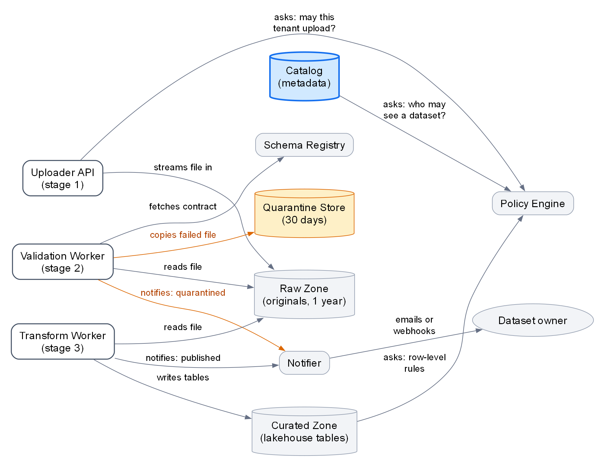

<!-- zone:human -->
# How the ingestion platform works: a first-week explainer

*2026-10-19 · GitHub Copilot, from Sam's architecture notes and the week-one checklist · draft - seven points for Sam to confirm (section 6) · for Priya and other new ingestion engineers*

## 👤 START HERE - at a glance (for Priya and other new ingestion engineers)

> **Mental model:** a customer uploads a file; the platform checks it against the dataset's schema contract (the agreed columns and types) and publishes it as a queryable table. Everything is asynchronous, and the Catalog (the metadata store) records where each upload stands.


*Figure 1 - one upload, read top to bottom. Takeaway: the three stages hand over through the Message Queue, and each records its status in the Catalog (blue, the source of truth). White boxes are the stages (their numbers are this page's labels), cylinders are stores and ovals are people; orange marks the failed-file path and red the infrastructure-failure path. Left out: the Raw Zone, Policy Engine, Schema Registry and Notifier, drawn in [Figure 2](#2-eleven-components-in-three-groups).*

| What to hold on to | The trap if you miss it | Detail |
|---|---|---|
| The Catalog, not the Message Queue, is the truth about an upload's status | Believing the Message Queue when the two disagree | [2](#2-eleven-components-in-three-groups), [4](#4-a-bad-file-is-routine-and-a-broken-dependency-pages-on-call) |
| A message can arrive twice, so every worker must be idempotent (safe to repeat) | Duplicate effects, and an unsafe dead-letter queue (DLQ) replay | [4](#4-a-bad-file-is-routine-and-a-broken-dependency-pages-on-call) |
| A file failing validation is routine: held in quarantine, dataset owner emailed | Treating a bad file as a platform fault | [4](#4-a-bad-file-is-routine-and-a-broken-dependency-pages-on-call) |
| A Version (one upload) never changes; a breaking schema change is a new dataset major version | Editing a Version, or shipping a breaking schema as a new Version | [1](#1-six-concepts-and-four-statuses-to-learn-first) |
| Locally, permission checks (the Policy Engine) are mocked as allow-all unless `POLICY_MODE=strict` | A green local run that real permissions would reject | [5](#5-your-first-week-runs-from-access-to-a-first-ticket), [6](#6-confirm-seven-points-with-sam-before-relying-on-them) |

**Key facts:** published within 15 minutes for files up to 1 GB (typical 50 to 500 MB, maximum 5 GB) · 3 attempts, then the DLQ pages the on-call engineer · quarantine kept 30 days, originals 1 year · every timestamp is UTC

**Week one:** get access, run the local stack and the e2e smoke test with `POLICY_MODE=strict`, upload one passing and one failing sample file, then take INGEST-310 or INGEST-322; also read two runbooks, shadow one on-call shift and join two standing meetings ([5](#5-your-first-week-runs-from-access-to-a-first-ticket)).

**Confidence:** medium - everything comes from Sam's notes (true as of October 2026) and the week-one checklist, none of it checked against code, runbooks or dashboards, and seven points are unconfirmed ([6](#6-confirm-seven-points-with-sam-before-relying-on-them)).

**Read next**

- [1 Six concepts and four statuses](#1-six-concepts-and-four-statuses-to-learn-first) - the words every other section uses · 2 min
- [2 Eleven components in three groups](#2-eleven-components-in-three-groups) - who does what, how long data is kept, Figure 2 · 3 min
- [3 One upload crosses three stages](#3-one-upload-crosses-three-stages-and-ends-published-or-quarantined) - the order of events and the timings · 2 min
- [4 A bad file is routine](#4-a-bad-file-is-routine-and-a-broken-dependency-pages-on-call) - quarantine, retries, DLQ, replay · 2 min
- [5 Your first week](#5-your-first-week-runs-from-access-to-a-first-ticket) - the checklist, with why each step matters · 2 min
- [6 Confirm seven points with Sam](#6-confirm-seven-points-with-sam-before-relying-on-them) - what the notes leave open · 2 min
- [B Config reference](#b-config-reference) - all 20 settings with defaults, in [report.evidence.md](report.evidence.md#config-reference) · as needed

*Short on time? Read this panel, then 3 and 4. About to start a ticket? Add 1 and 2. Looking up a setting? Go to B.*

## 1 Six concepts and four statuses to learn first

*Every later section uses these words. The four statuses are the values the Catalog records for each Version.*

| Term | Meaning, and what to watch |
|---|---|
| **Tenant** | A customer organisation. Everything is scoped to a tenant. |
| **Dataset** | A named collection a tenant owns, with a schema contract. Example: `acme/orders`. |
| **Version** | One upload of a dataset. Immutable: re-uploading creates a new Version and never overwrites. People ask to "fix" a Version; they must upload a new one. |
| **Schema contract** | The agreed column names, types and constraints; validation checks a file against it. Stored per dataset, versioned, in the Schema Registry (the service that holds contracts); only backward-compatible changes are allowed. |
| **Quarantine** | Where a Version goes when validation fails. It stays visible in the Catalog with status `quarantined`. |
| **Lineage record** | Links a published Version to its raw file and to the schema contract version it was validated with. |

Three different things are called a version, so keep them apart: a **Version** is one upload; a **schema contract version** is one revision of a dataset's contract; a **dataset major version** is what a breaking schema change requires, and it is not a new Version.

| Status | Meaning | Set by |
|---|---|---|
| `received` | The original file is stored, the Version exists and validation is queued | Uploader API |
| `validated` | The file passed its schema contract and transform is queued | Validation Worker |
| `quarantined` | The file failed its schema contract and is held back in the Quarantine Store | Validation Worker |
| `published` | The curated table is written and the lineage recorded | Transform Worker |

Three delivery terms come up constantly:

- **At-least-once delivery** - the Message Queue may deliver the same message more than once.
- **Idempotent** - handling the same message twice leaves the same result. Every worker must be, because delivery is at-least-once.
- **Dead-letter queue (DLQ)** - where a message lands after repeated failures (section 4 has the numbers); a message there pages the on-call engineer.

## 2 Eleven components in three groups

*Who does what, how long data is kept and who asks whom. The order of events is in section 3; the grouping is this page's, not the notes'.*



*Figure 2 - what each stage reads, writes and asks; arrows run from the caller to what it uses. Takeaway: the Policy Engine is asked from three places, and the Raw Zone is touched by all three stages. Colours and shapes are as in Figure 1 (blue is the Catalog, orange the failed-file path, cylinders stores, ovals people). Left out: the status writes to the Catalog, which are in Figure 1.*

| Group | Component | Job | Know this |
|---|---|---|---|
| Pipeline | **Uploader API** | The only public entry point: authenticates the caller and starts the pipeline | Hard limit 5 GB (`MAX_UPLOAD_MB` 5120), streamed in 16 MB chunks |
| Pipeline | **Message Queue** | Carries `validate` and `transform` messages between the stages | At-least-once delivery; messages that keep failing end in the DLQ |
| Pipeline | **Validation Worker** | Checks each file against its schema contract | A failed check is a quarantine, not an error. Time limit 600 s per message |
| Pipeline | **Transform Worker** | Converts a validated file to the curated format and publishes it | Time limit 1800 s per message |
| Storage | **Raw Zone** | Immutable blob storage holding the original upload | Kept 1 year |
| Storage | **Quarantine Store** | Holds files that failed validation | Kept 30 days, not 1 year: people mix the two up |
| Storage | **Curated Zone** | The lakehouse tables customers query | Row-level access is enforced by the Policy Engine |
| Shared services | **Catalog** | Metadata store: datasets, Versions, statuses, lineage, owners | The source of truth for status, not the Message Queue. Every timestamp is UTC, including in the Catalog UI. Workers cache Catalog reads for 60 s |
| Shared services | **Policy Engine** | Answers "may this user or tenant do X on dataset Y?" | Asked by the Uploader API (upload rights), the Catalog (who can see a dataset) and the Curated Zone (row-level rules) |
| Shared services | **Schema Registry** | Stores each dataset's schema contract, versioned | Backward-compatible changes only. Reads are cached for 300 s |
| Shared services | **Notifier** | Sends emails and webhooks | Fire-and-forget: it retries twice, and a failed email never fails a Version |

## 3 One upload crosses three stages and ends published or quarantined

*The order of events, with the Catalog status each stage records. Customers upload CSV, Parquet or JSON lines files; the stage numbers are this page's labels. Figure 1 is the same story as a picture.*

**Stage 1 - upload (Uploader API), ends at `received`**

1. Authenticate the caller, then ask the Policy Engine whether this tenant may upload to this dataset.
2. Stream the file into the Raw Zone.
3. Create the Version in the Catalog with status `received`.
4. Put a `validate` message on the Message Queue. Nobody waits on an HTTP call for the outcome.

**Stage 2 - validate (Validation Worker), ends at `validated` or `quarantined`**

1. Take the `validate` message, read the file from the Raw Zone and fetch the dataset's schema contract from the Schema Registry.
2. Check the file against the contract.
3. If it passes, set `validated` and put a `transform` message on the Message Queue.
4. If it fails, copy the file to the Quarantine Store, set `quarantined` and have the Notifier tell the dataset owner why. The pipeline stops for that Version.

**Stage 3 - transform and publish (Transform Worker), ends at `published`**

1. Take the `transform` message and read the validated file from the Raw Zone.
2. Convert it to the curated format and write it to the Curated Zone.
3. Write a Lineage record to the Catalog: which Version came from which raw file and which schema contract.
4. Set `published` and ask the Notifier to email the dataset owner.

| Measure | Value |
|---|---|
| Typical file | 50 to 500 MB, maximum 5 GB |
| Validation, p95 for 1 GB | 40 seconds |
| Transform, p95 for 1 GB | 6 minutes |
| Target | Published within 15 minutes for files up to 1 GB |

## 4 A bad file is routine and a broken dependency pages on-call

*What happens when something fails, who acts and which runbook applies. The two kinds of failure behave very differently.*

| What went wrong | What the platform does | Catalog status | Who acts |
|---|---|---|---|
| The file fails its schema contract | Quarantines it, and the Notifier tells the dataset owner why. An expected outcome, not a platform error | `quarantined` | The owner fixes the file and uploads a new Version, or asks support to release it with the `quarantine-release` runbook (files are kept 30 days) |
| A dependency fails (a blob timeout, the Schema Registry unavailable) | Retries: 3 attempts with backoff of 30 s, 2 min and 10 min, then moves the message to the DLQ, which pages the on-call engineer | Not stated in the notes ([6](#6-confirm-seven-points-with-sam-before-relying-on-them)) | The on-call engineer is paged. The DLQ can be replayed with the `replay-dlq` runbook, which is safe to run because workers are idempotent |

- **Trust the Catalog.** If a Version's status in the Catalog and what you see in the Message Queue disagree, believe the Catalog. Reading the status there first is the sensible place to start (my suggestion).
- **Idempotent is not optional.** The Message Queue may deliver a message twice and a replay runs messages again, so a worker that repeats its effects breaks both.
- **What pages.** The alert fires when the DLQ holds 1 or more messages (`DLQ_ALERT_THRESHOLD` 1). The notes mention paging only for DLQ messages; a quarantine goes to the dataset owner.

## 5 Your first week runs from access to a first ticket

*The week-one checklist in its own order, with what each step teaches. The steps come from the checklist; the pairings with sections and the "why" are mine.*

1. **Get access.** Repo permissions, the `ingestion-dev` cloud subscription, the on-call rota (read-only for now) and Grafana. Do this first: the steps below need it.
2. **Clone the four repos.** `ingest-api`, `ingest-workers`, `schema-contracts` and `platform-docs`. The notes do not say which component lives where ([6](#6-confirm-seven-points-with-sam-before-relying-on-them)).
3. **Run the local stack.** `docker compose up` starts emulators for the Message Queue and blob storage, and the Policy Engine is mocked as allow-all. Then run the e2e smoke test with `POLICY_MODE=strict`, and do the same before every PR: with the allow-all mock, a permission problem cannot show up locally. The notes give no command for the smoke test.
4. **Read the two runbooks.** `replay-dlq` and `quarantine-release` are the two operational actions behind section 4. The notes do not say what a release does to a Version's status; the runbook should.
5. **Upload two sample files.** One that passes and one that fails validation, and follow both in the Catalog UI. Expect `published` for the first and `quarantined` for the second; timestamps are UTC. The notes do not say where to upload, the local stack or `ingestion-dev` ([6](#6-confirm-seven-points-with-sam-before-relying-on-them)).
6. **Shadow the on-call engineer for one shift.** If a DLQ page comes in, that is section 4 in practice. Your rota access is read-only for now.
7. **Pick up a starter ticket.** INGEST-310 (add a column type to the Schema Registry validator) or INGEST-322 (improve the quarantine email wording). Read sections 1 and 3 first for INGEST-310, sections 2 and 3 for INGEST-322.
8. **Join the standing meetings.** The weekly ingestion sync (Wednesdays 10:00 CET) and the Friday incident review (the notes give no time).

## 6 Confirm seven points with Sam before relying on them

*Where the notes are silent or disagree, and what this page does about it. Delete this section once Sam has answered.*

| Point | What the notes say | What this page does |
|---|---|---|
| Local policy default | The config table lists `POLICY_MODE` as `strict` by default, with `allow-all` only in local dev. A gotcha says the local stack mocks the Policy Engine as allow-all unless you set `strict` | Follows the gotcha: set `POLICY_MODE=strict` yourself for every smoke test |
| Retry count | One place says 3 attempts with delays of 30 s, 2 min and 10 min; another says "retried 3 times" | Says "3 attempts, then DLQ". If all three delays run, they add up to 12.5 minutes (my sum) before a message can reach the DLQ |
| Status of a dead-lettered Version | Not stated | Leaves it open in section 4. My inference, unconfirmed: it keeps the last status written, because each stage sets only its own |
| What `quarantine-release` does | Support can release a file with it; the effect on the Version is not described | Says nothing more; the runbook is on your week-one list |
| Which repo holds what | Four repos are listed; where each component lives is not | Makes no claim |
| Practical details missing | The notes say to run "the e2e smoke test" with no command, name the Friday incident review with no time, and say to upload sample files without saying where (local stack or `ingestion-dev`) | Gives none of the three; ask the team |
| Largest files and the transform time limit | Transform p95 is 6 minutes for 1 GB, the time limit is 1800 s and the maximum file is 5 GB | My arithmetic: if transform time scales linearly, 5 GB takes about 30 minutes, which is the limit. Unverified |

---

<!-- zone:archive -->
## 🗄️ Machine and archive zone - skip unless you need the raw reference or are an agent updating this page

*Settings, diagram edge lists and the stated-versus-inferred ledger back the claims above. Nothing here is needed to understand the platform.*

<!-- zone:ai-input -->
### A Keeping this page current

*🤖 AI input - what an agent needs to update this page without breaking it. Paths are relative to this file's folder.*

<details>
<summary>Sources, what goes stale, commands and constraints - click to expand</summary>

**Sources.** `architecture-notes.md` (Sam's notes, "true as of October 2026") and `onboarding-checklist.md`. Their SHA-256 values are in [report.evidence.md](report.evidence.md#sources); if either file changes, re-check this page against it.

**Facts that go stale, check these first.** Every number in sections 2 to 4 and in the panel's key facts (limits, timings, retries, retention), the 20 settings in block B, the four repo names, the tickets INGEST-310 and INGEST-322, the meeting times and the four status names.

**Where each fact lives.** Write it once and change it there:

- Retention, limits, time limits, caches: the section 2 table. Timings: the section 3 table. Retry and backoff numbers: the section 4 table.
- Status names: the section 1 table and the edge labels in `flow-map.dot`.
- Component names: the section 2 table, both `.dot` files and both edge lists in [report.evidence.md](report.evidence.md#diagram-edge-lists). Keep each name exactly as written.

**Regenerate the figures** (Graphviz, run from this file's folder). Both sources pin the order of the stages with invisible edges inside `rank=same` groups; keep those when adding nodes.

```
dot -Tpng -Gdpi=150 report.assets/flow-map.dot -o report.assets/flow-map.png
dot -Tpng -Gdpi=150 report.assets/touch-map.dot -o report.assets/touch-map.png
```

**Constraints.** Keep the config table out of the human zone. Mark anything that is not in the notes as inferred or mine, and add it to the ledger in [report.evidence.md](report.evidence.md#stated-versus-inferred). Call the local emulators and the allow-all Policy Engine mock what they are, never production behaviour. Keep both figures legible at about 800 px wide.

**Open items.** The seven points in section 6 wait for Sam. When he answers, update the section each point touches, delete section 6, change the status in the line under the title from draft to final, and remove every pointer to section 6 (the line under the title, the panel's traps table, Confidence line and Read-next list, and sections 4 and 5).

**Moving or renaming.** `report.md`, `report.evidence.md` and `report.assets/` travel together and link to each other by relative path. If the page gets another name, rename the other two to match and update every link that names them (search for `report.`).

**Done when.** The panel agrees with sections 1 to 4, every link and image resolves, and both PNG files were rebuilt from their `.dot` sources after any change.

</details>

<!-- zone:archive -->
### B Config reference

*🗄️ Archive - all 20 settings from the notes, verbatim; backs the numbers in sections 2 to 4.*

Full table: [report.evidence.md](report.evidence.md#config-reference) - each setting with its default and the notes' own comment.

<!-- zone:archive -->
### C Diagram edge lists

*🗄️ Archive - every edge of Figures 1 and 2 with the sentence in the notes that backs it, so the diagrams can be checked or regenerated.*

Full lists: [report.evidence.md](report.evidence.md#diagram-edge-lists) - 12 edges in Figure 1 and 12 in Figure 2, none inferred. Sources: [flow-map.dot](report.assets/flow-map.dot) and [touch-map.dot](report.assets/touch-map.dot).

<!-- zone:archive -->
### D Stated versus inferred

*🗄️ Archive - what this page adds to the notes: derived numbers, inferences, my own labels and suggestions.*

Full ledger: [report.evidence.md](report.evidence.md#stated-versus-inferred)
