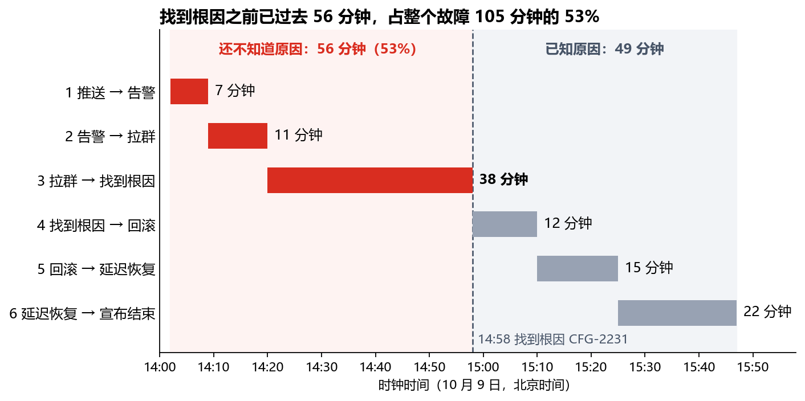
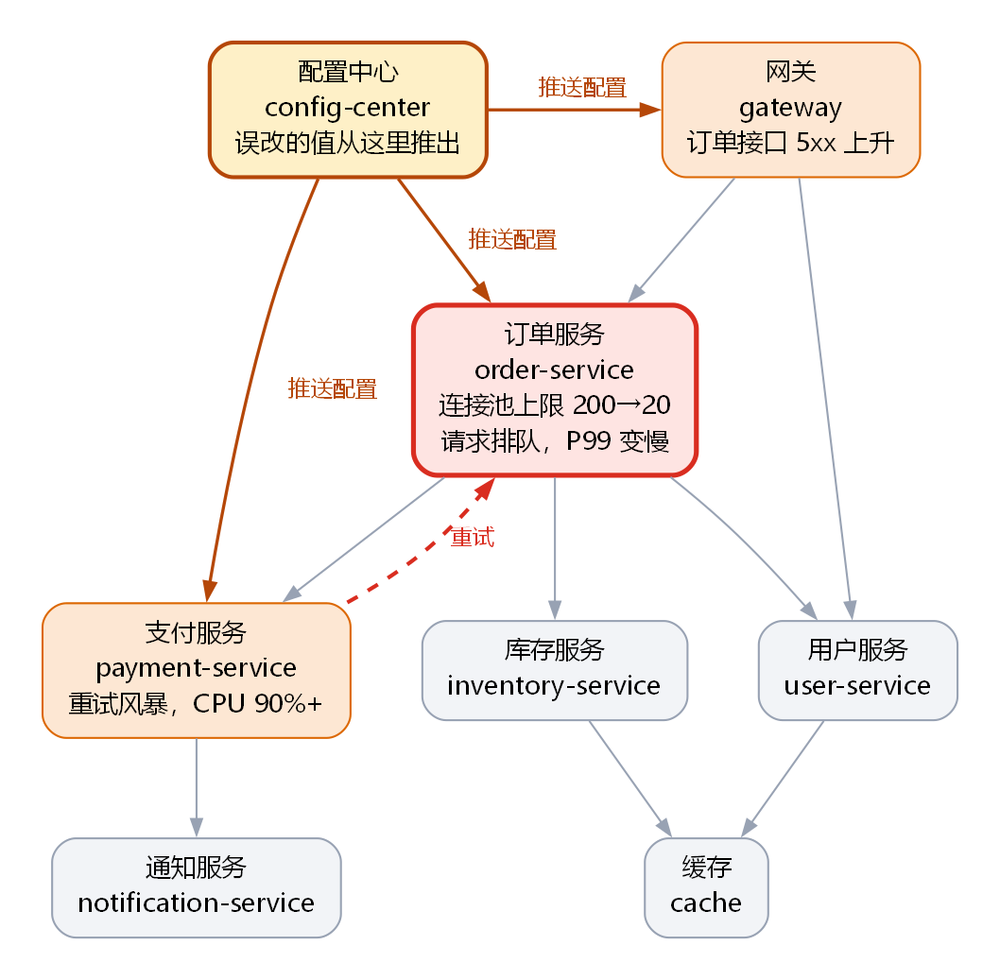

<!-- zone:human -->
# 订单故障复盘（10 月 9 日，周五）：配置误改使下单与支付故障 105 分钟，需决定先做哪些改进项

*2026-10-19 · 整理：Copilot（AI 助手） · 状态：终稿，第 5 节的数据待相关同事核对 · 读者：全体研发团队，技术负责人张伟据此决定改进项优先级 · 依据：李娜整理的时间线、服务清单、故障群聊天记录*

## 👤 从这里开始 - 一览（读者：全体研发团队；张伟据此定改进项顺序）

> ### 🟡 故障已结束、根因已查明，但六项改进都还没定优先级，同类误配仍可能再发生
>
> **结论：** 配置变更 CFG-2231 把订单服务的连接池上限从 200 误改成 20（本意只改测试环境），14:02 一次性全量推送（无灰度），下单与支付故障 105 分钟，约 3,800 笔订单失败、约 1,200 名用户受影响；15:10 回滚后恢复。
>
> **把握：** 根因：高（回滚后 15 分钟内恢复）；影响数字：中（取自时间线，未用监控复核；另有四处来源之间对不上，见 [5 待核对](#5-待核对-四处数据对不上-两件事来源没说)）。

> ### 🧭 需要决定
>
> - **张伟** 决定下个迭代**先做哪些改进项**（6 项共 17 人天，只腾得出约 10 人天）。来源没给日期和优先级建议；本报告建议在下个迭代排期前定，先做 A4 值班手册、A6 双人评审、A3 告警阈值、A1 取值校验、A5 重试退避（共 9 人天），A2 灰度（8 人天）顺延。详见 [4](#4-改进项排序-建议先做五项共九人天-a2-顺延)
> - **张伟** 决定**要不要新增“配置按环境区分默认值”一项**：群聊提到了这个缺口，六项里没有对应项；来源没有日期、负责人和工作量。本报告建议和上一项一起定，先评估工作量。详见 [3](#3-根因-误改的配置没有被任何一道防线拦住)
>
> 排错的代价：同类误配仍会无校验、无灰度地全量推送，支付仍会放大订单服务的任何故障。

| | 主要风险（排序是本报告的判断） | 后果 | 详见 |
|---|---|---|---|
| 🔴 | 配置变更仍可无校验、无灰度地全量上线 | 一个误改值再次全量生效 | [3](#3-根因-误改的配置没有被任何一道防线拦住) |
| 🟠 | 测试环境的改动仍可写成全局默认值，且没有对应改进项 | 本次的出错路径依旧畅通 | [3](#3-根因-误改的配置没有被任何一道防线拦住) |
| 🟠 | 支付对订单的重试仍无退避、无熔断 | 订单服务任何变慢都拖垮支付 | [4](#4-改进项排序-建议先做五项共九人天-a2-顺延) |
| 🟠 | 值班仍不先查配置变更 | 本次拉群后找根因花了 38 分钟 | [2](#2-故障经过-找到根因时已过去一半以上的时间) |
| 🟡 | 6 项 17 人天，预算约 10 人天 | 不排序，最大的一项会挤掉其余 | [4](#4-改进项排序-建议先做五项共九人天-a2-顺延) |



*怎么看：每行一个阶段，红色是还不知道原因的三段；知道原因之后，回滚加生效只用了 27 分钟。*

**接下来读**

- [2 故障经过](#2-故障经过-找到根因时已过去一半以上的时间) - 105 分钟花在哪里 · 2 分钟
- [3 根因](#3-根因-误改的配置没有被任何一道防线拦住) - 七道防线的现状 · 2 分钟
- [4 改进项排序](#4-改进项排序-建议先做五项共九人天-a2-顺延) - 六项怎么排、为什么 · 3 分钟
- [5 待核对](#5-待核对-四处数据对不上-两件事来源没说) - 哪些数字还不能当结论 · 1 分钟
- [A 原始群聊记录](#a-原始群聊记录) - 原文备查 · 按需

*只做决定？读 4 即可。术语不熟？先看 [1 系统图与术语](#1-系统图与术语-故障沿配置中心到订单到支付传播)。要查证据：A，或 [report.evidence.md](report.evidence.md)。*

## 1 系统图与术语 故障沿配置中心到订单到支付传播

*一句话的模型：错误的值经配置中心进入订单服务，订单服务排队变慢，支付服务的无退避重试再把自己和订单服务一起压垮。*



*怎么看：箭头＝调用（服务清单），“推送配置”例外；红＝故障点，橙＝受波及，灰＝来源没提到受影响；红虚线＝群聊里的支付重试订单，服务清单没记（见 [5](#5-待核对-四处数据对不上-两件事来源没说)）。结论：订单服务是故障点，支付的重试放大了它。*

- **CFG-2231**：出事的那次配置变更的编号，13:58 合并。
- **配置中心**：统一保存并下发各服务配置的系统；这次由它把新配置推给网关、订单服务和支付服务。
- **连接池上限**：订单服务同时可用的连接数上限；用完后新请求排队，处理线程被占住。
- **灰度**：新配置先推给一小部分实例，观察一段时间没问题再推给全部；这次没有灰度，是一次性全量推送。
- **重试风暴、退避、熔断**：超时后大量重试会拖垮被调用方和调用方自己；退避是重试间隔逐次拉长，熔断是失败过多时暂停调用。
- **A1 到 A6**：时间线里六项改进的编号，对照见 [4](#4-改进项排序-建议先做五项共九人天-a2-顺延) 的表。

## 2 故障经过 找到根因时已过去一半以上的时间

*回答：105 分钟花在了哪里，哪一段最值得缩短（分段图在一览里）。时间均为北京时间；逐条核对见 [B1 时间线与群聊逐条核对](report.evidence.md#b1-时间线与群聊逐条核对)。*

| 阶段 | 时间 | 用时 | 当时发生的事 |
|---|---|---|---|
| 1 推送到告警 | 14:02–14:09 | 7 分钟 | 新配置推给网关、订单、支付；14:05 订单 P99 超过 3 秒，告警阈值是 5 秒，14:09 才告警 |
| 2 告警到拉群 | 14:09–14:20 | 11 分钟 | 14:11 客服收到第一批投诉；14:12 值班的王磊看到告警，订单服务 CPU 和内存都不高 |
| 3 拉群到找到根因 | 14:20–14:58 | 38 分钟 | 先查数据库（14:27 提出，14:35 排除）；14:40 得知下午没有服务发布；14:46 决定不重启、先抓线程栈，14:52 线程栈指向连接池；14:58 对出 CFG-2231 |
| 4 找到根因到回滚 | 14:58–15:10 | 12 分钟 | 15:01、15:03 群里先讨论“怎么推到了生产”，15:07 决定回滚，15:10 回滚并开始推送 |
| 5 回滚到延迟恢复 | 15:10–15:25 | 15 分钟 | 15:14 线程池开始释放，15:25 延迟恢复正常 |
| 6 延迟恢复到宣布结束 | 15:25–15:47 | 22 分钟 | 15:31 支付 CPU 回落，15:40 没有新投诉，15:47 错误率低于 0.1% |

**影响**（来源：时间线，未用监控复核）

- 失败订单约 3,800 笔，受影响用户约 1,200 人。
- 支付服务被重试风暴推到 CPU 90% 以上，时间线记为约 40 分钟（与群聊对不上，见 [5](#5-待核对-四处数据对不上-两件事来源没说)）。
- 当月可用性从 99.97% 降到 99.93%，比 99.95% 的 SLO（可用性目标）低 0.02 个百分点。

**做得好的地方**（本报告的判断）

- 14:44 有人提议重启订单服务，14:46 王磊先抓线程栈、保留现场；6 分钟后线程栈指向连接池，12 分钟后找到根因。
- 数据库方向很快排除：14:27 提出，14:35 DBA 老吴回复正常，8 分钟。
- 回滚后 15 分钟内延迟恢复正常。

## 3 根因 误改的配置没有被任何一道防线拦住

*回答：为什么一次本意只改测试环境的变更，4 分钟内就全量推送到了网关、订单服务和支付服务，并让下单和支付瘫痪 105 分钟。*

**根因**（时间线的结论；把握：高，依据是回滚后 15 分钟内恢复，且线程栈里大部分线程在等连接池）：13:58 合并的 CFG-2231 把连接池上限从 200 误改成 20。本意只改测试环境，结果改成了全局默认值；配置中心没有取值范围校验，这个值原样生效。

下表按误改经过的先后，列出七道防线在这次的情况，顺序不代表重要性。防线 3 是时间线的根因，4 至 7 是时间线的四条促成因素，防线 1 来自群聊 15:03，防线 2 来源没说。

| 防线 | 本次的情况 | 依据 | 对应改进项 |
|---|---|---|---|
| 1 配置的作用范围 | 配置中心不区分环境的默认值，本意只改测试环境的值成了全局默认值 | 群聊 15:03 李娜；时间线（“误改了全局默认值”） | 无 |
| 2 合并前评审 | CFG-2231 是否评审过，来源没说 | 无 | A6 |
| 3 取值范围校验 | 没有，200 改成 20 直接生效（根因） | 时间线 | A1 |
| 4 灰度推送 | 没有，14:02 一次推给网关、订单、支付 | 时间线促成因素 1 | A2 |
| 5 延迟告警 | 阈值 5 秒，14:05 超过 3 秒、14:09 才响 | 时间线促成因素 2 | A3 |
| 6 值班手册 | 没有“先查配置变更”一步；14:38 问的是有没有发布，14:40 得到“没有”，直到 14:57 才有人去看配置 | 时间线促成因素 3；群聊 | A4 |
| 7 调用方保护 | 支付对订单的重试没有退避和熔断，CPU 被推到 90% 以上 | 时间线促成因素 4 | A5 |

（本报告的解读）14:40 那句“今天下午没有服务发布”字面上没错，但配置变更不算“发布”，这条线索就被排除了。A4 要补的正是这个盲区。

## 4 改进项排序 建议先做五项共九人天 A2 顺延

*回答：约 10 人天先做哪些。来源只给了六项改进、负责人和估算，没有给优先级；下面的排序是本报告的建议。时间线的预估单位是“天”，这里按 1 天 = 1 人天计，未重新估算。*

预算对不上：6 项合计 **17 人天**，下个迭代大约能腾出 **10 人天**（时间线）。周杰名下的 A1 与 A2 合计 11 人天，一个人就超过整个预算；来源只给了团队总量，没有给每个人的可用天数。

| 建议顺序 | 编号 | 改进项 | 负责人 | 人天 | 累计 | 针对本次的哪一环 |
|---|---|---|---|---|---|---|
| 1 | A4 | 值班手册加入“先查最近 30 分钟的配置变更” | 王磊 | 0.5 | 0.5 | 拉群后找根因用了 38 分钟（14:20–14:58） |
| 2 | A6 | 配置变更必须双人评审（CODEOWNERS 规则） | 李娜 | 1 | 1.5 | 合并环节；是否评审过，来源没说 |
| 3 | A3 | 订单服务延迟告警阈值从 5 秒降到 2 秒 | 王磊 | 0.5 | 2 | 推送到告警 7 分钟，最多提前这 7 分钟 |
| 4 | A1 | 配置中心增加取值范围校验（最小值、最大值） | 周杰 | 3 | 5 | 根因：200 改成 20 直接生效 |
| 5 | A5 | 支付服务对订单服务的重试增加指数退避和熔断 | 赵敏 | 4 | 9 | 重试风暴让支付 CPU 到 90% 以上 |
| 6 | A2 | 配置推送支持灰度（先推 5% 实例，观察 10 分钟） | 周杰 | 8 | 17 | 14:02 一次推给三个服务，没有缓冲 |

按这个顺序，累计到第 5 项是 **9 人天**，在预算之内；加上 A2 是 17，超出约 7 人天。预算缩水就从表尾往前砍：5 人天只够做到 A1，2 人天只够做到 A3。

**怎么排的**（本报告的判断）

1. 先做便宜、能缩短或拦住这次故障的项。A4 用 0.5 人天对准最长的一段（38 分钟）；A6 用 1 人天多一道人工关卡；A3 只要 0.5 人天，但上限只有 7 分钟，告警规则还有疑点（见 [5](#5-待核对-四处数据对不上-两件事来源没说)），顺手做、不必争先。
2. 再做直接对应根因的 A1，和管住放大环节的 A5。
3. A2 最贵，一项占预算的八成。它不只拦越界的值，凡是 10 分钟内能在指标上看出来的坏配置都能拦，所以是顺延，不是放弃。

**其他方案**

| 方案 | 包含 | 人天 | 留下的缺口 |
|---|---|---|---|
| X（建议） | A4、A6、A3、A1、A5 | 9 | 配置仍一次全量推送，只靠 A1 与 A6 拦截；A2 排到下个迭代之后 |
| Y | A2、A4、A6、A3 | 10 | A1 没做：越界值要进了灰度实例才暴露；A5 没做：订单变慢仍会拖垮支付 |
| Z | 全部六项 | 17 | 要追加约 7 人天，来源没说能不能追加 |

**三处措辞或前提要先对一下**（本报告的建议）

- A4：“最近 30 分钟”要从告警时刻往前数，不能从“现在”往前数：推送在 14:02，从“现在”往前数的话 14:32 以后就查不到它，而群聊里 14:38 才有人问“最近有没有发布”。还可以写上“定位到可疑变更先回滚，再讨论原因”（根因 14:58 找到，15:07 才决定回滚）。
- A3：告警原文是“> 5s，已持续 5 分钟”，规则里似乎带“持续 5 分钟”的条件，只降阈值可能提前不了多少；建议王磊连同持续时间一起看。
- A5：服务清单里没有“支付调用订单”这条边，赵敏动手前要先确认真实的调用路径。

**未列入的缺口**（建议新增，暂记 A7）：配置中心区分环境的默认值（见 [3](#3-根因-误改的配置没有被任何一道防线拦住) 的防线 1）。来源没有负责人和工作量，不计入上面的 9 人天；方案 X 剩下的约 1 人天可以先用来评估它。

## 5 待核对 四处数据对不上 两件事来源没说

*回答：哪些数字和结论现在还不能当最终结论，谁能确认。前四项是来源之间对不上，后两项是来源没说。*

| 事项 | 来源怎么说 | 影响什么 | 建议谁确认 |
|---|---|---|---|
| 1 数据库方向耗时 | 时间线：这个方向浪费约 25 分钟。群聊：数据库只占 14:27–14:35 共 8 分钟；14:20 拉群到 14:46 抓线程栈是 26 分钟 | 报告不引用“25 分钟”，改用能从群聊算出的 8、26、38 分钟 | 李娜、王磊 |
| 2 支付 CPU 90% 以上的时长 | 时间线：约 40 分钟。群聊：14:22 已 90%，15:31 才有人报告回落，相隔 69 分钟 | 影响的持续时间；报告沿用 40 分钟并标待核 | 赵敏（看 CPU 曲线） |
| 3 告警为什么 14:09 才响 | 时间线：阈值 5 秒，所以 14:09 才触发。告警原文“> 5s，已持续 5 分钟”：规则似乎带持续时间条件，5 秒线在 14:04 前后就被越过，比时间线的 14:05 略早 | A3 的收益可能小于预期 | 王磊（看告警规则） |
| 4 支付是否调用订单 | 服务清单：只有订单调用支付，没有支付调用订单。群聊和时间线：支付在重试订单 | A5 动手前要先弄清调用路径；服务清单漏了一条 | 赵敏 |
| 5 CFG-2231 有没有评审 | 来源没说 | 没法判断 A6 能不能拦住这类误改 | 查合并记录 |
| 6 支付、网关的连接池是否也成了 20 | 来源只证实订单服务线程池满；配置推送到了三个服务 | 影响面可能被低估 | 周杰、赵敏 |

另外，失败订单、受影响用户和可用性三个数字只有时间线一个来源，没有交叉验证。逐条核对见 [B1 时间线与群聊逐条核对](report.evidence.md#b1-时间线与群聊逐条核对) 和 [B3 数字推导](report.evidence.md#b3-数字推导)。

---

<!-- zone:archive -->
## 🗄️ 机器与存档区 - 需要查证时再看，不需要的人可以直接跳过

*这里放原始群聊记录（A，按要求留在报告里）和证据文件的入口（B）。它们支撑第 2、3、5 节里的时间点、数字和判断。*

<!-- zone:archive -->
### A 原始群聊记录

*🗄️ 存档 - 故障当天群聊的原文，逐字保留，没有改动；支撑第 2、3、5 节里的每一个时间点。来源 chat-log.txt，校验和见 [B4 来源与校验和](report.evidence.md#b4-来源与校验和)。*

<details>
<summary>展开 28 条消息（14:09–15:47）</summary>

```text
[14:09] 告警机器人: 订单服务 P99 延迟 > 5s，已持续 5 分钟
[14:12] 王磊: 看到告警了，我先看下
[14:13] 客服-小陈: 有用户反馈下单一直转圈，已经 10 多个了
[14:15] 王磊: 订单服务 CPU 不高，内存也正常，奇怪
[14:17] 客服-小陈: 现在 30 多个了，群里有人说支付也卡
[14:20] 王磊: 拉群了，@赵敏 @周杰 @李娜 麻烦都进一下，订单和支付都有问题
[14:22] 赵敏: 支付服务 CPU 90% 了，在疯狂重试订单服务
[14:24] 周杰: 网关这边 5xx 在涨，主要是订单接口
[14:27] 王磊: 先看是不是数据库的问题，@DBA-老吴
[14:35] DBA-老吴: 数据库连接数、慢查询都正常，不是数据库
[14:38] 王磊: 那是啥……有没有最近的发布？
[14:40] 李娜: 今天下午没有服务发布。
[14:44] 赵敏: 要不要先重启订单服务？
[14:46] 王磊: 先别，重启会丢掉现场。我先抓一份线程栈
[14:52] 王磊: 线程栈里大部分线程都在等连接池
[14:55] 赵敏: 连接池？这个值不是 200 吗
[14:57] 赵敏: 我看下配置……现在是 20
[14:58] 赵敏: 找到了，CFG-2231，今天 13:58 合并的，把默认值改成 20 了
[15:01] 周杰: 这是我们测试环境的改动，怎么推到生产了
[15:03] 李娜: 配置中心没有区分环境的默认值，也没有范围校验……
[15:07] 王磊: 先回滚再说
[15:10] 周杰: 已回滚 CFG-2231，正在推送
[15:14] 赵敏: 订单服务线程池开始释放了
[15:20] 王磊: 延迟在降
[15:25] 王磊: 延迟恢复正常
[15:31] 赵敏: 支付服务 CPU 也降下来了，重试风暴结束
[15:40] 客服-小陈: 新的投诉没有了
[15:47] 王磊: 错误率 < 0.1%，宣布故障结束。晚点拉复盘
```

</details>

<!-- zone:archive -->
### B 证据文件

*🗄️ 存档 - 时间线与群聊的逐条核对、服务清单与图的边表、数字推导、来源与校验和；支撑一览和第 1 至 5 节里的时间点、数字与系统图。*

完整证据：[report.evidence.md](report.evidence.md) - B1 时间线与群聊逐条核对，B2 服务清单与图的边表，B3 数字推导，B4 来源与校验和。三个输入文件的逐字节副本在 `report.data/`。
