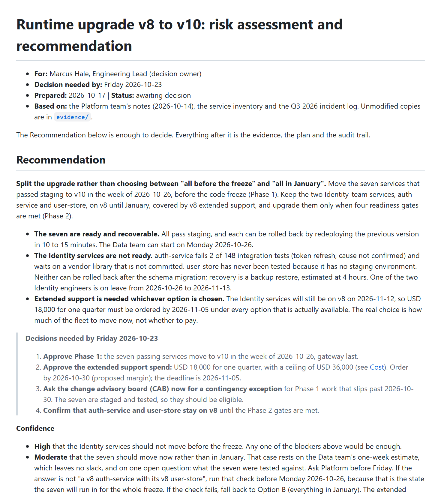
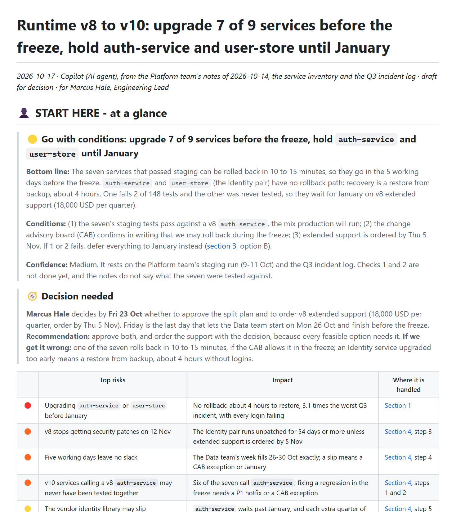

# Upgrade risk report · iteration 1

[← Iteration 1](README.md) · [Review dashboard](../README.md)

> **Prompt given to both agents**
>
> Our runtime upgrade (v8 to v10) is on the table and our Eng Lead, Marcus, has to decide by Friday whether we upgrade before the November code freeze or push everything to January. I put the notes, the service inventory and last quarter's incidents in examples/01-upgrade-risk-report/input/. Write the assessment report for Marcus. I also want it kept in the repo as the audit trail for whatever we decide, so keep the supporting data.

## Result

| | Without the skill | With the skill |
|---|---|---|
| Assertions passed | **8 / 14** (57%) | **14 / 14** (100%) |
| Automatic checker (the v0.1 checker: errors and warnings, no tiers) | 0 errors · 4 warnings | 0 errors · 0 warnings |

## What the reader sees first

| Without the skill | With the skill |
|---|---|
|  |  |
| [Open the document](outputs/eval-1-upgrade-risk-report/without-skill/report.md) | [Open the document](outputs/eval-1-upgrade-risk-report/with-skill/report.md) |

## Assertion scorecard

Each assertion was graded by an agent that read the document and cited evidence; ✅ passed, ❌ failed. The evidence for every failure is below, and the full evidence for every assertion is in the raw `grading.json` of each run.

| Assertion | Without | With |
|---|:-:|:-:|
| Zones labeled | ❌ | ✅ |
| Human part highlighted | ❌ | ✅ |
| Glance first | ✅ | ✅ |
| Reading path | ❌ | ✅ |
| Links work | ✅ | ✅ |
| Relationship diagram | ✅ | ✅ |
| Diagram portable | ✅ | ✅ |
| Diagram readable | ✅ | ✅ |
| Evidence out of the way | ✅ | ✅ |
| Headings tell the story | ❌ | ✅ |
| Verdict and ask first | ✅ | ✅ |
| Top risks first | ❌ | ✅ |
| Figures are right | ❌ | ✅ |
| Audit data kept | ✅ | ✅ |

The full text of every assertion in this scorecard

- Zones labeled: the document labels a part for human reading and a separate part for AI-input / archive / evidence material, using explicit headings or banners that name the audience (a bare 'Appendix' does not count), and the two parts do not interleave
- Human part highlighted: the part written for humans is marked by a prominent banner or heading that says it is for people or where to start (for example an emoji-led 'start here' heading), so a reader cannot miss it
- Glance first: the first section after the title is a one-screen overview that states the conclusion itself (what is true or what to do), not merely what the document covers; no background, method or table of contents comes before it
- Reading path: within the first screen (about 60 lines) there is a reading path or 'read next' list with at least 3 working links to sections, each saying what the reader gets
- Links work: every in-document link and every image path resolves (scripts/check_doc.py reports no ERROR lines)
- Relationship diagram: the nine services and their dependencies are shown as a diagram (embedded image or Mermaid) that includes all nine services and labels or clearly draws the relationships
- Diagram portable: the diagram a human sees first is an embedded image file that exists on disk (PNG or SVG), not only a Mermaid or other code block, because the reader's VS Code preview and Azure DevOps repo pages do not render Mermaid
- Diagram readable: the diagram has a caption or how-to-read line, and viewing the rendered image shows legible labels with no overlapping or cut-off text
- Evidence out of the way: bulky raw material (the 36 incident rows, the full inventory table, long logs) is not in the human part; it sits in the archive/machine part or in a linked file
- Headings tell the story: at least half of the body headings state a claim, finding or question rather than a generic topic label like 'Overview', 'Analysis' or 'Details'
- Verdict and ask first: the first screen gives a clear recommendation on upgrading before the freeze versus deferring (a conditional or split answer is fine) and names the decision Marcus must make with its deadline (Friday 23 Oct)
- Top risks first: the first screen lists at least 3 top risks with severity markers, including the 12 Nov end of support and the missing rollback path for auth-service
- Figures are right: the report states that auth-service has 6 dependents and accounts for 11 of the 36 Q3 incidents
- Audit data kept: the 36 incident rows and the 9-service inventory are preserved for audit, inline in the archive part or as linked files, as the user asked

### Evidence for the failed assertions

❌ <b>Zones labeled</b> · without the skill

**Assertion:** Zones labeled: the document labels a part for human reading and a separate part for AI-input / archive / evidence material, using explicit headings or banners that name the audience (a bare 'Appendix' does not count), and the two parts do not interleave

**Grader evidence:** No zone labels exist. The headings are Recommendation, Options considered, What the evidence shows, Plan, Cost, Risks, Assumptions and open items, When to revisit, Decision record, then 'Appendix A: Supporting data', 'Appendix B: Q3 incident analysis' and 'Appendix C: Key dates' - bare appendices that name no audience. mechanical.json warns 'no &lt;!-- zone:... --&gt; markers; human-read and machine/archive content are not marked' and stats.zones is \[]. The only orientation is plain text at line 8: 'The Recommendation below is enough to decide. Everything after it is the evidence, the plan and the audit trail.' That is not a heading or banner, names no audience (people vs AI/archive), and lumps the plan and the decision record in with the evidence. The evidence/ and analysis/ folders form a separate bundle on disk, but report.md itself never labels the two audiences.

❌ <b>Human part highlighted</b> · without the skill

**Assertion:** Human part highlighted: the part written for humans is marked by a prominent banner or heading that says it is for people or where to start (for example an emoji-led 'start here' heading), so a reader cannot miss it

**Grader evidence:** Nothing in report.md says 'for people' or 'start here'. The first heading (line 10) is the plain topic label '## Recommendation'; line 3 only names the addressee ('For: Marcus Hale, Engineering Lead') and line 8 is an unformatted sentence. There is no emoji-led heading, banner or callout marking the human-reading zone, so a reader is not prominently told where to start.

❌ <b>Reading path</b> · without the skill

**Assertion:** Reading path: within the first screen (about 60 lines) there is a reading path or 'read next' list with at least 3 working links to sections, each saying what the reader gets

**Grader evidence:** The first 60 lines contain only two links: line 6 (the `evidence/` folder link inside the 'Based on' metadata) and line 21 ('\[Cost](#cost)' inside decision 2). There is no reading-path or 'read next' list, only one link points to a section, and none says what the reader gets. mechanical.json agrees: 'fewer than 2 in-document links near the top; add a Read next path'. The expectation needs at least 3 section links with descriptions.

❌ <b>Headings tell the story</b> · without the skill

**Assertion:** Headings tell the story: at least half of the body headings state a claim, finding or question rather than a generic topic label like 'Overview', 'Analysis' or 'Details'

**Grader evidence:** There are 18 body headings (excluding the H1 title: 12 H2, 6 H3). Only 4 state a finding: 'The seven are ready; the two Identity services are not', 'auth-service is where the risk concentrates', 'Recovery cost differs by an order of magnitude' and 'The calendar is the binding constraint' (all H3 under 'What the evidence shows'). The other 14 are topic labels: Recommendation, Options considered, What the evidence shows, Plan, 'Phase 1: the seven passing services, before the freeze', 'Phase 2: the Identity services, in January', Cost, Risks, Assumptions and open items, When to revisit, Decision record, Appendix A: Supporting data, Appendix B: Q3 incident analysis, Appendix C: Key dates. 4/18 = 22% (6/18 = 33% even if the two Phase headings are generously counted) is below the half bar, and all 12 H2 headings are generic.

❌ <b>Top risks first</b> · without the skill

**Assertion:** Top risks first: the first screen lists at least 3 top risks with severity markers, including the 12 Nov end of support and the missing rollback path for auth-service

**Grader evidence:** The first 60 lines contain no top-risk list and no severity markers (no High/Critical/SEV labels, colour or emoji on risks). The only risk table, with Likelihood/Impact columns, is under '## Risks' at line 178. The first screen has a recommendation narrative instead: the missing rollback path appears in a bullet (line 15: 'Neither can be rolled back after the schema migration; recovery is a backup restore, estimated at 4 hours'), but the 12 Nov end of support is only implied (line 16: the Identity services 'will still be on v8 on 2026-11-12'); the explicit 'end of security support on 2026-11-12' first appears at line 96. The only 'High'/'Moderate' markers (lines 27-28) rate confidence in the recommendation, not risk severity.

❌ <b>Figures are right</b> · without the skill

**Assertion:** Figures are right: the report states that auth-service has 6 dependents and accounts for 11 of the 36 Q3 incidents

**Grader evidence:** 6 dependents is stated correctly: line 81 'Six of the other eight services call it directly: gateway, catalog-service, share-service, connector-service, map-service and notify-service' (matches services.csv). The incident share is not stated as 11 of 36: line 85 says 'auth-service accounts for 11 of 35 Q3 incidents (31%), 380 of 854 incident minutes'. incidents-q3.csv has 36 rows (auth-service 11 rows and 380 min; 932 min in total). The report merges the 2026-07-11 gateway SEV1 row ('caused by auth-service SEV1') into the auth-service row and uses 35 as the denominator throughout (Figure 2 title 'n = 35', gateway 6 instead of 7 rows, 854 instead of 932 minutes). The merge is disclosed (lines 75, 247) and '36' appears only as a row count (lines 234, 247), but the figure the report states is 11 of 35, not the 11 of 36 the expectation requires.

## What the graders said about the assertions themselves

Graders were asked to critique the test, not only the document. These are the suggestions they raised for this scenario (the skill and the assertions were revised from them; see [how the skill evolved](../skill-evolution/README.md)).

<b>Grader critique, with the skill run</b> (5 suggestions)

- **Figures are right** — '11 of 36' is the naive count. The fixture has a deliberate duplicate (11 Jul gateway SEV1 'caused by auth-service SEV1') and three more gateway incidents naming auth-service, so a careful report can headline '14 of 35'. This run printed 11 and 36 as separate facts and headlined 14 of 35, which passes on a literal reading but could be graded either way. Reword to 'states that auth-service logged 11 of the 36 Q3 records (and says so if it de-duplicates the 11 Jul pair)', and add checks for other planted figures (148 tests, 18,000 USD, order by 5 Nov, 54 days, 4-hour RTO).
- **Glance first** — Passes on line count (panel is lines 6-42), yet a panel with long paragraphs, a 5-row wrapped table and an 800 px-wide picture renders at roughly two screens, and the executor itself says ~1.3. Consider a stricter or rendered-height criterion (e.g. verdict and ask visible without scrolling, panel text &lt;= 40 lines excluding the image).
- **Headings tell the story** — 'Body headings' is ambiguous. Here 4-5 of 6 human-part headings are claims, but only 4-5 of 11 if the plain-label machine-zone headings (A-D, banner) are counted. Say 'headings in the human part'.
- **Evidence out of the way** — Unclear whether a compact, derived 9-row readiness table in the human part counts as 'the full inventory table'. Specify what is not allowed (e.g. a verbatim dump with runtime and depends_on columns, or more than N raw rows).
- Nothing checks that the AI-input part is actually usable by an agent (state, files, commands, constraints, next steps). Assertion 1 would pass with a bare 'AI input' heading over nothing; this run's block A is good but unchecked. Likewise nothing checks that proposals and assumptions are kept apart from facts from the notes (this run does it well with a claim register).

**Overall:** Solid structural assertions that this output genuinely meets. They check presence and placement but are lenient on density (one-screen), ambiguous on scope ('body headings', 'full inventory table'), and check only two planted figures. Content correctness beyond those two numbers is not asserted.

<b>Grader critique, without the skill run</b> (5 suggestions)

- **Figures are right** — Ambiguous against this fixture. incidents-q3.csv has 36 rows, but the 2026-07-11 gateway SEV1 row says '(caused by auth-service SEV1)' and repeats the auth-service SEV1 (same date, 78 min). This run merged them and reported 11 of 35 while disclosing the 36 rows in Appendix B, which flips the verdict on otherwise careful, transparent work. State whether a disclosed de-duplication is acceptable (for example '11 of the 36 rows; 11 of 35 also accepted if the merged 07-11 SEV1 is disclosed'). The assertion also checks only two figures while the report carries about 30 derived numbers (854 minutes, 8.4 days, 3.1x, 63%) that nothing spot-checks.
- **Evidence out of the way** — Passes for any report that leaves the CSVs in separate files, and it does not say whether a condensed per-service table counts as 'the full inventory table' (this run has a 9-row derived table at lines 61-73 inside a 3,700-word, roughly 14-table body). A measurable bulk limit on the human part (words or table rows before the first archive heading) would make it discriminating.
- **Glance first** — 'One-screen' is only checkable through the 60-line convention. This run's overview is about 440 words of dense bullets, paragraphs and a 4-item callout (lines 10-28) and passes. A size bound (for example 250 words or 25 lines) would separate a true glance from a short essay.
- **Links work** — Only ERROR lines count. check_doc.py warned that the anchors #appendix-b-q3-incident-analysis and #appendix-c-key-dates sit on headings containing a colon and 'may differ between viewers'; Azure DevOps repo pages are a stated reader surface, so those warnings arguably should fail the assertion or the headings should be required to use plain words.
- No assertion covers honesty about inferred versus given facts. This run labels its own proposals and assumptions (USD 36,000 ceiling, 2026-10-30 order date, 2026-12-15 checkpoint, 'passed staging' reading of the CAB rule) in the Assumptions table and Appendix C, which matters for an audit trail, yet it also states option C feasibility as 'Yes' for all seven services on the strength of the Data team's estimate for its own four. A check that estimates and assumptions are distinguished from sourced facts (and not extrapolated) would catch both the good and the bad.

**Overall:** Assertions 1, 2, 4, 10 and 12 discriminate well: a competent plain report fails them and only layout-aware work passes. Weak spots are 9 (satisfied by any report that keeps raw CSVs in separate files), 3 (no size bound), 5 (ignores anchor-fragility warnings) and 13 (denominator ambiguity caused by a duplicated incident row).

## Executor notes and raw records

The agent that wrote each document also left notes on where the instructions it had were unclear.

| Record | Without the skill | With the skill |
|---|---|---|
| Executor notes | [executor-notes.md](records/eval-1-upgrade-risk-report/without-skill/executor-notes.md) | [executor-notes.md](records/eval-1-upgrade-risk-report/with-skill/executor-notes.md) |
| Grading (assertions, evidence, claims, critique) | [grading.json](records/eval-1-upgrade-risk-report/without-skill/grading.json) | [grading.json](records/eval-1-upgrade-risk-report/with-skill/grading.json) |
| Automatic checker output | [mechanical.json](records/eval-1-upgrade-risk-report/without-skill/mechanical.json) | [mechanical.json](records/eval-1-upgrade-risk-report/with-skill/mechanical.json) |
| Timing (estimated from file times) | [timing.json](records/eval-1-upgrade-risk-report/without-skill/timing.json) | [timing.json](records/eval-1-upgrade-risk-report/with-skill/timing.json) |
| Prompt and assertions | [eval_metadata.json](records/eval-1-upgrade-risk-report/eval_metadata.json) | |
