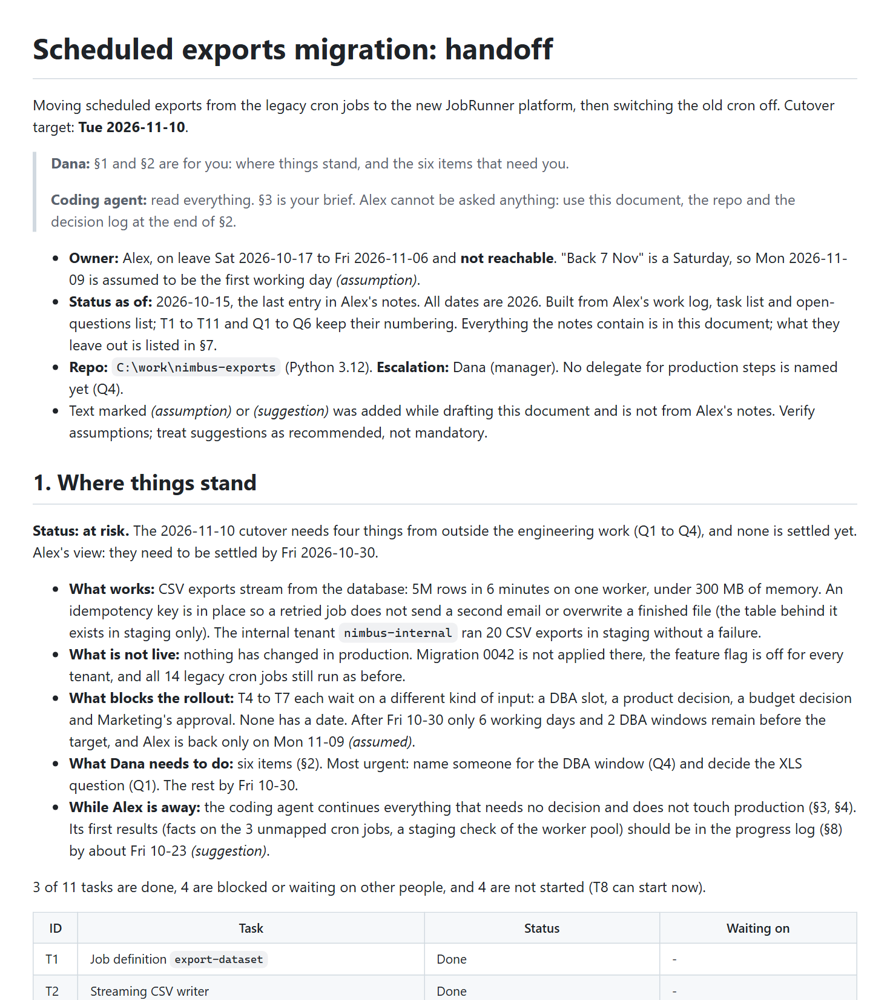
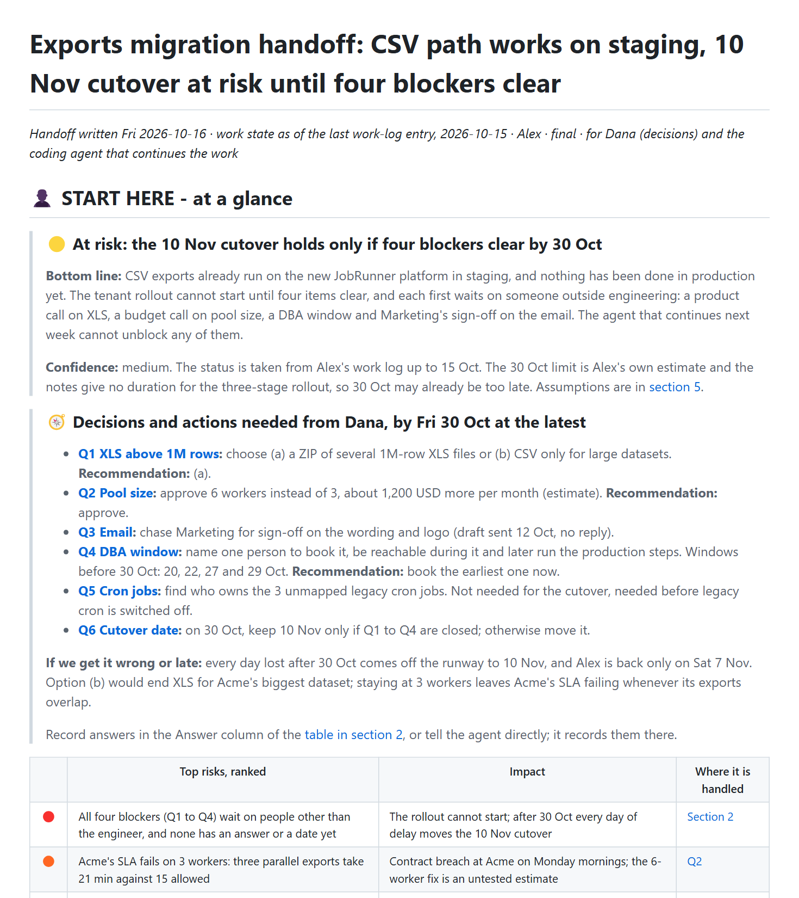

# Dual-audience handoff · iteration 1

[← Iteration 1](README.md) · [Review dashboard](../README.md)

> **Prompt given to both agents**
>
> I'm on leave from tomorrow for three weeks (back 7 Nov). My notes on the exports migration are in examples/02-dual-audience-handoff/input/ (work log, task list, open questions). Turn them into a handoff document. My manager Dana will skim it to see where things stand and what she needs to decide, and an AI coding agent will pick up the remaining work next week from this same document, so it has to be able to continue without asking me anything.

## Result

| | Without the skill | With the skill |
|---|---|---|
| Assertions passed | **11 / 15** (73%) | **14 / 15** (93%) |
| Automatic checker (the v0.1 checker: errors and warnings, no tiers) | 0 errors · 2 warnings | 0 errors · 0 warnings |

## What the reader sees first

| Without the skill | With the skill |
|---|---|
|  |  |
| [Open the document](outputs/eval-2-dual-audience-handoff/without-skill/report.md) | [Open the document](outputs/eval-2-dual-audience-handoff/with-skill/report.md) |

## Assertion scorecard

Each assertion was graded by an agent that read the document and cited evidence; ✅ passed, ❌ failed. The evidence for every failure is below, and the full evidence for every assertion is in the raw `grading.json` of each run.

| Assertion | Without | With |
|---|:-:|:-:|
| Zones labeled | ❌ | ✅ |
| Human part highlighted | ✅ | ✅ |
| Glance first | ❌ | ✅ |
| Reading path | ❌ | ✅ |
| Links work | ✅ | ✅ |
| Relationship diagram | ✅ | ✅ |
| Diagram portable | ✅ | ✅ |
| Diagram readable | ✅ | ✅ |
| Evidence out of the way | ✅ | ✅ |
| Headings tell the story | ❌ | ❌ |
| Dana's view | ✅ | ✅ |
| Cutover risk | ✅ | ✅ |
| Agent-ready | ✅ | ✅ |
| Guardrails | ✅ | ✅ |
| No leakage | ✅ | ✅ |

The full text of every assertion in this scorecard

- Zones labeled: the document labels a part for human reading and a separate part for AI-input / archive / evidence material, using explicit headings or banners that name the audience (a bare 'Appendix' does not count), and the two parts do not interleave
- Human part highlighted: the part written for humans is marked by a prominent banner or heading that says it is for people or where to start (for example an emoji-led 'start here' heading), so a reader cannot miss it
- Glance first: the first section after the title is a one-screen overview that states the conclusion itself (what is true or what to do), not merely what the document covers; no background, method or table of contents comes before it
- Reading path: within the first screen (about 60 lines) there is a reading path or 'read next' list with at least 3 working links to sections, each saying what the reader gets
- Links work: every in-document link and every image path resolves (scripts/check_doc.py reports no ERROR lines)
- Relationship diagram: the eleven tasks T1-T11 and their dependencies are shown as a diagram (embedded image or Mermaid) that includes all eleven tasks and draws the dependency edges
- Diagram portable: the diagram a human sees first is an embedded image file that exists on disk (PNG or SVG), not only a Mermaid or other code block, because the reader's VS Code preview and Azure DevOps repo pages do not render Mermaid
- Diagram readable: the diagram has a caption or how-to-read line, and viewing the rendered image shows legible labels with no overlapping or cut-off text
- Evidence out of the way: bulky raw material (the chronological log, dead-end stories, long command listings) is not in the part written for Dana; it sits in the archive/machine part or in a linked file
- Headings tell the story: at least half of the body headings state a claim, finding or question rather than a generic topic label like 'Overview', 'Status' or 'Details'
- Dana's view: the first screen says where things stand (how many of the 11 tasks are done, blocked or open) and lists the decisions Dana must make (XLS above 1M rows, pool size and its cost, DBA window, email template, owner of the 3 cron jobs) with options or a recommendation
- Cutover risk: states that the 10 Nov cutover depends on tasks T4-T7 (the blocked ones) and is at risk if decisions slip past about 30 Oct
- Agent-ready: the agent-facing part holds exact commands and paths from the log (for example pytest tests/exports -q, the staging deploy command, jobs/export-dataset.yaml) and an ordered next-steps list that respects the task dependencies
- Guardrails: the agent-facing part says what not to do (do not retry the in-memory or OFFSET approaches, do not apply migration 0042 in production without the DBA window, do not copy secrets from the vault path)
- No leakage: the part written for Dana contains no shell commands or code blocks, and the dead-end stories (OOM, OFFSET paging) are archived rather than narrated in it

### Evidence for the failed assertions

❌ <b>Zones labeled</b> · without the skill

**Assertion:** Zones labeled: the document labels a part for human reading and a separate part for AI-input / archive / evidence material, using explicit headings or banners that name the audience (a bare 'Appendix' does not count), and the two parts do not interleave

**Grader evidence:** Near miss. Lines 5-7 are a two-line reader-guide blockquote: 'Dana: §1 and §2 are for you...' / 'Coding agent: read everything. §3 is your brief.' Only two headings name an audience ('## 2. What Dana needs to decide or unblock' and '## 3. Agent brief'). The rest of the agent/archive material sits under bare topic headings ('4. Remaining work, task by task', '5. Reference', '6. Dead ends and gotchas', '7. Assumptions and gaps', '8. Progress log'), which is no better than the bare 'Appendix' the assertion excludes, and the guide tells the agent to 'read everything', so no separate AI/archive zone is delimited or labeled. Order is human first (lines 14-116) then agent (117-387), so nothing interleaves, but the labeling requirement is not met. mechanical.json warns: 'no &lt;!-- zone:... --&gt; markers; human-read and machine/archive content are not marked'.

❌ <b>Glance first</b> · without the skill

**Assertion:** Glance first: the first section after the title is a one-screen overview that states the conclusion itself (what is true or what to do), not merely what the document covers; no background, method or table of contents comes before it

**Grader evidence:** The verdict itself is good and early: line 16 under '## 1. Where things stand' (line 14) says '**Status: at risk.** The 2026-11-10 cutover needs four things from outside the engineering work (Q1 to Q4), and none is settled yet.' But the assertion forbids background or method before it, and lines 3-12 are exactly that: line 3 is project background ('Moving scheduled exports from the legacy cron jobs to the new JobRunner platform, then switching the old cron off'), lines 9-12 are owner/provenance/method bullets ('Built from Alex's work log, task list and open-questions list... what they leave out is listed in §7'; 'Text marked (assumption) or (suggestion) was added while drafting this document...'). Section 1 then runs on through 5 long bullets, an 11-row table and a 1215x935 diagram (lines 14-43), so it is more than a glance.

❌ <b>Reading path</b> · without the skill

**Assertion:** Reading path: within the first screen (about 60 lines) there is a reading path or 'read next' list with at least 3 working links to sections, each saying what the reader gets

**Grader evidence:** There are no section links at all. The only markdown link syntax in the file is the two image embeds (lines 40 and 59). mechanical.json stats: internal_links 0, with warning 'fewer than 2 in-document links near the top; add a Read next path'. The only reading guidance is plain-text section numbers in the blockquote (lines 5-7), which are not links.

❌ <b>Headings tell the story</b> · without the skill

**Assertion:** Headings tell the story: at least half of the body headings state a claim, finding or question rather than a generic topic label like 'Overview', 'Status' or 'Details'

**Grader evidence:** 35 body headings (H2/H3). Only Q1-Q6 (lines 61-97, e.g. 'Q2. Approve 6 workers instead of 3', 'Q6. Keep or move the 2026-11-10 date') are clearly claim/question headings. 18 are generic topic labels: 'Where things stand', 'Decision log', 'Agent brief', 'Rules', 'First hour', 'Work queue', 'Remaining work, task by task', 'Not in the task list (optional)', 'Reference', 'Where things are', 'Commands', 'Environments', 'Measurements', 'People and tenants', 'Dead ends and gotchas', 'Assumptions and gaps', 'Assumptions made while drafting', 'Progress log'. Even counting the 8 task headings T4-T11 (which carry a state such as 'waits for Q1') and 3 borderline ones ('What Dana needs to decide or unblock', 'Keeping this document current', 'Gaps in the notes: verify, do not guess') as claims, the total is 17 of 35, below half.

❌ <b>Headings tell the story</b> · with the skill

**Assertion:** Headings tell the story: at least half of the body headings state a claim, finding or question rather than a generic topic label like 'Overview', 'Status' or 'Details'

**Grader evidence:** Counting every heading below the H1 gives 23 (lines 7-368). Only 5-6 state a claim, finding or ask: 'At risk: the 10 Nov cutover holds only if four blockers clear by 30 Oct', '1 The CSV path works on staging and nothing is in production yet', '2 Six open questions and four of them block the rollout', '3 The 10 Nov date holds only if all four blockers clear by 30 Oct', '4 Next week the agent can prepare but cannot unblock anything', and arguably 'Decisions and actions needed from Dana, by Fri 30 Oct at the latest' = 22-26%. The other 17 are topic labels: 'START HERE - at a glance', 'Q1 XLS above 1M rows', 'Q2 Pool size 3 to 6 workers', 'Q3 Email wording and logo sign-off', 'Q4 DBA window for migration 0042', 'Q5 Owner of the three unmapped cron jobs', 'Q6 Cutover date', '5 Assumptions and what is not known', the machine-zone banner, and 'A Agent brief with rules and order of work' through 'H Diagram source and edge list'. Restricted to the human zone it is 6 of 14 = 43%, still under half. It would only reach half by counting the six 'Qn &lt;topic&gt;' item names as question headings, but they are neither phrased as questions nor claims (the actual question is an italic line under each heading). Burden of proof is on the expectation, so FAIL; this is borderline and depends on that reading.

## What the graders said about the assertions themselves

Graders were asked to critique the test, not only the document. These are the suggestions they raised for this scenario (the skill and the assertions were revised from them; see [how the skill evolved](../skill-evolution/README.md)).

<b>Grader critique, with the skill run</b> (7 suggestions)

- **Headings tell the story** — The verdict hinges on an undefined denominator and on whether item-name headings count. Over all headings this output scores about 26%; over the human zone only, 43%; it reaches half only if the six 'Qn &lt;topic&gt;' headings are counted as question headings. Lettered reference blocks (A-H) legitimately carry label headings. Specify the scope (human zone only?) and a test for a qualifying heading (for example contains a verb, a number or an outcome, or ends with '?').
- **Glance first** — 'One screen' and 'first 60 source lines' diverge: the glance section is 43 source lines but renders to about two screens because of the embedded picture, the six-item ask list and the risk table, and the check passes on line count. Consider a stricter operational test, such as verdict plus asks inside the first ~30 lines, or a cap on the number of elements.
- **Dana's view** — This passes with '3 of 11 tasks done, 4 blockers' and no open count, and two of the five decisions (email, cron owner) carry an imperative ask but no labelled option or recommendation. Require all three counts and a recommendation per decision, or relax the wording so a pass means the same thing for every output.
- **Evidence out of the way ... / No leakage ...** — These two overlap heavily (both ask that raw material and dead ends stay out of Dana's part) and are satisfied by the same facts. Consider merging them and adding a size budget for the human zone (here 192 of 390 lines, about half the document) or a jargon/path-density check: Dana's part contains 23 inline code identifiers and a technical 'How the new setup works' paragraph yet passes.
- **Zones labeled / Human part highlighted** — Both pass on the same heading ('START HERE - at a glance'). Neither requires the banner to say who the part is for, although the first says 'name the audience'; the person glyph and 'START HERE' were accepted. Merge them, or require the word for Dana/people in the banner.
- No assertion checks fidelity to the notes or honest labelling of assumptions. This output added content the notes do not contain (an 'Allowed without asking' permission model, time-boxes, an untested xlsxwriter hint, CET/CEST conversion, recommendations for Q2-Q4 and Q6) and labelled it as assumption or inference in section 5 and block E. A discriminating assertion would spot-check key figures (3 of 11 done; 9.5/21/15 min; 1,200 USD/month; 11 of 14 cron jobs; DBA window Tue/Thu 22:00-23:00 UTC; back on a Saturday) and require invented or inferred items to be labelled.
- 'Continue without asking me anything' is the core requirement for the agent part, but no assertion checks the protocol for pending decisions. The output has an Answer column, a 'stop, do not invent work' rule, a stale-status update rule and a progress log; an assertion such as 'the agent part says what to do while Q1-Q4 are open and where answers are recorded' would reward this and punish handoffs that only list tasks.

**Overall:** Most assertions test for structural features that this output satisfies, so they discriminate weakly; the single fail comes from an ambiguous heading metric. The assertions do not check factual fidelity, labelling of assumptions, or how the agent handles unanswered decisions, which matter most in a handoff.

<b>Grader critique, without the skill run</b> (8 suggestions)

- **Links work** — Passes vacuously for a document with no links. This run has internal_links 0 and no navigation at all, yet check_doc.py reports no ERROR lines. Only the 'Reading path' assertion catches it. Consider requiring a minimum number of resolving section links here, or merging the two.
- **Zones labeled / Human part highlighted** — The run put a two-line reader-guide blockquote under the title naming Dana and the coding agent. The assertions do not say whether a pointer callout counts as a banner, or whether the agent/archive zone needs its own label. I judged 'Human part highlighted' a borderline PASS and 'Zones labeled' a FAIL on the same blockquote. Add a decision rule, for example: each zone must open with a heading or banner that names its audience, and a pointer in the header does not count.
- **Glance first** — Mixes 'verdict first' with 'nothing but the verdict before it'. This run states a strong verdict at line 16 but only after 12 lines of purpose, reader guide and provenance bullets, so the outcome turns on how strictly 'no background or method before it' is read. Consider an objective threshold, such as the verdict appearing within the first N lines or before any provenance or marker-legend text.
- **Dana's view** — 'First screen' is defined as the first ~60 lines, but a large image early on pushes the decisions table below the fold when rendered (it sits at lines 48-55, behind a 935 px diagram and an 11-row table). It is also unclear whether each of the five decisions needs an option or recommendation (Q3 and Q5 show '-').
- **Relationship diagram** — A diagram with wrong edges would also pass. Consider asserting a few specific edges from tasks.md (T9 fed by exactly T4-T7, T10 by T8 and T9, T11 isolated). This run's edges are all correct, which the current wording cannot distinguish from a wrong one.
- No assertion covers how long the human part is. Dana's part (sections 1 and 2) is about 2,100 words and 100 lines with six long question cards, which is a lot for a manager who will 'skim'. A size or collapse requirement would separate a skimmable document from a merely well-ordered one.
- No assertion rewards separating source facts from drafting assumptions. This run tags every inference '(assumption)' or '(suggestion)' and lists gaps in section 7, which matters when the agent cannot ask the author. It also caught that 'back 7 Nov' is a Saturday (one working day before the 10 Nov cutover) and that the task list and work log disagree on T7. A hidden-trap check like this would be worth adding.
- No assertion checks the loop from Dana back to the agent. This run adds a decision log in section 2 that the agent must act on, and rules for what the agent may do alone versus what needs a named human. That is the core of a dual-audience handoff and is only partly covered by 'Guardrails'.

**Overall:** Assertions discriminate well on structure (zones, links, headings, diagram), but several depend on undefined thresholds (banner prominence, what counts as the first screen, a link check that passes with zero links), and nothing checks fixture-grounded facts beyond the diagram's nodes. A few fact checks (counts, edges, dates, the Saturday trap) and a length bound on the human part would make the set more discriminating.

## Executor notes and raw records

The agent that wrote each document also left notes on where the instructions it had were unclear.

| Record | Without the skill | With the skill |
|---|---|---|
| Executor notes | [executor-notes.md](records/eval-2-dual-audience-handoff/without-skill/executor-notes.md) | [executor-notes.md](records/eval-2-dual-audience-handoff/with-skill/executor-notes.md) |
| Grading (assertions, evidence, claims, critique) | [grading.json](records/eval-2-dual-audience-handoff/without-skill/grading.json) | [grading.json](records/eval-2-dual-audience-handoff/with-skill/grading.json) |
| Automatic checker output | [mechanical.json](records/eval-2-dual-audience-handoff/without-skill/mechanical.json) | [mechanical.json](records/eval-2-dual-audience-handoff/with-skill/mechanical.json) |
| Timing (estimated from file times) | [timing.json](records/eval-2-dual-audience-handoff/without-skill/timing.json) | [timing.json](records/eval-2-dual-audience-handoff/with-skill/timing.json) |
| Prompt and assertions | [eval_metadata.json](records/eval-2-dual-audience-handoff/eval_metadata.json) | |
