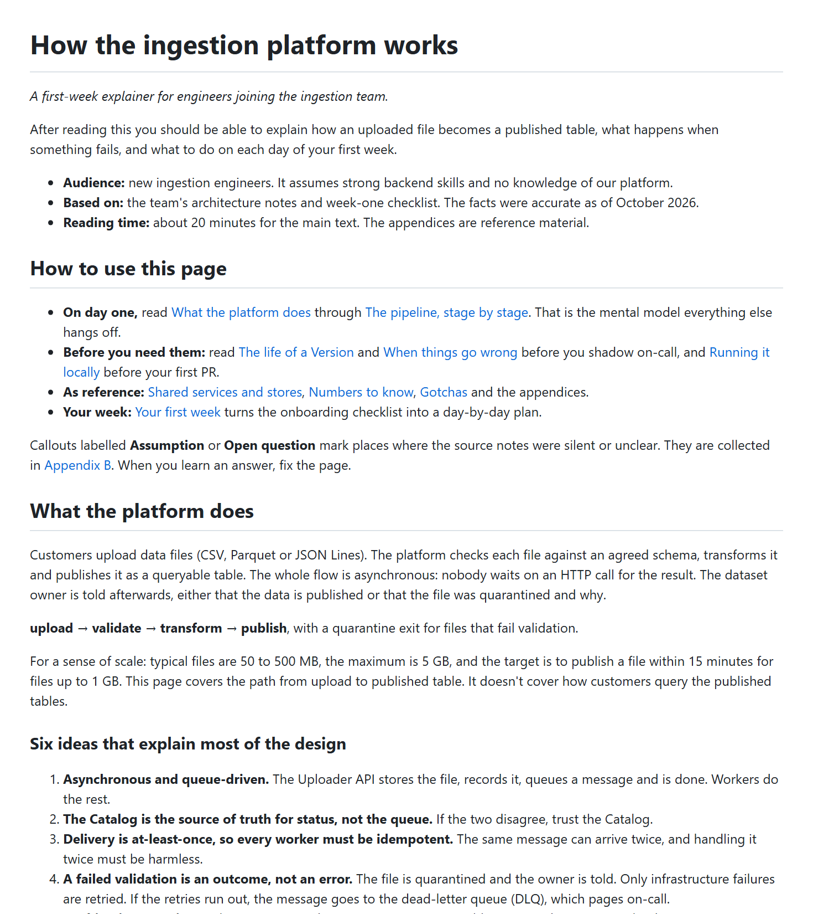
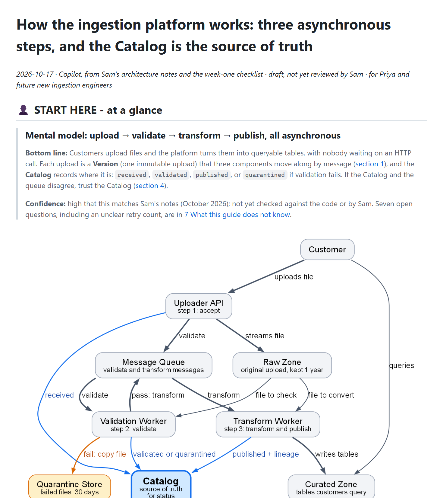

# Platform explainer for a new hire · iteration 1

[← Iteration 1](README.md) · [Review dashboard](../README.md)

> **Prompt given to both agents**
>
> New engineer Priya starts on the ingestion team on Monday. She's a strong backend dev but knows nothing about our platform. Using the notes in examples/03-ingestion-explainer/input/, write an explainer of how the ingestion platform works so she's productive in her first week. Save it as a doc we can drop into the team wiki repo.

## Result

| | Without the skill | With the skill |
|---|---|---|
| Assertions passed | **11 / 15** (73%) | **12 / 15** (80%) |
| Automatic checker (the v0.1 checker: errors and warnings, no tiers) | 0 errors · 3 warnings | 0 errors · 0 warnings |

## What the reader sees first

| Without the skill | With the skill |
|---|---|
|  |  |
| [Open the document](outputs/eval-3-ingestion-explainer/without-skill/report.md) | [Open the document](outputs/eval-3-ingestion-explainer/with-skill/report.md) |

## Assertion scorecard

Each assertion was graded by an agent that read the document and cited evidence; ✅ passed, ❌ failed. The evidence for every failure is below, and the full evidence for every assertion is in the raw `grading.json` of each run.

| Assertion | Without | With |
|---|:-:|:-:|
| Zones labeled | ❌ | ✅ |
| Human part highlighted | ❌ | ✅ |
| Glance first | ❌ | ✅ |
| Reading path | ✅ | ✅ |
| Links work | ✅ | ✅ |
| Relationship diagram | ✅ | ❌ |
| Diagram portable | ✅ | ✅ |
| Diagram readable | ✅ | ✅ |
| Evidence out of the way | ✅ | ✅ |
| Headings tell the story | ❌ | ✅ |
| No invented verdict | ✅ | ✅ |
| Mental model first | ✅ | ❌ |
| Concepts before flows | ✅ | ❌ |
| Week-one use | ✅ | ✅ |
| Figures are right | ✅ | ✅ |

The full text of every assertion in this scorecard

- Zones labeled: the document labels a part for human reading and a separate part for AI-input / archive / evidence / reference material, using explicit headings or banners that name the audience (a bare 'Appendix' does not count), and the two parts do not interleave
- Human part highlighted: the part written for humans is marked by a prominent banner or heading that says it is for people or where to start (for example an emoji-led 'start here' heading), so a reader cannot miss it
- Glance first: the first section after the title is a one-screen overview that states the bottom line itself (how the platform works in a sentence or two), not merely what the document covers; no background, method or table of contents comes before it
- Reading path: within the first screen (about 60 lines) there is a reading path or 'read next' list with at least 3 working links to sections, each saying what the reader gets
- Links work: every in-document link and every image path resolves (scripts/check_doc.py reports no ERROR lines)
- Relationship diagram: the eleven platform components and how they connect are shown as a diagram (embedded image or Mermaid) that includes all eleven components and labels or clearly draws the relationships
- Diagram portable: the diagram a human sees first is an embedded image file that exists on disk (PNG or SVG), not only a Mermaid or other code block, because the reader's VS Code preview and Azure DevOps repo pages do not render Mermaid
- Diagram readable: the diagram has a caption or how-to-read line, and viewing the rendered image shows legible labels with no overlapping or cut-off text
- Evidence out of the way: bulky raw material (the 20-row configuration table) is not in the human reading flow; it sits in the reference/machine part or in a linked file
- Headings tell the story: at least half of the body headings state a claim, finding or question rather than a generic topic label like 'Overview', 'Components' or 'Details'
- No invented verdict: the document does not fabricate a verdict, a 'decision needed' block or a risk table; the first screen gives a bottom line and mental model instead
- Mental model first: the first screen has a diagram of the eleven components and their flow with a one-line bottom line, and calls out that the Catalog (not the queue) is the source of truth for status
- Concepts before flows: Dataset, Version, Schema contract, Quarantine, Lineage record and Tenant are defined (glossary or equivalent) before the detailed step-by-step flow
- Week-one use: includes the six gotchas and what to do in week one (runbooks, starter tickets INGEST-310 and INGEST-322, the weekly sync)
- Figures are right: states the correct retry behaviour (3 attempts with 30 s, 2 min, 10 min backoff, then the dead-letter queue) and the 15-minute publish target for files up to 1 GB

### Evidence for the failed assertions

❌ <b>Zones labeled</b> · without the skill

**Assertion:** Zones labeled: the document labels a part for human reading and a separate part for AI-input / archive / evidence / reference material, using explicit headings or banners that name the audience (a bare 'Appendix' does not count), and the two parts do not interleave

**Grader evidence:** No part is labelled for an audience. mechanical.json warns 'no &lt;!-- zone:... --&gt; markers; human-read and machine/archive content are not marked' (stats.zones = \[]). The only reference-type parts are the trailing 'Appendix A: configuration reference' (L254) and 'Appendix B: assumptions and open questions' (L281), i.e. topic-labelled appendices that do not name an audience, and nothing labels the human-reading part. Reference material is also interleaved with the human flow: L15 says 'As reference: Shared services and stores, Numbers to know, Gotchas', and those sections (L100, L153, L182) sit between 'The life of a Version' / 'When things go wrong' / 'Running it locally' and 'Your first week'.

❌ <b>Human part highlighted</b> · without the skill

**Assertion:** Human part highlighted: the part written for humans is marked by a prominent banner or heading that says it is for people or where to start (for example an emoji-led 'start here' heading), so a reader cannot miss it

**Grader evidence:** No banner, callout or emoji heading marks a human part. The nearest thing is the plain H2 '## How to use this page' (L11), styled like the other 24 headings; its text is a reading guide ('On day one, read ...') and it neither says it is for people nor 'start here'. L7 'Audience: new ingestion engineers' is a low-key metadata bullet, not a prominent banner. With no machine/reference zone to contrast against and no zone markers (mechanical.json), nothing is highlighted as the human part.

❌ <b>Glance first</b> · without the skill

**Assertion:** Glance first: the first section after the title is a one-screen overview that states the bottom line itself (how the platform works in a sentence or two), not merely what the document covers; no background, method or table of contents comes before it

**Grader evidence:** The first section after the title is '## How to use this page' (L11-18), a link-list reading guide (a TOC-like navigation list), and it is preceded by a preamble (L3-9) with a what-the-document-covers sentence ('After reading this you should be able to explain how an uploaded file becomes a published table...'), 'Based on: the team's architecture notes and week-one checklist' (source/method) and 'Reading time'. The bottom line only starts in the second section, '## What the platform does' (L20-26: 'The platform checks each file against an agreed schema, transforms it and publishes it as a queryable table...'; L24 'upload -&gt; validate -&gt; transform -&gt; publish, with a quarantine exit').

❌ <b>Relationship diagram</b> · with the skill

**Assertion:** Relationship diagram: the eleven platform components and how they connect are shown as a diagram (embedded image or Mermaid) that includes all eleven components and labels or clearly draws the relationships

**Grader evidence:** No single diagram contains all eleven components. Figure 1 (first screen, report.assets/ingestion-overview.png) shows Customer plus 8 components: Uploader API, Message Queue, Raw Zone, Validation Worker, Transform Worker, Quarantine Store, Catalog, Curated Zone; its own caption (line 16) says 'The Policy Engine, Schema Registry and Notifier are left out here'. Figure 2 (section 3, shared-services.png, line 93) shows 8 components (Uploader API, Validation Worker, Transform Worker, Curated Zone, Catalog, Policy Engine, Schema Registry, Notifier) and omits Message Queue, Raw Zone and Quarantine Store. Every edge in both figures is labeled with a verb or message name, and the union of the two figures does cover all eleven, but the expectation asks for 'a diagram ... that includes all eleven components'; the relationships among all eleven are never drawn in one place. Judgment call (the executor deliberately split 11 components into overview + zoom); the burden of proof is on the expectation, so not passed.

❌ <b>Headings tell the story</b> · without the skill

**Assertion:** Headings tell the story: at least half of the body headings state a claim, finding or question rather than a generic topic label like 'Overview', 'Components' or 'Details'

**Grader evidence:** There are 24 body headings (25 incl. the H1) and nearly all are generic topic labels: 'How to use this page', 'What the platform does', 'The big picture', 'Core concepts', 'The pipeline, stage by stage', 'Stage 1: upload (Uploader API)', 'Stage 2: validate ...', 'Stage 3: transform and publish ...', 'Shared services and stores', 'The life of a Version', 'When things go wrong', 'Quick triage', 'Numbers to know', 'Running it locally', 'Gotchas', 'Your first week', 'The repos', 'A suggested plan', 'Appendix A: configuration reference', 'Appendix B: assumptions and open questions', 'Assumptions made in this page', 'Open questions'. Only 'Six ideas that explain most of the design' (L28) and 'You've got it when you can answer these' (L245) carry a claim or criterion, about 8% even when counted generously, far below half.

❌ <b>Mental model first</b> · with the skill

**Assertion:** Mental model first: the first screen has a diagram of the eleven components and their flow with a one-line bottom line, and calls out that the Catalog (not the queue) is the source of truth for status

**Grader evidence:** Met: a diagram is on the first screen (line 14); there is a bottom line (line 10) with a one-line mental-model heading above it (line 8); the Catalog callout is strong (H1 '...and the Catalog is the source of truth'; line 10 'If the Catalog and the queue disagree, trust the Catalog'; row 1 of the table, line 20, 'The Catalog, not the queue, says where a file is'; diagram node 'Catalog - source of truth for status'). Not met: the first-screen diagram is not a diagram of the eleven components. It shows 8 of the 11 (no Policy Engine, Schema Registry or Notifier), and its caption says so: 'The Policy Engine, Schema Registry and Notifier are left out here' (line 16). The figure that adds those three (section 3) is not on the first screen and itself omits Message Queue, Raw Zone and Quarantine Store. No partial credit.

❌ <b>Concepts before flows</b> · with the skill

**Assertion:** Concepts before flows: Dataset, Version, Schema contract, Quarantine, Lineage record and Tenant are defined (glossary or equivalent) before the detailed step-by-step flow

**Grader evidence:** The detailed step-by-step flow is section 1 (lines 42-64: table of steps 1, 2, 2a, 2b, 3 with component, action and Catalog status). The glossary is section 2 'Six terms to know and a Version that never changes' (lines 66-87), i.e. after it, and the read-next order on lines 32-33 keeps it that way ('1 ... the order of events', '2 ... the vocabulary'). Section 1 already uses 'Schema contract', 'Quarantine Store', 'Lineage record' and 'Version' undefined. Before section 1 only Version is glossed inline ('Each upload is a Version (one immutable upload)', line 10); Dataset, Schema contract, Quarantine, Lineage record and Tenant are first defined in section 2 (lines 72-77). The glossary content itself is complete and correct (all six terms, matching Sam's definitions); only the ordering fails.

## What the graders said about the assertions themselves

Graders were asked to critique the test, not only the document. These are the suggestions they raised for this scenario (the skill and the assertions were revised from them; see [how the skill evolved](../skill-evolution/README.md)).

<b>Grader critique, with the skill run</b> (7 suggestions)

- **Relationship diagram** — Pass/fail hinges on 'a diagram ... that includes all eleven'. The executor followed the skill's guidance to split 11 components into an overview (8 components + Customer) and a zoom on the shared services (8 components); together they cover all eleven and every edge, yet no single figure does, so this assertion fails what is arguably the more readable design. Decide whether the intent is one all-in-one diagram (then the skill's split rule conflicts with the eval on purpose) or 'every component and relationship appears in some figure' (then reword, and add a check that every relation in the notes is drawn at least once).
- **Mental model first** — Bundles four checks (diagram, all eleven, one-line bottom line, Catalog callout) so a doc that gets three right fails wholesale because the first-screen flow diagram deliberately omits Policy Engine, Schema Registry and Notifier. Consider splitting, and say whether 'one-line' is strict (this doc has a one-line mental-model heading plus a three-sentence bottom line).
- **No invented verdict** — 'Risk table' is ambiguous. This doc dropped the verdict and decision block but kept a severity-glyph table ('Five ideas that matter most | The trap if you miss it') on the first screen, which the executor says is the skeleton's 'Top risks' table reused. Its content is Sam's gotchas so I passed it, but the orange/yellow ranking is invented. State whether a ranked key-ideas/gotchas table is acceptable, or add 'any severity or priority ranking must be traceable to the source'.
- **Glance first** — 'One-screen' is not measurable: the panel is 35 source lines (inside the 60-line proxy) but renders at about 1.5-2 screens once the picture is counted. A testable proxy such as 'bottom line within the first 15 lines' would be stricter and clearer.
- **Headings tell the story** — The verdict depends on whether machine-zone block headings and zone banners count as 'body headings' (5/7 or 7/7 of the numbered sections qualify, but only 43-57% of all 14 headings). Specify 'headings of the human reading flow'.
- No assertion checks content discipline beyond the retry and 15-minute figures. The notes contain an internal tension (3 attempts but three backoff delays); this doc flagged it and tagged its own inferences (cache-lifetime effect, repo purposes, ticket mapping, 5 GB arithmetic, weekday schedule), but 'Figures are right' would pass whether the doc hedges or silently picks an interpretation, and nothing penalises an untagged invention. Consider an assertion that every statement not in the notes is marked as inferred, and that the summary of inferred items is complete (here section 7 omits three of the tagged inferences).
- No assertion covers portability of the wiki drop-in. The machine-zone handoff block hard-codes absolute local Windows paths (lines 211-237: &lt;workspace&gt;\...) for sources, outputs and the checker, which would be noise or a leak in a team wiki, and the deliverable is three coupled parts (report.md, report.evidence.md, report.assets/) that must be copied together. A check for machine-specific paths in a document meant for a shared repo would have caught this.

**Overall:** Mostly discriminating: the flow-before-glossary check (#13) and the all-eleven-components checks (#6, #12) caught real structural gaps, while the layout, link, portability and figure checks passed on substance. Weak spots: the single-diagram wording (#6, #12), the ambiguous 'risk table' (#11), the unmeasurable 'one-screen' (#3) and the heading-counting rule (#10); nothing checks inferred-content discipline or machine-specific paths.

<b>Grader critique, without the skill run</b> (6 suggestions)

- **Zones labeled / Human part highlighted** — Both fail this run because it lacks the specific zone convention (audience-naming banners, zone markers), even though it has a sensible conventional structure: a reading guide at the top and a labelled 'configuration reference' appendix at the end. If the goal is the outcome (a reader can tell the human narrative from machine/reference material), say so; if it is the convention, name it explicitly in the assertion. 'Zones labeled' also bundles three conditions (human part labelled, reference part labelled, no interleaving), so split it to show which part a run gets right.
- **Mental model first** — The 60-line yardstick lets this run pass with the diagram at L39, behind a preamble, a reading guide, an overview and six ideas (roughly 1.3 rendered screens down because the PNG is 1710 px wide), while 'Glance first' fails the same ordering. Consider anchoring the check to rendered position, or to the diagram being the first block after the overview.
- **No invented verdict** — Any explainer passes this, because there is no verdict to invent, so it does not discriminate here. More telling for this eval: whether inferences are presented as source facts. This run added unstated content (repo contents inferred from names, the day-by-day order, a derived 'Quick triage' row, 'Policy Engine runs strict everywhere except local dev') but labelled most of it; an assertion on unflagged inventions would catch the difference.
- **Figures are right** — The notes are genuinely ambiguous ('3 attempts' vs 'retried 3 times' vs three back-off delays). The assertion fixes one reading, but does not say how a document should handle the ambiguity. This run quoted every figure and raised an explicit open question (L138), a good behaviour no assertion rewards, and a doc that silently chose 'three retries' while listing the same delays would pass equally.
- **Links work** — Passing on 'no ERROR lines' hides that check_doc.py warns two link targets may not resolve in Azure DevOps (headings with a comma or colon). One of them, #the-pipeline-stage-by-stage, is in the reading path at L13. Since ADO is a named target viewer, consider treating the fragile-anchor warning as a failure for links in the first screen.
- No assertion covers length or proportion for a first-week explainer: this run is about 4,100 words and 305 lines, with a second diagram, a seven-item quick-triage and self-check section, and an Appendix B of eight open questions that sits next to the reference material. An assertion on reading time or on keeping the human flow lean would catch padding.

**Overall:** Solid on content (all 11 components, all figures, glossary, gotchas and week-one actions are correct) but the formatting-structure assertions (zones, human banner, glance-first, claim headings) are the discriminating ones and this run, written without the skill, fails exactly those four. 'No invented verdict' and 'Diagram portable' are close to trivially satisfied here.

## Executor notes and raw records

The agent that wrote each document also left notes on where the instructions it had were unclear.

| Record | Without the skill | With the skill |
|---|---|---|
| Executor notes | [executor-notes.md](records/eval-3-ingestion-explainer/without-skill/executor-notes.md) | [executor-notes.md](records/eval-3-ingestion-explainer/with-skill/executor-notes.md) |
| Grading (assertions, evidence, claims, critique) | [grading.json](records/eval-3-ingestion-explainer/without-skill/grading.json) | [grading.json](records/eval-3-ingestion-explainer/with-skill/grading.json) |
| Automatic checker output | [mechanical.json](records/eval-3-ingestion-explainer/without-skill/mechanical.json) | [mechanical.json](records/eval-3-ingestion-explainer/with-skill/mechanical.json) |
| Timing (estimated from file times) | [timing.json](records/eval-3-ingestion-explainer/without-skill/timing.json) | [timing.json](records/eval-3-ingestion-explainer/with-skill/timing.json) |
| Prompt and assertions | [eval_metadata.json](records/eval-3-ingestion-explainer/eval_metadata.json) | |
