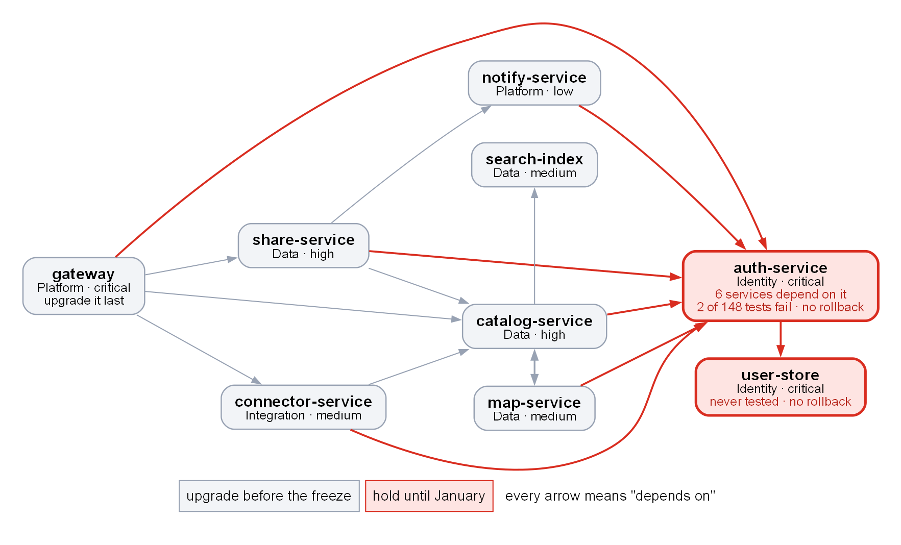
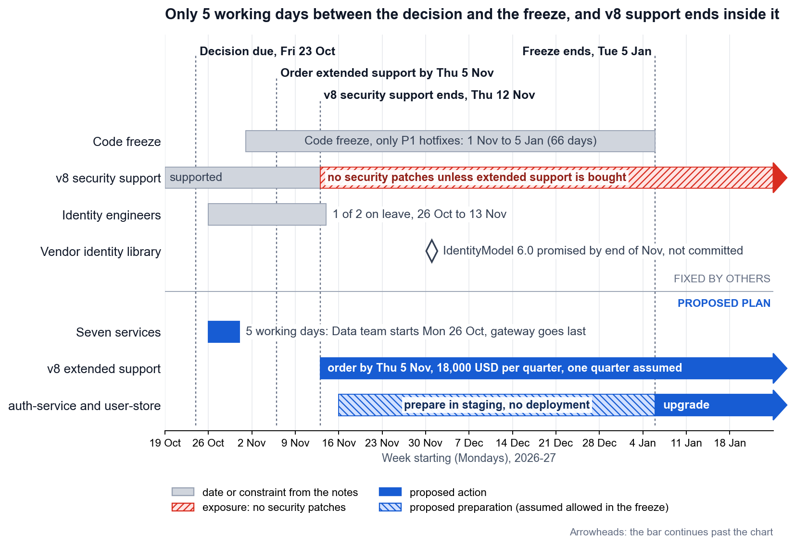

<!-- zone:human -->
# Runtime v8 to v10: upgrade 7 of 9 services before the freeze, hold auth-service and user-store until January

*2026-10-17 · Copilot (AI agent), from the Platform team's notes of 2026-10-14, the service inventory and the Q3 incident log · draft for decision · for Marcus Hale, Engineering Lead*

## 👤 START HERE - at a glance

> ### 🟡 Go with conditions: upgrade 7 of 9 services before the freeze, hold `auth-service` and `user-store` until January
>
> **Bottom line:** The seven services that passed staging can be rolled back in 10 to 15 minutes, so they go in the 5 working days before the freeze. `auth-service` and `user-store` (the Identity pair) have no rollback path: recovery is a restore from backup, about 4 hours. One fails 2 of 148 tests and the other was never tested, so they wait for January on v8 extended support (18,000 USD per quarter).
>
> **Conditions:** (1) the seven's staging tests pass against a v8 `auth-service`, the mix production will run; (2) the change advisory board (CAB) confirms in writing that we may roll back during the freeze; (3) extended support is ordered by Thu 5 Nov. If 1 or 2 fails, defer everything to January instead ([section 3](#3-splitting-beats-upgrading-everything-or-deferring-everything), option B).
>
> **Confidence:** Medium. It rests on the Platform team's staging run (9-11 Oct) and the Q3 incident log. Checks 1 and 2 are not done yet, and the notes do not say what the seven were tested against.

> ### 🧭 Decision needed
>
> **Marcus Hale** decides by **Fri 23 Oct** whether to approve the split plan and to order v8 extended support (18,000 USD per quarter, order by Thu 5 Nov). Friday is the last day that lets the Data team start on Mon 26 Oct and finish before the freeze. **Recommendation:** approve both, and order the support with the decision, because every feasible option needs it. **If we get it wrong:** one of the seven rolls back in 10 to 15 minutes, if the CAB allows it in the freeze; an Identity service upgraded too early means a restore from backup, about 4 hours without logins.

| | Top risks | Impact | Where it is handled |
|---|---|---|---|
| 🔴 | Upgrading `auth-service` or `user-store` before January | No rollback: about 4 hours to restore, 3.1 times the worst Q3 incident, with every login failing | [Section 1](#1-seven-services-are-ready-and-the-two-identity-services-are-not) |
| 🟠 | v8 stops getting security patches on 12 Nov | The Identity pair runs unpatched for 54 days or more unless extended support is ordered by 5 Nov | [Section 4](#4-the-plan-puts-seven-services-in-the-26-to-30-october-window-and-two-in-january), step 3 |
| 🟠 | Five working days leave no slack | The Data team's week fills 26-30 Oct exactly; a slip means a CAB exception or January | [Section 4](#4-the-plan-puts-seven-services-in-the-26-to-30-october-window-and-two-in-january), step 4 |
| 🟠 | v10 services calling a v8 `auth-service` may never have been tested together | Six of the seven call `auth-service`; fixing a regression in the freeze needs a P1 hotfix or a CAB exception | [Section 4](#4-the-plan-puts-seven-services-in-the-26-to-30-october-window-and-two-in-january), steps 1 and 2 |
| 🟡 | The vendor identity library may slip | `auth-service` waits past January, and each extra quarter of support costs 18,000 USD | [Section 4](#4-the-plan-puts-seven-services-in-the-26-to-30-october-window-and-two-in-january), step 5 |

**Key facts:** **7 of 9** services pass staging and roll back in 10 to 15 minutes · **6 of the other 8** services depend on `auth-service`, which fails 2 of 148 tests and cannot be rolled back · **14 of 35** Q3 incidents (40%) involve `auth-service` · **5 working days** between the decision and the freeze · v8 patches end **12 Nov**, **54 days** before the freeze ends



*How to read it: an arrow points from a service to a service it depends on (all 16 come from `services.csv`; the two-headed arrow means `catalog-service` and `map-service` depend on each other). Red services are held until January, grey ones upgrade before the freeze. Takeaway: six arrows end at `auth-service`, so it is the one service whose failure everyone feels, and it cannot be rolled back.*

**Read next**

1. [1 Seven services are ready and the two Identity services are not](#1-seven-services-are-ready-and-the-two-identity-services-are-not) - the readiness table and why the Identity pair waits · 3 min
2. [2 auth-service is also the weak point in production](#2-auth-service-is-also-the-weak-point-in-production) - what last quarter's incidents add · 2 min
3. [3 Splitting beats upgrading everything or deferring everything](#3-splitting-beats-upgrading-everything-or-deferring-everything) - four options, their cost, why the split wins · 3 min
4. [4 The plan puts seven services in the 26 to 30 October window and two in January](#4-the-plan-puts-seven-services-in-the-26-to-30-october-window-and-two-in-january) - dates, owners, the two checks and the fallbacks · 4 min
5. [5 What we assumed and what we still do not know](#5-what-we-assumed-and-what-we-still-do-not-know) - open questions and assumptions · 2 min

*Only deciding? You can stop here. Want the reasoning? Read 1 to 3. Running the plan? Continue to 4 and 5. Auditing a number? Go to [B Evidence and sources](#b-evidence-and-sources).*

## 1 Seven services are ready and the two Identity services are not

*Which services can move before the freeze, and what exactly blocks the other two?*

*The seven* are the services that upgrade before the freeze; *the Identity pair* is `auth-service` and `user-store`. Terms used in this report:

- the *freeze* (1 Nov to 5 Jan) lets only P1 hotfixes deploy; anything else needs an exception from the change advisory board (*CAB*);
- a *rollback path* is a way back to the previous version, and *RTO* is how long recovery takes;
- the *compatibility shim* is a temporary layer that lets `auth-service` run its current identity library (IdentityModel 5.x) on v10;
- *extended support* is the vendor's paid, security-patches-only continuation of v8.

| Service | Team | Criticality | Staging, 9-11 Oct | Rollback | Call |
|---|---|---|---|---|---|
| `gateway` | Platform | critical | pass | yes | now, last |
| `catalog-service` | Data | high | pass | yes | now |
| `share-service` | Data | high | pass | yes | now |
| `connector-service` | Integration | medium | pass | yes | now |
| `map-service` | Data | medium | pass | yes | now |
| `search-index` | Data | medium | pass | yes | now |
| `notify-service` | Platform | low | pass | yes | now |
| `auth-service` | Identity | critical | **fail**: 2 of 148 tests | **no** | January |
| `user-store` | Identity | critical | **not tested**: no staging environment | **no** | January |

`auth-service` waits because:

- its v10-compatible identity library (IdentityModel 6.0) is promised "by end of November" but not committed, so it would run on the shim;
- 2 of 148 integration tests fail in the token refresh flow, and the root cause is not confirmed;
- it has no rollback path: recovery is a restore from backup, RTO about 4 hours;
- it is the hub of the map: `catalog-service`, `connector-service`, `gateway`, `map-service`, `notify-service` and `share-service` all depend on it directly.

`user-store` waits because:

- it was never tested: there is no staging environment, and building one is about a week of work;
- the upgrade changes its schema migration format (new database driver), and migrations are one-way afterwards, so there is no way back;
- it sits under `auth-service`, so a failure there reaches 7 of the other 8 services.

The other seven can go because they passed every staging test, including the two upgrade changes that touch them (the custom JSON converters in `connector-service` and `share-service`, and the custom retry policy in `gateway`), and each can be rolled back by redeploying the previous version in 10 to 15 minutes. Q3 agrees: all five failed rollouts in these services were rolled back within 10 to 19 minutes, so the estimate is slightly optimistic at the top end.

The Identity team has two engineers and one is on leave from 26 Oct to 13 Nov, which covers the whole pre-freeze window and the first 13 days of the freeze. That is one more reason to keep Identity work out of that period.

*Evidence: [E3 claim register](report.evidence.md#e3-claim-register), [E6 dependency analysis](report.evidence.md#e6-dependency-analysis).*

**Next →** [2 auth-service is also the weak point in production](#2-auth-service-is-also-the-weak-point-in-production)

## 2 auth-service is also the weak point in production

*Does last quarter's incident record change the picture? It strengthens the case for holding `auth-service`.*

The Q3 incident log has 36 records. Two of them, both on 11 Jul, are one outage seen from two services, so there were 35 distinct incidents.

- **It is involved in 40% of incidents.** `auth-service` logged 11 incidents (380 minutes: 1 SEV1, 6 SEV2, 4 SEV3), and 3 more at `gateway` are linked to it in their summaries (5 Jul, 27 Aug, 15 Sep). That is 14 of 35 distinct incidents (40%). The quarter's only SEV1 was its outage on 11 Jul: logins failed for 78 minutes and `gateway` returned 503 on every authenticated route.
- **Token handling keeps breaking.** Causes were token-validation timeouts (5), token-refresh bugs (3), configuration (2) and GC pauses (1). The 3 refresh bugs (21 Jul, 14 Aug, 28 Sep) sit in the same flow as the 2 failing staging tests. Inference: the flow is already fragile; the root cause of the test failures is still unknown.
- **A failed upgrade would outlast every Q3 incident.** A 4-hour restore is 3.1 times the longest incident of the quarter (78 minutes).
- **The rest of the fleet is quieter.** The other eight services logged 25 records between them, and 20 of those are SEV3.

What the log cannot tell us: it predates the upgrade, so it shows where the risk sits, not how v10 changes it (for example, whether v10 reduces the 3 GC-pause incidents, one of which hit `auth-service`).

*Evidence: [E4 incidents by service](report.evidence.md#e4-incidents-by-service), [E5 cited incident records](report.evidence.md#e5-incident-records-cited-in-the-report).*

**Next →** [3 Splitting beats upgrading everything or deferring everything](#3-splitting-beats-upgrading-everything-or-deferring-everything)

## 3 Splitting beats upgrading everything or deferring everything

*What are the options, what do they cost, and why does the split come out ahead?*

Costs and dates come from the notes; the "Main problem" column is judgment, not data.

| Option | What happens | Cost | Main problem | Call |
|---|---|---|---|---|
| A. Upgrade all 9 before the freeze | 9 deployments in 5 working days | none | Puts the Identity pair into production failing or untested and without a rollback path ([section 1](#1-seven-services-are-ready-and-the-two-identity-services-are-not)), while half the Identity team is away | Not feasible |
| B. Defer all 9 to January | No change in Nov and Dec; all 9 stay on v8 with extended support from 12 Nov | 18,000 USD per quarter | January must absorb nine services plus the hard Identity work, and v10 gets no production time before the riskiest upgrade; without the support order, 9 services run unpatched for 54 days or more | Fallback |
| C. Split: 7 now, 2 in January | The seven upgrade 26-30 Oct; the Identity pair prepares in staging and upgrades after 5 Jan; extended support covers it | 18,000 USD per quarter, same as B | A change in the last week before a 66-day freeze, and v10 services calling a v8 `auth-service` for about 10 weeks | **Recommended**, after the two checks |
| D. As C, but the Identity pair upgrades in December under a CAB exception | Needs both services staged and tested, and the vendor library out | 18,000 USD plus CAB effort | A one-way change inside the freeze, on a vendor date nobody has committed to | Fallback only |

Why C:

1. **It moves what can be undone and leaves what cannot.** The seven roll back in 10 to 15 minutes; the Identity pair does not roll back at all.
2. **It uses a window that exists.** The Data team can start on 26 Oct, and four of the seven services are theirs.
3. **It keeps January small.** January then holds two services instead of nine, and the freeze weeks from 16 Nov, when both Identity engineers are back, go on preparing them: root cause, the `user-store` staging environment and the vendor library.
4. **It costs no more than B.** Extended support is needed in B and in C, so ordering it is a no-regret move. This assumes a flat price (see [section 5](#5-what-we-assumed-and-what-we-still-do-not-know)).
5. **It fails soft.** Any service that misses the window waits for January under the same extended support.

What C costs compared with B: a change in the last week before the freeze (any non-P1 problem found after 1 Nov needs a CAB exception) and a mixed v10 and v8 fleet until January. [Section 4](#4-the-plan-puts-seven-services-in-the-26-to-30-october-window-and-two-in-january) turns both into checks that must pass first.

The teams' stated positions are compatible with C: Identity "would rather not touch auth-service until the vendor library is out", Data can do its four services "in a week if we start Monday", Platform wants `gateway` last, and Integration says `connector-service` can go any time.

*Evidence: [E3 claim register](report.evidence.md#e3-claim-register).*

**Next →** [4 The plan puts seven services in the 26 to 30 October window and two in January](#4-the-plan-puts-seven-services-in-the-26-to-30-october-window-and-two-in-january)

## 4 The plan puts seven services in the 26 to 30 October window and two in January

*Who does what, when, and what must be true before each step?*



*How to read it: grey bars and dates come from the notes, blue bars are the plan proposed here, and the red hatched bar is the stretch where v8 gets no security patches unless we buy extended support. Takeaway: the plan fits seven upgrades into one week, then uses the freeze to prepare the Identity pair, not to deploy it.*

| # | When | Who | What | If it fails |
|---|---|---|---|---|
| 1 | by Thu 22 Oct | Platform | **Check 1:** rerun the seven services' staging suites against `auth-service` and `user-store` on v8, the mix production will run | Failure: choose option B. Not finished by Thu: run it first thing Mon 26 Oct, before any deploy |
| 2 | by Thu 22 Oct | Marcus | **Check 2:** get the CAB to confirm in writing that rolling back an upgraded service is allowed in the freeze, and how a v8 security patch for the Identity pair would be deployed | "No": choose option B |
| 3 | Fri 23 Oct | Marcus | Decide, and order extended support the same day (hard deadline Thu 5 Nov) | A missed order means no patches for the Identity pair from 12 Nov |
| 4 | Mon 26 to Fri 30 Oct | Data, Integration, Platform | Upgrade the seven. Suggested order: `notify-service`, `search-index`, `connector-service`; then `map-service` and `catalog-service` together, since they depend on each other; then `share-service`; `gateway` last, once `catalog-service`, `share-service` and `connector-service` run healthy on v10 | A service that misses the window waits for January on extended support. `gateway` may instead get a CAB exception, since it is staged and tested |
| 5 | from Mon 16 Nov | Identity | Find the root cause of the 2 failing token-refresh tests, build the `user-store` staging environment (about a week) and test IdentityModel 6.0 once it ships | Library not out by Mon 30 Nov: plan a second quarter of extended support (another 18,000 USD) instead of rushing |
| 6 | after Tue 5 Jan | Identity | Rehearse the restore, then upgrade the Identity pair together; Identity sets the order | Only after both pass in staging |

*The order of the seven is a suggestion (lowest criticality first); the only order the teams asked for is `gateway` last. The check deadlines and the Identity preparation window are proposals.*

*Evidence: [E7 calendar](report.evidence.md#e7-calendar).*

**Next →** [5 What we assumed and what we still do not know](#5-what-we-assumed-and-what-we-still-do-not-know)

## 5 What we assumed and what we still do not know

*What is unconfirmed, and which of it could change the recommendation?*

Open questions. Q1 and Q2 are the two checks from [section 4](#4-the-plan-puts-seven-services-in-the-26-to-30-october-window-and-two-in-january) and can flip the recommendation to option B; the rest do not change it today.

| # | Question | Why it matters | Who answers | By |
|---|---|---|---|---|
| Q1 | Which `auth-service` did the seven services' staging tests run against, v8 or the v10 shim? The notes only say that `auth-service` itself ran on the shim | If it was the v10 shim, the mix production will run (v10 callers, v8 `auth-service`) has never been tested | Platform | Thu 22 Oct |
| Q2 | Does the freeze allow a rollback of an upgraded service, and how would a v8 security patch for the Identity pair be deployed in it? | The 10 to 15 minute rollback only helps if we may use it; patches in the freeze need P1 status or an exception | CAB | Thu 22 Oct |
| Q3 | Why do 2 of 148 token-refresh tests fail: the shim, v10 or the tests themselves? | Decides how realistic a January upgrade is | Identity | Before the January rehearsal |
| Q4 | Will IdentityModel 6.0 ship by the end of November? | Without it `auth-service` stays on v8 and support must be extended | Identity, vendor | Mon 30 Nov |
| Q5 | What are the extended support terms: flat price, length of a "quarter", ordering lead time? | The first assumption below drives the 18,000 USD figure | Marcus, vendor | Before ordering |

Assumptions made in this report:

- Extended support costs a flat 18,000 USD per quarter however many services stay on v8, and a quarter runs 3 months from 12 Nov (to about 12 Feb), enough for the January upgrade. If it is billed by calendar quarter, covering January takes two quarters, 36,000 USD.
- The freeze stops production deployments only; staging work and testing continue. Worth confirming together with Q2.
- The freeze's end date, 5 Jan, is its last day, so the Identity pair deploys from 6 Jan.
- Working days are Monday to Friday, and the Data team's "one week from Monday" means 26 to 30 Oct.
- Platform, which wrote the notes, can rerun the staging suites for Check 1; the notes do not say who ran them.
- `services.csv` is complete and current, and the staging results of 9-11 Oct still hold. Neither was checked against the systems.
- Each incident's cause is taken from its own summary text.

*Evidence: [E3 claim register](report.evidence.md#e3-claim-register), which tags every claim as stated, derived, inferred, assumed or proposed.*

---

<!-- zone:ai-input -->
## 🗄️ MACHINE AND ARCHIVE ZONE - skip unless you need the evidence or are an agent continuing this work

*The audit trail for this decision: what an agent needs to continue (A), the evidence behind sections 1 to 5 (B), the diagram sources (C) and a place to record the decision (D).*

### A Handoff context for the next agent

<details>
<summary>AI input: state, files, commands, constraints and next steps - click to expand</summary>

**State on 2026-10-17:** assessment complete; decision pending (due Fri 2026-10-23); nothing deployed, ordered or sent.

**Files**, relative to the folder that holds `report.md`: `report.evidence.md` (claims, method, derived tables); `report.data/` (verbatim copies of `upgrade-notes.md`, `services.csv` and `incidents-q3.csv`; do not edit, hashes in E1); `report.assets/` (`overview.dot` and `.png`, `timeline.py` and `.png`, `analyze.py`).

**Commands** (Python 3, matplotlib and Graphviz `dot` on the PATH):

```text
python report.assets/analyze.py
dot -Tpng -Gdpi=150 report.assets/overview.dot -o report.assets/overview.png
python report.assets/timeline.py
```

**Constraints:** every number in sections 1 to 5 comes from `analyze.py` (exit code 0 means all 23 checks pass), so rerun it after any data change. In `timeline.png`, grey items are dates from the notes and blue items are proposals; never present proposals as decisions. After any edit, recheck the glance panel against the body.

**Next steps, in order:** (1) record the results of checks 1 and 2 (section 4, steps 1 and 2) in D; if either fails, change the verdict to option B and update the panel. (2) When Marcus decides, fill in D and replace "draft for decision" under the title. (3) After the January upgrade, add the outcome to D.

</details>

<!-- zone:archive -->
### B Evidence and sources

<details>
<summary>Archive: everything behind sections 1 to 5 is in report.evidence.md</summary>

[E1 Sources and hashes](report.evidence.md#e1-sources-and-hashes) · [E2 Method](report.evidence.md#e2-method) · [E3 Claim register](report.evidence.md#e3-claim-register) · [E4 Incidents by service](report.evidence.md#e4-incidents-by-service) · [E5 Incident records cited in the report](report.evidence.md#e5-incident-records-cited-in-the-report) · [E6 Dependency analysis](report.evidence.md#e6-dependency-analysis) · [E7 Calendar](report.evidence.md#e7-calendar) · [E8 Reproduce](report.evidence.md#e8-reproduce). Each section there names the report section it supports; E3 gives every claim its source line and marks it stated, derived, inferred, assumed or proposed.

</details>

<!-- zone:archive -->
### C Diagram sources and edge list

<details>
<summary>Archive: sources of both pictures and the edge list of the dependency map - supports the map and section 4</summary>

Sources: [overview.dot](report.assets/overview.dot) (dependency map) and [timeline.py](report.assets/timeline.py) (calendar); commands to rebuild them are in A. Every edge below comes from the `depends_on` column of [services.csv](report.data/services.csv); none is inferred. The map draws the two catalog-service and map-service rows as one two-headed arrow.

| From | Relation | To | Verified? |
|---|---|---|---|
| gateway | depends on | auth-service | yes |
| gateway | depends on | catalog-service | yes |
| gateway | depends on | share-service | yes |
| gateway | depends on | connector-service | yes |
| auth-service | depends on | user-store | yes |
| catalog-service | depends on | auth-service | yes |
| catalog-service | depends on | search-index | yes |
| catalog-service | depends on | map-service | yes |
| share-service | depends on | auth-service | yes |
| share-service | depends on | catalog-service | yes |
| share-service | depends on | notify-service | yes |
| connector-service | depends on | auth-service | yes |
| connector-service | depends on | catalog-service | yes |
| map-service | depends on | auth-service | yes |
| map-service | depends on | catalog-service | yes |
| notify-service | depends on | auth-service | yes |

</details>

<!-- zone:archive -->
### D Decision record

<details>
<summary>To be filled in after Friday: decision, check results and outcome</summary>

| Field | Entry |
|---|---|
| Decision (option A, B, C, D or other), decided by, date | pending |
| Check 1 (staging against v8 `auth-service`) and check 2 (CAB on rollbacks and security patches in the freeze): result, date, who | pending |
| Extended support ordered (date, term, price) | pending |
| Deviations from the recommendation, and why | |
| Outcome after the January upgrade | |

</details>
