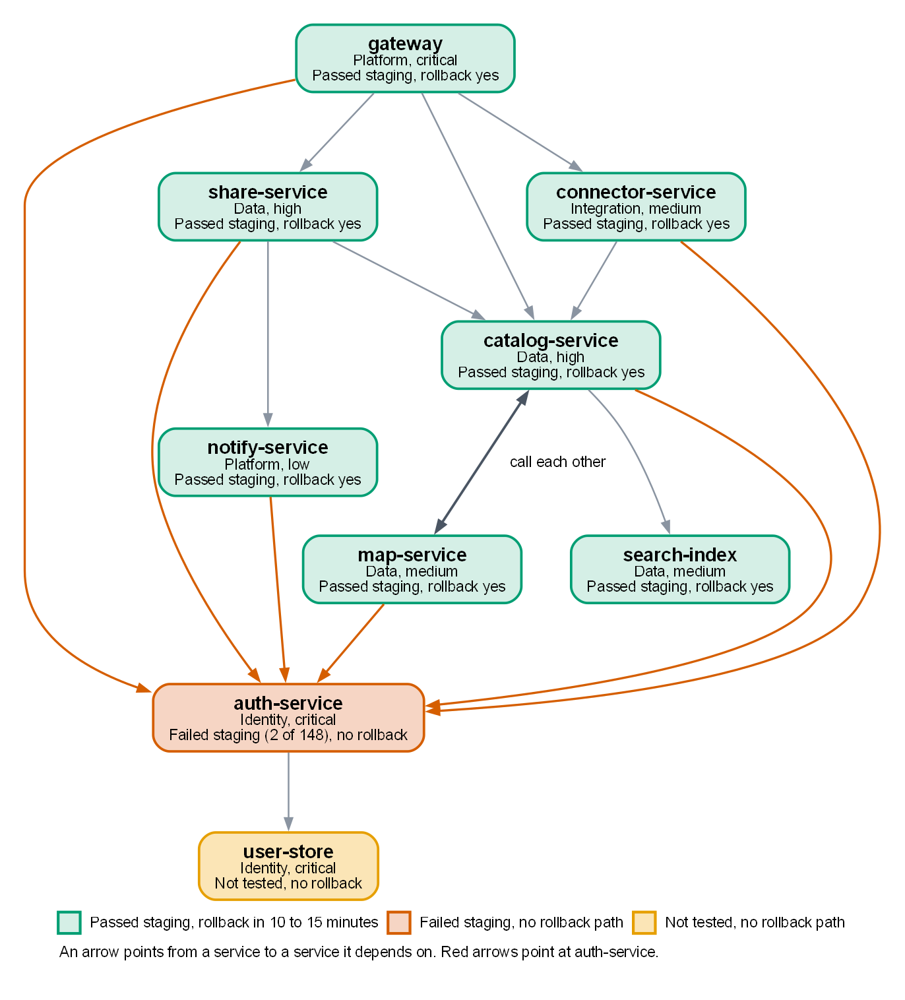
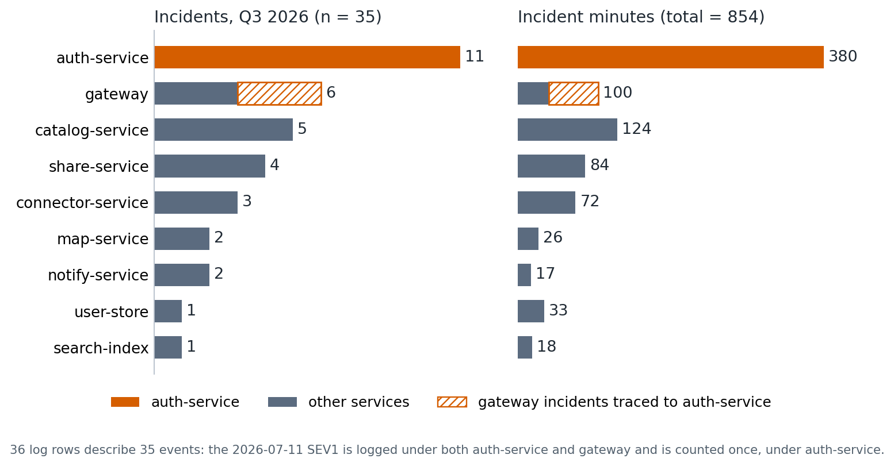
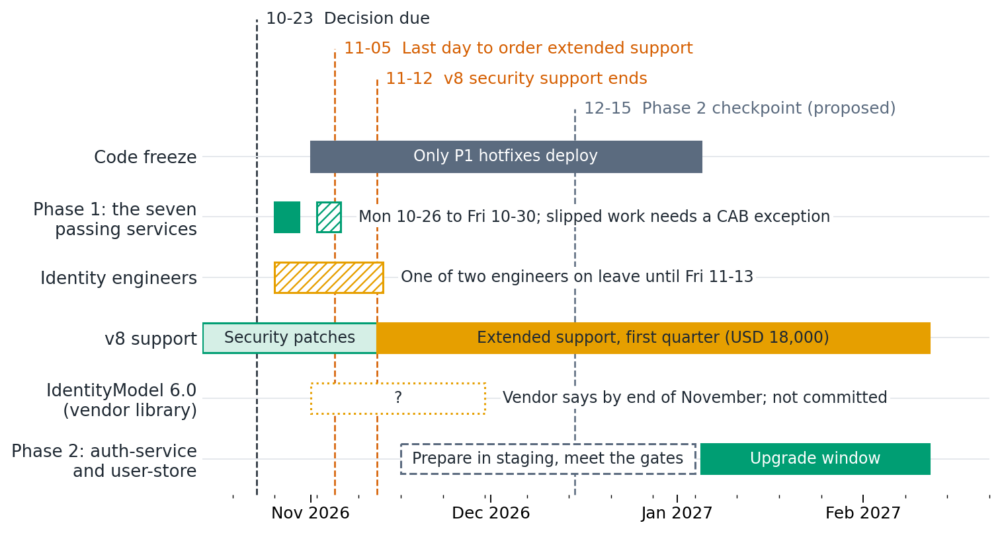

# Runtime upgrade v8 to v10: risk assessment and recommendation

- **For:** Marcus Hale, Engineering Lead (decision owner)
- **Decision needed by:** Friday 2026-10-23
- **Prepared:** 2026-10-17 | **Status:** awaiting decision
- **Based on:** the Platform team's notes (2026-10-14), the service inventory and the Q3 2026 incident log. Unmodified copies are in [`evidence/`](evidence/).

The Recommendation below is enough to decide. Everything after it is the evidence, the plan and the audit trail.

## Recommendation

**Split the upgrade rather than choosing between "all before the freeze" and "all in January".** Move the seven services that passed staging to v10 in the week of 2026-10-26, before the code freeze (Phase 1). Keep the two Identity-team services, auth-service and user-store, on v8 until January, covered by v8 extended support, and upgrade them only when four readiness gates are met (Phase 2).

- **The seven are ready and recoverable.** All pass staging, and each can be rolled back by redeploying the previous version in 10 to 15 minutes. The Data team can start on Monday 2026-10-26.
- **The Identity services are not ready.** auth-service fails 2 of 148 integration tests (token refresh, cause not confirmed) and waits on a vendor library that is not committed. user-store has never been tested because it has no staging environment. Neither can be rolled back after the schema migration; recovery is a backup restore, estimated at 4 hours. One of the two Identity engineers is on leave from 2026-10-26 to 2026-11-13.
- **Extended support is needed whichever option is chosen.** The Identity services will still be on v8 on 2026-11-12, so USD 18,000 for one quarter must be ordered by 2026-11-05 under every option that is actually available. The real choice is how much of the fleet to move now, not whether to pay.

> **Decisions needed by Friday 2026-10-23**
>
> 1. **Approve Phase 1:** the seven passing services move to v10 in the week of 2026-10-26, gateway last.
> 2. **Approve the extended support spend:** USD 18,000 for one quarter, with a ceiling of USD 36,000 (see [Cost](#cost)). Order by 2026-10-30 (proposed margin); the deadline is 2026-11-05.
> 3. **Ask the change advisory board (CAB) now for a contingency exception** for Phase 1 work that slips past 2026-10-30. The seven are staged and tested, so they should be eligible.
> 4. **Confirm that auth-service and user-store stay on v8** until the Phase 2 gates are met.

**Confidence**

- **High** that the Identity services should not move before the freeze. Any one of the blockers above would be enough.
- **Moderate** that the seven should move now rather than in January. That case rests on the Data team's one-week estimate, which leaves no slack, and on one open question: what the seven were tested against. Ask Platform before Friday. If the answer is not "a v8 auth-service with its v8 user-store", run that check before Monday 2026-10-26, because that is the state the seven will run in for the whole freeze. If the check fails, fall back to Option B (everything in January). The extended support order is needed either way.

## Options considered

| | A. Everything before the freeze | B. Everything in January | C. Split (recommended) |
|---|---|---|---|
| Moves before 2026-11-01 | All 9 services | Nothing | The 7 passing services |
| On v8 after 2026-11-12 | Nothing, if it all lands (it cannot; see below) | All 9 services | auth-service and user-store |
| Extended support needed | Yes, as a hedge | Yes, for all 9 | Yes, for the 2 Identity services and any Phase 1 work that slips |
| Worst case | A 4-hour backup restore of the login layer in the week before a nine-week freeze, with half the Identity team | Deferred, not removed: the same exposure arrives in January | One service rolled back in 10 to 15 minutes (Q3 failed rollouts took 10 to 19) |
| Feasible by 2026-10-30? | No: user-store is untested, auth-service fails 2 of 148 tests, the vendor library is not out | Yes | Yes, with no slack: the Data team's week ends on the last working day before the freeze |
| Work left for January | None | All 9 services, including the two hardest | The 2 Identity services |
| Verdict | Reject | Acceptable fallback | **Recommend** |

**Why not A.** It is not realistic, not just risky. The vendor library that auth-service needs is due at the end of November, after the freeze starts, so auth-service would have to run on the compatibility shim, which is where it fails 2 of 148 tests. user-store has no staging environment: building one takes about a week, and it would still need testing before 2026-10-30, with Identity at half strength from 2026-10-26. The CAB exception that could stretch the deadline covers only work that is already staged and tested.

**Why C over B.** Both pay the same for extended support (assuming a flat price) and both leave the Identity services for January. C uses the week before the freeze to take seven of nine services off v8, so January is left with the two hard services. It also gives the new runtime about nine weeks of production running, across the freeze, on services that can be rolled back before it reaches the login layer. The price is a compressed week, about three months of mixed versions (v10 services calling v8 Identity services) and a freeze that starts right after the change. B is the right fallback if that price looks too high.

## What the evidence shows

Source tags: (notes) is [`evidence/upgrade-notes.md`](evidence/upgrade-notes.md), (inventory) is [`evidence/services.csv`](evidence/services.csv), (incidents) is [`evidence/incidents-q3.csv`](evidence/incidents-q3.csv), and (analysis) means computed by [`analysis/analyze.py`](analysis/analyze.py).

### The seven are ready; the two Identity services are not

The split follows the four breaking changes the notes list. The two that touch the seven are tested and pass; the two that touch the Identity services are not.

| Breaking change (notes) | Hits | Status |
|---|---|---|
| JSON serializer defaults (property naming, null handling) | Custom converters in connector-service and share-service | Re-tested in staging: pass |
| Default HTTP client handler and retry behaviour | All services on the defaults; gateway has a custom retry policy | Staging: pass |
| Identity library: IdentityModel 5.x to 6.0 | auth-service | 6.0 not released; running on a compatibility shim; 2 of 148 integration tests fail |
| Database driver changes the schema migration format; migrations are one-way | user-store | Not tested: no staging environment |

Service by service:

| Service | Team | Criticality | Staging (2026-10-09 to 10-11) | Rollback | Q3 incidents | Phase |
|---|---|---|---|---|---|---|
| gateway | Platform | Critical | Pass | Yes | 6 | 1 (last) |
| catalog-service | Data | High | Pass | Yes | 5 | 1 |
| share-service | Data | High | Pass | Yes | 4 | 1 |
| connector-service | Integration | Medium | Pass | Yes | 3 | 1 |
| map-service | Data | Medium | Pass | Yes | 2 | 1 |
| search-index | Data | Medium | Pass | Yes | 1 | 1 |
| notify-service | Platform | Low | Pass | Yes | 2 | 1 |
| auth-service | Identity | Critical | **Fail:** 2 of 148 integration tests | **No** | 11 | 2 |
| user-store | Identity | Critical | **Not tested:** no staging environment | **No** | 1 | 2 |

*Rollback "Yes" means redeploy the previous version (10 to 15 minutes); "No" means restore from backup after the schema migration (estimated 4 hours). Q3 incidents are distinct events (35 in total, analysis): gateway's 2026-07-11 SEV1 row restates the auth-service SEV1 and is counted once, under auth-service; see [Appendix B](#appendix-b-q3-incident-analysis). Sources: inventory and notes.*

*Figure 1. Who depends on whom (inventory). The seven passing services are green; the two Identity services are the only ones without a rollback path. catalog-service and map-service call each other.*

- **auth-service is the hub.** Six of the other eight services call it directly: gateway, catalog-service, share-service, connector-service, map-service and notify-service. The other two are user-store, which auth-service itself calls, and search-index (inventory).

### auth-service is where the risk concentrates

auth-service accounts for 11 of 35 Q3 incidents (31%), 380 of 854 incident minutes (about 45%) and 7 of the 11 SEV1 or SEV2 events (analysis).

- **Counts.** Three more gateway incidents point to auth-service in their log summaries (2026-07-05, 2026-08-27, 2026-09-15). With those, auth-service is involved in 14 of 35 events (40%) and 441 of 854 minutes (52%).
- **The one SEV1.** On 2026-07-11 an auth-service login outage lasted 78 minutes and gateway returned 503 on all authenticated routes. The log carries it twice, once per service. It is one event.
- **The failing tests sit where production already breaks.** The 2 failing staging tests are in the token refresh flow (notes). Token-refresh bugs caused 3 Q3 incidents: 2026-07-21 (SEV2, 41 minutes), 2026-08-14 and 2026-09-28 (SEV3). The root cause of the failures is not confirmed.
- **Identity is already busy.** Q3 averaged one auth-service incident every 8.4 days. At that rate the 19-day leave window (2026-10-26 to 2026-11-13) would see about two, with half the team. This is an illustration from Q3's rate, not a forecast.

*Figure 2. Q3 2026 incidents by service (incidents, analysis). Hatched: gateway incidents whose log summary traces them to auth-service.*

The upgrade is not a reliability fix. Only 3 of 35 events cite the runtime (GC pauses), and the notes do not claim that v10 changes that, so this assessment assumes no reliability benefit. The case for upgrading is the end of security support on 2026-11-12.

### Recovery cost differs by an order of magnitude

| | The seven passing services | auth-service and user-store |
|---|---|---|
| Recovery path | Redeploy the previous version (notes: 10 to 15 minutes) | Restore from backup after the schema migration (notes: estimated 4 hours) |
| Q3 evidence | 5 failed rollouts, all rolled back in 10 to 19 minutes (median 15), all SEV3 | Longest auth-service incident: 78 minutes. A 4-hour recovery is 3.1 times longer and equals 63% of all auth-service incident minutes in Q3 |
| Who feels it | One service at a time | Every login. Identity's own words (notes): "A failed upgrade takes down every login." |
| Practised? | Rollback worked five times in Q3 (regular deploys, not runtime upgrades) | Restore not rehearsed; the 4 hours is an estimate |

Failed rollouts are routine on these services (5 in one quarter, 4 of the 7 services), and one rollback took 19 minutes against the notes' 10 to 15. Plan Phase 1 for up to 20 minutes per rollback, and assume at least one service will need one.

### The calendar is the binding constraint

*Figure 3. Key dates. Dates come from the notes, except the 12-15 checkpoint (proposed) and the end of the extended support term (assumed); see [Appendix C](#appendix-c-key-dates). The hatched box after Phase 1 is illustrative slip room that would need a CAB exception.*

- **Phase 1 has five working days.** The decision is due on Friday 2026-10-23, the Data team can start on Monday 2026-10-26, and the freeze starts on Sunday 2026-11-01. The Data team's one-week estimate ends on the last working day before the freeze.
- **The freeze closes the door on the Identity services too.** A CAB exception covers only work already staged and tested (notes). On the reading in the assumptions below, the seven qualify; auth-service (failing) and user-store (untested) do not.
- **The extended support deadline lands inside the freeze.** The order must be in by 2026-11-05, a week before v8 support ends on 2026-11-12.
- **Identity is thinnest exactly when Phase 1 runs.** One of two engineers is away from 2026-10-26 to 2026-11-13.
- **The vendor library cannot arrive before the freeze.** The vendor has announced IdentityModel 6.0 for "by end of November" but has not committed to it.

## Plan

The plan follows each team's stated position (notes): Data starts Monday 2026-10-26, Integration can go at any time, Platform wants gateway last, and Identity does not want to touch auth-service before the vendor library ships.

### Phase 1: the seven passing services, before the freeze

The order puts every service after the services it calls (auth-service stays on v8, so it is the exception) and, where there is a choice, the less critical service first. The owning teams set the day-by-day schedule; this order is a proposal.

| Step | Service | Owner | Why here |
|---|---|---|---|
| 1 | notify-service, search-index | Platform, Data | Lowest criticality (low, medium). Neither calls another Phase 1 service. share-service and catalog-service call them, so they move first |
| 2 | map-service and catalog-service, together | Data | They call each other, and Q3 had two incidents where one's latency hit the other (2026-09-08, 2026-09-19). catalog-service is called by gateway, share-service, connector-service and map-service |
| 3 | share-service, connector-service | Data, Integration | Both have custom JSON converters, re-tested and passing (notes). Both call catalog-service, so they follow it. Integration says connector-service can go at any time |
| 4 | gateway | Platform | Last, because it fronts everything (Platform's advice). Its custom retry policy passes staging. Move it only once the services behind it have run on v10 without problems. It is the first candidate to defer to January, at no extra extended support cost if the price is flat |

Phase 1 can be cut back at any point without changing the extended support order. Every service moved is a gain, and every service left over only adds to January.

**Before the first production change (by Monday 2026-10-26):**

1. **Mixed-version check.** Confirm in staging that the seven pass on v10 against a v8 auth-service with its v8 user-store, the production state for the whole freeze. The notes do not say what the staging runs used.
2. **CAB.** Lodge the contingency request and confirm that rolling a Phase 1 service back during the freeze is allowed.
3. **Triggers and cover.** Agree numeric rollback triggers per service (for example 5xx rate and p99 latency against the v8 baseline) and name an Identity contact for the week.

**During the week:**

- catalog-service and map-service go together or not at all. Do not carry a half-moved pair into the freeze.
- Whatever is not finished by Friday 2026-10-30 uses the CAB exception or waits for January.
- Do not touch auth-service or user-store, even if everything else goes well.
- After each step, watch error rates and latency between services. The v10 changes to the default HTTP client and retry behaviour act on the mechanism that spread Q3 failures: 11 of 35 events were dependency or downstream-timeout failures (analysis).

### Phase 2: the Identity services, in January

All four gates must be met before the Identity upgrade is scheduled.

| Gate | Requirement | Why |
|---|---|---|
| 1 | IdentityModel 6.0 is released and replaces the compatibility shim | Upgrading now would put two changes on the most critical service: the shim now and 6.0 later |
| 2 | The 2 failing token-refresh tests are root-caused and fixed; the suite passes 148 of 148 on 6.0 | Token refresh is where Q3's production bugs were |
| 3 | A user-store staging environment exists (about one week to build) and the migration has run through it | user-store has never been tested |
| 4 | A restore from backup has been rehearsed and the real recovery time is known | There is no rollback, and the 4 hours is an estimate |

Identity can prepare in staging during the freeze (assuming the freeze limits production deployments only): build the user-store environment, find the root cause, adopt 6.0 when it ships. Schedule the upgrade after the freeze ends on 2027-01-05, in a window when both Identity engineers are available. The first extended support quarter runs to about 2027-02-12, which leaves about five weeks of slack.

**Checkpoint on 2026-12-15 (proposed).** If 6.0 has not shipped, or gates 2 to 4 are not on track, plan for a second quarter of extended support (USD 18,000). Do not relax the gates.

## Cost

| Item | Amount | Basis |
|---|---|---|
| Extended support, one quarter | USD 18,000 | Notes: USD 18,000 per quarter, security patches only. Must be ordered by 2026-11-05 to be active on 2026-11-12 |
| Budget ceiling | USD 36,000 | Covers calendar-quarter billing (Q4 2026 plus Q1 2027) or a Phase 2 slip past the first quarter |
| Each further quarter | USD 18,000 | If the vendor library or the Phase 2 gates slip |

- **The same under B and C.** Both leave the Identity services on extended support, and the notes quote one price (assumed flat; if it is per service, C is cheaper). Option A does not avoid it either, because the Identity services will not be ready.
- **No cost reason to rush Phase 2.** The first quarter is paid whether Phase 2 lands in early January or early February (assuming no pro-rating).
- **Not costed.** Engineering time (the notes give only the Data team's week and about one week to build the user-store staging environment) and downtime (no figure was provided). A failed Identity upgrade means up to four hours without logins; this report does not convert that into dollars.

## Risks

Likelihood and impact are judgments, not measurements.

| # | Risk | Likelihood | Impact | Mitigation |
|---|---|---|---|---|
| 1 | Phase 1 slips past 2026-10-30: no slack, and 5 failed rollouts in Q3 | Medium to high | Low to medium | CAB contingency lodged up front; callee-first order; catalog-service and map-service move together; gateway can wait |
| 2 | Seven v10 services call v8 Identity services for about three months, a state the notes do not say was tested | Low to medium | Medium | Mixed-version check before 2026-10-26; rollback triggers; watch inter-service errors and latency |
| 3 | A v10 problem appears during the freeze, when only P1 hotfixes deploy | Low to medium | Medium | Rollback path for all seven; confirm rollback is allowed in the freeze; monitoring |
| 4 | Thin Identity cover while Phase 1 runs: one of two engineers, and about two auth-service incidents in the leave window at Q3's rate | High | Medium | Named Identity contact; no Identity changes during the leave |
| 5 | Extended support not active on 2026-11-12: the order deadline falls in the freeze and the scope and billing terms are unconfirmed | Low if ordered by 2026-10-30 | High: unpatched identity layer | Order by 2026-10-30; confirm the price covers all v8 workloads and the term dates |
| 6 | IdentityModel 6.0 slips past January | Medium (not committed) | Medium: another USD 18,000 and a longer time on v8 | Checkpoint on 2026-12-15; budget ceiling; do not run the shim in production without a full pass |

## Assumptions and open items

Facts from the notes (staging results, rollback times, vendor dates, price) are taken as given. The underlying staging reports and vendor correspondence were not reviewed.

| Assumption or unknown | If it is wrong |
|---|---|
| The nine services in the inventory are the whole v8 estate | Other v8 workloads change the extended support scope and the plan |
| Extended support is a flat USD 18,000 per quarter for all of v8, on a three-month term from 2026-11-12 (to about 2027-02-12) | Calendar-quarter billing doubles the cost to USD 36,000; per-service pricing makes C cheaper than B |
| "Already staged and tested" in the CAB rule means "passed staging" | A stricter reading shrinks the contingency; slipped work waits for January |
| The freeze limits production deployments only, so staging work continues | If staging is also blocked, Identity's preparation and the January date are at risk |
| A rollback during the freeze counts as part of incident response | If not, a misbehaving Phase 1 service cannot be reverted without a CAB decision |
| The notes do not say what the seven were tested against, or why auth-service has no rollback path (they tie it to the schema migration) | The first is the mixed-version check. The second could change the order of work inside Phase 2 |
| The 4-hour recovery time is an estimate that has not been rehearsed | If it is longer, the case for deferring the Identity services gets stronger; Gate 4 gives the real number |

## When to revisit

Reopen the decision if any of these happens:

- The mixed-version check fails: fall back to Option B.
- The Data team cannot start on 2026-10-26: Phase 1 moves into the CAB route or to January.
- Extended support cannot be ordered by 2026-11-05: escalate at once, because the Identity services would run unpatched from 2026-11-12.
- IdentityModel 6.0 has not shipped, or gates 2 to 4 are off track, at the 2026-12-15 checkpoint.

## Decision record

To be completed after the decision. Keep this section append-only.

| Field | Entry |
|---|---|
| Option chosen (A, B or C) | |
| Decided by and date | |
| Conditions or changes to the recommendation | |
| Extended support order (date, reference) | |
| CAB request (date, reference) | |

Revision history: v1.0, 2026-10-17, initial assessment for decision.

## Appendix A: Supporting data

| Path | Contents | As of |
|---|---|---|
| [`evidence/upgrade-notes.md`](evidence/upgrade-notes.md) | Platform team notes: context, breaking changes, staging results, rollback, costs, team quotes | 2026-10-14 |
| [`evidence/services.csv`](evidence/services.csv) | The 9 services: owner, criticality, runtime, dependencies, rollback path, staging result | Staging 2026-10-09 to 10-11 |
| [`evidence/incidents-q3.csv`](evidence/incidents-q3.csv) | 36 incident rows, 2026-07-02 to 2026-09-28 | Q3 2026 |
| [`analysis/analyze.py`](analysis/analyze.py) | Recomputes every number and figure in this report from `evidence/` and stops if a data check fails | |
| [`analysis/derived/`](analysis/derived/) | The script's tables: incidents by service, incidents by cause, dependencies, and `key-numbers.csv` (each number quoted here, with its definition) | |
| [`figures/`](figures/) | The figures in this report; `dependency-graph.dot` is the diagram source | |

The evidence files are byte-for-byte copies of the files supplied for this assessment. Do not edit them: if the facts change, add a dated file and a new revision of this report. To reproduce the numbers and figures, run `python analysis/analyze.py` (Python 3.9 or later and matplotlib; Graphviz `dot` for the dependency graph).

Data checks in the script: 9 unique services; every dependency and every incident refers to a known service; all incident dates fall in Q3 2026. Rows whose summary says "caused by" are matched to the row they restate (one match in this data).

## Appendix B: Q3 incident analysis

**Method.**

- The log has 36 rows. The two 2026-07-11 SEV1 rows (auth-service and gateway, both 78 minutes) are one event: the gateway row says "caused by auth-service SEV1". It is counted once, under auth-service. That gives 35 events and 854 minutes (932 if rows are summed).
- Three other gateway rows tie the 504s to auth-service (2026-07-05, 2026-08-27, 2026-09-15). No auth-service row shares their dates, so they stay separate events, flagged "traced to auth-service".
- Durations are the logged incident durations, not customer-impact minutes. The log covers one quarter and has no deploy counts, so a failure rate per deploy cannot be computed.

**By service** (distinct events; [`analysis/derived/incidents-by-service.csv`](analysis/derived/incidents-by-service.csv)):

| Service | Events | Minutes | SEV1 | SEV2 | SEV3 | Share of minutes |
|---|---|---|---|---|---|---|
| auth-service | 11 | 380 | 1 | 6 | 4 | 44.5% |
| gateway | 6 | 100 | 0 | 1 | 5 | 11.7% |
| catalog-service | 5 | 124 | 0 | 1 | 4 | 14.5% |
| share-service | 4 | 84 | 0 | 1 | 3 | 9.8% |
| connector-service | 3 | 72 | 0 | 0 | 3 | 8.4% |
| map-service | 2 | 26 | 0 | 0 | 2 | 3.0% |
| notify-service | 2 | 17 | 0 | 0 | 2 | 2.0% |
| user-store | 1 | 33 | 0 | 1 | 0 | 3.9% |
| search-index | 1 | 18 | 0 | 0 | 1 | 2.1% |
| **Total** | **35** | **854** | **1** | **10** | **24** | **100%** |

**By cause** (distinct events; [`analysis/derived/incidents-by-cause.csv`](analysis/derived/incidents-by-cause.csv)):

| Cause | Events | Minutes | Where |
|---|---|---|---|
| dependency | 6 | 183 | connector-service (2), catalog-service (2), share-service, map-service |
| config | 6 | 113 | auth-service (2), gateway (2), catalog-service, user-store |
| token-validation-timeout | 5 | 221 | auth-service (5) |
| downstream-timeout | 5 | 93 | gateway (4), share-service |
| deploy | 5 | 73 | share-service (2), catalog-service, map-service, connector-service |
| runtime-gc | 3 | 82 | catalog-service, auth-service, search-index |
| token-refresh-bug | 3 | 72 | auth-service (3) |
| queue-backlog | 2 | 17 | notify-service (2) |

- **Change-related** (config plus deploy): 11 of 35 events (31%). Changes already cause a third of incidents, and a runtime upgrade is a bigger change than most, so each step needs its own rollback trigger.
- **Propagated** (dependency plus downstream-timeout): 11 of 35 (31%).
- **Runtime** (GC): 3 of 35 (9%). The notes do not claim v10 fixes these.
- **Volume:** 10, 11 and 14 events in July, August and September.

## Appendix C: Key dates

| Date | Event | Source |
|---|---|---|
| Fri 2026-10-23 | Decision due | Notes |
| Mon 2026-10-26 | Data team can start; Identity engineer's leave starts | Notes |
| Fri 2026-10-30 | Last working day before the freeze; proposed date to place the extended support order | Proposed |
| Sun 2026-11-01 | Code freeze starts (only P1 hotfixes deploy) | Notes |
| Thu 2026-11-05 | Last day to order extended support | Notes |
| Thu 2026-11-12 | v8 end of security support | Notes |
| Fri 2026-11-13 | Identity engineer's leave ends | Notes |
| Mon 2026-11-30 | Vendor target for IdentityModel 6.0: "by end of November", not committed | Notes |
| Tue 2026-12-15 | Phase 2 checkpoint | Proposed |
| Tue 2027-01-05 | Code freeze ends | Notes |
| About Fri 2027-02-12 | End of the first extended support quarter, if the term is three months from 2026-11-12 | Assumption |
