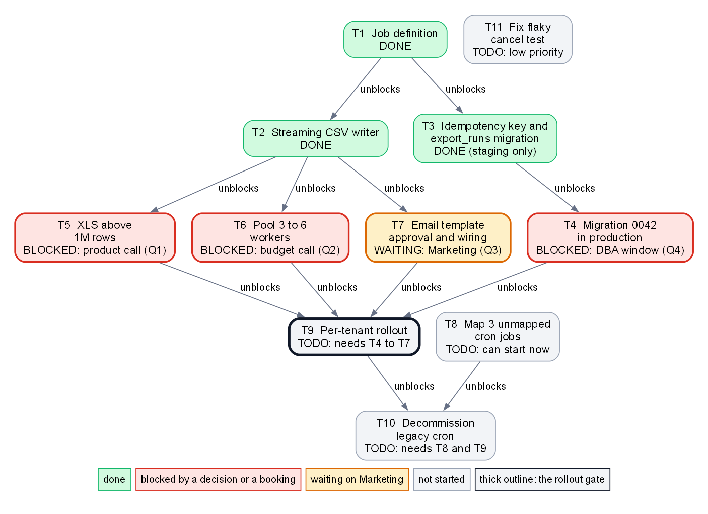

<!-- zone:human -->
<!-- Agent continuing this work: read the glance panel, then sections 1 and 2 for context, then blocks A to F in the machine zone. Block A has the rules. -->
# Exports migration handoff: CSV path works on staging, 10 Nov cutover at risk until four blockers clear

*Handoff written Fri 2026-10-16 · work state as of the last work-log entry, 2026-10-15 · Alex · final · for Dana (decisions) and the coding agent that continues the work*

## 👤 START HERE - at a glance

> ### 🟡 At risk: the 10 Nov cutover holds only if four blockers clear by 30 Oct
>
> **Bottom line:** CSV exports already run on the new JobRunner platform in staging, and nothing has been done in production yet. The tenant rollout cannot start until four items clear, and each first waits on someone outside engineering: a product call on XLS, a budget call on pool size, a DBA window and Marketing's sign-off on the email. The agent that continues next week cannot unblock any of them.
>
> **Confidence:** medium. The status is taken from Alex's work log up to 15 Oct. The 30 Oct limit is Alex's own estimate and the notes give no duration for the three-stage rollout, so 30 Oct may already be too late. Assumptions are in [section 5](#5-assumptions-and-what-is-not-known).

> ### 🧭 Decisions and actions needed from Dana, by Fri 30 Oct at the latest
>
> - **[Q1 XLS above 1M rows](#q1-xls-above-1m-rows):** choose (a) a ZIP of several 1M-row XLS files or (b) CSV only for large datasets. **Recommendation:** (a).
> - **[Q2 Pool size](#q2-pool-size-3-to-6-workers):** approve 6 workers instead of 3, about 1,200 USD more per month (estimate). **Recommendation:** approve.
> - **[Q3 Email](#q3-email-wording-and-logo-sign-off):** chase Marketing for sign-off on the wording and logo (draft sent 12 Oct, no reply).
> - **[Q4 DBA window](#q4-dba-window-for-migration-0042):** name one person to book it, be reachable during it and later run the production steps. Windows before 30 Oct: 20, 22, 27 and 29 Oct. **Recommendation:** book the earliest one now.
> - **[Q5 Cron jobs](#q5-owner-of-the-three-unmapped-cron-jobs):** find who owns the 3 unmapped legacy cron jobs. Not needed for the cutover, needed before legacy cron is switched off.
> - **[Q6 Cutover date](#q6-cutover-date):** on 30 Oct, keep 10 Nov only if Q1 to Q4 are closed; otherwise move it.
>
> **If we get it wrong or late:** every day lost after 30 Oct comes off the runway to 10 Nov, and Alex is back only on Sat 7 Nov. Option (b) would end XLS for Acme's biggest dataset; staying at 3 workers leaves Acme's SLA failing whenever its exports overlap.
>
> Record answers in the Answer column of the [table in section 2](#2-six-open-questions-and-four-of-them-block-the-rollout), or tell the agent directly; it records them there.

| | Top risks, ranked | Impact | Where it is handled |
|---|---|---|---|
| 🔴 | All four blockers (Q1 to Q4) wait on people other than the engineer, and none has an answer or a date yet | The rollout cannot start; after 30 Oct every day of delay moves the 10 Nov cutover | [Section 2](#2-six-open-questions-and-four-of-them-block-the-rollout) |
| 🟠 | Acme's SLA fails on 3 workers: three parallel exports take 21 min against 15 allowed | Contract breach at Acme on Monday mornings; the 6-worker fix is an untested estimate | [Q2](#q2-pool-size-3-to-6-workers) |
| 🟠 | XLS above 1M rows is only a stub | Acme's 4.2M-row dataset cannot be exported as XLS | [Q1](#q1-xls-above-1m-rows) |
| 🟡 | Only staging has been exercised, and the one person who knows the setup is away until 7 Nov | Surprises during the production rollout with nobody to ask | [Section 5](#5-assumptions-and-what-is-not-known), [block E](#e-gotchas-and-things-to-verify-first) |
| 🟡 | Three legacy cron jobs have no known owner | Legacy cron cannot be switched off, and an export could stop unnoticed if one is retired by mistake | [Q5](#q5-owner-of-the-three-unmapped-cron-jobs) |

**Key facts:** 3 of 11 tasks done, 4 blockers ([section 1](#1-the-csv-path-works-on-staging-and-nothing-is-in-production-yet)) · 20 of 20 CSV test exports passed on staging · Acme's biggest dataset (4.2M rows): 9.5 min alone, 21 min with three in parallel, limit 15 ([Q2](#q2-pool-size-3-to-6-workers)) · 11 of 14 legacy cron jobs mapped ([Q5](#q5-owner-of-the-three-unmapped-cron-jobs)) · nothing in production yet



*How to read it: an arrow points from a task to what it unblocks. Green is done, red is blocked by a decision or a booking, amber is waiting on Marketing, grey is not started, and the thick outline is the rollout. Takeaway: four boxes sit between the finished work and the rollout, and only T8 and T11 can start without anyone's answer.*

**Read next**

1. [1 The CSV path works on staging and nothing is in production yet](#1-the-csv-path-works-on-staging-and-nothing-is-in-production-yet) - what is done, blocked and proven · 2 min
2. [2 Six open questions and four of them block the rollout](#2-six-open-questions-and-four-of-them-block-the-rollout) - options, recommendations, who answers · 3 min
3. [3 The 10 Nov date holds only if all four blockers clear by 30 Oct](#3-the-10-nov-date-holds-only-if-all-four-blockers-clear-by-30-oct) - the calendar and how tight it is · 1 min
4. [4 Next week the agent can prepare but cannot unblock anything](#4-next-week-the-agent-can-prepare-but-cannot-unblock-anything) - what the agent will and will not do · 1 min
5. [A Agent brief with rules and order of work](#a-agent-brief-with-rules-and-order-of-work) - everything the continuing agent needs · 10 min

*Dana: you can stop after 2; sections 3 and 4 add the calendar and what to expect. Agent: read 1 and 2 for context, then A to F in order.*

## 1 The CSV path works on staging and nothing is in production yet

*Where do things stand, and what has actually been proven?*

**How the new setup works.** Each export is a JobRunner job: a YAML definition (`jobs/export-dataset.yaml`, parameters `dataset`, `format`, `tenant`, `notify_email`) that a worker in the pool `exports-pool` runs; the pool has 3 workers today. The worker reads Postgres with keyset pagination and writes through a streaming CSV writer, which keeps memory under 300 MB. An idempotency key (`export_id`, together with the new table `export_runs`) stops a retried job from sending a second email or overwriting a finished file. The feature flag `exports.jobrunner.enabled` (off by default, per-tenant override in the table `tenant_flags`) controls who uses JobRunner. It presumably switches a tenant over from legacy cron, which is still the live system with 14 jobs in `legacy/crontab.txt` (inferred, not stated in the notes).

| | ID | Task | Status | Waiting on, or next step |
|---|---|---|---|---|
| ✅ | T1 | Job definition for export-dataset | done | - |
| ✅ | T2 | Streaming CSV writer | done | - |
| ✅ | T3 | Idempotency key and `export_runs` migration | done on staging only | the production run is T4 |
| ⛔ | T4 | Apply migration 0042 in production | blocked | a DBA window, ticket DBA-5521 not scheduled: [Q4](#q4-dba-window-for-migration-0042) |
| ⛔ | T5 | XLS export above 1M rows | blocked | product decision: [Q1](#q1-xls-above-1m-rows) |
| ⛔ | T6 | Pool size 3 to 6 workers | blocked | budget decision: [Q2](#q2-pool-size-3-to-6-workers) |
| ⏳ | T7 | Email template approval and wiring | in progress, waiting | Marketing sign-off, wiring is done: [Q3](#q3-email-wording-and-logo-sign-off) |
| ⬜ | T8 | Map the 3 unmapped cron jobs | todo, can start now | owner unknown: [Q5](#q5-owner-of-the-three-unmapped-cron-jobs) |
| ⬜ | T9 | Per-tenant rollout: `nimbus-internal`, then Acme, then all tenants | todo | T4, T5, T6 and T7 |
| ⬜ | T10 | Decommission legacy cron | todo | T8 and T9 |
| ⬜ | T11 | Fix flaky `test_export_cancel` | todo, low priority | - |

| Measured so far | Not proven |
|---|---|
| 20 of 20 CSV exports for `nimbus-internal` ran fine on staging | XLS above 1M rows: only a stub exists |
| 5M rows in 6 min on one worker, memory under 300 MB | That 6 workers fix the SLA overlap: an estimate, never run |
| Acme's biggest dataset (4.2M rows) meets the 15-min SLA when it runs alone on 3 workers (numbers in [Q2](#q2-pool-size-3-to-6-workers)) | Anything in production: migration 0042, runner secrets, flag overrides |
| 212 tests pass and 1 is an expected failure (the flaky `test_export_cancel`) | That a retry after a finished run is a no-op end to end: the notes do not record a test |

**Done means** every tenant exports through JobRunner, all 14 legacy cron jobs are mapped or retired by their owner, and legacy cron is switched off (T10).

**Next →** [2 Six open questions and four of them block the rollout](#2-six-open-questions-and-four-of-them-block-the-rollout)

## 2 Six open questions and four of them block the rollout

*What does each open question need, from whom, and by when?*

Q1 to Q4 block the rollout (T9). Q5 blocks only the shutdown of legacy cron (T10). Q6 depends on Q1 to Q4. The numbering follows Alex's `open-questions.md`. The Answer column is where an answer gets recorded, so the agent knows what is settled.

| ID | Question | Who answers | Needed by | Answer (record here) |
|---|---|---|---|---|
| Q1 | XLS above 1M rows | Dana (product call; asked on 6 Oct, no reply) | Fri 30 Oct | open |
| Q2 | Pool size 3 to 6 workers | Dana (budget) | Fri 30 Oct | open |
| Q3 | Marketing sign-off on email wording and logo | Marketing; Dana to chase | Fri 30 Oct | open |
| Q4 | DBA window for migration 0042, and an owner for production steps | Dana names the person; the DBA team gives the window | name now; run by Thu 29 Oct, last fallback Thu 5 Nov | open |
| Q5 | Owner of the 3 unmapped cron jobs | Dana, or whoever she asks | before legacy cron is switched off | open |
| Q6 | Keep the 10 Nov cutover | Dana | Fri 30 Oct | open |

### Q1 XLS above 1M rows

*Which Excel output do customers get when a dataset has more rows than one sheet holds?*

`xlsxwriter` stops at 1,048,576 rows per sheet. Acme's biggest dataset has 4.2M rows, and today `src/exports/xls_writer.py` is a stub that raises `NotImplementedError` above 1M rows. T5 cannot start until one option is chosen.

| Option | What customers receive | Assessment |
|---|---|---|
| (a) ZIP of several XLS files of 1M rows each | A ZIP instead of one file (about 5 files for Acme) | **Recommended.** Keeps XLS for large datasets. It changes what customers receive, which is why it needs a product decision. Alex prefers it. |
| (b) Drop XLS for large datasets | No XLS; customers use CSV | Acme's 4.2M-row XLS export would stop working. |
| (c) Several sheets in one file | One file, data spread over tabs | Not offered: each sheet is still capped, and the layout is confusing. |

### Q2 Pool size 3 to 6 workers

*Is Acme's SLA worth about 1,200 USD more per month?*

Acme's contract requires an export to finish within 15 minutes. Acme's biggest dataset (4.2M rows) takes 9.5 min on the 3-worker pool when it runs alone (pass), but 21 min when three exports run at once (fail), which Acme does on Monday mornings. Alex expects 6 workers to fix this for an estimated 1,200 USD more per month, about 14,400 USD a year. The overlap case has not been run on 6 workers, and the notes do not explain how one export uses several workers, so the agent will try to measure it on staging ([block C](#c-playbook-for-tasks-that-can-start-now)). **Recommendation:** approve 6 workers. The alternative is to stay at 3 and accept SLA misses whenever Acme's exports overlap.

### Q3 Email wording and logo sign-off

*Can the new notification email go out?*

The legacy system sent plain text. The new HTML template, `templates/export_ready.html`, is wired in and used only when `notify_email` is set, but Marketing must approve its wording and logo. Alex sent the draft on 12 Oct and has no answer; the notes name no contact. **Recommendation:** Dana chases Marketing and asks for an answer by 30 Oct.

### Q4 DBA window for migration 0042

*Who gets the `export_runs` table into production, and when?*

Migration `migrations/0042_export_runs.sql` adds the table `export_runs` and has run on staging only. Production needs a DBA window (Tuesdays and Thursdays, 22:00-23:00 UTC, which is 23:00 CET, the zone of the legacy cron logs, or midnight CEST before the clocks change on Sun 25 Oct) under ticket DBA-5521, which is opened but not scheduled. A person has to book the slot and be reachable during it, and Alex is away. T4 depends only on T3, which is done, so this can happen now; the windows are in the [calendar](#3-the-10-nov-date-holds-only-if-all-four-blockers-clear-by-30-oct). The same person, or another with production access, must also run the production steps of T9 and T10 (assumption 3 in [section 5](#5-assumptions-and-what-is-not-known)). **Recommendation:** Dana names that person this week, and they book the earliest window the DBA team offers.

### Q5 Owner of the three unmapped cron jobs

*Who knows what `export_weekly_xls`, `export_audit` and `export_adhoc` do?*

Of the 14 jobs in `legacy/crontab.txt`, 11 map one-to-one to JobRunner definitions (listed in `docs/cron-mapping.md`) and these 3 do not. Nobody on the team knows who owns them. They do not block the rollout, but legacy cron cannot be switched off until each is mapped or retired by someone who owns it. The agent will document what each does (T8), which should help find the owners. The name `export_weekly_xls` hints at a link to Q1; that is inferred from the name only. **Recommendation:** Dana asks around for the owners before the cutover so the shutdown is not delayed.

### Q6 Cutover date

*Is Tue 10 Nov still realistic?*

The target is Tue 10 Nov. The rollout (T9) cannot start until Q1 to Q4 are resolved, and Alex's own limit for those is 30 Oct. **Recommendation:** on Fri 30 Oct, keep 10 Nov only if Q1 to Q4 are all answered and the production migration has run or is booked in a window on or before Thu 5 Nov; otherwise move the date and record the new one in the Answer column. The calendar is in [section 3](#3-the-10-nov-date-holds-only-if-all-four-blockers-clear-by-30-oct).

**Next →** [3 The 10 Nov date holds only if all four blockers clear by 30 Oct](#3-the-10-nov-date-holds-only-if-all-four-blockers-clear-by-30-oct)

## 3 The 10 Nov date holds only if all four blockers clear by 30 Oct

*What has to happen when, and how much slack is there?*

| Date | What happens | Why it matters |
|---|---|---|
| Fri 16 Oct | Handoff written; last working day before Alex's leave | The work state is as of 15 Oct |
| Mon 19 Oct | The agent starts; Dana can answer Q1 to Q4 from here on | Every day of delay after this comes off the runway |
| Tue 20, Thu 22, Tue 27, Thu 29 Oct | DBA windows, 22:00-23:00 UTC | One booked slot finishes T4 before the checkpoint |
| Fri 30 Oct | Checkpoint: are Q1 to Q4 answered? Decide Q6 | The limit given in Alex's notes |
| Tue 3 and Thu 5 Nov | Last DBA windows before the target | Fallback for T4 only |
| Sat 7 Nov | Alex is back; first working day is Mon 9 Nov | One working day before the target |
| Tue 10 Nov | Cutover target (assumed to mean T9 is complete) | Also a DBA window day |

After 30 Oct there are six working days before 10 Nov (2 to 6 Nov and 9 Nov). In that time T5 must be built and tested once Q1 is answered, the pool resized, the template finalised, and the rollout run in three stages (`nimbus-internal`, then Acme, then everyone else) by someone other than Alex. The notes give no duration for the stages, so the plan has no visible spare time; that is a judgement, not a measurement.

**Next →** [4 Next week the agent can prepare but cannot unblock anything](#4-next-week-the-agent-can-prepare-but-cannot-unblock-anything)

## 4 Next week the agent can prepare but cannot unblock anything

*What will the agent do while the four blockers are open, and what will it not do?*

- **Starts now:** T8, documenting what the 3 unmapped cron jobs do, which helps Q5; and T11, the flaky test (low priority).
- **Optional preparation, never merged or deployed:** a branch with option (a) of T5, and a staging measurement of whether 6 workers fix the SLA overlap, which would turn the Q2 estimate into a number.
- **Will not do:** anything in production, any customer-visible change before its question (Q1 or Q3) is answered, or any spending. Production steps (T4, T9, T10) need the named person from Q4.
- **What Dana sees:** a dated entry in the [progress log](#f-progress-log) after every session, with the status table, the picture and this glance panel kept true.

**Next →** [5 Assumptions and what is not known](#5-assumptions-and-what-is-not-known)

## 5 Assumptions and what is not known

*What was assumed, and what could not be established from the notes?*

Assumptions (each changes the plan if it is wrong):

1. **Dates.** Written on Fri 16 Oct. Alex's leave runs 17 Oct to 6 Nov and he is back Sat 7 Nov, so his first working day is Mon 9 Nov.
2. **"Cutover" means every tenant exports through JobRunner (T9 done).** Decommissioning legacy cron (T10) follows. The notes do not define the word.
3. **The agent has staging access and no production access.** Production steps (T4, T9, T10) are done by a named person, which is what Q4 asks Dana for.
4. **Dana answers Q1, Q2 and Q6.** Alex asked her about Q1 on 6 Oct. If product or budget ownership sits elsewhere, she routes the question.
5. **The performance runs were on staging.** The notes do not say where they ran; production is untouched.
6. **Recommendations.** Alex's notes state a preference only for Q1. The recommendations for Q2 to Q4 and Q6 are drawn from the notes' own numbers and dates.

Not known:

- How long each rollout stage takes and how to roll a tenant back. The notes give neither.
- Whether all of Alex's work is committed and pushed, and on which branch. [Block E](#e-gotchas-and-things-to-verify-first) tells the agent how to check, and lists the other technical unknowns.
- Whether the paths, commands and file names in this document match the repository. They are copied from Alex's notes; the repository itself was not inspected.

**Next →** [A Agent brief with rules and order of work](#a-agent-brief-with-rules-and-order-of-work) (for the continuing agent)

---

<!-- zone:ai-input -->
## 🗄️ MACHINE AND ARCHIVE ZONE - skip unless you need the evidence or are an agent continuing this work

*What is in here: everything an agent needs to continue the work (A to F) and the evidence behind the claims above (G and H). It supports sections 1 to 4.*

<!-- zone:ai-input -->
### A Agent brief with rules and order of work

<details>
<summary>Mission, boundaries, order of work and definition of done (click to expand)</summary>

**Mission.** Finish moving scheduled exports from legacy cron (14 jobs in `legacy/crontab.txt`) to JobRunner. Cutover target: Tue 2026-11-10. Alex, who wrote the notes this is built from, is on leave 2026-10-17 to 2026-11-06 and cannot be asked anything. Dana (manager) answers Q1 to Q6 through the Answer column of the table in [section 2](#2-six-open-questions-and-four-of-them-block-the-rollout). Record an answer as `decided: <choice> - <who> - <date>`. If Dana tells you directly in a session, write it into that table before acting on it. If an answer is unclear or changes the plan, stop work on that task and note the question in the [progress log](#f-progress-log).

**Allowed without asking:** edit code, tests and docs in `C:\work\nimbus-exports`; run local tests; deploy to and test on STAGING; commit to a new branch.

**Never, because these are for a person:**

1. Any production action: running migration 0042 in production (T4), deploying to production, changing `tenant_flags` or the flag default in production (T9), resizing the production pool (T6), switching off legacy cron (T10). Prepare and document them; do not run them.
2. Reading, printing or copying production secrets (`kv://nimbus/exports/prod/*`) into code, logs, commits, this document or chat.
3. Merging to the default branch, force-pushing, rewriting history or discarding uncommitted work (`git reset --hard`, `git clean`). The notes say nothing about the branch workflow, so this is a safe default.

**Not until the matching answer is recorded in section 2:**

4. Changing what customers receive: the XLS output (T5, needs Q1) or the email wording and logo (T7, needs Q3).

**Do not retry dead ends:**

5. Loading all rows into memory (the worker was OOM-killed at 2M rows with a 2 GB limit) and LIMIT/OFFSET paging (slower with every page).

**Order of work.**

1. Orient with the git and test commands in [block B](#b-environment-and-commands). If the test result differs from the baseline there, log the difference in the progress log before you change anything.
2. Check the unknowns in [block E](#e-gotchas-and-things-to-verify-first) that your next step depends on.
3. Do T8 ([block C](#c-playbook-for-tasks-that-can-start-now)). Then the optional preparation there, if time remains.
4. At the start of every session, re-read the Answer column. For each newly answered question, follow its playbook in [block D](#d-playbook-for-tasks-that-wait-for-an-answer).
5. Do T11 last.
6. If everything left waits for Q1 to Q4, stop: add a progress-log entry saying what you wait for. Do not invent work.

**After every session:** update the status table in [section 1](#1-the-csv-path-works-on-staging-and-nothing-is-in-production-yet), the Answer column, the glance panel (verdict, risks, key facts) and the progress log, so none of them goes stale. On or after Fri 2026-10-30, if Q1 to Q4 are not all answered, change the verdict to 🔴 and say that 10 Nov cannot hold unless Q6 moves the date. If `dot` is available, edit `report.assets/task-map.dot` and re-render the picture ([block H](#h-diagram-source-and-edge-list)).

**Definition of done for the migration.** As defined at the end of [section 1](#1-the-csv-path-works-on-staging-and-nothing-is-in-production-yet), and no Answer cell says open.

</details>

<!-- zone:ai-input -->
### B Environment and commands

<details>
<summary>Commands to run and files to know (click to expand)</summary>

Repository root: `C:\work\nimbus-exports` (Python 3.12, Windows with PowerShell). Every repository path in this document is relative to that root, and every command runs from it.

```powershell
git status; git branch --show-current; git log --oneline -15     # orient first (block E, item 1)
docker compose up -d postgres                                    # needed before local runs and tests
python -m exports.cli run --dataset demo --format csv --rows 100000   # local run
pytest tests/exports -q                                          # expected: 212 passed, 1 xfailed
./scripts/deploy.ps1 -Env staging -Service exports-runner        # needs the staging VPN
kubectl get pods -n exports                                      # run after every deploy: deploy.ps1 fails silently without the VPN
```

| Path or name | What it is |
|---|---|
| `jobs/export-dataset.yaml` | JobRunner job definition (T1); parameters `dataset`, `format`, `tenant`, `notify_email`; pool `exports-pool` |
| `src/exports/streaming_csv.py` | `StreamingCsvWriter`: keyset pagination plus streaming write (T2) |
| `src/exports/xls_writer.py` | XLS stub; raises `NotImplementedError` above 1M rows (T5) |
| `migrations/0042_export_runs.sql` | adds `export_runs`; applied on staging (T3), not in production (T4) |
| `templates/export_ready.html` | new notification email, used only when `notify_email` is set (T7) |
| `tests/exports/test_export_cancel.py` | holds the flaky `test_export_cancel`, marked `xfail` (T11) |
| `legacy/crontab.txt`, `docs/cron-mapping.md` | the 14 legacy jobs; the 11 mapped ones (T8) |
| tables `export_runs`, `tenant_flags` | idempotency records (timestamps in UTC); per-tenant flag overrides |
| flag `exports.jobrunner.enabled` | default false; enabled for tenant `nimbus-internal` in staging only |
| ticket DBA-5521 | production DBA window for migration 0042; opened, not scheduled |

</details>

<!-- zone:ai-input -->
### C Playbook for tasks that can start now

<details>
<summary>T8, T11 and optional preparation (click to expand)</summary>

**T8 Map the 3 unmapped cron jobs** (ready, no dependencies).

1. In `legacy/crontab.txt`, find `export_weekly_xls`, `export_audit` and `export_adhoc`. For each, record the schedule, command or script, arguments, recipients and output.
2. Check who touched each (`git log` and `git blame` on the crontab line and the script). This only hints at owners; contact nobody.
3. Compare with `docs/cron-mapping.md` and `jobs/export-dataset.yaml`: can the job be run as `export-dataset` with `dataset`, `format`, `tenant`, `notify_email`? If not, say what is missing.
4. Add an "Unmapped jobs" section to `docs/cron-mapping.md` with the findings and a proposed action per job (map or retire). Mind the time zones (block E).
5. Do not retire or edit any job. Done when each of the 3 has a documented purpose and a proposed action. The owner stays "unknown" until Q5 is answered.

**T11 Fix flaky `test_export_cancel`** (ready, low priority, do it last). The test cancels before the worker has started, so it fails intermittently and is marked `xfail`. Alex spent half a day without a fix; time-box to the same. Wait until the worker has started before cancelling, then remove `xfail`. Done when it passes 20 runs in a row, or when you stop at the time-box and leave `xfail` with a note on what you tried.

**Optional preparation (never merge, never deploy):**

- T5 option (a) on a branch: `xls_writer.py` writing files of at most 1M rows into one ZIP, streaming the rows, with tests at the boundaries. Discard it if Q1 is answered with (b). Untested hint: `xlsxwriter` has a `constant_memory` mode; check that it fits before using it.
- T6 measurement on staging: with the pool at 6 workers, start three exports of Acme's biggest dataset (4.2M rows) together and record the elapsed time; compare it with the numbers in [Q2](#q2-pool-size-3-to-6-workers). The staging autoscaler is disabled (block E), so scale by hand and put the pool back to 3 afterwards. The notes do not say how the earlier runs were started or how to scale; if you cannot work it out in about half a day, skip it and log what is missing.
- Ideas with no owner or ticket, not needed for the cutover: Grafana dashboards for export duration (folder "Exports") and an alert on the dead-letter queue.

</details>

<!-- zone:ai-input -->
### D Playbook for tasks that wait for an answer

<details>
<summary>T4 to T7, T9 and T10: what to do once each answer is recorded (click to expand)</summary>

Human-run steps (T4, T9, T10) count as done only when a person writes so in the [progress log](#f-progress-log) or tells you in a session; you cannot check production yourself.

**T4 Migration 0042 in production.** Starts when Q4 names a person and a window. Human only: the agent does not run it. Optional help: summarise `migrations/0042_export_runs.sql` (what it adds, how to undo it) for ticket DBA-5521. Done when a person has applied it in the DBA window and confirmed that `export_runs` exists in production.

**T5 XLS above 1M rows.** Starts when Q1 is answered.

- (a) ZIP of XLS files: finish the branch from block C. Keep streaming. Test at 1M rows, 1M plus 1, and 4.2M. Done when a 4.2M-row XLS export works on staging with memory well under the 2 GB container limit (the CSV writer stays under 300 MB) and tests pass.
- (b) CSV only: replace the `NotImplementedError` with an early, explicit error that tells the user to use CSV, and add a test. Customer messaging is Dana's.

**T6 Pool 3 to 6 workers.** Starts when Q2 is answered. Find where the size of `exports-pool` is set (start with `jobs/export-dataset.yaml` and the JobRunner docs); a person applies it in production. Done when the pool has 6 workers where exports run and the overlap test (three parallel exports of the 4.2M-row dataset) finishes within 15 min. Record the measured time in the [progress log](#f-progress-log).

**T7 Email template.** Starts when Q3 is answered. Apply the approved wording and logo to `templates/export_ready.html`, run the tests, then send one staging export with `notify_email` set to an internal Nimbus address only, never a customer. If you cannot find an internal test address, skip the send and log that. Done when the template matches what Marketing approved.

**T9 Per-tenant rollout.** Starts when T4, T5, T6 and T7 are done and Q6 confirms the date. A person with production access does it; the agent prepares a runbook in `docs/` and rehearses on staging. Order: `nimbus-internal`, then Acme, then everyone else, by setting the `exports.jobrunner.enabled` override in `tenant_flags`. After each stage check `export_runs` and the email; for Acme also watch a Monday morning with overlapping exports against the 15-minute limit. The notes give no stage durations and no rollback, so the runbook must define both and put them in front of Dana. Done when every tenant exports through JobRunner.

**T10 Decommission legacy cron.** Starts only when T8 and T9 are done and Q5 has an owner's decision for each unmapped job. A person does it. Done when the 14 legacy cron entries are switched off: 11 replaced by JobRunner, 3 mapped or retired by their owner.

</details>

<!-- zone:ai-input -->
### E Gotchas and things to verify first

<details>
<summary>Traps from the work log and questions the notes leave open (click to expand)</summary>

Traps, from Alex's notes:

- The staging runner-pool autoscaler is disabled: if exports queue up, scale the pool by hand.
- `export_runs` timestamps are UTC; legacy cron logs are in local time (CET). Convert before comparing.
- `scripts/deploy.ps1` fails silently when the VPN is down: always run `kubectl get pods -n exports` afterwards.
- `test_export_cancel` is flaky because of timing, not because of a regression.

Verify before relying on them, because the notes are silent:

1. Git state: which branch holds the work, and whether everything is committed and pushed. Discard nothing you find.
2. Where `exports.jobrunner.enabled` is read and what it switches. Confirm that a flagged tenant's exports are not also run by legacy cron (double exports and double emails).
3. Whether the 11 mapped jobs already exist as definitions in `jobs/`, or only on paper in `docs/cron-mapping.md`.
4. Where `export_id` is enforced (search the code for `export_id`) and whether a test covers "a retry after a finished run does nothing".
5. How the `exports-pool` size is set, how to scale it on staging, and how the earlier staging benchmarks were started. The notes mention "the JobRunner docs" without a location; look in the repository's `docs/` first.
6. The valid `-Env` values of `deploy.ps1`. Only `staging` is documented here; read the script before using any other.
7. The `tenant_flags` columns (read the migrations) before writing any override.
8. Whether the performance runs were on staging (assumption 5 in section 5).

</details>

<!-- zone:ai-input -->
### F Progress log

<details>
<summary>Append newest first: date, who, what changed, what is awaited (click to expand)</summary>

| Date | Who | What changed | Awaiting |
|---|---|---|---|
| 2026-10-16 | Alex | Handoff written from the work log (entries to 2026-10-15). Nothing done in production. | Q1 to Q4 |

</details>

<!-- zone:archive -->
### G Evidence and provenance

<details>
<summary>Where each number comes from, and the dated work-log digest (click to expand)</summary>

Full file: [report.evidence.md](report.evidence.md). It lists the three source notes, a claim-to-source table that marks each figure as measured, estimated, inferred or computed, and a dated digest of the work log with the dead ends. It supports the numbers in [section 1](#1-the-csv-path-works-on-staging-and-nothing-is-in-production-yet) and [section 2](#2-six-open-questions-and-four-of-them-block-the-rollout).

</details>

<!-- zone:archive -->
### H Diagram source and edge list

<details>
<summary>Source and edge list of the task map in the glance panel (click to expand)</summary>

Source file: [task-map.dot](report.assets/task-map.dot). Render, from the folder that holds `report.md`, with `dot -Tpng -Gdpi=120 report.assets/task-map.dot -o report.assets/task-map.png`. Every edge is read from the "Depends on" column of Alex's task table; none is inferred. This edge list is the text form of the picture in the glance panel and of the status table in [section 1](#1-the-csv-path-works-on-staging-and-nothing-is-in-production-yet).

| From | Relation | To | Verified? |
|---|---|---|---|
| T1 | unblocks | T2 | yes |
| T1 | unblocks | T3 | yes |
| T3 | unblocks | T4 | yes |
| T2 | unblocks | T5 | yes |
| T2 | unblocks | T6 | yes |
| T2 | unblocks | T7 | yes |
| T4 | unblocks | T9 | yes |
| T5 | unblocks | T9 | yes |
| T6 | unblocks | T9 | yes |
| T7 | unblocks | T9 | yes |
| T8 | unblocks | T10 | yes |
| T9 | unblocks | T10 | yes |

</details>
