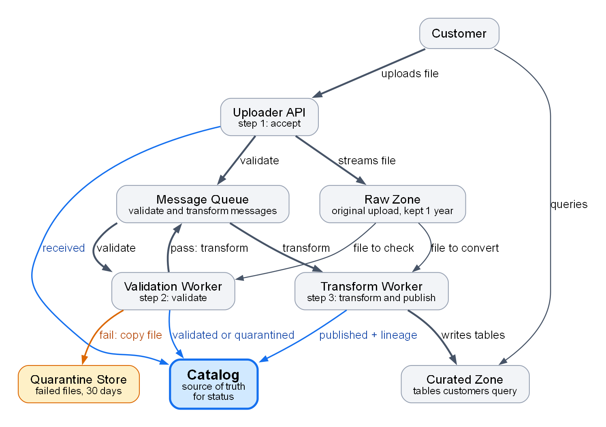
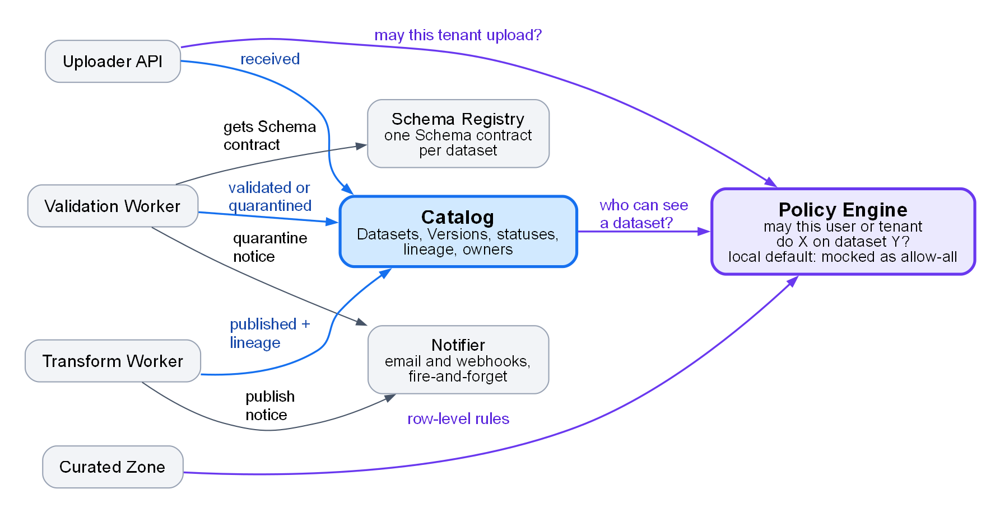

<!-- zone:human -->
# How the ingestion platform works: three asynchronous steps, and the Catalog is the source of truth

*2026-10-17 · Copilot, from Sam's architecture notes and the week-one checklist · draft, not yet reviewed by Sam · for Priya and future new ingestion engineers*

## 👤 START HERE - at a glance

> ### Mental model: upload → validate → transform → publish, all asynchronous
>
> **Bottom line:** Customers upload files and the platform turns them into queryable tables, with nobody waiting on an HTTP call. Each upload is a **Version** (one immutable upload) that three components move along by message ([section 1](#1-a-file-becomes-a-table-in-three-asynchronous-steps)), and the **Catalog** records where it is: `received`, `validated`, `published`, or `quarantined` if validation fails. If the Catalog and the queue disagree, trust the Catalog ([section 4](#4-two-kinds-of-failure-and-one-source-of-truth)).
>
> **Confidence:** high that this matches Sam's notes (October 2026); not yet checked against the code or by Sam. Seven open questions, including an unclear retry count, are in [7 What this guide does not know](#7-what-this-guide-does-not-know).



*How to read it: arrows follow the way a file, message, query or status update travels. Thick = the path of a file that passes, orange = the failure branch, blue = the Catalog and the status each step writes to it. Takeaway: three components do the work and each one reports to the Catalog. The Policy Engine, Schema Registry and Notifier are left out here; see [3 Eleven components in five roles with two hubs](#3-eleven-components-in-five-roles-with-two-hubs).*

| | Five ideas that matter most (🟠 costly to miss, 🟡 confusing to miss) | The trap if you miss it | Where it is handled |
|---|---|---|---|
| 🟠 | The Catalog, not the queue, says where a file is | You misjudge a file's state and chase the wrong thing | [Section 4](#4-two-kinds-of-failure-and-one-source-of-truth) |
| 🟠 | Test with `POLICY_MODE=strict` before every PR; the local default mocks the Policy Engine as allow-all | Access-control bugs pass local tests | [Section 5](#5-test-locally-in-strict-policy-mode) |
| 🟠 | Delivery is at-least-once, so every worker must be idempotent | A worker that is not idempotent repeats its effects when a message arrives twice | [Section 4](#4-two-kinds-of-failure-and-one-source-of-truth) |
| 🟡 | A Version never changes; re-upload instead, and a breaking schema change needs a new dataset major version | You try to "fix" a Version in place | [Section 2](#2-six-terms-to-know-and-a-version-that-never-changes) |
| 🟡 | Retention differs by store (quarantine 30 days, Raw Zone 1 year) and every timestamp is UTC | You mix up the periods or misread UTC times; support gets confused by UTC every week | [Section 3](#3-eleven-components-in-five-roles-with-two-hubs) |

**Key facts:** 3 steps · 11 components ([section 3](#3-eleven-components-in-five-roles-with-two-hubs)) · target: published within **15 minutes** for files up to 1 GB, hard limit 5 GB ([section 1](#1-a-file-becomes-a-table-in-three-asynchronous-steps)) · failed messages are retried, then dead-lettered, and a dead-lettered message pages on-call ([section 4](#4-two-kinds-of-failure-and-one-source-of-truth))

**Your first week:** get access, run the local stack in strict policy mode, push one good and one bad file through it, shadow one on-call shift and take one starter ticket ([6 Your first week in eight steps](#6-your-first-week-in-eight-steps)).

**Read next**

1. [1 A file becomes a table in three asynchronous steps](#1-a-file-becomes-a-table-in-three-asynchronous-steps) - the order of events and how long it takes · 3 min
2. [2 Six terms to know and a Version that never changes](#2-six-terms-to-know-and-a-version-that-never-changes) - the vocabulary · 2 min
3. [3 Eleven components in five roles with two hubs](#3-eleven-components-in-five-roles-with-two-hubs) - who does what and who calls whom · 3 min
4. [4 Two kinds of failure and one source of truth](#4-two-kinds-of-failure-and-one-source-of-truth) - what happens when things go wrong · 3 min
5. [5 Test locally in strict policy mode](#5-test-locally-in-strict-policy-mode) - run it on your machine · 1 min
6. [6 Your first week in eight steps](#6-your-first-week-in-eight-steps) - what to do in what order · 2 min
7. [7 What this guide does not know](#7-what-this-guide-does-not-know) - what to confirm with Sam · 3 min

*Only want the mental model? You can stop here. Starting Monday? Read 5 and 6. Shadowing on-call? Add 2 and 4. About to change code? Read 1 to 4 first. Items marked (inferred) are readings of the notes, not statements in them; section 7 lists them.*

## 1 A file becomes a table in three asynchronous steps

*What happens, in order, between a customer uploading a file and a customer querying a table?*

Customers upload CSV, Parquet or JSON lines files. The Uploader API stores the file and queues the work; everything after that happens in the background, as the map at the top shows.

| Step | Component | What happens | Catalog status afterwards |
|---|---|---|---|
| 1 Accept | Uploader API | Authenticates the caller and asks the Policy Engine whether this tenant may upload to this dataset. Streams the file into the Raw Zone, creates the Version in the Catalog and puts a `validate` message on the Message Queue. | `received` |
| 2 Validate | Validation Worker | Takes the `validate` message, reads the file from the Raw Zone, fetches the dataset's Schema contract from the Schema Registry and checks the file against it. | unchanged |
| 2a File passes | Validation Worker | Puts a `transform` message on the queue. | `validated` |
| 2b File fails | Validation Worker | Copies the file to the Quarantine Store and has the Notifier tell the dataset owner why. The automatic path ends here. | `quarantined` |
| 3 Transform and publish | Transform Worker | Takes the `transform` message, reads the validated file from the Raw Zone, converts it to the curated format and writes it to the Curated Zone. Writes a Lineage record to the Catalog, sets the status and asks the Notifier to email the owner. | `published` |

What to take from the table:

- The queue carries messages, not files. Each worker reads the file itself from the Raw Zone, which is immutable.
- Every step leaves a status in the Catalog, so the Catalog can always say how far a Version got.
- A file that fails validation is a normal ending for the automatic path, not an error; [4 Two kinds of failure and one source of truth](#4-two-kinds-of-failure-and-one-source-of-truth) explains what happens next.

**How long it should take.** The target is a published table within 15 minutes for files up to 1 GB. At p95 a 1 GB file spends 40 seconds in validation and 6 minutes in transform, so the two workers use about 7 of those minutes. Typical files are 50 to 500 MB; the hard limit is 5 GB.

**Next →** [2 Six terms to know and a Version that never changes](#2-six-terms-to-know-and-a-version-that-never-changes)

## 2 Six terms to know and a Version that never changes

*What do the capitalised terms in this guide mean?*

| Term | Meaning | The rule that matters |
|---|---|---|
| Tenant | A customer organisation | Everything is scoped to a tenant |
| Dataset | A named collection a tenant owns, with a Schema contract; for example `acme/orders` | A breaking change to the Schema contract needs a new dataset major version |
| Version | One upload of a Dataset | Immutable: re-uploading creates a new Version and never overwrites, so "fixing" a Version means uploading a new one |
| Schema contract | The agreed column names, types and constraints for a Dataset | Validation checks every file against it |
| Quarantine | Where a Version goes when validation fails | The Version stays visible in the Catalog as `quarantined`, and the file waits in the Quarantine Store |
| Lineage record | Links a published Version to its raw file and to the Schema contract version it was validated with | Written by the Transform Worker at publish time |

Three different things carry the word "version", and they are easy to mix up:

| Name | What it is | What may change |
|---|---|---|
| Version (capital V) | One upload of a Dataset | Nothing; upload a new Version instead |
| Schema contract version | One revision of a Dataset's Schema contract, kept in the Schema Registry | Only backward-compatible changes are allowed |
| Dataset major version | What a breaking schema change requires | A breaking change needs a new one; it is never handled as a new Version |

**Next →** [3 Eleven components in five roles with two hubs](#3-eleven-components-in-five-roles-with-two-hubs)

## 3 Eleven components in five roles with two hubs

*Who is who, and who calls whom?*



*How to read it: arrows point from the caller to the component it calls. Blue is the Catalog, purple is the Policy Engine, grey arrows go to the Schema Registry and the Notifier. Takeaway: the Catalog (status) and the Policy Engine (access) are the two hubs; the Uploader API, both workers and the Curated Zone each call at least one of them. Every arrow comes from Sam's notes.*

| Role | Component | What to remember |
|---|---|---|
| Entry | Uploader API | The only public entry point; hard limit 5 GB per file |
| Transport | Message Queue | Carries `validate` and `transform` messages. Delivery is at-least-once. A message that keeps failing ends in the dead-letter queue (DLQ), which pages on-call |
| Workers | Validation Worker | A file that fails validation is an expected outcome, not an error |
| Workers | Transform Worker | Converts to the curated format; the settings table gives 128 MB Parquet row groups and `upload_date` partitioning by default |
| Stores | Raw Zone | Immutable blob storage that keeps the original upload for 1 year |
| Stores | Quarantine Store | Keeps failed files for 30 days, not 1 year |
| Stores | Curated Zone | The lakehouse tables customers query; row-level access is enforced by the Policy Engine |
| Shared services | Catalog | Metadata store for Datasets, Versions, statuses, lineage and owners. The source of truth for status, not the queue. Timestamps are UTC, in the UI too |
| Shared services | Policy Engine | Answers "may this user or tenant do X on dataset Y?" for upload rights, dataset visibility and row-level rules. Mocked as allow-all in the default local stack |
| Shared services | Schema Registry | Keeps one versioned Schema contract per Dataset; only backward-compatible changes are allowed |
| Shared services | Notifier | Sends emails and webhooks. Fire-and-forget: a failed email never fails a Version |

The settings table gives cache lifetimes of 60 s for Catalog reads, 300 s for Schema Registry reads and 30 s for the Policy Engine (see [B Config reference](report.evidence.md#b-config-reference)), so a change may take up to that long to reach a worker (inferred).

**Next →** [4 Two kinds of failure and one source of truth](#4-two-kinds-of-failure-and-one-source-of-truth)

## 4 Two kinds of failure and one source of truth

*What happens when something goes wrong, and who is told?*

| | Validation failure | Infrastructure failure |
|---|---|---|
| Example | The file does not match the Schema contract | A blob storage timeout, or the Schema Registry is unavailable |
| An error? | No, it is an expected outcome | Yes |
| What the platform does | Copies the file to the Quarantine Store, sets `quarantined` and has the Notifier tell the dataset owner why | Retries (3 attempts, waiting 30 s, then 2 min, then 10 min), then moves the message to the DLQ |
| Who is told | The dataset owner, by email or webhook | The on-call engineer, paged as soon as the DLQ holds one message |
| How it is resolved | The owner fixes the file and uploads a new Version, or asks support to release the file with the `quarantine-release` runbook | Replay the DLQ with the `replay-dlq` runbook, which is safe because workers are idempotent |
| Version status meanwhile | `quarantined` | Stays at the last status written, `received` or `validated` (inferred; question 2 in [section 7](#7-what-this-guide-does-not-know)) |

The notes say 3 attempts but list three delays; question 1 in [section 7](#7-what-this-guide-does-not-know) asks whether the first try counts.

Three rules follow from this:

1. **The Catalog wins.** If the status in the Catalog and what you see in the queue disagree, trust the Catalog.
2. **Workers must be idempotent.** The queue delivers at least once, so a worker can see the same message twice and must end in the same state both times. This is also why replaying the DLQ is safe.
3. **A failed email never fails a Version.** The Notifier is fire-and-forget.

A Version that sits in `received` or `validated` much longer than the p95 times in [1 A file becomes a table in three asynchronous steps](#1-a-file-becomes-a-table-in-three-asynchronous-steps) deserves a look at the queue and the DLQ (inferred): its message may be waiting, retrying or dead-lettered. Whatever the queue shows, the Catalog's status is the one to believe.

**Next →** [5 Test locally in strict policy mode](#5-test-locally-in-strict-policy-mode)

## 5 Test locally in strict policy mode

*How do I run the platform on my machine without fooling myself?*

1. Start the local stack with `docker compose up`. It starts emulators for the queue and blob storage.
2. Know what is mocked: the Policy Engine is mocked as allow-all unless you set `POLICY_MODE=strict`. The shared default is `strict`; `allow-all` is for local development only.
3. Before you open a PR, run the e2e smoke test with `POLICY_MODE=strict`. Always.

**Why it matters.** The Policy Engine makes three kinds of decision: upload rights, who can see a dataset and row-level access (the purple arrows in the figure in [3 Eleven components in five roles with two hubs](#3-eleven-components-in-five-roles-with-two-hubs)). The allow-all mock approves every request, so a denial can never show up locally unless you switch to strict.

*The exact commands, and whether the variable is set for the stack or for the test run, are not in the notes; see question 4 in [section 7](#7-what-this-guide-does-not-know).*

**Next →** [6 Your first week in eight steps](#6-your-first-week-in-eight-steps)

## 6 Your first week in eight steps

*What do I do, in what order, and why?*

The eight steps come from the week-one checklist. The order and the days are a suggestion; the checklist itself fixes only the two meetings.

| # | When | Do this | Why it matters |
|---|---|---|---|
| 1 | Mon | Get access: repo permissions, the `ingestion-dev` cloud subscription, the on-call rota (read-only for now) and Grafana | Every later step waits on it, so ask first |
| 2 | Mon | Clone `ingest-api`, `ingest-workers`, `schema-contracts` and `platform-docs` | Judging by the names: the Uploader API, the two workers, the Schema contracts, and the docs and runbooks (inferred; question 3 in [section 7](#7-what-this-guide-does-not-know)) |
| 3 | Tue | Run the local stack and the e2e smoke test with `POLICY_MODE=strict` | This is the check you run before every PR ([section 5](#5-test-locally-in-strict-policy-mode)) |
| 4 | Tue | Read the runbooks `replay-dlq` and `quarantine-release` | They are the two recovery paths in [section 4](#4-two-kinds-of-failure-and-one-source-of-truth) |
| 5 | Wed | Upload a sample file that passes and one that fails validation, and watch both in the Catalog UI | You see `published` and `quarantined` happen, with UTC timestamps |
| 6 | When the rota allows | Shadow the on-call engineer for one shift | You see how a page and a runbook play out in practice |
| 7 | Thu or Fri | Pick up a starter ticket: INGEST-310 (add a column type to the Schema Registry validator) or INGEST-322 (improve the quarantine email wording) | 310 appears to work on checking files against Schema contracts (step 2 in section 1); 322 on the notice the Notifier sends when a file is quarantined (step 2b); both inferred from the titles |
| 8 | Wed 10:00 CET and Fri | Join the weekly ingestion sync (Wednesdays) and the Friday incident review | The team's regular places to sync and to learn from incidents |

**Self-check by Friday.** Without looking, can you say what status a Version has after each step, what differs between a validation failure and an infrastructure failure, and why you test with `POLICY_MODE=strict`? If so, you have the model this guide is built to give you.

**Next →** [7 What this guide does not know](#7-what-this-guide-does-not-know)

## 7 What this guide does not know

*Which parts are inferred or still unconfirmed, and who can settle them?*

This guide rests on two documents: Sam's unedited architecture notes (true as of October 2026) and the week-one checklist. The code, the runbooks and the dashboards were not read. Ask Sam to settle the seven questions below, then remove the matching (inferred) tags.

| # | Open question | Why it matters | What this guide assumes |
|---|---|---|---|
| 1 | Does "3 attempts" include the first try? The notes say 3 attempts (`QUEUE_MAX_ATTEMPTS` is 3) but list three delays: 30 s, 2 min, 10 min | With 3 tries only two delays apply, so a failing message reaches the DLQ after about 2.5 minutes of waiting; with 4 tries all three apply, about 12.5 minutes. That decides how soon on-call is paged | Repeats the notes: 3 attempts, delays of 30 s, 2 min and 10 min |
| 2 | What does the Catalog show while a message is retrying or after it reaches the DLQ? The notes list only `received`, `validated`, `quarantined` and `published` | It decides what a stuck Version looks like to support and to on-call | The Version keeps its last status, `received` or `validated` |
| 3 | Which repo holds which component, and which components does the ingestion team own? The checklist names four repos; the notes name eleven components | Where to look first, and whom to ask about the Catalog, Policy Engine, Schema Registry and Notifier | Guessed from the repo names in [section 6](#6-your-first-week-in-eight-steps); ownership unknown |
| 4 | How exactly do I run the e2e smoke test, and is `POLICY_MODE` set for the stack or for the test run? | You need it on day 2 | Not in the notes; check the repo READMEs or ask Sam |
| 5 | What does the `quarantine-release` runbook do to a Version, and who runs `replay-dlq`? | It decides what you can do during on-call | Only what the notes say; read both runbooks on day 2 |
| 6 | Do files near the 5 GB limit fit the timeouts? Transform p95 is 6 minutes for 1 GB and `TRANSFORM_TIMEOUT_S` is 1800 s (30 minutes) | If transform time grows in line with file size, a 5 GB file would take about 30 minutes, right at the timeout (arithmetic from the notes' numbers, assuming linear growth) | The 15-minute target applies only to files up to 1 GB, as the notes say |
| 7 | Where are the Catalog UI, the Grafana dashboards, the on-call rota and the runbooks? | You need them on days 1 and 2 | Not in the notes; ask when you request access |

Other assumptions: you already know queues, blob storage and idempotency, so this guide explains only what is specific to this platform; the day-by-day pacing in section 6 is a suggestion.

---

<!-- zone:ai-input -->
## 🗄️ MACHINE AND ARCHIVE ZONE - skip unless you need the evidence or are an agent continuing this work

*Handoff notes for an agent, plus pointers to the full settings table, the diagram edge lists and the source trace. It supports every section above; the bulky material lives in [report.evidence.md](report.evidence.md) because it is longer than about 60 lines.*

### A Handoff context for the next agent

<details>
<summary>Sources, files, rebuild commands, constraints and next steps (AI input) - click to expand</summary>

*AI input: what an agent needs to maintain or extend this guide. Supports the whole document.*

**Purpose.** Onboarding explainer for new ingestion engineers, to be dropped into the team wiki repo. First reader: Priya, a strong backend developer who knows nothing about the platform.

**Sources** (read only; absolute paths on the machine where this was written, 2026-10-17):

- `<workspace>\fixtures\explainer\architecture-notes.md` - Sam's notes, true as of October 2026.
- `<workspace>\fixtures\explainer\onboarding-checklist.md` - the week-one checklist.

**Files** (all in `<workspace>\iteration-1\eval-3-ingestion-explainer\with_skill\run-1\outputs`): `report.md`, `report.evidence.md`, `report.assets\ingestion-overview.dot` and `.png`, `report.assets\shared-services.dot` and `.png`.

**Rebuild the images** (PowerShell, from the folder above):

```powershell
cd report.assets
dot -Tpng -Gdpi=150 ingestion-overview.dot -o ingestion-overview.png
dot -Tpng -Gdpi=150 shared-services.dot -o shared-services.png
```

**Constraints.**

- One name per entity: Uploader API, Message Queue (also written "the queue"; its dead-letter queue is the DLQ), Validation Worker, Transform Worker, Schema Registry, Quarantine Store, Raw Zone, Curated Zone, Catalog, Policy Engine, Notifier. Defined terms: Tenant, Dataset, Version, Schema contract, Quarantine, Lineage record.
- The only statuses in the source are `received`, `validated`, `quarantined` and `published`. Do not add numbers or settings that are not in the notes.
- Tag anything the notes do not state as (inferred) and list it in section 7.
- Headings that are link targets use plain words and digits. If you rename one, fix every link to it and re-run the checker.
- If you rename `report.md`, rename `report.assets` and `report.evidence.md` with it and fix the relative links.

**Next steps, in order.**

1. Send section 7 to Sam and collect the answers.
2. Apply them: remove the matching (inferred) tags, and fix the retry wording in sections 4 and 7 and in block B of the evidence file.
3. Change "draft, not yet reviewed by Sam" under the title to the final status.
4. Re-render the images if a figure changed, then run `python <workspace>\skill-snapshot-iter1\scripts\check_doc.py report.md`; expect 0 errors.
5. Copy `report.md`, `report.evidence.md` and the `report.assets` folder into the wiki repo.

**Definition of done.** Sam has answered the seven questions; no (inferred) tag remains that Sam did not confirm; the checker reports 0 errors; a new joiner can follow sections 5 and 6 without asking for a missing command.

</details>

<!-- zone:archive -->
### B Config reference

<details>
<summary>All 20 settings with defaults, in the evidence file - supports sections 1, 3, 4 and 5</summary>

*Archive: the settings table from Sam's notes, unchanged, with the sections that use each setting.* Full table: [B Config reference](report.evidence.md#b-config-reference).

</details>

<!-- zone:archive -->
### C Diagram sources and edge lists

<details>
<summary>Sources and edge lists of both diagrams - supports the figure in the glance panel and the figure in section 3</summary>

*Archive: the DOT sources and, for each figure, a table of from, relation, to and whether the edge is verified.* Sources: [ingestion-overview.dot](report.assets/ingestion-overview.dot) and [shared-services.dot](report.assets/shared-services.dot). Edge lists: [C Diagram sources and edge lists](report.evidence.md#c-diagram-sources-and-edge-lists).

</details>

<!-- zone:archive -->
### D Source trace

<details>
<summary>Which passage of the notes each section rests on, and which statements are inferred - supports section 7</summary>

*Archive: a table that maps each part of this guide to its source passage and marks it stated or inferred.* Full table: [D Source trace](report.evidence.md#d-source-trace).

</details>
