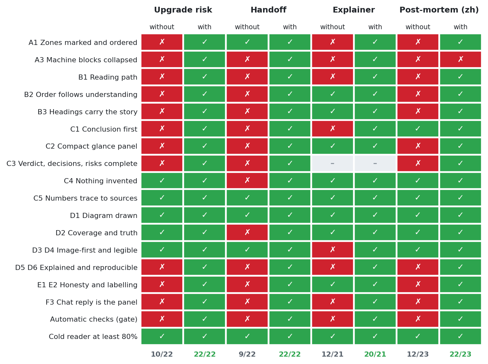
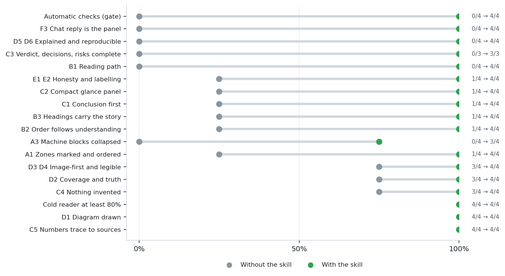
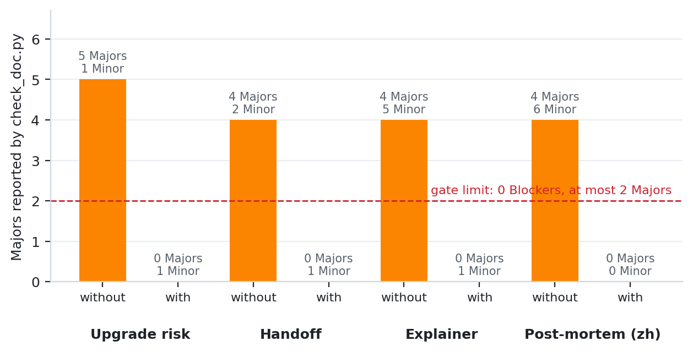
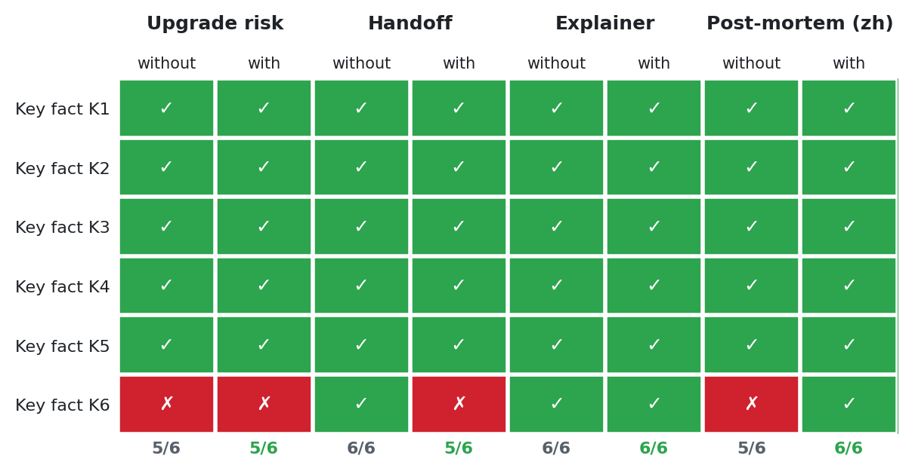

# Iteration 2 · skill v0.2

[← Review dashboard](../README.md)

The skill after it gained a review rubric and a tiered checker, tested on four scenarios (one in Chinese). Assertions were derived from the rubric plus scenario-specific ones, and no tool hints were given to either arm. One grader agent per run, a separate cold reader per document, and the automatic checker as a gate.

| | Without the skill | With the skill |
|---|---|---|
| Assertions passed (pooled) | **43 / 88** | **86 / 88** |
| Mean pass rate per run | **48.9%** | **97.7%** |
| Automatic gate passed | **0 / 4** | **4 / 4** |
| Cold-reader facts recovered | **22 / 24** | **22 / 24** |

## Scenario by scenario

| Scenario | Without | With | Automatic checker (without → with) | Page |
|---|---|---|---|---|
| Upgrade risk report | 10/22 | 22/22 | ❌ 0 Blockers · 5 Majors · 1 Minor → ✅ 0 Blockers · 0 Majors · 1 Minor | [details](eval-1-upgrade-risk-report.md) |
| Dual-audience handoff | 9/22 | 22/22 | ❌ 0 Blockers · 4 Majors · 2 Minors → ✅ 0 Blockers · 0 Majors · 1 Minor | [details](eval-2-dual-audience-handoff.md) |
| Platform explainer for a new hire | 12/21 | 20/21 | ❌ 0 Blockers · 4 Majors · 5 Minors → ✅ 0 Blockers · 0 Majors · 1 Minor | [details](eval-3-ingestion-explainer.md) |
| Post-mortem in Chinese | 12/23 | 22/23 | ❌ 0 Blockers · 4 Majors · 6 Minors → ✅ 0 Blockers · 0 Majors · 0 Minors | [details](eval-4-postmortem-zh.md) |

## Every common assertion, every run

Rows are the assertions that appear in at least two scenarios; ✓ passed, ✗ failed, – not part of that scenario. Scenario-specific assertions are on each scenario page.

## Where the skill moved the needle

Each row is one assertion. The grey dot is the pass rate without the skill, the green dot with it. Long lines are where the skill matters; assertions where both dots sit together passed or failed for both arms.

## The automatic gate

`check_doc.py` reports every finding with a rule ID and a tier. The gate is: no Blocker and at most two Majors.

## Cold reader

## What the analyst noticed

- Headline (cold-reader assertion included): with the skill the four runs pass 22/22, 22/22, 20/21 and 22/23; the baselines pass 10/22, 9/22, 12/21 and 12/23. The automatic gate (no Blocker, at most two Majors) is passed by every with-skill run (0 Blockers, 0 Majors) and failed by every baseline (4-5 Majors).
- Where the skill adds value: audience zones (A1, A3), the reading path (B1), headings that carry the argument (B3), a conclusion-first panel (C1), a compact panel (C2), complete verdict/decisions/risks (C3), diagram explanation and sources (D5/D6), honesty labels (E1/E2), a chat reply that is the panel in miniature (F3) and the automatic gate. Every one of these fails in at least three of the four baselines.
- Cold reader (first 60 lines only, six source-derived facts per eval): with-skill 22 of 24 facts, baseline 22 of 24. Recall is the same because the baselines also opened with a conclusion when asked for a decision report. The skill's measurable value is therefore structure and consistency, not first-screen recall. The test stays a regression check, not a differentiator.
- Non-discriminating assertions: C4 (nothing invented), C5 (numbers trace to the sources), D1/D2 (a diagram exists and is truthful) and the content checks pass in both configurations. Layout rules did not cost any factual accuracy.
- Skill misses: eval 3, Figure 1 shows seven of the eleven components (the Raw Zone is missing) so 'mental model first' fails, and the assertion itself never names the eight core components; eval 4, A3 fails because a 28-line chat log and a 93-line machine zone stayed inline although the skill sets a threshold of about 25 lines (borderline, and the user asked for the log in the report).
- Assertion and skill wording problems found by the graders: A1 'names its audience' versus the skeleton's own heading 'START HERE - at a glance' (no reader named); A3 does not say whether a one-line pointer block counts as collapsed; B2 does not say whether the glance panel is exempt from 'terms before first use'; C3 demands a 'by when' while C4 forbids inventing one; F3 does not define an acceptable file-path format.
- Tooling bug found: check_doc.py counted a literal details tag inside inline code as an unbalanced block (false Blocker B4 on a notes file). Missing assertions: body-level factual accuracy (three small slips in eval 1, e.g. 'seven of the other eight'), date and weekday sanity, flagging conflicts between inputs, and a handoff panel that says what the continuing agent may do alone (the with-skill handoff missed that cold-reader fact).
- Time and tokens are not measurable here: the harness reports no token counts, so tokens are shown as 0 and time is estimated from file timestamps (it includes idle waits).

## Records

- [benchmark.json](records/benchmark.json) and [benchmark.md](records/benchmark.md): aggregated results in the format of the skill-creator viewer
- [analyst-notes.json](records/analyst-notes.json): the analyst's observations, quoted above
- [coldreader-scores.json](records/coldreader-scores.json): which key facts each cold reader recovered
- Per scenario: prompt and assertions, grading, checker output, executor notes (see each scenario page)
- Note: the harness reports no token counts and no true execution time, so neither is compared; the timing files are estimates from file timestamps and include idle waits.
