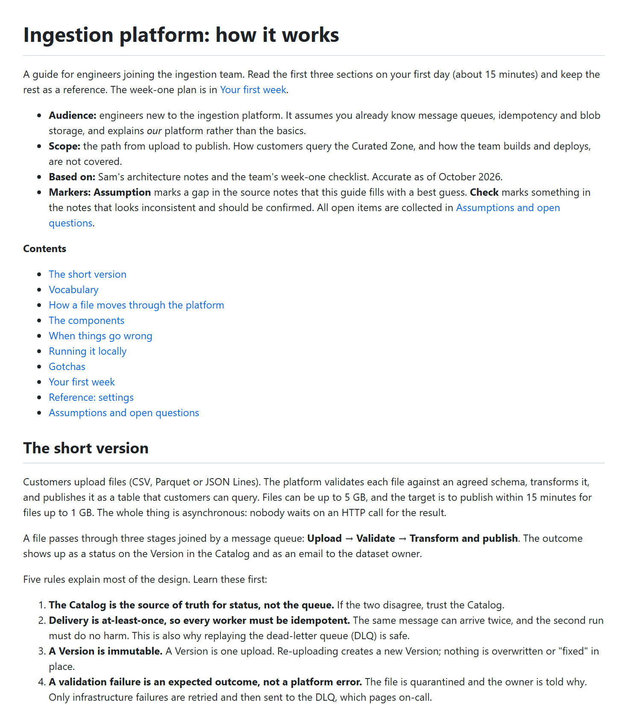
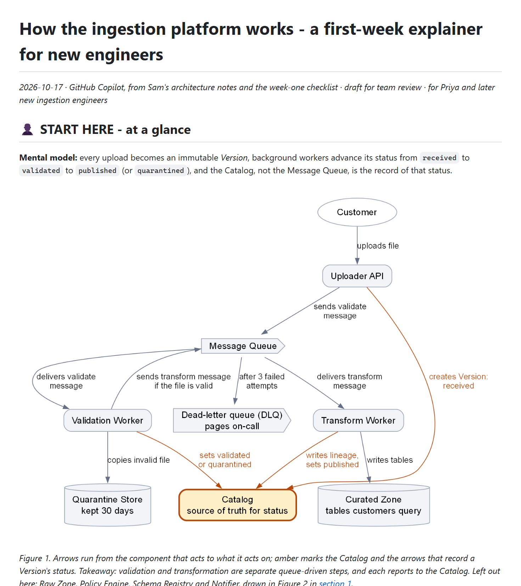

# Platform explainer for a new hire · iteration 2

[← Iteration 2](README.md) · [Review dashboard](../README.md) · [Example documents](../../examples/03-ingestion-explainer/README.md)

> **Prompt given to both agents**
>
> New engineer Priya starts on the ingestion team on Monday. She's a strong backend dev but knows nothing about our platform. Using the notes in examples/03-ingestion-explainer/input/, write an explainer of how the ingestion platform works so she's productive in her first week. Save it as a doc we can drop into the team wiki repo.

## Result

| | Without the skill | With the skill |
|---|---|---|
| Assertions passed | **12 / 21** (57%) | **20 / 21** (95%) |
| Automatic checker | ❌ 0 Blockers · 4 Majors · 5 Minors | ✅ 0 Blockers · 0 Majors · 1 Minor |
| First section, words (the checker's panel measure; budget about 300) | 239 | 289 |
| Words in the human-read zone (the whole document when there are no zones) | 3,331 | 2,362 |
| Cold reader, first 60 lines | 6 / 6 key facts | 6 / 6 key facts |

## What the reader sees first

| Without the skill | With the skill |
|---|---|
|  |  |
| [Open the document](../../examples/03-ingestion-explainer/without-skill/report.md) | [Open the document](../../examples/03-ingestion-explainer/with-skill/report.md) |

## Assertion scorecard

Each assertion was graded by an agent that read the document and cited evidence; ✅ passed, ❌ failed. The evidence for every failure is below, and the full evidence for every assertion is in the raw `grading.json` of each run.

| Assertion | Without | With |
|---|:-:|:-:|
| A1 Zones marked and ordered | ❌ | ✅ |
| A3 Machine blocks collapsed | ❌ | ✅ |
| B1 Reading path | ❌ | ✅ |
| B2 Order follows understanding | ✅ | ✅ |
| B3 Headings carry the story | ✅ | ✅ |
| C1 Conclusion first | ❌ | ✅ |
| C2 Compact glance panel | ✅ | ✅ |
| C4 Nothing invented | ✅ | ✅ |
| C5 Numbers trace to sources | ✅ | ✅ |
| D1 Diagram drawn | ✅ | ✅ |
| D2 Coverage and truth | ✅ | ✅ |
| D3 D4 Image-first and legible | ❌ | ✅ |
| D5 D6 Explained and reproducible | ❌ | ✅ |
| E1 E2 Honesty and labelling | ✅ | ✅ |
| F3 Chat reply is the panel | ❌ | ✅ |
| Automatic checks (gate) | ❌ | ✅ |
| Mental model first | ❌ | ❌ |
| Concepts before flows | ✅ | ✅ |
| Week-one use | ✅ | ✅ |
| Figures | ✅ | ✅ |
| Cold reader at least 80% | ✅ | ✅ |

The full text of every assertion in this scorecard

- A1 Zones marked and ordered: the document opens with a human zone whose heading or banner names its audience (a pointer line in the header does not count), and any AI-input, archive or reference material sits last in its own labelled zone; nothing for people follows machine content
- A3 Machine and archive blocks are collapsed in details blocks and plain-headed, each opening with a line that names its bin (AI input or archive) and what it supports; long material sits in a sibling file behind a pointer
- B1 Reading path: within 60 lines of the title there are at least 3 links to sections, each saying what the reader gets, and a line saying who can stop where
- B2 Order follows understanding: the mental model comes first, terms are defined before the first section that uses them, and chronology lives in the archive
- B3 The H2 headings of the human zone, read alone, give the outline or the argument; question and decision headings carry their answer or ask
- C1 Conclusion first: the glance panel opens the document straight after the title and one metadata line, and its bottom line states the mental model itself, not what the document covers
- C2 Compact panel: about 300 words of prose or fewer (tables and picture excluded; mechanical.json gives panel_words), and the mental model, the few things that matter and the reading path fit the first screen or two
- C4 Nothing invented: no verdict, decision or risk block without grounding in the sources, any ranking is traceable, empty slots are omitted
- C5 Numbers in the panel trace to the sources (spot-check at least three); derived or inferred numbers say so
- D1 Diagram drawn: the eleven related platform components (Uploader API, Message Queue, Validation Worker, Schema Registry, Quarantine Store, Transform Worker, Raw Zone, Curated Zone, Catalog, Policy Engine, Notifier) are shown in at least one diagram
- D2 Coverage and truth: every one of the eleven components appears in at least one diagram (a single diagram or an overview plus zoomed views, the overview's caption saying what it leaves out), every drawn edge exists in the notes, and inferred edges are dashed and captioned
- D3 D4 Image-first and legible: the diagram a human sees first is an embedded image file that exists (PNG or SVG), not only a Mermaid or other code block, and viewing it at about 800 px wide shows legible labels, no overlap and no empty glyph boxes
- D5 D6 Explained and reproducible: alt text, a caption saying how to read the diagram and its takeaway, a legend where colour carries meaning, the relation stated (verbs on edges, or once when all edges are alike), the diagram source file beside each image, and an edge list or equivalent in the archive
- E1 E2 Honesty: content not in the inputs (assumptions, suggestions, inferences) is labelled as such; ambiguities in the notes are flagged rather than silently resolved; unknowns are listed
- F3 Chat reply: the executor's final reply (final_reply.md) is the glance panel in miniature (the mental model, the few things that matter, the file path, where to start) and does not paste the document
- Automatic checks: check_doc.py on report.md and every sibling Markdown file reports no Blocker and at most two Majors in total
- Mental model first: the first screen or two has a diagram showing the main flow (at least the eight core components) and calls out that the Catalog, not the queue, is the source of truth for status
- Concepts before flows: Dataset, Version, Schema contract, Quarantine, Lineage record and Tenant are defined (glossary or definition on first use) before the step-by-step flow that uses them
- Week-one use: includes the six gotchas and what to do in week one (runbooks, starter tickets INGEST-310 and INGEST-322, the weekly sync)
- Figures: retry behaviour (3 attempts, backoff 30 s, 2 min, 10 min, then the dead-letter queue) and the 15-minute publish target for files up to 1 GB are right, and the notes' ambiguity between attempts and retries is flagged or handled without silently contradicting the notes
- Cold reader: a fresh reader who sees only the first 60 lines and the images in them recovers at least 80% of the key facts (cold-reader test, scored separately)

### Evidence for the failed assertions

❌ <b>A1 Zones marked and ordered</b> · without the skill

**Assertion:** A1 Zones marked and ordered: the document opens with a human zone whose heading or banner names its audience (a pointer line in the header does not count), and any AI-input, archive or reference material sits last in its own labelled zone; nothing for people follows machine content

**Grader evidence:** No zone heading, banner or marker anywhere. After the title (line 1), line 3 is a what-this-is paragraph and line 5 is an 'Audience:' bullet inside the header metadata, which the assertion says does not count. mechanical.json has zones: \[] and flags A1 ('no &lt;!-- zone:... --&gt; markers'). Reference material is not in a labelled zone: '## Reference: settings' (line 235, a 20-row table) is followed by the people-facing '## Assumptions and open questions' (line 264), so content for people comes after the reference block.

❌ <b>A3 Machine blocks collapsed</b> · without the skill

**Assertion:** A3 Machine and archive blocks are collapsed in details blocks and plain-headed, each opening with a line that names its bin (AI input or archive) and what it supports; long material sits in a sibling file behind a pointer

**Grader evidence:** mechanical.json stats show details_blocks: 0 and the file contains no &lt;details&gt; tag. There is no AI-input or archive block and no sibling archive file (outputs holds report.md, diagrams/ and the executor's user_notes.md, which report.md never points to). Raw/reference material sits inline in the human body: the 20-row settings table (lines 235-260, flagged A2 Major at line 239) and the 11-item open-questions list (lines 264-286).

❌ <b>B1 Reading path</b> · without the skill

**Assertion:** B1 Reading path: within 60 lines of the title there are at least 3 links to sections, each saying what the reader gets, and a line saying who can stop where

**Grader evidence:** The first 60 lines hold 12 section links (line 3, line 8 and the Contents list at lines 12-21), but the 10 Contents entries are bare titles such as '- \[Gotchas](#gotchas)' with no statement of what the reader gets. Only line 3 annotates one link ('The week-one plan is in \[Your first week]'). Line 3 says 'Read the first three sections on your first day (about 15 minutes) and keep the rest as a reference', a day-one stop point, but nothing says who can stop where or what each link delivers.

❌ <b>C1 Conclusion first</b> · without the skill

**Assertion:** C1 Conclusion first: the glance panel opens the document straight after the title and one metadata line, and its bottom line states the mental model itself, not what the document covers

**Grader evidence:** Lines 3-21 (a what-the-guide-is paragraph, four Audience/Scope/Based on/Markers bullets and a 10-link Contents list) come before the mental model, which starts at line 23. mechanical.json flags C1: '25 lines of text come before the first panel element'. Line 3 opens with what the document covers ('A guide for engineers joining the ingestion team...'); the model ('three stages joined by a message queue', line 27) only appears after the header block.

❌ <b>D3 D4 Image-first and legible</b> · without the skill

**Assertion:** D3 D4 Image-first and legible: the diagram a human sees first is an embedded image file that exists (PNG or SVG), not only a Mermaid or other code block, and viewing it at about 800 px wide shows legible labels, no overlap and no empty glyph boxes

**Grader evidence:** D3 holds: Figures 1 and 2 are embedded PNGs that exist (lines 62 and 99; diagrams/pipeline.png and version-lifecycle.png) and no Mermaid is used. D4 fails its size bound: pipeline.png, the diagram seen first, is 2760 px wide, over the rubric's 500-2600 px limit, and mechanical.json flags D4 Major at line 62. I viewed an 800 px downscale: node titles read (about 12 px), with no overlap or empty glyph boxes, but sub-labels, edge labels and the footnote render at about 8-10 px (SVG fonts 14-17 px at 0.58 scale). Legible with effort and borderline, but it fails the rule's width bound. version-lifecycle.png (2480 px) is within bounds.

❌ <b>D5 D6 Explained and reproducible</b> · without the skill

**Assertion:** D5 D6 Explained and reproducible: alt text, a caption saying how to read the diagram and its takeaway, a legend where colour carries meaning, the relation stated (verbs on edges, or once when all edges are alike), the diagram source file beside each image, and an edge list or equivalent in the archive

**Grader evidence:** Present: descriptive alt text on both images (lines 62, 99), an in-image legend, verbs on edges ('may upload?', 'get contract', 'stream file'), and sources beside the images (pipeline.svg, version-lifecycle.svg, build_diagrams.py). Missing: the captions say how to read (Figure 1: solid, dashed, red) but give no takeaway ('The platform at a glance'; Figure 2: 'Open this figure side by side with the Catalog UI...'), and there is no edge list or text equivalent in an archive because the document has no archive. The closest equivalent is the 'Who talks to it' column of the Components table, which is in the human zone.

❌ <b>F3 Chat reply is the panel</b> · without the skill

**Assertion:** F3 Chat reply: the executor's final reply (final_reply.md) is the glance panel in miniature (the mental model, the few things that matter, the file path, where to start) and does not paste the document

**Grader evidence:** final_reply.md gives the file path and a start point ('The first three sections take about 15 minutes to read; the rest is reference') and does not paste the document. It has no mental model: 'It covers upload to publish for an engineer new to the team, with a week-one checklist and starter tickets' is scope, and nothing says the Catalog is the source of truth, Versions are immutable or the flow is Upload -&gt; Validate -&gt; Transform. Its 'few things' are three open questions for Sam. It also says all three are 'marked Check in the guide', but only two inline Check callouts exist (lines 156, 184); the 5 GB item appears only in the open-questions list (line 272).

❌ <b>Automatic checks (gate)</b> · without the skill

**Assertion:** Automatic checks: check_doc.py on report.md and every sibling Markdown file reports no Blocker and at most two Majors in total

**Grader evidence:** mechanical.json gate: passed false, 0 Blockers, 4 Majors (limit is 2), 5 Minors. Majors: A1 (no zone markers); C1 ('25 lines of text come before the first panel element'); D4 ('pipeline.png is 2760 px wide'); A2 ('20-row table in the human zone', line 239). Only report.md is covered (no report.*.md siblings exist).

❌ <b>Mental model first</b> · without the skill

**Assertion:** Mental model first: the first screen or two has a diagram showing the main flow (at least the eight core components) and calls out that the Catalog, not the queue, is the source of truth for status

**Grader evidence:** The first image (Figure 1) is at line 62, after the header, Contents, short version, Vocabulary table and callout, so the first 60 lines and roughly the first two screens of rendered content contain no diagram. The Catalog call-out is present early (line 31: 'The Catalog is the source of truth for status, not the queue'), but the diagram half of the expectation is not met.

❌ <b>Mental model first</b> · with the skill

**Assertion:** Mental model first: the first screen or two has a diagram showing the main flow (at least the eight core components) and calls out that the Catalog, not the queue, is the source of truth for status

**Grader evidence:** The Catalog call-out is met: line 8 says 'the Catalog, not the Message Queue, is the record of that status' and Figure 1 (line 10, first screen) labels and highlights the Catalog node 'source of truth for status'. The 'at least the eight core components' part is not met: Figure 1 draws seven of the eleven platform components (Uploader API, Message Queue, Validation Worker, Transform Worker, Quarantine Store, Curated Zone, Catalog) plus the external Customer and a DLQ box, and the document's own Section 1 table treats the dead-letter queue as part of the Message Queue, not a twelfth component. The Raw Zone, which the Uploader API writes and both workers read, is left out of the flow (caption: 'Left out here: Raw Zone, Policy Engine, Schema Registry and Notifier') and appears only in Figure 2 at line 70, well below the first two screens. Eight boxes can be counted only by counting the DLQ, so the burden of proof is not met.

## Cold reader

A fresh agent saw only the first 60 lines of each document (and the images in them), answered six fixed questions, and was scored against key facts derived from the *inputs*, so both arms face the same list.

| Key fact | Without | With |
|---|:-:|:-:|
| **K1** Mental model: upload, validate, transform, publish, all asynchronous (nobody waits on an HTTP call). | ✅ | ✅ |
| **K2** The Catalog, not the queue, is the source of truth for a Version's status. | ✅ | ✅ |
| **K3** Main components: Uploader API, Message Queue, Validation Worker, Transform Worker, Raw Zone, Curated Zone, Catalog and Quarantine Store (plus Policy Engine, Schema Registry and Notifier). | ✅ | ✅ |
| **K4** A failed validation is an expected outcome (file quarantined, owner told); infrastructure failures are retried 3 times and then go to the dead-letter queue, which pages on-call. | ✅ | ✅ |
| **K5** Versions are immutable: a re-upload creates a new Version. | ✅ | ✅ |
| **K6** Where to read next or what to do first: a reading path or a first-week plan is visible. | ✅ | ✅ |

Raw answers: [without the skill](records/eval-3-ingestion-explainer/without-skill/coldreader-answers.md) · [with the skill](records/eval-3-ingestion-explainer/with-skill/coldreader-answers.md)

- Scoring note, without the skill: K1 is borderline: asynchrony is only implied by 'stages joined by a message queue'.

## What the graders said about the assertions themselves

Graders were asked to critique the test, not only the document. These are the suggestions they raised for this scenario (the skill and the assertions were revised from them; see [how the skill evolved](../skill-evolution/README.md)).

<b>Grader critique, with the skill run</b> (5 suggestions)

- **Mental model first** — The eight core components are never named, so the verdict depends on counting rules. In this run Figure 1 has eight boxes besides Customer (including a DLQ box) but only seven of the eleven named components; the Raw Zone is missing. List the eight (for example Uploader API, Message Queue, Raw Zone, Validation Worker, Transform Worker, Quarantine Store, Curated Zone, Catalog) and say whether the DLQ counts.
- **A1 Zones marked and ordered** — The skill's standard zone heading ('START HERE' with a person glyph) does not literally name an audience. This run passes only because the H1 and metadata line say 'for new engineers' / 'for Priya'. State whether the zone heading itself must name who it is for, or whether the glyph plus START HERE convention is accepted.
- **E1 E2 Honesty and labelling** — Too generic: it would pass if only the attempts-vs-retries ambiguity were flagged. The notes contain other planted conflicts this run caught (POLICY_MODE strict in the config table vs allow-all locally; 'Schema Registry validator' in INGEST-310 vs the component list; Version status while dead-lettered). Name them, and add a check that derived numbers (2.5 vs 12.5 minutes; 6 min x 5 GB = the 1800 s timeout) are arithmetically right.
- Nothing asserts that a multi-file deliverable is portable, although the user asked for 'a doc we can drop into the team wiki repo'. check_doc.py reports 0 internal links for report.evidence.md, so its cross-file anchors are not machine-checked; I verified all 49 links by script. Add a B4-style assertion (all links, cross-file anchors and image paths resolve) or extend the checker.
- **A3 Machine blocks collapsed** — Ambiguous for pointer-only blocks and for the archive-only sibling file, whose tables are not in details blocks. Say explicitly that a one-line pointer block or an archive-only sibling satisfies the collapse requirement. The same applies to F3's 'file path' (folder name plus file names was judged enough) and to C5, which does not say whether writer-made counts and reading-time minutes in the panel need a derived label.

**Overall:** Mostly solid: the content checks (six gotchas, week-one items, retry and 15-minute figures, concepts before flows) and the diagram checks are discriminating. Weak spots are the unnamed 'eight core components', the loosely worded A1 and A3 pass conditions, and a generic honesty check that would not separate a run that flagged one ambiguity from one that flagged all of them.

<b>Grader critique, without the skill run</b> (7 suggestions)

- **D3 D4 Image-first and legible** — The assertion text omits the 500-2600 px width bound that rule D4 and the checker apply. This run's Figure 1 (2760 px) is readable-but-small at 800 px, so the verdict turned on a 160 px overshoot rather than on the reader's experience. State the bound in the assertion, or use a measurable criterion such as a minimum rendered font size (for example 9 px at 800 px).
- **C2 Compact glance panel** — Passes trivially when no glance panel exists: panel_words counts the prose of the first H2, so any document whose first section is short passes (here 239 words for 'The short version', sitting behind 20 lines of header). Pair it with C1 or measure from the title.
- **Mental model first** — Compound of two checks (diagram within the first screen or two, and the Catalog-not-queue call-out). This run met the call-out but not the diagram, and the verdict hides which half failed. Split into two assertions.
- **D5 D6 Explained and reproducible** — Six sub-claims in one pass/fail. 'Edge list in the archive' cannot be met when the document has no archive, and 'takeaway' is subjective. Split D5 from D6 and define the minimum (for example, the caption contains a sentence stating the takeaway).
- **E1 E2 Honesty and labelling** — The universal clause ('content not in the inputs is labelled') is falsified by a single unlabelled addition (the 'By Friday' goals), yet a conscientious baseline like this one otherwise meets it. Test the specific planted ambiguities (attempts vs retries, POLICY_MODE default, CET) and the unknowns list instead; as written it barely separates skill from no-skill.
- No assertion checks fidelity of the 20-row config table or other transcribed figures beyond retries and the 15-minute target. A wrong default would go uncaught; add a spot-check of at least five settings against architecture-notes.md.
- Human-zone length (about 3,331 words against the 2,500 advisory, rule F2) and the 20-row inline table (rule A2) surface only inside the aggregate 'Automatic checks' count. Consider an explicit proportionality assertion for explainers.

**Overall:** Structural assertions (A1, A3, B1, C1, Mental model first) discriminate well: this competent no-skill run fails all of them. Content assertions (D1, D2, Concepts before flows, Week-one use, Figures) are met by a careful baseline, so they check correctness but do not separate skill from no-skill. Several compound assertions (D3 D4, D5 D6, Mental model first) hide which sub-claim decided the verdict.

## Executor notes and raw records

The agent that wrote each document also left notes on where the instructions it had were unclear.

| Record | Without the skill | With the skill |
|---|---|---|
| Executor notes | [executor-notes.md](records/eval-3-ingestion-explainer/without-skill/executor-notes.md) | [executor-notes.md](records/eval-3-ingestion-explainer/with-skill/executor-notes.md) |
| Cold-reader answers | [coldreader-answers.md](records/eval-3-ingestion-explainer/without-skill/coldreader-answers.md) | [coldreader-answers.md](records/eval-3-ingestion-explainer/with-skill/coldreader-answers.md) |
| Grading (assertions, evidence, claims, critique) | [grading.json](records/eval-3-ingestion-explainer/without-skill/grading.json) | [grading.json](records/eval-3-ingestion-explainer/with-skill/grading.json) |
| Automatic checker output | [mechanical.json](records/eval-3-ingestion-explainer/without-skill/mechanical.json) | [mechanical.json](records/eval-3-ingestion-explainer/with-skill/mechanical.json) |
| Timing (estimated from file times) | [timing.json](records/eval-3-ingestion-explainer/without-skill/timing.json) | [timing.json](records/eval-3-ingestion-explainer/with-skill/timing.json) |
| Prompt and assertions | [eval_metadata.json](records/eval-3-ingestion-explainer/eval_metadata.json) | |
