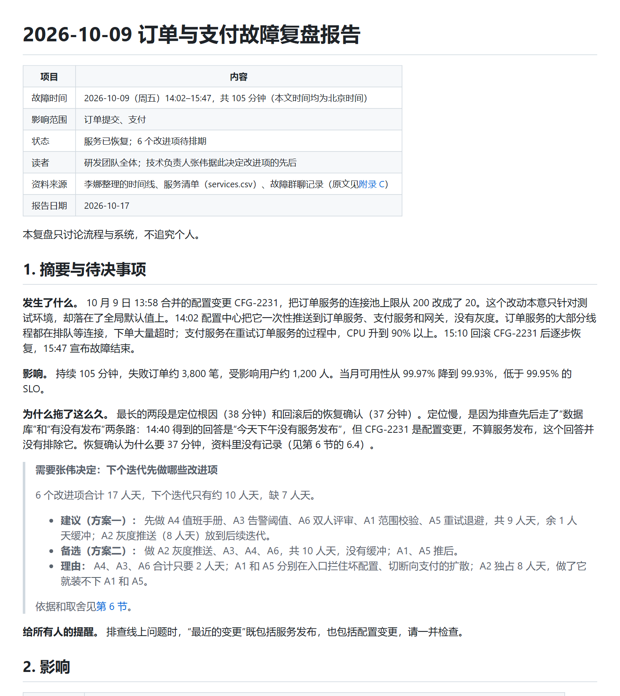

# Post-mortem in Chinese · iteration 2

[← Iteration 2](README.md) · [Review dashboard](../README.md) · [Example documents](../../examples/04-postmortem-zh/README.md)

> **Prompt given to both agents**
>
> 上周五（10月9日）下午的订单故障已经处理完了。时间线、服务清单和当时的群聊记录我放在 examples/04-postmortem-zh/input/ 里。请帮我写一份复盘报告，发给整个研发团队，技术负责人张伟要根据它决定先做哪些改进项。原始群聊记录也要留在报告里备查。

## Result

| | Without the skill | With the skill |
|---|---|---|
| Assertions passed | **12 / 23** (52%) | **22 / 23** (96%) |
| Automatic checker | ❌ 0 Blockers · 4 Majors · 6 Minors | ✅ 0 Blockers · 0 Majors · 0 Minors |
| First section, words (the checker's panel measure; budget about 300) | 359 | 283 |
| Words in the human-read zone (the whole document when there are no zones) | 3,851 | 2,480 |
| Cold reader, first 60 lines | 5 / 6 key facts | 6 / 6 key facts |

## What the reader sees first

| Without the skill | With the skill |
|---|---|
|  |  |
| [Open the document](../../examples/04-postmortem-zh/without-skill/report.md) | [Open the document](../../examples/04-postmortem-zh/with-skill/report.md) |

## Assertion scorecard

Each assertion was graded by an agent that read the document and cited evidence; ✅ passed, ❌ failed. The evidence for every failure is below, and the full evidence for every assertion is in the raw `grading.json` of each run.

| Assertion | Without | With |
|---|:-:|:-:|
| A1 Zones marked and ordered | ❌ | ✅ |
| A3 Machine blocks collapsed | ❌ | ❌ |
| B1 Reading path | ❌ | ✅ |
| B2 Order follows understanding | ❌ | ✅ |
| B3 Headings carry the story | ❌ | ✅ |
| C1 Conclusion first | ✅ | ✅ |
| C2 Compact glance panel | ❌ | ✅ |
| C3 Verdict, decisions, risks complete | ❌ | ✅ |
| C4 Nothing invented | ✅ | ✅ |
| C5 Numbers trace to sources | ✅ | ✅ |
| D1 Diagram drawn | ✅ | ✅ |
| D2 Coverage and truth | ✅ | ✅ |
| D3 D4 Image-first and legible | ✅ | ✅ |
| D5 D6 Explained and reproducible | ❌ | ✅ |
| E1 E2 Honesty and labelling | ❌ | ✅ |
| F3 Chat reply is the panel | ❌ | ✅ |
| F4 Reader's language | ✅ | ✅ |
| Automatic checks (gate) | ❌ | ✅ |
| Root cause and factors right | ✅ | ✅ |
| Impact right | ✅ | ✅ |
| Decision for the tech lead | ✅ | ✅ |
| Raw chat log preserved | ✅ | ✅ |
| Cold reader at least 80% | ✅ | ✅ |

The full text of every assertion in this scorecard

- A1 Zones marked and ordered: the document opens with a human zone whose heading or banner names its audience (a pointer line in the header does not count), and any AI-input or archive material sits last in its own labelled zone; nothing for people follows machine content
- A3 Machine and archive blocks are collapsed in details blocks and plain-headed, each opening with a line that names its bin (AI input or archive) and what it supports; long material sits in a sibling file behind a pointer
- B1 Reading path: within 60 lines of the title there are at least 3 links to sections, each saying what the reader gets, and a line saying who can stop where
- B2 Order follows understanding: the mental model comes first, terms are defined before the first section that uses them, and chronology lives in the archive (or is a compact timeline in the human zone with the raw chat log in the archive)
- B3 The H2 headings of the human zone, read alone, give the outline or the argument; question and decision headings carry their answer or ask
- C1 Conclusion first: the glance panel opens the document straight after the title and one metadata line, and its bottom line states the conclusion itself, not what the document covers
- C2 Compact panel: about 300 words of prose or fewer (tables and picture excluded; mechanical.json gives panel_words, where one Chinese character counts as 0.6 words), one line per decision and per risk, and verdict, decisions and top risks fit the first screen
- C3 Verdict, decisions and risks are complete and loud in the panel: the verdict has a glyph, confidence and basis; each decision has who, what, by when and a recommendation; at most 5 ranked risks, each with severity and consequence
- C4 Nothing invented: no verdict, decision or risk block without grounding in the sources, any ranking is traceable, empty slots are omitted
- C5 Numbers in the panel trace to the sources (spot-check at least three); derived, merged or de-duplicated numbers say so
- D1 Diagram drawn: the eight related services (gateway, order-service, payment-service, inventory-service, user-service, notification-service, config-center, cache) and their call and push relationships are shown in at least one diagram
- D2 Coverage and truth: every one of the eight services appears in at least one diagram, every drawn edge exists in services.csv, and inferred edges are dashed and captioned
- D3 D4 Image-first and legible: the diagram a human sees first is an embedded image file that exists (PNG or SVG), not only a Mermaid or other code block, and viewing it at about 800 px wide shows legible labels, no overlap and no empty glyph boxes
- D5 D6 Explained and reproducible: alt text, a caption saying how to read the diagram and its takeaway, a legend where colour carries meaning, the relation stated (verbs on edges, or once when all edges are alike), the diagram source file beside each image, and an edge list or equivalent in the archive
- E1 E2 Honesty: every judgment has a confidence level and its basis; content not in the inputs (assumptions, suggestions, inferences) is labelled as such; unknowns are listed
- F3 Chat reply: the executor's final reply (final_reply.md) is the glance panel in miniature (verdict, decisions, top risks, the file path, where to start) and does not paste the document
- F4 Language: the document, its headings, labels and diagram text are in Chinese, the language of the request, and no glyph shows as an empty box (look at the diagram image)
- Automatic checks: check_doc.py on report.md and every sibling Markdown file reports no Blocker and at most two Majors in total
- Root cause and factors right: CFG-2231 changed the order-service connection pool limit from 200 to 20 (meant for test only, applied to the global default); the config centre had no value-range validation; the push had no canary; the 5 s latency alert threshold was too lax; the runbook lacked a check of recent config changes; payment retries without backoff amplified the failure
- Impact right: 105 minutes (14:02 to 15:47), about 3,800 failed orders, about 1,200 affected users, availability down from 99.97% to 99.93% against a 99.95% SLO
- Decision for the tech lead: the panel asks Zhang Wei to prioritise the six follow-ups A1-A6, notes that they total about 17 person-days against about 10 available, and recommends which to do first
- Raw chat log preserved: the chat excerpt is kept in the archive part or a linked file, not in the human zone, as the user asked
- Cold reader: a fresh reader who sees only the first 60 lines and the images in them recovers at least 80% of the key facts (cold-reader test, scored separately)

### Evidence for the failed assertions

❌ <b>A1 Zones marked and ordered</b> · without the skill

**Assertion:** A1 Zones marked and ordered: the document opens with a human zone whose heading or banner names its audience (a pointer line in the header does not count), and any AI-input or archive material sits last in its own labelled zone; nothing for people follows machine content

**Grader evidence:** No zone markers at all (mechanical.json stats.zones = \[] and Major A1 'no &lt;!-- zone:... --&gt; markers'). The document does not open with a human zone whose heading or banner names its audience: line 1 is the title, lines 3-10 are a metadata table, and its row ‘读者 | 研发团队全体；技术负责人张伟据此决定改进项的先后’ (line 8) is exactly the header pointer line the expectation says does not count; the first heading is ‘## 1. 摘要与待决事项’ (line 14). The raw chat does sit last (Appendix C, line 237) and nothing for people follows it, but under a plain ‘附录 C’ heading, not in a labelled archive or AI-input zone.

❌ <b>A3 Machine blocks collapsed</b> · without the skill

**Assertion:** A3 Machine and archive blocks are collapsed in details blocks and plain-headed, each opening with a line that names its bin (AI input or archive) and what it supports; long material sits in a sibling file behind a pointer

**Grader evidence:** stats.details_blocks = 0, so nothing is collapsed. The only raw/archive material, the chat log, is an open 28-line fenced block (lines 241-270) under ‘附录 C 原始群聊记录’ (line 237), and Appendices A and B (lines 208-235) are open tables. The Appendix C lead-in (line 239: ‘以下为故障群聊记录原文，共 28 条，未做任何修改…’) does not name a bin (archive or AI input) or say which claim it supports, and the log is not in a sibling file behind a one-line pointer.

❌ <b>A3 Machine blocks collapsed</b> · with the skill

**Assertion:** A3 Machine and archive blocks are collapsed in details blocks and plain-headed, each opening with a line that names its bin (AI input or archive) and what it supports; long material sits in a sibling file behind a pointer

**Grader evidence:** Met: blocks A (L180-199), B (L202-240) and C (L243-267) are each collapsed in `&lt;details&gt;` (3, balanced), have plain-word headings (`### A 给后续接手者的上下文`, `### B 群聊原文`, `### C 示意图的来源和边清单`) and open with an italic line naming the bin and what it supports (L182 `🤖 AI 输入 - 让接手的人或 AI 知道这份复盘停在哪、决定之后要更新哪里…`; L204 `🗄️ 存档 - 2026-10-09 故障群聊导出…支撑第 3 节的耗时拆解和第 5 节的核对`; L245 `🗄️ 存档 - 概览图是怎么画出来的…支撑第 1 节的链路和第 5 节的第 4 行`). NOT met: long material is not in a sibling file behind a pointer. The raw chat is a 28-line code block (L209-238), over the skill's ~25-line single-block threshold, and the machine zone is 93 lines (75 non-blank), over the ~60-line combined threshold (SKILL.md Step 3). No report.evidence.md or any other sibling Markdown file exists and there is no one-line pointer to one (the only pointer is to services.dot, L250). user_notes.md 2.1 concedes the deviation (kept inline because the user said '留在报告里'), but the final assertion accepts 'a linked file' too, so a sibling file would not have broken the user's request. With the burden on the expectation and one of its four clauses unmet this is a FAIL, though a borderline one: everything else in A3 is done well.

❌ <b>B1 Reading path</b> · without the skill

**Assertion:** B1 Reading path: within 60 lines of the title there are at least 3 links to sections, each saying what the reader gets, and a line saying who can stop where

**Grader evidence:** Lines 1-60 hold only scattered inline links: line 9 (→ 附录 C, inside the metadata table), line 30 (→ 第 6 节, ‘依据和取舍见’), lines 43 and 50 (→ 附录 B). There is no reading-path block telling the reader what each section gives them, and no line saying who can stop where (a search for such wording finds nothing; the only audience text is the ‘读者’ metadata row on line 8). check_doc.py's link-count test passes (no B1 finding), but the judged part of the rule is not met.

❌ <b>B2 Order follows understanding</b> · without the skill

**Assertion:** B2 Order follows understanding: the mental model comes first, terms are defined before the first section that uses them, and chronology lives in the archive (or is a compact timeline in the human zone with the raw chat log in the archive)

**Grader evidence:** The structure is Summary → Impact → Timeline → Cause, i.e. chronology first. A 23-row, discovery-order timeline table (§3.2, lines 67-93) sits in the main body before the root-cause section (§4, line 95) and before the propagation diagram that is the real mental model (§4.1, lines 99-108); mechanical.json flags it as A2 ‘23-row table in the human zone’. Only §3.1 (5-row phase table) is compact. Terms are mostly defined before use (A1-A6 glossed in the decision box, † defined on line 50), but ‘A7’ is used in the §4.2 table (line 115) before it is explained in §6.4 (line 191). The §1 summary gives a short causal story, which does not satisfy the ‘chronology in the archive or compact’ clause.

❌ <b>B3 Headings carry the story</b> · without the skill

**Assertion:** B3 The H2 headings of the human zone, read alone, give the outline or the argument; question and decision headings carry their answer or ask

**Grader evidence:** The H2s are bare topic labels: ‘1. 摘要与待决事项’, ‘2. 影响’, ‘3. 时间线’, ‘4. 根因与促成因素’, ‘5. 做得好的与靠运气的’, ‘6. 改进项与优先级建议’, ‘7. 待确认事项’, then three ‘附录’ headings. Read alone they give a generic postmortem table of contents, not the argument (no cause, no 105-minute / ~3,800-order impact, no 17-vs-10 person-day squeeze). The two decision-type headings (‘摘要与待决事项’, ‘改进项与优先级建议’) do not carry their ask or answer, e.g. the recommended plan.

❌ <b>C2 Compact glance panel</b> · without the skill

**Assertion:** C2 Compact panel: about 300 words of prose or fewer (tables and picture excluded; mechanical.json gives panel_words, where one Chinese character counts as 0.6 words), one line per decision and per risk, and verdict, decisions and top risks fit the first screen

**Grader evidence:** mechanical.json stats.panel_words = 359 and Major C2 (line 14: the first section runs to about 359 words, budget 300). The decision is three multi-clause bullets (lines 26-28), not one line, and the panel lists no risks at all, so ‘one line per decision and per risk’ and ‘top risks fit the first screen’ are not met. The decision box itself does sit on the first screen (lines 22-30).

❌ <b>C3 Verdict, decisions, risks complete</b> · without the skill

**Assertion:** C3 Verdict, decisions and risks are complete and loud in the panel: the verdict has a glyph, confidence and basis; each decision has who, what, by when and a recommendation; at most 5 ranked risks, each with severity and consequence

**Grader evidence:** The panel (lines 14-32) has no verdict line with a glyph, confidence level and basis. The decision (lines 22-30) gives who (张伟), what (which improvement items first) and a recommendation (方案一) but no ‘by when’ (only ‘下个迭代’ in the title). There is no ranked risk list with severity and consequence in the panel at all; the cost of deferring A2 appears only deep in §6.3 point 4 (line 185).

❌ <b>D5 D6 Explained and reproducible</b> · without the skill

**Assertion:** D5 D6 Explained and reproducible: alt text, a caption saying how to read the diagram and its takeaway, a legend where colour carries meaning, the relation stated (verbs on edges, or once when all edges are alike), the diagram source file beside each image, and an edge list or equivalent in the archive

**Grader evidence:** Present: alt text on all three images (lines 54, 101, 144); in-image legends for colour and line meaning (fig2: 直接故障 / 被牵连 / 变更来源 / 资料未提及受影响; 调用关系 / 配置推送 / 重试), which also states the relation types once; figures/make_figures.py sits in the same folder and regenerates all three; Appendix A (lines 208-221) lists each service's call targets. Not met: a caption giving how to read the diagram and its takeaway. The fig1 (line 56) and fig3 (line 146) captions are bare titles with the message only in alt text, and fig2's caption (line 103) explains only the dashed edge and provenance, the takeaway living in the numbered list below. The edge list is not in a labelled archive (the retry edge is not listed as an edge there), and check_doc.py reports D6 ‘no source file beside’ for each PNG (same-stem rule). With no partial credit this fails.

❌ <b>E1 E2 Honesty and labelling</b> · without the skill

**Assertion:** E1 E2 Honesty: every judgment has a confidence level and its basis; content not in the inputs (assumptions, suggestions, inferences) is labelled as such; unknowns are listed

**Grader evidence:** Only part met. Labelling and unknowns are good: ‘假设“10 人天”是团队合计’ (line 141), ‘（推断，未验证）’ (line 127), ‘均为…估算，不是实测’ (line 159), ‘A7（候选）’ (line 191), † marks plus the Appendix B reconciliation, and §7 lists 7 unknowns with owners (lines 194-206). But no judgment carries a confidence level (no 把握 / 置信 / high-medium-low anywhere): the root cause, the recommendation of 方案一 (lines 26-28, 180-185) and the ‘做得好 / 靠运气’ judgments (lines 126-134) give a basis but no stated confidence. The panel also presents the writer's inference as fact (‘定位慢，是因为排查先后走了“数据库”和“有没有发布”两条路’, line 20), and the no-blame line (line 12) is an unlabelled addition, admitted only in user_notes.md.

❌ <b>F3 Chat reply is the panel</b> · without the skill

**Assertion:** F3 Chat reply: the executor's final reply (final_reply.md) is the glance panel in miniature (verdict, decisions, top risks, the file path, where to start) and does not paste the document

**Grader evidence:** final_reply.md is short, does not paste the report, gives the full output path, a recommendation (‘我建议先做 A4、A3、A6、A1、A5（9 人天），把 A2 灰度推送（8 人天）放到后续迭代’, plus the alternative) and where to start (‘报告开头就是摘要和给张伟的决策框’, trade-offs in §6). But there is no verdict: it never states the root cause (CFG-2231) or the impact (105 min, ~3,800 orders, SLO miss). The ‘top risks’ slot is filled by four report-reliability caveats (‘发出前请留意’: source conflicts, A7, A3 benefit, 7 open items) with no severity or consequence, followed by notes about browser scratch files. It reads as a hand-off note, not the panel in miniature.

❌ <b>Automatic checks (gate)</b> · without the skill

**Assertion:** Automatic checks: check_doc.py on report.md and every sibling Markdown file reports no Blocker and at most two Majors in total

**Grader evidence:** mechanical.json gate: 0 Blockers, 4 Majors, 6 Minors, passed = false. Majors: A1 (no zone markers), C2 (panel 359 words &gt; 300, line 14), A2 (23-row table, line 69), A2 (28-line code block, line 241). mechanical.json covers only report.md (no report.*.md siblings), and 4 Majors already exceeds the allowance of 2.

## Cold reader

A fresh agent saw only the first 60 lines of each document (and the images in them), answered six fixed questions, and was scored against key facts derived from the *inputs*, so both arms face the same list.

| Key fact | Without | With |
|---|:-:|:-:|
| **K1** Incident on 9 Oct from 14:02 to 15:47 (105 minutes): order submission and payment were failing. | ✅ | ✅ |
| **K2** Root cause: change CFG-2231 set the order service's connection pool limit from 200 to 20 (meant for test, applied globally) and was pushed to everything at once; the config centre had no range validation. | ✅ | ✅ |
| **K3** Impact: about 3,800 failed orders and 1,200 users; availability fell to 99.93%, below the 99.95% SLO. | ✅ | ✅ |
| **K4** Contributing factors: no canary for config pushes, the 5 s latency alert was too lax, the runbook lacked a config-change check, and payment retries without backoff amplified the failure. | ✅ | ✅ |
| **K5** Decision needed: Zhang Wei prioritises follow-ups A1 to A6 (about 17 person-days of work against about 10 available). | ✅ | ✅ |
| **K6** How the services relate: gateway calls order and user; order calls payment, inventory and user; config-center pushes config to gateway, order and payment. | ❌ | ✅ |

Raw answers: [without the skill](records/eval-4-postmortem-zh/without-skill/coldreader-answers.md) · [with the skill](records/eval-4-postmortem-zh/with-skill/coldreader-answers.md)

- Scoring note, without the skill: Only the config-center push targets were stated; the call relations among services were not visible in the first 60 lines.

## What the graders said about the assertions themselves

Graders were asked to critique the test, not only the document. These are the suggestions they raised for this scenario (the skill and the assertions were revised from them; see [how the skill evolved](../skill-evolution/README.md)).

<b>Grader critique, with the skill run</b> (5 suggestions)

- **A3 Machine blocks collapsed** — The last clause cannot be judged consistently for this fixture: the 28-line chat log is 3 lines over the skill's ~25-line threshold, the user asked for it 'in the report', and the later assertion accepts 'archive part or a linked file'. The run's verdict hinges on that one borderline clause. Make the fixture clearly long (e.g. 60+ lines) or clearly short, add 'unless the user asked to keep it inline', and consider splitting the structural clauses from the sibling-file clause.
- **A1 Zones marked and ordered** — 'Names its audience' is ambiguous against the skeleton's own heading ('👤 START HERE - at a glance'), which marks the zone with a glyph and an instruction instead of naming a reader group. The parenthetical rules out header pointer lines but not header metadata that names the readers (this run has one at L4). State what counts, e.g. 'the zone heading carries the human-zone glyph or says who it is for'.
- **B2 Order follows understanding** — Hard to apply when the glance panel and the first chain steps use terms that a glossary inside section 1 defines a few lines later. Say whether the panel is exempt and whether a glossary placed right after the mental model satisfies the rule.
- **C3 Verdict, decisions, risks complete** — C3 requires a 'by when' while C4 forbids invention, and the sources give no deadline. The run assumed 'before next iteration planning' and disclosed it only in §4 and the chat reply, not in the panel. Say what is expected (e.g. 'date not set' or mark the date as assumed in the panel).
- No assertion tests that conflicts between inputs are surfaced. timeline.md says CPU stayed above 90% 'about 40 minutes' (chat: 14:22 to 15:31 = 69 min) and that the database direction 'wasted about 25 minutes' (chat: 14:27 to 14:35 = 8 min), and services.csv has no payment→order edge although the timeline says payment retries order. This run caught all three and listed them in §5, a high-value behaviour; a run that repeated the timeline's numbers silently would pass every current assertion, including 'Impact right' and E1 E2. Suggest an assertion such as 'the report flags at least two conflicts between timeline and chat and says who should verify them'.

**Overall:** The assertions discriminate well on structure, and the three content checks (root cause, impact, decision) are solid. Several bundle 4-6 clauses (A3, D5 D6, E1 E2), so one borderline clause decides the verdict; clarify the ambiguous wording above and add a conflict-flagging assertion. The Automatic-checks assertion cannot see length bloat: the human zone passes at 2,480 'words' but is about 3,700 Chinese characters.

<b>Grader critique, without the skill run</b> (6 suggestions)

- **D5 D6 Explained and reproducible** — Bundles six sub-conditions from two rules, so the verdict hinges on its weakest piece (here the caption takeaway and a labelled archive edge list). check_doc.py's D6 test also accepts only a same-stem source file, so it reports ‘no source file’ for all three PNGs although one make_figures.py in the same folder regenerates them, while the rubric text says ‘script file sits beside each image’. Align the checker and the rubric, and split D5 from D6.
- **Raw chat log preserved** — Passes for an open, uncollapsed 28-line block in a trailing appendix, the layout that A2 and A3 count as a defect, so it cannot tell an archive from a dump at the end of the page. State what counts (e.g. collapsed or in a sibling file under a labelled archive heading, not inline in the numbered sections) and keep the verbatim 28/28 check, which is solid.
- No assertion scores whether the report surfaces the discrepancies and gaps in the fixtures: ‘~25 min wasted on the DB’ vs the chat timestamps (8 min), first response 14:12 vs 14:20, 14:52 thread dump vs 14:58 credit, the payment→order retry edge missing from services.csv, ‘no per-environment defaults’ appearing only in the chat, and the ‘10 person-days’ ambiguity. This run found and reconciled all of them (Appendix B, §7, the dashed edge), so a run that silently picked one source would score the same on content. Add an assertion that conflicts and gaps are named and say which source was used.
- **C2 Compact glance panel** — ‘About 300’ is ambiguous next to the script's hard 300 limit: 359 words fails the checker but could be read as ‘about 300’. Give a number (e.g. at most 330) or defer to panel_words. Also, a panel with no risk lines is only caught indirectly through ‘one line per risk’.
- **Decision for the tech lead** — ‘Recommends which to do first’ would also pass a recommendation that overshoots the ~10 person-day budget. Require that the recommended set sums to at most 10 person-days (this run: 9) and that the deferred items are named; that is the real quality test of this decision.
- **C1 Conclusion first** — Passes for any report that starts with a summary paragraph. This run has no labelled bottom-line sentence (the first block is a causal narrative) and I credited it on judgement although the rule is Blocker-tier. State whether a one-sentence conclusion (root cause plus the ask) must be the first element.

**Overall:** The content assertions (root cause, impact, decision, raw log kept verbatim) are met by this no-skill baseline and mostly guard against regression rather than measure the skill. The format assertions discriminate, but several are bundled (D5 D6, E1 E2, A1) or depend on judgement calls (C1 bottom line, C2 ‘about’, raw-log ‘archive part’). The biggest gap is that nothing scores surfacing the source conflicts, which this run did well.

## Executor notes and raw records

The agent that wrote each document also left notes on where the instructions it had were unclear.

| Record | Without the skill | With the skill |
|---|---|---|
| Executor notes | [executor-notes.md](records/eval-4-postmortem-zh/without-skill/executor-notes.md) | [executor-notes.md](records/eval-4-postmortem-zh/with-skill/executor-notes.md) |
| Cold-reader answers | [coldreader-answers.md](records/eval-4-postmortem-zh/without-skill/coldreader-answers.md) | [coldreader-answers.md](records/eval-4-postmortem-zh/with-skill/coldreader-answers.md) |
| Grading (assertions, evidence, claims, critique) | [grading.json](records/eval-4-postmortem-zh/without-skill/grading.json) | [grading.json](records/eval-4-postmortem-zh/with-skill/grading.json) |
| Automatic checker output | [mechanical.json](records/eval-4-postmortem-zh/without-skill/mechanical.json) | [mechanical.json](records/eval-4-postmortem-zh/with-skill/mechanical.json) |
| Timing (estimated from file times) | [timing.json](records/eval-4-postmortem-zh/without-skill/timing.json) | [timing.json](records/eval-4-postmortem-zh/with-skill/timing.json) |
| Prompt and assertions | [eval_metadata.json](records/eval-4-postmortem-zh/eval_metadata.json) | |
