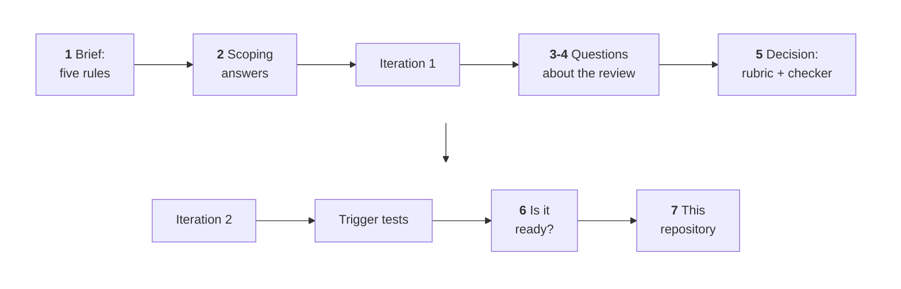

# The human review: questions, decisions and what they changed

[← Review dashboard](README.md)

> ### What this page is
>
> The numbers on the other pages come from agents. The direction of the work came from a human, the repository's maintainer, in conversation with the coding agent that built the skill. This page records those questions and decisions in order, and what each one changed.
>
> **Read this first:** the review viewer had feedback boxes for every document, and every `feedback.json` is empty. The human review happened in conversation. It is a record of **decisions**, not of ratings: no human scored any document blind ([method](method.md#what-the-evidence-cannot-show)).

*The bold numbers are the rows of the decision log below; read the first row left to right, then the second.*

## The decision log

| # | The maintainer asked or decided | What the agent proposed or found | What it changed |
|---|---|---|---|
| 1 | **The brief.** A skill that loads whenever an agent is about to write a large document. Five rules: separate human-read from AI-input and archive content and make the human part highly visible; structure the human part as a reading path with links; always open with an at-a-glance overview that gives 80% of the understanding in a short time, with decisions and risks first and loud; draw a relationship diagram when related things form a web or pass five; a diagram may be Mermaid or an embedded image, whichever explains it best | Turned the five rules into four ideas (audience split, glance first, guided reading, draw the web) and a first draft | The skeleton of [`SKILL.md`](../skills/document-formatting/SKILL.md) and, later, the rubric groups A to D |
| 2 | **Scoping answers.** Readers use VS Code's Markdown preview and Azure DevOps repo and pull-request pages. Diagrams: embedded images by default. Install personally. Name: `document-formatting`. Test the full way, with a baseline | Neither viewer reliably renders Mermaid, and Azure DevOps handles heading anchors and `
` differently from GitHub | Image-first diagrams (Graphviz, matplotlib), a reader profile in the rubric with an `--allow-mermaid` switch for GitHub readers, plain-word link-target headings, blank lines around `
` |
| 3 | **"How much of this review stays with the skill for good?"** (asked while the first viewer was open) | The viewer is tooling and stays out. The skill itself, the checker script, and optionally a regression kit stay | The regression kit was kept and later moved to this repository's [`evals/`](../evals/README.md) |
| 4 | **"What is an assertion?"** | A pre-written pass/fail check that stands in for "good". It is a proxy: the human's judgment is the final standard, and ambiguous assertions should be reported | Iteration 2 rewrote the vague ones ("one screen", "all components in one diagram") |
| 5 | **"Can the assertions become the standing check for every document the skill produces? What must be corrected and added?"** | Yes, if split into an automatic layer (a script) and a judgment layer (a rubric). Listed about eight corrections and eight additions, and proposed a cold-reader test | **Decided:** build the full rubric and a tiered checker; use the cold reader only as a regression test; keep the regression kit. Result: [`review-rubric.md`](../skills/document-formatting/references/review-rubric.md) (about 32 rules) and the new checker. Iteration 2's assertions are derived from the same rubric, so the test standard and the long-term standard are one |
| 6 | **"Is the skill ready?"** | Ran the trigger simulation on candidate descriptions and made the frontmatter parse everywhere (YAML-safe, under 1,024 characters) | [Trigger tests](trigger-tests/README.md); the final description; the skill was installed for the maintainer |
| 7 | **Publish it**, with the sample documents, the full review records and a visual presentation, as completely as a well-run public skill repository | Published the records in sanitised form and generated every chart and table from the records | This repository. One choice was the agent's and is open to change: the MIT license |

## What the human review changed, in three sentences

It moved the standard from ad-hoc assertions to a rubric plus a deterministic checker, so every future document can be judged the same way. It kept the review's tooling out of the skill and kept a regression kit for later changes. And it set the release bar: the description is tested for triggering, the frontmatter parses everywhere, and the numbers on the review pages are generated from the records.

## What is not recorded

- **Per-document human ratings.** None exist; see above.
- **Which documents the maintainer opened in the viewer.** The viewer does not log it.
- **The wording of the maintainer's messages.** They were written in Chinese and are summarised here; the substance of each question and each decision is as stated.
