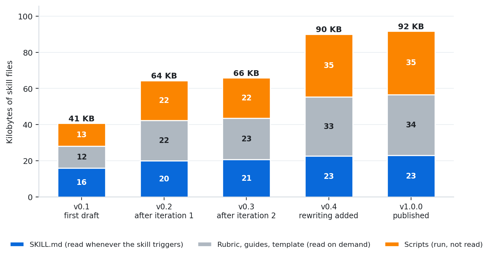
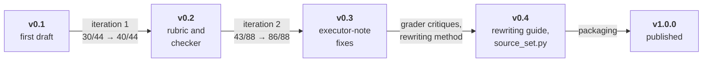

# How the skill evolved

[← Review dashboard](../README.md)

> ### Five versions, and what changed in each
>
> The skill was revised after each round of review. For versions 0.2 and 0.3, each row below names **what the review found**, **where it surfaced** and **what changed in the skill**. Versions 0.4 and 1.0.0 added a method for rewriting an existing long document and prepared the skill for release; this repository holds no review round for that method, only unit tests for its scripts ([open items](#open-items)). The diffs are real: they were produced from snapshots of every version ([diffs](#the-diffs)).
>
> **The pattern.** The early rounds mostly fixed *contradictions in the skill's own instructions*, found by the agents that had to follow them. The later versions added a *new capability* (rewriting an existing document) and the rules still miss things ([open items](#open-items)).

*The part an agent must read whenever the skill triggers (`SKILL.md`) grew by about 45%. Most of the growth went into material that is read on demand (the rubric, the rewriting guide) or executed without being read (the scripts). Sizes are bytes of each version's files; see [`sizes.json`](sizes.json).*

| Version | Written after | Size of change | What it added |
|---|---|---|---|
| v0.1 | the first draft | | `SKILL.md`, skeleton, diagram guide, a simple link checker |
| v0.2 | [iteration 1](../iteration-1/README.md) (30/44 → 40/44) | 5 files, +434 −148 | review rubric (A to F), tiered checker, panel budget, sibling-file rules |
| v0.3 | the executors' notes of [iteration 2](../iteration-2/README.md) | 5 files, +20 −13 | cut order for the panel, data copies, handoff row, zone marker per block |
| v0.4 | iteration 2's grader critiques, and a new rewriting method | 7 files, +360 −40 | rewriting guide, `source_set.py`, rubric group G, sharper rules |
| v1.0.0 | packaging for release | 5 files, +22 −10 | `requested-table` marker, supporting-notes mining, simulation labelling, rewrite-aware description, license and metadata |

The pass rates in the arrows are the results *of the version on the left*; the change on the right is what they led to.

## Round 1 · iteration 1 → v0.2

Evidence: [iteration 1](../iteration-1/README.md#what-the-analyst-noticed) and the three scenario pages.

| # | What the review found | Where it surfaced | What changed in v0.2 |
|---|---|---|---|
| 1 | The panel promised "one screen" but had to carry six elements; with-skill panels ran 420 to 595 words and rendered at 1.5 to 2 screens | executors' notes, analyst | A prose budget of about 300 words (tables and picture excluded), one line per decision and per risk, and a definition of the first screen: verdict, decisions, top risks |
| 2 | In the explainer the glossary came after the step-by-step flow, so terms were used before they were defined | analyst: a real gap in the skill | "Concepts before flows" in the reading-order guidance; later rubric rule B2 |
| 3 | The explainer split 11 components into an overview plus a zoom, so no single diagram held all 11, which the assertion demanded | analyst: the assertion conflicted with the skill's size rule | The diagram rule is now about legibility at about 800 px; a split into overview and zoomed views is fine if every entity appears in at least one view |
| 4 | "(AI input)" in skeleton headings clashed with "plain headings, they are link targets" | executors' notes | Headings stay plain; the bin is named in an italic line under each block heading |
| 5 | "A verb on every edge" is noise on a graph whose edges all mean the same thing | executors' notes | Say it once in the legend or caption and label only the exceptions |
| 6 | Absolute paths in documents that live in a repo; a local path can also leak a username | executors' notes | Repo-relative paths with the root stated once, and rule A5, which the checker enforces |
| 7 | The 60-line sibling-file rule collided with a request for one self-sufficient document | executors' notes | An explicit exception (made a default in v0.3) |
| 8 | A single "Decision needed" did not fit a document with several asks | executors' notes | "Decisions needed": one line each |
| 9 | The checker raised false positives on archive-only sibling files and did not check cross-file anchors | executors' notes | The checker was rewritten: rule IDs and tiers, machine-only files recognised, cross-file anchors and image files checked |
| 10 | Assertions overlapped, could not be measured, or were met by anything; none covered labelling of inferred content or leaking local paths | graders' critiques | A review rubric of about 32 rules (A to F, three tiers, automatic or judged). Iteration 2's assertions were derived from it, plus new ones for honesty, the chat reply, the gate and the cold reader |

## Round 2 · iteration 2 → v0.3 and v0.4

Evidence: [iteration 2](../iteration-2/README.md#what-the-analyst-noticed), the four scenario pages and their grader critiques.

**v0.3 came from the executors' own notes** (what was unclear or contradictory when they followed the skill):

| # | What the review found | What changed in v0.3 |
|---|---|---|
| 1 | The 300-word budget collided with a seven-entry reading path; the skill did not say what to cut first | A cut order (key facts, then the wording of path entries, then the number of entries; never the verdict, decisions or risks). The checker and rule C2 no longer count the Read-next list |
| 2 | A3 said "collapse in `
`" while the skeleton said "use a one-line pointer for a sibling file" | A3: a pointer counts as collapsed |
| 3 | "Keep the supporting data" against the size rule: which wins? In the Chinese post-mortem a 28-line chat log and a 93-line machine zone stayed inline because the user asked for the log | The size rule is now an explicit default that the user's request overrides |
| 4 | Nowhere to keep byte-exact copies of the inputs for an audit trail | `<doc-stem>.data/`, with checksums recorded in the evidence file |
| 5 | The AI-input handoff block is built for handoffs; a decision report did not need one | "Add an AI-input block only when a later agent will continue the work"; the skeleton marks block A optional and gives each block its own zone marker |
| 6 | Importing the checker as a module wrote `__pycache__` into the skill folder | `sys.dont_write_bytecode = True` |
| 7 | A handoff panel did not say what the continuing agent may do alone (the one fact the cold reader missed on that scenario) | A handoff row in the panel table: who carries on, what they may do alone, what they must not touch |
| 8 | 🟡 had no wording for "resolved, but the causes are still open" | Added to the verdict guidance |
| 9 | A legend of swatch nodes inside a graph distorted its layout | `diagrams.md`: drop it and state the colours in the caption |

**v0.4 took in the graders' critiques of the rules themselves:**

| # | What the review found | What changed in v0.4 |
|---|---|---|
| 1 | A1 said the heading must name its audience, but the skeleton's own heading ("START HERE - at a glance") named none | The skeleton heading gained "(for {audience})"; A1 requires the audience in words and gives an example |
| 2 | B2 did not say whether the glance panel is exempt from "define terms before use" | The panel is exempt from the glossary but must read cold: a term it needs gets a short gloss in place |
| 3 | C3 demanded a "by when" while C4 forbade inventing one | Where the sources give no date or recommendation, say so ("no date set"); a date or recommendation you propose is marked "(suggested)" |
| 4 | F3 did not say what an acceptable file path looks like | The folder plus the file name, relative to the repo root when there is one |
| 5 | The checker counted a literal details tag inside inline code as an unbalanced block, a false Blocker | Tags inside inline code are ignored |
| 6 | The explainer's Figure 1 showed seven of eleven components, and the assertion never named them | D2: every entity the document names as a participant is its own labelled node in at least one diagram |

## Round 3 · the rewriting method (v0.4)

v0.4 added a way to rewrite an existing long document without losing anything. There is no published review round for it: the table lists what was added, and the [open items](#open-items) say how little of it is tested.

| What v0.4 added | Where |
|---|---|
| A method: read all of it, classify every section by layer, settle contradictions over time, keep the verbatim text in sibling files, restate faithfully, add a section map, verify | [`references/rewriting.md`](../../skills/document-formatting/references/rewriting.md) |
| A script: `slice` copies verbatim ranges with markers and demoted headings; `verify` fails when a block differs, a non-blank source line is missing or a source H2 is not mapped | [`scripts/source_set.py`](../../skills/document-formatting/scripts/source_set.py) |
| Rule G2, current truth first: where a source contradicts itself over time the human zone states the current truth, and labels match the source's own marking | the rubric |
| C4: an attribution matches the source's wording and version; a pick of your own is marked "(suggested)" | the rubric |
| B2 covers codes and abbreviations the reader must decode; B7: a cross-reference names something the reader can see | the rubric |
| B3: headings must be words that cannot be misread | the rubric |
| Re-read every caption against its table; an out-of-scope finding goes in one line under the decisions | the rewriting guide |
| "Partial result" in the verdict guidance, a coverage matrix as a suggestion, a `ver` document type | `SKILL.md`, the rubric |
| When rewriting, a short restatement beside the verbatim original is not duplication | `SKILL.md` |
| `--slugs` prints each heading's anchor, so links do not need guessed anchors | `check_doc.py` |

## Round 4 · packaging → v1.0.0

| # | What changed in v1.0.0 | Why |
|---|---|---|
| 1 | A2: a table the user asked for by name is exempt when marked `<!-- requested-table -->`. The rewriting guide: if the user asks for a short map and the source has more than about a dozen sections, give a short grouped map where readers look and keep the full map in the archive | A long table that the user asked for should not trip the size rule |
| 2 | Rewriting guide step 5: mine the supporting notes (release notes, exceptions, known gaps) for caveats and carry them into the human zone | Caveats a reviewer must know are easy to leave buried in an archive block |
| 3 | E2: evidence from a simulation or stand-in is called that every time it is mentioned | Such evidence is easy to describe as if it were real |
| 4 | The description says "whenever you are asked to rewrite or restructure an existing long report". In the simulation both versions of the description loaded the skill for the two rewrite requests, so this is a precaution the test could not confirm ([trigger tests](../trigger-tests/README.md)) | The description did not mention rewriting |
| 5 | Four wording edits to the description, and `license`, `compatibility` and `metadata` fields | The frontmatter had to parse as YAML everywhere and fit 1,024 characters |
| 6 | The last line of the rubric | The rubric pointed at an `evals/` folder inside the skill; the regression kit now lives in the repository |

## Open items

What the review leaves undone, in order of importance.

1. **The rewriting method has no published evidence beyond unit tests.** `source_set.py` is covered by unit tests; the rewriting guide and rubric group G have not been exercised in a published review round, so treat the rewrite flow as less proven than the rest of the skill. Several of its rules (B3 on headings that can be misread, G2 on labels that match the source, D2 on named participants in diagrams) depend on a reviewer's judgment and have no mechanical check.
2. **No human rated any document blind.** Graders and cold readers were AI agents, and they were not blinded ([method](../method.md#what-the-evidence-cannot-show)).
3. **The documents under review come from v0.1 and v0.2.** The exceptions are the four final-check documents, which v1.0.0 wrote. v1.0.0 differs from v0.4, the version of the last full round, by 22 added and 10 removed lines. It is covered by the [final-check round](../final-check/README.md) (four scenarios rewritten with the published skill: every document passes the gate, cold readers recovered 23 of 24 key facts), the checker on every example, the unit tests and the trigger confirmation run, not by a fresh graded round.
4. **The final check found eleven points where the executors found the instructions unclear or contradictory**: what counts toward the panel budget, a slot in the panel for a handoff reader's questions, question headings against plain link targets, block letters that collide across files, and more. None was changed in v1.0.0, so that the tested version is the published one. They are the backlog for the next version ([the list](../final-check/README.md#what-the-executors-reported)).
5. **`SKILL.md` is about 23 KB, roughly 5 to 6 thousand tokens**, loaded whole whenever the skill triggers; one executor's file viewer could not read it in a single call. Moving more of it into on-demand references would cut that.
6. **Thresholds are provisional**: 300 panel words, 2,500 human-zone words, 15-row tables, 25-line code blocks. They were calibrated on a handful of documents.
7. **Rendering is only partly verified.** Previews in this repository come from a GitHub-like stylesheet ([`tools/render_preview.py`](../../tools/render_preview.py)), not from VS Code or Azure DevOps. How Azure DevOps repo and PR pages handle `
` and CJK heading anchors is taken from its documentation, not tested.
8. **Three things the unit tests found in `check_doc.py` and left alone**, so that the tested version is the published one:
   - word counts cover Latin-script languages and CJK; Cyrillic, Arabic or Thai text counts as zero words, so the panel budget is not enforced there, and accented Latin words can be over-counted;
   - a link to a missing file is a Major in the script, while rule B4 of the rubric and the script's own docstring call it a Blocker;
   - importing the checker as a module still writes its own bytecode (running it as a script does not), which the `sys.dont_write_bytecode` line cannot prevent.

   One further finding was fixed: `source_set.py slice` crashed on Python 3.9 (see the [changelog](../../CHANGELOG.md)).
9. **Two gaps in `source_set.py verify`:** it has no mode for an original that is kept somewhere other than beside the output (every non-blank source line must be in the document set), and it proves blocks identical and section titles named but not that the map's line ranges point at the right blocks.

## The diffs

Every diff compares the whole skill folder between two versions (`a` is the older one). GitHub shows `.diff` files with colours.

| Change | Files | Lines | Diff |
|---|---|---|---|
| v0.1 → v0.2 | 5 | +434 −148 | [v0.1-to-v0.2.diff](diffs/v0.1-to-v0.2.diff) |
| v0.2 → v0.3 | 5 | +20 −13 | [v0.2-to-v0.3.diff](diffs/v0.2-to-v0.3.diff) |
| v0.3 → v0.4 | 7 | +360 −40 | [v0.3-to-v0.4.diff](diffs/v0.3-to-v0.4.diff) |
| v0.4 → v1.0.0 | 5 | +22 −10 | [v0.4-to-v1.0.0.diff](diffs/v0.4-to-v1.0.0.diff) |

Before the diffs were produced, a few illustrative phrases (example wording and numbers) in the older snapshots were replaced by the wording the published skill has, so that they do not appear as changes. The per-file statistics are in [`diffstat.json`](diffstat.json).
