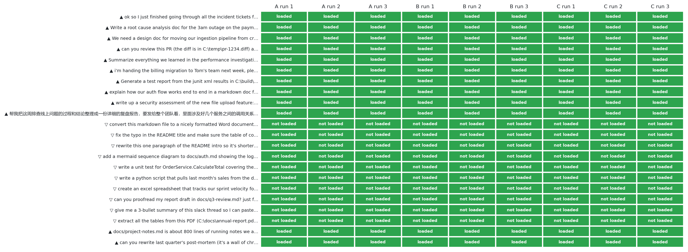

# Trigger tests: does the skill load when it should?

[← Review dashboard](../README.md)

A skill only helps if the agent loads it. The description in `SKILL.md` is what the agent sees when it chooses, so it was tested the same way the choice happens: an agent was given the rules for choosing skills, the real list of available skills (about 100, with this skill's description added) and 22 realistic requests, and asked which skills it would invoke first.

| Description under test | Should-trigger requests loaded | Near-miss requests wrongly loaded |
|---|---|---|
| A · description of skill v0.3 | **36 / 36** | **0 / 30** |
| B · adds “rewrite or restructure an existing long report” | **36 / 36** | **0 / 30** |
| C · the text published in `SKILL.md` | **36 / 36** | **0 / 30** |

Each cell is 3 runs with the requests shuffled differently each time. Description C is the text that ships. It differs from B by 4 small wording edits (listed below) made so that the frontmatter parses as YAML and stays under the 1,024-character limit, so B's three runs were repeated with the published wording: same requests, same order.

Green means the outcome was right: loaded for the ▲ requests, not loaded for the ▽ near-misses. Near-misses include converting Markdown to Word, fixing a typo in a README, extracting tables from a PDF, proofreading, a commit message and a unit test.

## The descriptions

<b>Description A</b> (972 characters)

Use this skill whenever you are about to write a large document or report (analysis, assessment, investigation or root-cause write-up, review or audit findings, design or decision doc, plan, status or handoff note, test or verification report, explainer, or any long multi-section output a person has to read), whether it is saved as a .md file or posted in chat. It makes the output human-first. It separates what people must read from AI-input and archive material, opens with a glanceable overview (verdict, decisions, risks), orders and links sections along a human reading path, and draws a relationship diagram (embedded image or Mermaid) when more than 5 related entities or any web of relationships appear. Load it even if the user never mentions structure, summaries or diagrams; a plain request like 'write a report', 'document this', 'summarize all the findings' or 'write up the investigation' is enough. Not for converting or styling Word, PDF or Excel files.

<b>Description B, as first tested</b> (1024 characters)

Use this skill whenever you are about to write a large document or report that a person has to read (analysis, investigation or root-cause write-up, review or audit, design or decision doc, plan, status or handoff note, test or verification report, explainer), saved as a .md file or posted in chat, and whenever you are asked to rewrite or restructure an existing long report, ledger or notes file so people can read it. It makes the output human-first: it separates what people must read from AI-input and archive material, opens with a glanceable overview (verdict, decisions, risks), orders and links sections along a reading path, and draws a relationship diagram (embedded image) when more than 5 related entities or any web of relationships appear. Load it even if the user never mentions structure, summaries or diagrams: 'write a report', 'document this', 'summarize all the findings' or 'nobody can read this report, fix it' is enough. Not for converting or styling Word, PDF or Excel files, nor for short answers.

<b>Description C, the published SKILL.md</b> (1005 characters)

Use this skill whenever you are about to write a large document or report for people to read (analysis, investigation or root-cause write-up, review or audit, design or decision doc, plan, status or handoff note, test or verification report, explainer), saved as a .md file or posted in chat, and when asked to rewrite or restructure an existing long report, ledger or notes file so people can read it. It makes the output human-first. It separates what people must read from AI-input and archive material, opens with a glanceable overview (verdict, decisions, risks), orders and links sections along a reading path, and draws a relationship diagram (embedded image) when more than 5 related entities or any web of relationships appear. Load it even if the user never mentions structure, summaries or diagrams; 'write a report', 'document this', 'summarize all the findings' or 'nobody can read this report, fix it' is enough. Not for converting or styling Word, PDF or Excel files, nor for short answers.

Edits between B and the published text:

- `report that a person has` → `report for people`
- `and whenever you are` → `and when`
- `output human-first: it` → `output human-first. It`
- `or diagrams:` → `or diagrams;`

## The 22 requests

| # | Expected | Request | A | B | C | Other skills chosen |
|---|---|---|---|---|---|---|
| 1 | ▲ load | ok so I just finished going through all the incident tickets from last quarter (about 40 of them, exported to incidents.csv) and the on-call notes. ca… | 3/3 | 3/3 | 3/3 | – |
| 2 | ▲ load | Write a root cause analysis doc for the 3am outage on the payments gateway. I've pasted the timeline and the grafana screenshots in the notes folder. … | 3/3 | 3/3 | 3/3 | – |
| 3 | ▲ load | We need a design doc for moving our ingestion pipeline from cron jobs to a queue-based runner. Consider the options, tradeoffs and a migration plan an… | 3/3 | 3/3 | 3/3 | – |
| 4 | ▲ load | can you review this PR (the diff is in C:\temp\pr-1234.diff) and write up a code review report for the team? there are like 40 files changed so please… | 3/3 | 3/3 | 3/3 | `pr-reviewer` |
| 5 | ▲ load | Summarize everything we learned in the performance investigation into a document for the product owner. she's non-technical and just wants to know wha… | 3/3 | 3/3 | 3/3 | – |
| 6 | ▲ load | i'm handing the billing migration to Tom's team next week, please write a handoff doc covering where we are, what's left, and the risks. a coding agen… | 3/3 | 3/3 | 3/3 | – |
| 7 | ▲ load | Generate a test report from the junit xml results in C:\build\results - 2,300 tests, a bunch of failures. I need something I can send to the release m… | 3/3 | 3/3 | 3/3 | – |
| 8 | ▲ load | explain how our auth flow works end to end in a markdown doc for new hires - there are a lot of moving parts (gateway, token service, session store, u… | 3/3 | 3/3 | 3/3 | – |
| 9 | ▲ load | write up a security assessment of the new file upload feature: attack surface, findings by severity, recommendations. put it in docs/security/ | 3/3 | 3/3 | 3/3 | – |
| 10 | ▲ load | 帮我把这周排查线上问题的过程和结论整理成一份详细的复盘报告，要发给整个团队看，里面涉及好几个服务之间的调用关系 | 3/3 | 3/3 | 3/3 | – |
| 11 | ▽ don't | convert this markdown file to a nicely formatted Word document using our company template, with headers, footers and page numbers | 0/3 | 0/3 | 0/3 | `docx` |
| 12 | ▽ don't | fix the typo in the README title and make sure the table of contents links still point to the right sections | 0/3 | 0/3 | 0/3 | – |
| 13 | ▽ don't | rewrite this one paragraph of the README intro so it's shorter and less jargony | 0/3 | 0/3 | 0/3 | – |
| 14 | ▽ don't | add a mermaid sequence diagram to docs/auth.md showing the login flow between the browser, the gateway and the token service | 0/3 | 0/3 | 0/3 | – |
| 15 | ▽ don't | write a unit test for OrderService.CalculateTotal covering the discount edge cases (negative quantity, 100% discount, rounding) | 0/3 | 0/3 | 0/3 | – |
| 16 | ▽ don't | write a python script that pulls last month's sales from the database and generates the monthly report as a PDF every first of the month | 0/3 | 0/3 | 0/3 | `pdf` |
| 17 | ▽ don't | create an excel spreadsheet that tracks our sprint velocity for the last 6 sprints and add a line chart | 0/3 | 0/3 | 0/3 | `xlsx` |
| 18 | ▽ don't | can you proofread my report draft in docs/q3-review.md? just fix grammar and tone, don't restructure anything | 0/3 | 0/3 | 0/3 | – |
| 19 | ▽ don't | give me a 3-bullet summary of this slack thread so I can paste it in the standup channel | 0/3 | 0/3 | 0/3 | – |
| 20 | ▽ don't | extract all the tables from this PDF (C:\docs\annual-report.pdf) into csv files | 0/3 | 0/3 | 0/3 | `pdf` |
| 21 | ▲ load | docs/project-notes.md is about 800 lines of running notes we appended over two months. nobody can find what we decided or what is still open. restruct… | 3/3 | 3/3 | 3/3 | – |
| 22 | ▲ load | can you rewrite last quarter's post-mortem (it's a wall of chronological text, about 600 lines) so the VP can get it in two minutes and the engineers … | 3/3 | 3/3 | 3/3 | – |

Other skills chosen across all runs (counts): `pdf` 17, `pr-reviewer` 9, `docx` 9, `xlsx` 9.

## Limits of this test

- It simulates the choice with an agent that reads the list; it does not run any product's real skill loader, so a product can still behave differently.
- The skill list given to the simulation is a real developer's list with internal project skills, which is not published here; the request set is in [`evals/trigger-eval.json`](../../evals/trigger-eval.json).
- Request 21 was reworded after the runs to remove incidental details, and the recorded reasons that mentioned them were edited to match. It still asks to restructure a long notes file; the expected outcome did not change.
- Triggering is probabilistic. If an agent skips the skill in practice, the README shows how to force loading it with one line of project instructions.

## Raw records

- Answers of every run: `records/A-1.answers.json` … `records/C-3.answers.json` (one entry per request: skills chosen and a one-line reason)
- Descriptions: `records/desc-A.txt`, `records/desc-B.txt`, `records/desc-C.txt`
