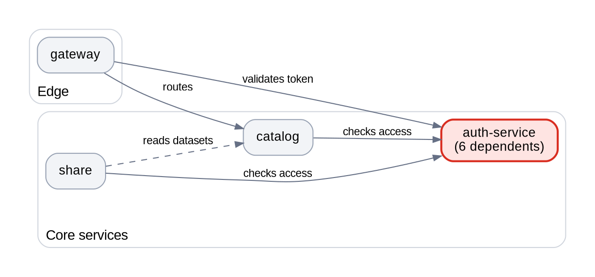
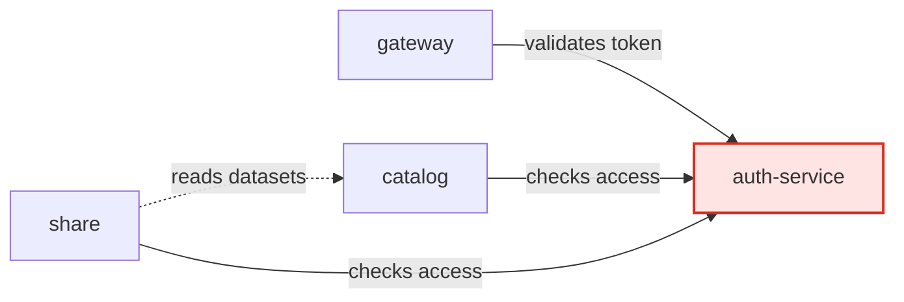

# Diagrams for reports

Read this when the diagram rule fires (a web of relationships, or more than five related entities) and you are about to draw. It covers choosing the form, rendering an image, the design rules that make a diagram readable, and what each viewer can display.

Contents: 1 Choose the form - 2 Render an image (default) - 3 Charts - 4 Mermaid (when allowed) - 5 Design rules - 6 Large webs - 7 Embed, caption, keep the source - 8 What the viewers can show

## 1 Choose the form

| What you must show | Use |
|---|---|
| Who depends on or calls whom, data flow, architecture, any network | Graphviz digraph (Mermaid `graph` if allowed) |
| Interaction over time between a few actors | Mermaid `sequenceDiagram`, or a numbered list when there are four steps or fewer |
| Data model, entities with cardinality | Mermaid `erDiagram`, or Graphviz record nodes |
| Lifecycle or status transitions | `stateDiagram-v2` or Graphviz |
| Schedule, phases, dependencies in time | `gantt` or `timeline`, or a matplotlib chart |
| Hierarchy or taxonomy | Graphviz tree (`rankdir=TB`), or an indented list for three levels or fewer |
| Comparison of options on criteria | A table, not a diagram |
| Quantities, trends, distributions | A matplotlib chart |

The best form is the one that explains the content most accurately and that is certain to render for this reader. When the two conflict, certainty of rendering wins, because an unrendered diagram is just noise.

## 2 Render an image (default)

Check what is available before choosing, and do not install system software silently:

```powershell
dot -V                                                    # Graphviz
python -c "import matplotlib; print(matplotlib.__version__)"
mmdc --version                                            # Mermaid CLI, rarely installed
```

Write the `.dot` file next to where the image will live, then render a PNG. PNG is the default because it displays everywhere; add an SVG only when you know the viewer supports it.

```powershell
dot -Tpng -Gdpi=150 report.assets/deps.dot -o report.assets/deps.png
```

Example source (invented services; one focal node, one inferred edge, verbs on edges):



Pitfalls that cost a retry:

- Quote node ids that contain hyphens, dots or spaces (`"auth-service"`). Unquoted, they are a syntax error.
- Do not combine `splines=ortho` with edge labels; Graphviz does not place labels on orthogonal edges well.
- Put cluster titles where no edge crosses them. In a left-to-right layout that is the bottom-left (`labelloc=b; labeljust=l`); at the top, edges run straight through the title. In a top-to-bottom layout a bottom title collides with outgoing edges and a top title with incoming ones: try the bottom-right, render, and look.
- Set `fontname` explicitly. The default serif font looks like a draft and may lack the glyphs you need.
- Legends: a legend of small swatch nodes inside the graph can render as big blobs and distort the layout. If it does, drop it and state the colour meanings in the caption, or in short words inside the focal nodes.
- **Non-Latin labels (Chinese, Japanese, Korean...) render as empty boxes** with the default font or Arial. Put a font that has the glyphs on the graph, nodes and edges (`graph [fontname="Microsoft YaHei"]`, same for `node` and `edge`; on Linux `"Noto Sans CJK SC"`, on macOS `"PingFang SC"`), then look at the image to confirm no boxes remain. Labels belong in the reader's language, so this matters whenever the report is not in English.
- If `dot` prints an error, fix the source and re-render; never embed a stale image.
- After rendering, check the pixel width (the checker warns above 2600 px). Wider than that at 150 dpi means the labels will be tiny when shown at 800 px: switch to `rankdir=TB`, shorten labels, or split the diagram.
- If you can view images, look at the PNG. If you cannot, at least confirm the file exists and is not empty.

## 3 Charts

For quantities, use matplotlib. One message per chart, and let the title state it:

```python
import matplotlib
matplotlib.use("Agg")
import matplotlib.pyplot as plt

fig, ax = plt.subplots(figsize=(8, 4.5), dpi=160)
ax.barh(names, counts, color=["#D92D20" if n == focus else "#98A2B3" for n in names])
ax.set_title("auth-service had 3x the incidents of any other service", loc="left",
             fontsize=13, fontweight="bold")
ax.set_xlabel("Incidents in Q3 (count)")
ax.spines[["top", "right"]].set_visible(False)
fig.savefig("report.assets/incidents.png", bbox_inches="tight")
```

Label axes with units, highlight the bar or line the argument is about and mute the rest, and use colours that survive greyscale and colour-blindness (the red and grey above do). For Chinese, Japanese or Korean text add `plt.rcParams["font.sans-serif"] = ["Microsoft YaHei", "SimHei", "DejaVu Sans"]` and `plt.rcParams["axes.unicode_minus"] = False` before plotting, or the labels become boxes.

## 4 Mermaid (when allowed)

Use inline Mermaid only if you know the target renders it, or if no image renderer is available. In the second case say in one line why the reader sees code, and add the edge list as a table so they still get the information.



Rules that keep it portable:

- Start with `graph LR` or `graph TD`, not `flowchart`. Azure DevOps wikis do not support `flowchart`.
- Avoid `---->` long arrows, links to or from a `subgraph`, HTML in labels (`<br/>`) and Font Awesome icons; Azure DevOps rejects them.
- Use simple ids and put the display text in brackets and quotes: `authsvc["auth-service (v2)"]`.
- Do not name a node `end`; it breaks the parser.

## 5 Design rules (any form)

- **About a dozen nodes, legible at 800 px wide.** A few more are fine when the layout is clean. Beyond that readers stop reading and start scanning for the one thing they care about, so make that easy (section 6).
- **One focal point.** Colour and weight go to the hub, the broken link, the changed component or the risk. Everything else is muted grey.
- **A verb on the edges.** "calls", "reads", "blocks", "owns". An unlabeled arrow forces the reader to guess the relation. When every edge means the same thing (a pure dependency graph), say so once in the legend or caption and label only the exceptions: twelve identical labels are noise and crowd out the structure.
- **Consistent encoding.** Same shape means same type, same colour means same meaning, and any colour that carries meaning appears in the caption or a legend.
- **Direction.** Left to right for flow and time, top to bottom for hierarchy.
- **Truth over symmetry.** Draw only relationships you verified. Dashed lines mark inferred ones; say so in the caption.
- **Legible at about 800 px wide**, because that is roughly what a browser or preview pane gives it.

## 6 Large webs

When the full graph would not stay legible, do not shrink it. Options, in order of preference:

1. **Overview plus zoom.** The overview shows groups (clusters, layers, teams) or just the main flow; one zoomed diagram per group that matters follows. Every entity must appear in at least one view, and the overview's caption says what it leaves out.
2. **Draw the argument.** Draw only the hub and its direct neighbours (or the path that matters) and put the full edge list in the archive.
3. **Matrix.** When nearly everything connects to everything, use a table with entities on both axes and a symbol in each cell.

## 7 Embed, caption, keep the source

- Store images in `<doc-stem>.assets/` next to the document, together with the `.dot` or `.mmd` source file. Link with relative paths, forward slashes and no spaces in names.
- Alt text states what the picture shows in one sentence. Under it, an italic caption says how to read it and the takeaway:

```markdown


*How to read it: arrows point from caller to callee, red is `auth-service`, dashed edges are inferred from logs. Takeaway: every core service depends on `auth-service`, so it has to move last.*
```

- In the machine zone, link the source file. Add the edge list as a table (from, relation, to, verified or inferred) when edges are inferred, when the diagram has more than about a dozen edges, or when the "verified how" column carries information readers need (for example which edges were checked directly). For a small, fully verified diagram the source file beside the image is the text equivalent, and a table would only repeat the picture. Either way the diagram must not be the only carrier of the information: a later agent must be able to regenerate or check it, and a screen reader or text-only client must get the same facts from the alt text and caption.

## 8 What the viewers can show

Facts checked against Microsoft documentation and against VS Code 1.137; re-check if the reader's setup differs.

| Viewer | Embedded PNG | Mermaid fence | `<details>` | Other |
|---|---|---|---|---|
| VS Code Markdown preview | yes | no, unless an extension or the newer built-in Markdown editor adds it | yes | |
| Azure DevOps wiki | yes | yes, limited syntax (section 4) | yes; needs a blank line after `</summary>` and after `</details>` | |
| Azure DevOps repo files and PR pages | yes | not documented, so do not rely on it | not documented; the content stays readable if the tags show | A line break inside a paragraph needs two trailing spaces, so separate lines with blank lines or lists |
| GitHub | yes | yes | yes | Alert blocks (`> [!NOTE]`) render |
| Chat window or terminal | no | usually no | no | Use a table or indented list |

Heading anchors are derived differently per platform (Azure DevOps turns more punctuation into hyphens than GitHub does). Plain-word headings are the same everywhere, which is why link targets should avoid emoji and punctuation.
